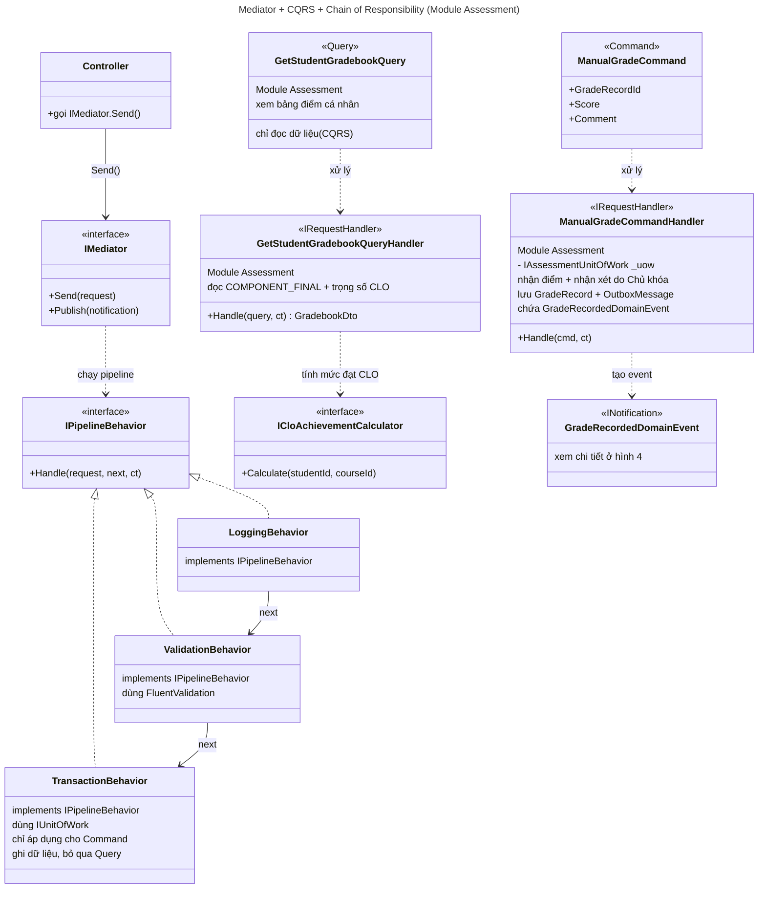
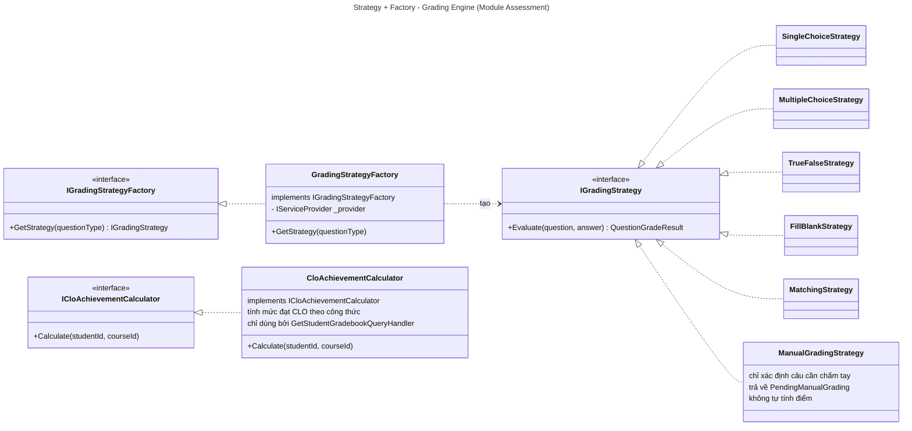
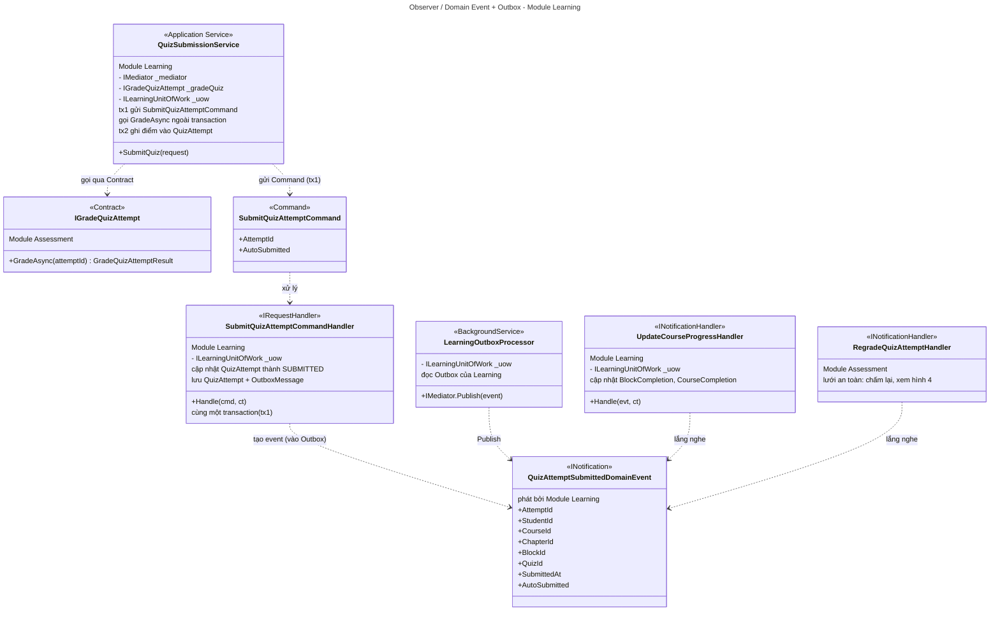
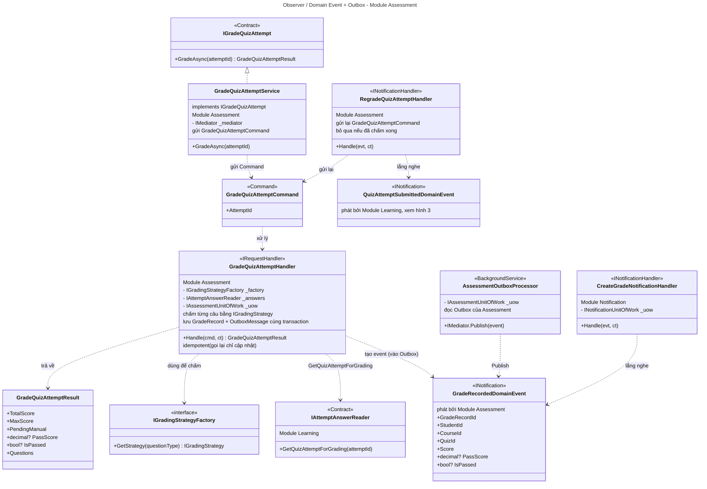
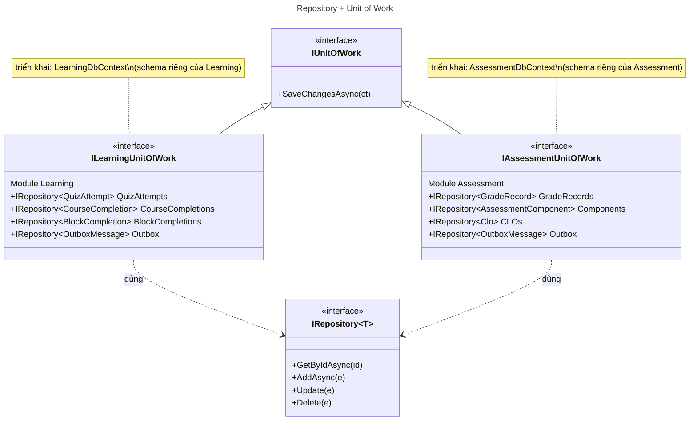
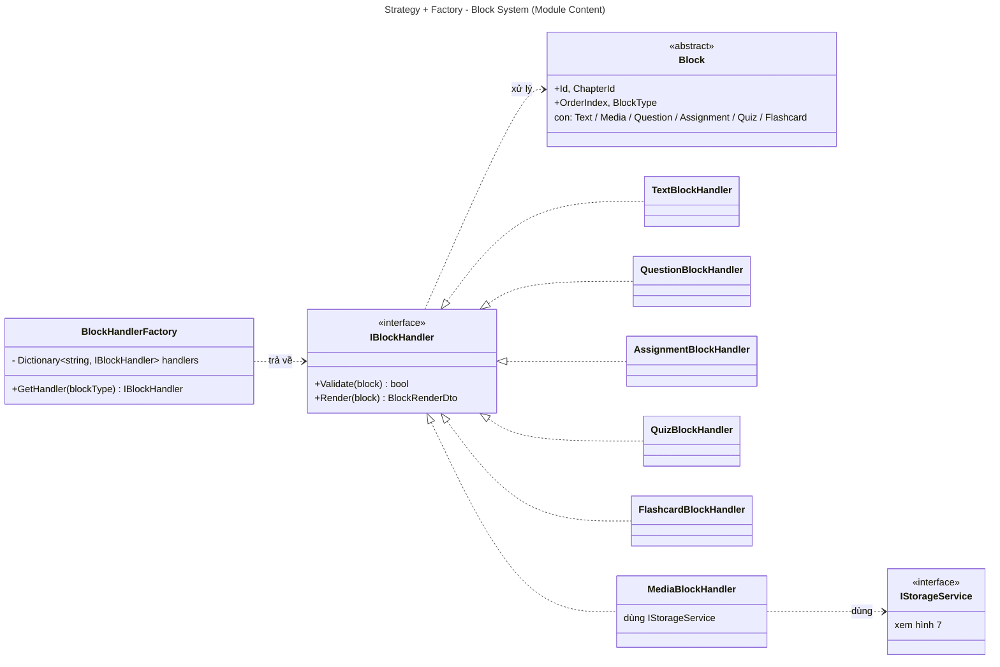
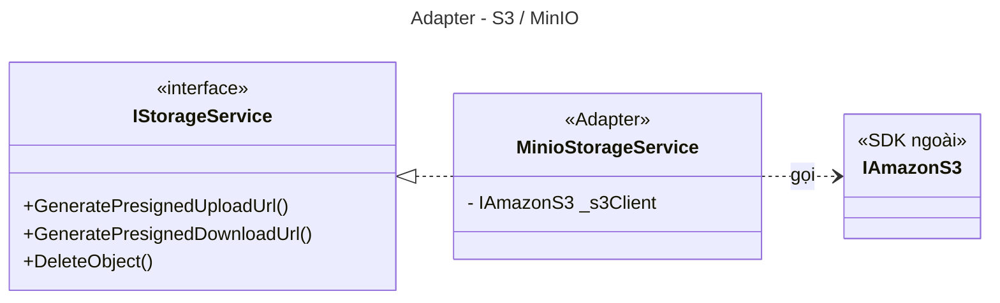

# CLASS DIAGRAM

## Mục lục

1. [Mediator + CQRS + Chain of Responsibility (Assessment)](#1-mediator--cqrs--chain-of-responsibility-module-assessment)
2. [Strategy + Factory: Grading Engine (Assessment)](#2-strategy--factory-grading-engine-module-assessment)
3. [Observer / Domain Event + Outbox: Module Learning](#3-observer--domain-event--outbox-module-learning)
4. [Observer / Domain Event + Outbox: Module Assessment](#4-observer--domain-event--outbox-module-assessment)
5. [Repository + Unit of Work](#5-repository--unit-of-work)
6. [Strategy + Factory: Block System (Content)](#6-strategy--factory-block-system-module-content)
7. [Adapter: S3 / MinIO](#7-adapter-s3--minio)

---

## 1. Mediator + CQRS + Chain of Responsibility (Module Assessment)

`TransactionBehavior` chỉ áp dụng cho Command; Query bỏ qua. `ICloAchievementCalculator` chỉ được dùng bởi `GetStudentGradebookQueryHandler` (mức đạt CLO tính khi đọc bảng điểm, không tính lúc nộp bài).

> `ManualGradeCommandHandler` = `IRequestHandler<ManualGradeCommand>`; `GetStudentGradebookQueryHandler` = `IRequestHandler<GetStudentGradebookQuery, GradebookDto>`.

---

## 2. Strategy + Factory: Grading Engine (Module Assessment)

---

## 3. Observer / Domain Event + Outbox: Module Learning

Luồng nộp bài (ADR-04, SD-05):

1. **TX1** (`SubmitQuizAttemptCommandHandler`): `IN_PROGRESS → SUBMITTED` (hoặc `AUTO_SUBMITTED`) và ghi `OutboxMessage` chứa `QuizAttemptSubmittedDomainEvent`, cùng một transaction.
2. Ngoài transaction: `QuizSubmissionService` gọi đồng bộ `IGradeQuizAttempt.GradeAsync(attemptId)` (Contract do Assessment cung cấp).
3. **TX2**: Learning ghi điểm từng câu, `total_score`, `GRADED` (nếu không còn câu chờ chấm tay).
4. Sau commit: `LearningOutboxProcessor` phát `QuizAttemptSubmittedDomainEvent`, `UpdateCourseProgressHandler` cập nhật tiến độ. Assessment cũng lắng nghe event này để chấm lại khi lời gọi đồng bộ lỗi (xem hình 4).

> Quiz Block hoàn thành khi học viên nộp bài: `UpdateCourseProgressHandler` nghe `QuizAttemptSubmittedDomainEvent` (có `BlockId`, `ChapterId`), không phụ thuộc đạt hay không đạt.

---

## 4. Observer / Domain Event + Outbox: Module Assessment

`GradeQuizAttemptHandler` là **Command handler gọi đồng bộ**, không còn là `INotificationHandler`. Handler không dùng `IQuizConfigReader` và `ICloAchievementCalculator`: `PassScore` lấy từ snapshot của lượt làm do Learning cung cấp qua `IAttemptAnswerReader.GetQuizAttemptForGrading`.

**Quy tắc điền `PassScore` / `IsPassed`** (ADR-05):

| Tình huống | `PassScore` | `IsPassed` |
|:--|:--|:--|
| Bài đặt `pass_score`, đã chấm xong | giá trị % (0–100) từ snapshot | `(TotalScore / MaxScore × 100) ≥ PassScore` |
| Bài không đặt `pass_score` | `null` | `null` |
| Còn câu tự luận chờ chấm tay | giữ nguyên | `null` |

`GradeRecordedDomainEvent` chỉ được ghi vào Outbox khi không còn câu chờ chấm tay.

---

## 5. Repository + Unit of Work

Mỗi module có UnitOfWork và DbContext riêng. `OutboxMessage` ở Learning dùng bảng `lrn_outbox_event`, ở Assessment dùng bảng `ast_outbox_event`.

---

## 6. Strategy + Factory: Block System (Module Content)

**Bảng ánh xạ 10 loại Block (`BlockType`) → 6 handler** (khớp `cnt_block.block_type`, mục 3.3.1 đặc tả):

| # | `BlockType` | Handler |
|:-:|:--|:--|
| 1 | `RICH_TEXT` | `TextBlockHandler` |
| 2 | `MARKDOWN` | `TextBlockHandler` |
| 3 | `IMAGE` | `MediaBlockHandler` |
| 4 | `VIDEO` | `MediaBlockHandler` |
| 5 | `AUDIO` | `MediaBlockHandler` |
| 6 | `FILE` | `MediaBlockHandler` |
| 7 | `FLASHCARD` | `FlashcardBlockHandler` |
| 8 | `QUESTION` | `QuestionBlockHandler` |
| 9 | `ASSIGNMENT` | `AssignmentBlockHandler` |
| 10 | `QUIZ` | `QuizBlockHandler` |

Tổng: 2 + 4 + 1 + 1 + 1 + 1 = 10 loại, 6 handler. `BlockHandlerFactory` đăng ký nhiều `blockType` trỏ về cùng một handler (ví dụ `RICH_TEXT` và `MARKDOWN` cùng trỏ `TextBlockHandler`).

---

## 7. Adapter: S3 / MinIO

