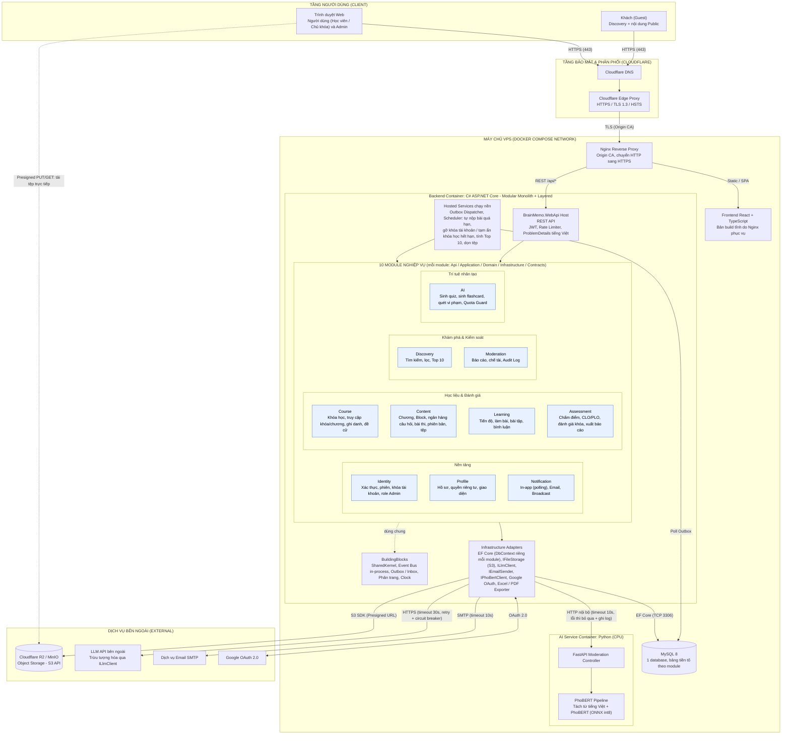
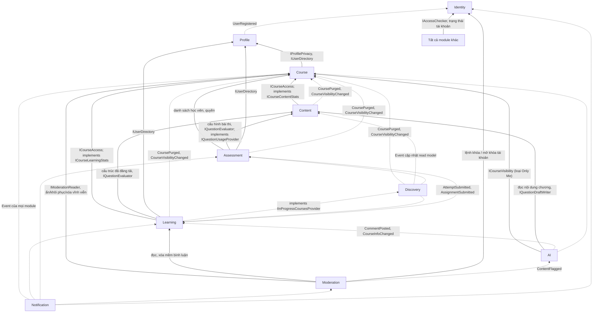
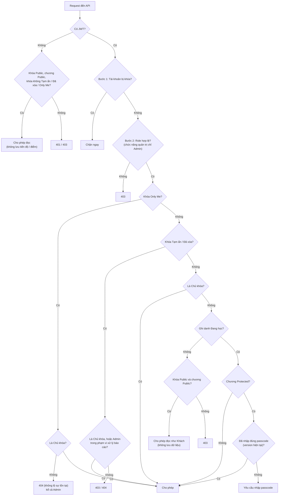

## 1. SƠ ĐỒ KIẾN TRÚC TỔNG THỂ

## 2. QUAN HỆ PHỤ THUỘC GIỮA CÁC MODULE

Quy ước: `A → B` nghĩa là A chỉ tham chiếu `B.Contracts`. Nét liền: gọi Contract. Nét đứt: nhận event hoặc implement port do B định nghĩa. Các project `*.Contracts` không tham chiếu module nào nên không có vòng phụ thuộc.

## 3. LUỒNG KIỂM TRA QUYỀN TRUY CẬP

