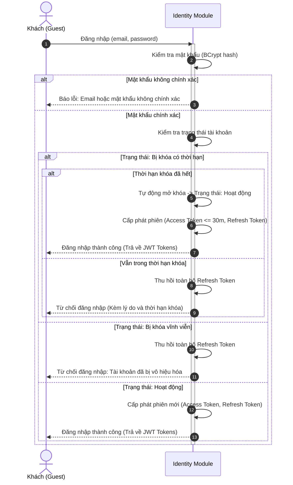
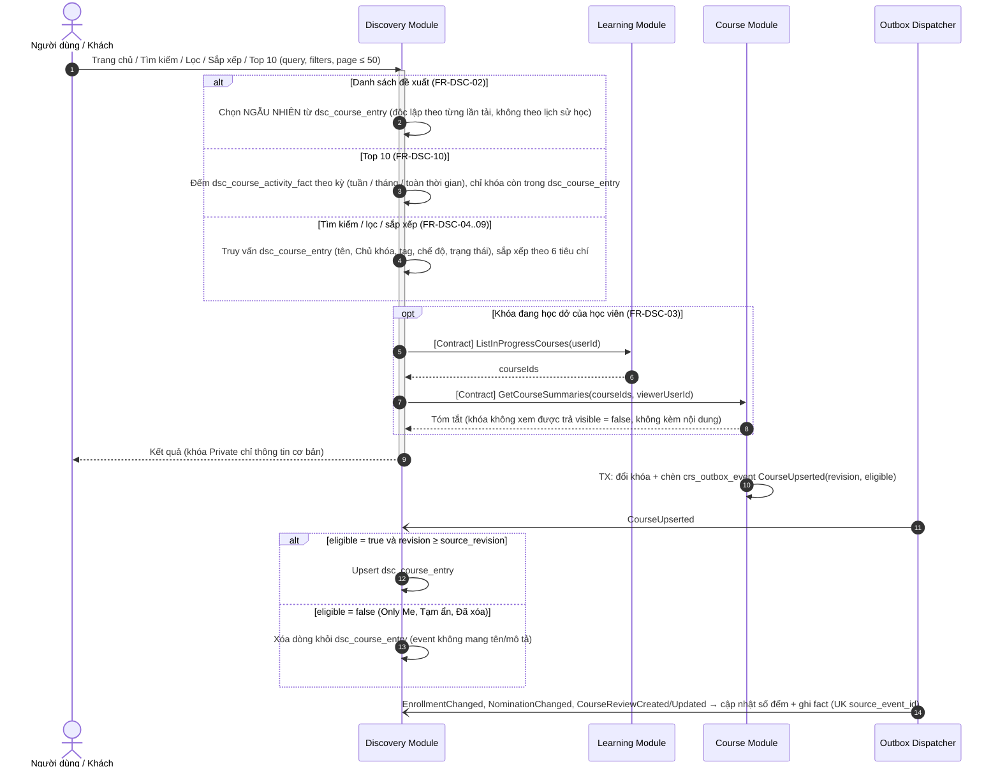
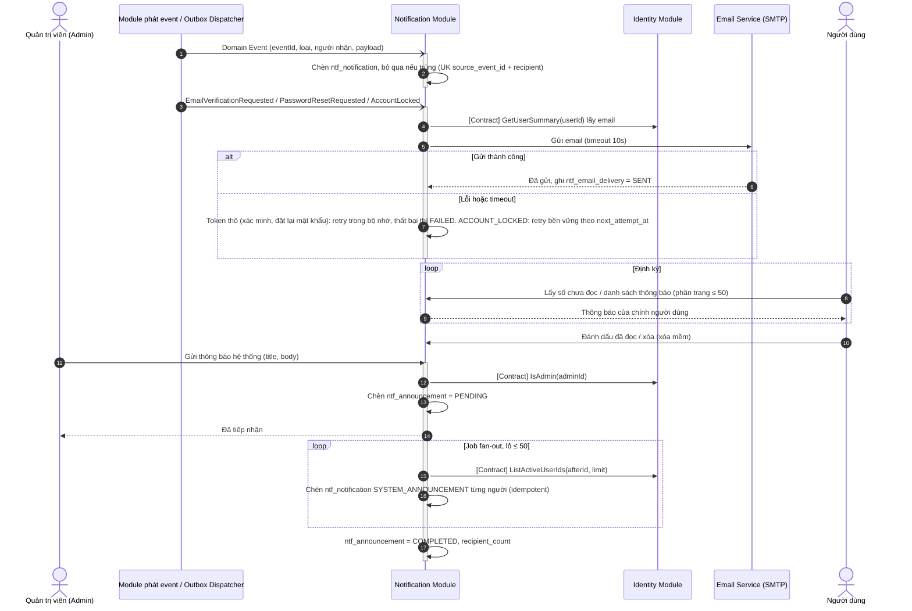
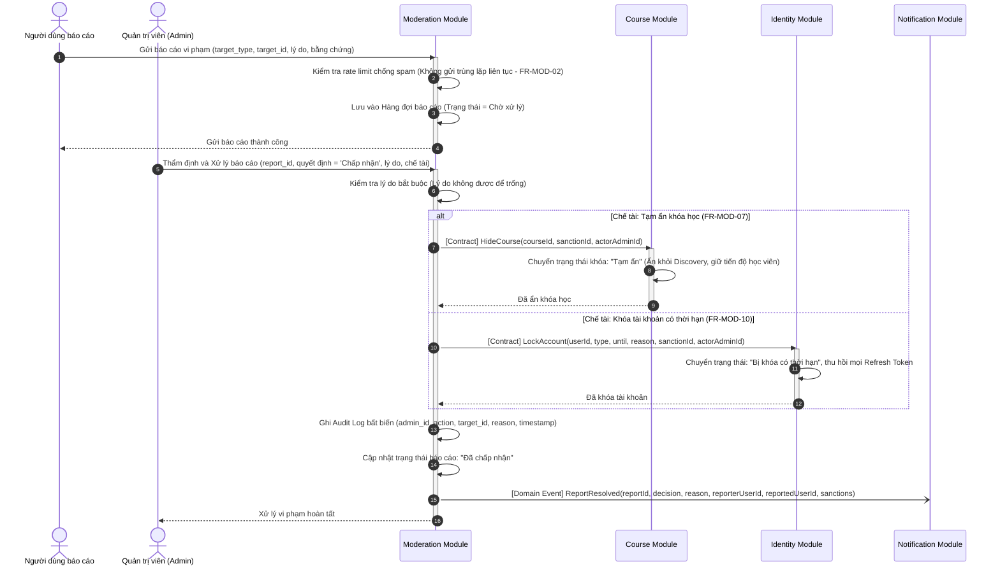
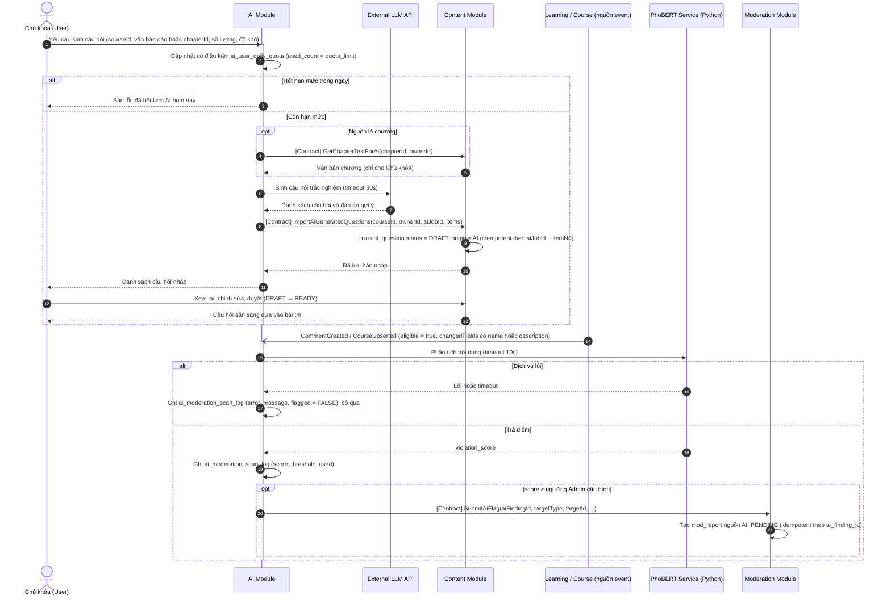

# TÀI LIỆU THIẾT KẾ UML SEQUENCE DIAGRAM

---

## MỤC LỤC 10 SEQUENCE DIAGRAMS

1. [SD-01 (Identity Module): Xác thực đăng nhập & Kiểm tra trạng thái tài khoản](#sd-01-identity-module-xác-thực-đăng-nhập--kiểm-tra-trạng-thái-tài-khoản)
2. [SD-02 (Course Module): Quản lý chế độ truy cập & Ghi danh khóa học](#sd-02-course-module-quản-lý-chế-độ-truy-cập--ghi-danh-khóa-học)
3. [SD-03 (Content Module): Tổ chức cấu trúc phân cấp & Cấu hình bài kiểm tra](#sd-03-content-module-tổ-chức-cấu-trúc-phân-cấp--cấu-hình-bài-kiểm-tra)
4. [SD-04 (Learning Module): Truy cập học tập ma trận Khóa - Chương & Tiến độ](#sd-04-learning-module-truy-cập-học-tập-ma-trận-khóa---chương--tiến-độ)
5. [SD-05 (Assessment Module): Nộp bài thi, Chấm tự động & Tính chuẩn đầu ra CLO](#sd-05-assessment-module-nộp-bài-thi-chấm-tự-động--tính-chuẩn-đầu-ra-clo)
6. [SD-06 (Discovery Module): Khám phá, Tìm kiếm, Lọc & Bảng xếp hạng Top 10](#sd-06-discovery-module-khám-phá-tìm-kiếm-lọc--bảng-xếp-hạng-top-10)
7. [SD-07 (Profile Module): Quản lý hồ sơ cá nhân & Thiết lập quyền riêng tư](#sd-07-profile-module-quản-lý-hồ-sơ-cá-nhân--thiết-lập-quyền-riêng-tư)
8. [SD-08 (Notification Module): Tiếp nhận Domain Event & Quản trị thông báo hệ thống](#sd-08-notification-module-tiếp-nhận-domain-event--quản-trị-thông-báo-hệ-thống)
9. [SD-09 (Moderation Module): Xử lý báo cáo vi phạm, Chế tài & Ghi Audit Log](#sd-09-moderation-module-xử-lý-báo-cáo-vi-phạm-chế-tài--ghi-audit-log)
10. [SD-10 (AI Module): Sinh nội dung AI & Quét kiểm duyệt tự động](#sd-10-ai-module-sinh-nội-dung-ai--quét-kiểm-duyệt-tự-động)

> **Bản sửa 2026-11-11** theo `CONFLICT_RESOLUTION.md`: tên Contract/event thống nhất với `THIET_KE_CSDL.md`; SD-05 chấm đồng bộ + Outbox; `pass_score` là phần trăm; Discovery dùng read model; thông báo dùng polling.

---

### SD-01 (Identity Module): Xác thực đăng nhập & Kiểm tra trạng thái tài khoản

- **Mục đích nghiệp vụ:** Xác thực người dùng qua email/mật khẩu (BCrypt), kiểm tra trạng thái khóa tài khoản đa tầng, tự động mở khóa nếu hết hạn và cấp phát JWT Token.
- **Mã FR liên quan:** `FR-IDN-03`, `FR-IDN-05`, `Mục 3.1.1`, `NFR-04`, `NFR-05`.
- **Actor và Lifelines:** `Guest`, `Identity Module`.



- **Mô tả ngắn gọn:** Khách nhập mật khẩu $\to$ Identity xác thực hash $\to$ kiểm tra trạng thái tài khoản. Nếu bị khóa thì từ chối và thu hồi refresh token. Nếu bình thường (hoặc đã hết hạn khóa) thì cấp phát JWT tokens.
- **Quy tắc quan trọng:** Tài khoản bị khóa bị chặn toàn bộ API xác thực (`3.1.1`).

---

### SD-02 (Course Module): Quản lý chế độ truy cập & Ghi danh khóa học

- **Mục đích nghiệp vụ:** Ghi danh tự do khóa Public, yêu cầu + duyệt khóa Private, bảo vệ khóa Only Me. Mọi thay đổi ghi danh ghi `crs_outbox_event` cùng transaction.
- **Mã FR liên quan:** `FR-CRS-06`, `FR-CRS-08`, `FR-CRS-10`, `Mục 3.2.2`, `Mục 3.2.3`, `NFR-09`.
- **Actor và Lifelines:** `Student`, `Owner`, `Identity`, `Course`, `Outbox Dispatcher`, `Notification`, `Discovery`.

```mermaid
sequenceDiagram
    autonumber
    actor Student as Học viên (User)
    actor Owner as Chủ khóa (User)
    participant Identity as Identity Module
    participant Course as Course Module
    participant Outbox as Outbox Dispatcher (crs_outbox_event)
    participant Notification as Notification Module
    participant Discovery as Discovery Module

    Student->>Course: Yêu cầu ghi danh (courseId)
    activate Course
    Course->>Identity: [Contract] GetAccountStatus(userId)
    Identity-->>Course: ACTIVE
    Course->>Course: Tính trạng thái hiệu lực + access_mode (chủ khóa không ghi danh khóa của mình)

    alt Khóa Only Me / Tạm ẩn / Đã xóa
        Course-->>Student: 404 (không lộ sự tồn tại)
    else Chế độ PUBLIC
        Course->>Course: TX: chèn/cập nhật crs_enrollment = ACTIVE (giữ first_enrolled_at) + chèn crs_outbox_event EnrollmentChanged(action = SELF_ENROLL hoặc SELF_REENROLL)
        Course-->>Student: Ghi danh thành công (học được chương Public)
    else Chế độ PRIVATE
        Course->>Course: TX: crs_enrollment_request = PENDING, crs_enrollment = PENDING_APPROVAL + outbox EnrollmentChanged(action = REQUEST_SENT)
        Course-->>Student: Đã gửi yêu cầu, chờ Chủ khóa duyệt

        Owner->>Course: Duyệt yêu cầu (requestId, Accept hoặc Reject)
        alt Chấp nhận
            Course->>Course: TX: cập nhật có điều kiện status = PENDING_APPROVAL → ACTIVE, request = ACCEPTED + outbox (REQUEST_APPROVED)
        else Từ chối
            Course->>Course: TX: request = REJECTED; enrollment về LEFT (nếu từng học) hoặc xóa dòng + outbox (REQUEST_REJECTED)
        end
        Course-->>Owner: Đã xử lý
    end
    deactivate Course

    Outbox-)Notification: EnrollmentChanged (idempotent theo eventId)
    Outbox-)Discovery: EnrollmentChanged (cập nhật learner_count, fact ENROLLMENT_NEW)
```

- **Mô tả ngắn gọn:** Public vào học ngay. Private: Chờ duyệt → Chủ khóa duyệt. Event đi qua Outbox, bên nhận idempotent.
- **Quy tắc quan trọng:** Only Me không ai ghi danh, kể cả Admin. Người nhận thông báo theo `action` (bảng 3.5.9.5 trong CSDL). Luồng mời học viên (FR-CRS-09) dùng cùng cơ chế với `action = INVITE_SENT / INVITE_ACCEPTED`.

---

### SD-03 (Content Module): Tổ chức cấu trúc phân cấp & Cấu hình bài kiểm tra

- **Mục đích nghiệp vụ:** Chủ khóa soạn Course → Chapter → Block, Lưu (bản chụp bất biến, khóa lạc quan), cấu hình bài kiểm tra từ ngân hàng câu hỏi, đăng tải chương, liên kết CLO (thuộc Assessment).
- **Mã FR liên quan:** `FR-CNT-01`, `FR-CNT-04`, `FR-CNT-10`, `FR-CNT-16`, `FR-CNT-12`, `FR-AST-13`.
- **Actor và Lifelines:** `Owner`, `Content`, `Course`, `Assessment`, `Notification`, `Discovery`.

```mermaid
sequenceDiagram
    autonumber
    actor Owner as Chủ khóa (User)
    participant Content as Content Module
    participant Course as Course Module
    participant Assessment as Assessment Module
    participant Notification as Notification Module
    participant Discovery as Discovery Module

    %% Bước 1: Lưu chương (không tự lưu)
    Owner->>Content: Lưu chương (chapterId, lastVersionNo đang dựa trên, blocks, cấu hình quiz/bài tập)
    activate Content
    Content->>Course: [Contract] GetCourseAccess(courseId, ownerId)
    Course-->>Content: isOwner = true, khóa chưa Đã xóa
    Content->>Content: TX: cập nhật có điều kiện last_version_no (xung đột thì báo lỗi, không ghi đè)
    Content->>Content: Ghi cnt_block và bảng cấu hình con; chỉ nhận câu hỏi trạng thái READY
    Content->>Content: Chèn cnt_chapter_version (snapshot bất biến, chỉ chứa questionId)
    Content-->>Owner: Lưu thành công (versionNo mới)

    %% Bước 2: Đăng tải
    Owner->>Content: Đăng tải chương
    Content->>Content: Kiểm điều kiện đăng (flashcard AI đã duyệt, tài nguyên còn, quiz đủ câu READY, cấu hình thời gian hợp lệ)
    Content->>Content: TX: published_version_no = last_version_no, dựng lại cnt_published_block
    Content-->>Owner: Đã đăng tải
    deactivate Content
    Content-)Notification: ChapterPublished (thông báo "chương mới" khi isFirstPublish)
    Content-)Discovery: ChapterPublished (published_chapter_count, first_published_at)

    %% Bước 3: Liên kết CLO do Assessment sở hữu
    Owner->>Assessment: Liên kết bài kiểm tra/bài tập với CLO (blockId, cloWeights: cloId + weight)
    activate Assessment
    Assessment->>Content: [Contract] GetAssessableBlocks(courseId)
    Content-->>Assessment: Danh sách bài kiểm tra/bài tập đã đăng tải + điểm tối đa
    Assessment->>Assessment: Lưu ast_assessment_component và ast_component_outcome_weight (kiểm cùng courseId)
    Assessment-->>Owner: Liên kết CLO hoàn tất
    deactivate Assessment
```

- **Mô tả ngắn gọn:** Lưu (khóa lạc quan + bản chụp) → Đăng tải (đổi con trỏ bản) → Assessment liên kết CLO qua `GetAssessableBlocks`.
- **Quy tắc quan trọng:** Content **không** có bảng trọng số CLO; bài chưa liên kết CLO thì không đóng góp vào CLO (`FR-CNT-12`). Chỉ đăng được bài đã đăng tải mới liên kết CLO.

---

### SD-04 (Learning Module): Truy cập học tập ma trận Khóa - Chương & Tiến độ

- **Mục đích nghiệp vụ:** Kiểm tra quyền đọc theo ma trận Khóa–Chương (chương Protected cần passcode), phục vụ nội dung đã đăng tải, ghi nhận Block hoàn thành và tính tiến độ cho học viên Đang học.
- **Mã FR liên quan:** `FR-CRS-07`, `FR-LRN-01`, `FR-LRN-03`, `FR-LRN-15`, `FR-LRN-16`, `Mục 3.2.2`, `Mục 3.4.1`.
- **Actor và Lifelines:** `Client` (Student/Guest), `Learning`, `Course`, `Content`.

```mermaid
sequenceDiagram
    autonumber
    actor Client as Người học (Student / Guest)
    participant Learning as Learning Module
    participant Course as Course Module
    participant Content as Content Module

    Client->>Learning: Mở chương (courseId, chapterId)
    activate Learning
    Learning->>Course: [Contract] CheckChapterAccess(courseId, chapterId, viewerUserId?)
    Course-->>Learning: {allowed, canSaveProgress, reason}

    alt reason = COURSE_DENIED hoặc NOT_FOUND (Only Me, Tạm ẩn, Đã xóa, Private chưa ghi danh)
        Learning-->>Client: 403 / 404
    else reason = PASSCODE_REQUIRED hoặc NOT_ENROLLED
        Learning-->>Client: Yêu cầu nhập passcode chương / yêu cầu ghi danh
        Client->>Course: Nhập passcode chương (API của Course, có rate limit)
        Course->>Course: So BCrypt, ghi crs_chapter_unlock (passcode_version hiện tại)
        Course-->>Client: Đã mở khóa, mở lại chương
    else allowed = true
        Learning->>Content: [Contract] GetPublishedChapterContent(chapterId)
        Content-->>Learning: Nội dung bản đã đăng tải, KHÔNG kèm đáp án
        Learning-->>Client: Hiển thị nội dung học tập

        opt canSaveProgress = true (học viên Đang học; Khách và người chưa ghi danh khóa Public thì false)
            Client->>Learning: Mở Block nội dung (blockId)
            Learning->>Learning: Chèn lrn_block_completion (UK user + block, idempotent)
            Learning->>Content: [Contract] ListPublishedBlocks(chapterId / courseId)
            Learning->>Learning: Tiến độ chương = Block hoàn thành / Block đã đăng tải
            opt Mọi Block đã đăng tải của chương hoàn thành
                Learning->>Learning: Tính tiến độ khóa = chương hoàn thành / chương đã đăng tải
                opt 100% chương đã đăng tải
                    Learning->>Learning: Chèn lrn_course_completion (một lần, không bị hủy) và phát CourseCompleted
                end
            end
        end
    end
    deactivate Learning
```

- **Mô tả ngắn gọn:** `CheckChapterAccess` quyết định cho đọc, hỏi passcode hay từ chối. Chỉ học viên Đang học được ghi tiến độ.
- **Quy tắc quan trọng:** Khách chỉ đọc chương Public của khóa Public, không lưu gì (`FR-LRN-16`). Block QUESTION hoàn thành khi đã làm, bài tập khi đã nộp, bài kiểm tra khi đã nộp (xem SD-05).

---

### SD-05 (Learning + Assessment): Nộp bài thi, Chấm đồng bộ & nhãn Đạt

- **Mục đích nghiệp vụ:** Nộp bài → Assessment chấm tự động **đồng bộ** → học viên thấy điểm ngay. Event `QuizAttemptSubmitted` đi qua Outbox làm lưới an toàn (chấm lại nếu lỗi) và cập nhật tiến độ. Mức đạt CLO tính khi đọc bảng điểm, không tính lúc nộp.
- **Mã FR liên quan:** `FR-LRN-08`, `FR-AST-01`, `FR-AST-02`, `FR-AST-03`, `FR-AST-15`, `FR-CNT-13`, `Mục 3.5.2`, `NFR-09`, `NFR-10`.
- **Quyết định liên quan:** `[ADR-04]` chấm đồng bộ; `[ADR-05]` `pass_score` là phần trăm.
- **Actor và Lifelines:** `Trigger` (Student hoặc Hệ thống khi hết giờ), `Learning`, `Assessment`, `Outbox Dispatcher`, `Notification`.

```mermaid
sequenceDiagram
    autonumber
    actor Trigger as Người nộp (Student / System khi quá deadline_at)
    participant Learning as Learning Module
    participant Assessment as Assessment Module
    participant Outbox as Outbox Dispatcher
    participant Notification as Notification Module

    Trigger->>Learning: Nộp bài (attemptId)
    activate Learning
    Learning->>Learning: TX1: cập nhật có điều kiện IN_PROGRESS → SUBMITTED (hoặc AUTO_SUBMITTED) + chèn lrn_outbox_event QuizAttemptSubmitted
    Learning->>Assessment: [Contract] GradeQuizAttempt(attemptId)
    activate Assessment
    Assessment->>Learning: [Contract] GetQuizAttemptForGrading(attemptId)
    Learning-->>Assessment: Snapshot đề (đáp án đúng, điểm, passScorePercent) + câu trả lời
    Assessment->>Assessment: IGradingStrategy từng câu (tự luận → PendingManualGrading)
    Assessment->>Assessment: TX: ghi ast_grade_record (QUIZ_ATTEMPT), áp score_selection_rule → COMPONENT_FINAL
    opt Không còn câu chờ chấm tay
        Assessment->>Assessment: is_fully_graded = TRUE; isPassed = (total / max × 100) ≥ passScorePercent, NULL nếu bài không đặt pass_score
        Assessment->>Assessment: Chèn ast_outbox_event GradeRecorded (cùng TX)
    end
    Assessment-->>Learning: {totalScore, maxScore, pendingManual, passScorePercent?, isPassed?, questions[]}
    deactivate Assessment
    Learning->>Learning: TX2: ghi điểm từng câu; nếu không pendingManual → GRADED, total_score, graded_at
    Learning-->>Trigger: Kết quả theo cấu hình hiển thị (FR-CNT-13); tự luận hiện "Chờ chấm tay"
    deactivate Learning

    alt Assessment lỗi hoặc timeout
        Learning-->>Trigger: "Đã nộp, đang chấm" (attempt giữ SUBMITTED)
    end

    Note over Outbox,Notification: Sau commit, Outbox Dispatcher phát event (bên nhận idempotent theo eventId)
    Outbox-)Learning: QuizAttemptSubmitted → UpdateCourseProgressHandler (Quiz Block hoàn thành, không cần đạt)
    Outbox-)Assessment: QuizAttemptSubmitted → lưới an toàn: gọi lại GradeQuizAttempt (bỏ qua nếu đã chấm xong)
    Outbox-)Notification: GradeRecorded → thông báo GRADE_FEEDBACK cho học viên
```

**Nhánh phụ: xem bảng điểm và mức đạt CLO (tính khi đọc)**

```mermaid
sequenceDiagram
    autonumber
    actor Viewer as Học viên / Chủ khóa
    participant Assessment as Assessment Module

    Viewer->>Assessment: GetStudentGradebook(userId, courseId)
    activate Assessment
    Assessment->>Assessment: Lấy COMPONENT_FINAL từng thành phần + trọng số ast_component_outcome_weight
    Assessment->>Assessment: t_i = điểm / điểm tối đa; CLO_k (%) = Σ(w_ik · t_i) / Σ w_ik × 100
    Assessment->>Assessment: Đạt CLO khi ≥ pass_threshold (mặc định 50%); gán tên mức theo achievement_levels_json
    Assessment-->>Viewer: Điểm tổng kết, xếp loại, mức đạt từng CLO (và PLO nếu bật)
    deactivate Assessment
```

- **Mô tả ngắn gọn:** Nộp → chấm đồng bộ → điểm trả ngay. Lỗi giữa chừng thì Outbox chấm lại. CLO tính lúc xem bảng điểm.
- **Quy tắc quan trọng:** Nhãn Đạt của bài theo `pass_score` (%); ngưỡng chung `pass_threshold` chỉ dùng cho điểm tổng kết và CLO/PLO. Hoàn thành khóa (tiến độ) và Đạt chuẩn đầu ra là hai kết quả độc lập (`3.4.1`, `3.5.2`). Chấm tay: Chủ khóa nhập điểm câu tự luận, sau đó `GradeQuizAttempt` được gọi lại (idempotent) để tính tổng.

---

### SD-06 (Discovery Module): Khám phá, Tìm kiếm, Lọc & Bảng xếp hạng Top 10

- **Mục đích nghiệp vụ:** Discovery phục vụ trang chủ, tìm kiếm, lọc, sắp xếp, Top 10 từ **read model riêng** (`dsc_course_entry`, `dsc_course_activity_fact`), được cập nhật bằng event từ Course (qua Outbox), Content, Assessment, Learning.
- **Mã FR liên quan:** `FR-DSC-01..10`, `Mục 3.6.1`, `NFR-16`.
- **Actor và Lifelines:** `Client`, `Discovery`, `Course`, `Outbox Dispatcher`, `Learning`.



- **Mô tả ngắn gọn:** Đọc từ read model của Discovery, không gọi Course lúc tìm kiếm. Khóa không đủ điều kiện công khai bị xóa khỏi read model.
- **Quy tắc quan trọng:** Only Me, Tạm ẩn, Đã xóa **không bao giờ** có trong `dsc_course_entry` (`3.6.1`). Read model dựng lại được qua `ListCourseSnapshots`, `ListEnrollmentFacts`, `ListNominationFacts`.

---

### SD-07 (Profile Module): Quản lý hồ sơ cá nhân & Thiết lập quyền riêng tư

- **Mục đích nghiệp vụ:** Người dùng cập nhật hồ sơ (tên, avatar, giới thiệu, ẩn/hiện danh sách khóa, giao diện). Người khác xem hồ sơ công khai; khóa Only Me không bao giờ hiển thị.
- **Mã FR liên quan:** `FR-PRF-01..07`, `FR-PRF-06`.
- **Actor và Lifelines:** `User`, `Viewer`, `Profile`, `Identity`, `Course`, `Discovery`.

```mermaid
sequenceDiagram
    autonumber
    actor User as Chủ tài khoản (User)
    actor Viewer as Người xem (Guest / User khác)
    participant Profile as Profile Module
    participant Identity as Identity Module
    participant Course as Course Module
    participant Discovery as Discovery Module

    %% Nhánh 1: cập nhật
    User->>Profile: Cập nhật hồ sơ (displayName, avatar, bio, showCourseList, uiTheme); userId lấy từ JWT
    activate Profile
    Profile->>Identity: [Contract] GetAccountStatus(userId)
    Identity-->>Profile: ACTIVE
    Profile->>Profile: Lưu prf_user_profile (làm sạch HTML)
    Profile-->>User: Cập nhật thành công
    deactivate Profile
    Profile-)Discovery: ProfileUpdated (cập nhật tên Chủ khóa trong read model)

    %% Nhánh 2: xem công khai
    Viewer->>Profile: GetPublicProfile(targetUserId)
    activate Profile
    Profile->>Identity: [Contract] GetUserSummary(targetUserId)
    Identity-->>Profile: created_at (ngày gia nhập)
    alt show_course_list = FALSE
        Profile-->>Viewer: Hồ sơ cơ bản, ẩn danh sách khóa
    else show_course_list = TRUE
        Profile->>Course: [Contract] ListUserCourses(targetUserId, relation, audience = PUBLIC, page ≤ 50)
        Course-->>Profile: Chỉ khóa Public/Private, KHÔNG Only Me / Tạm ẩn / Đã xóa
        Profile-->>Viewer: Hồ sơ kèm danh sách khóa
    end
    deactivate Profile
```

- **Mô tả ngắn gọn:** Cập nhật hồ sơ rồi phát `ProfileUpdated`. Xem công khai lấy danh sách khóa qua Course với `audience = PUBLIC`.
- **Quy tắc quan trọng:** Khóa Only Me không bao giờ hiển thị (`FR-PRF-06`). Ngày gia nhập lấy từ Identity, không sao chép.

---

### SD-08 (Notification Module): Tiếp nhận Domain Event & Quản trị thông báo hệ thống

- **Mục đích nghiệp vụ:** Tạo thông báo in-app từ event (sau khi nghiệp vụ chính commit), gửi email 3 loại, Admin phát thông báo hệ thống. Giao diện lấy thông báo bằng **polling**.
- **Mã FR liên quan:** `FR-NTF-01..07`.
- **Actor và Lifelines:** `Admin`, `Source` (module phát event), `Notification`, `Identity`, `Email Service`, `User`.



- **Mô tả ngắn gọn:** Event → thông báo in-app (idempotent). Email chỉ 3 loại. Giao diện polling, không đẩy thời gian thực. Broadcast fan-out theo lô, có thể tiếp tục nếu gián đoạn.
- **Quy tắc quan trọng:** Lỗi gửi không rollback nghiệp vụ chính (`FR-NTF-01`). Token thô chỉ nằm trong bộ nhớ, không ghi DB/log (`NFR-04`).

---

### SD-09 (Moderation Module): Xử lý báo cáo vi phạm, Chế tài & Ghi Audit Log

- **Mục đích nghiệp vụ:** Người dùng gửi báo cáo (chống spam), Admin thẩm định trong hàng đợi, thực thi chế tài (Ẩn khóa / Khóa tài khoản) và ghi Audit Log bất biến.
- **Mã FR liên quan:** `FR-MOD-01`, `FR-MOD-04`, `FR-MOD-07`, `FR-MOD-10`, `FR-MOD-13`.
- **Actor và Lifelines:** `Reporter`, `Admin`, `Moderation Module`, `Course Module`, `Identity Module`, `Notification Module`.



- **Mô tả ngắn gọn:** Tiếp nhận báo cáo qua bộ lọc spam $\to$ Admin xử lý bắt buộc có lý do $\to$ áp dụng chế tài (ẩn khóa hoặc khóa tài khoản) $\to$ ghi Audit Log bất biến.
- **Giao dịch:** cập nhật `mod_report` (điều kiện PENDING) → chèn `mod_sanction` → gọi Contract → ghi `mod_audit_log` trong **một transaction**; Contract từ chối (`LAST_ADMIN`, `ALREADY_LOCKED`, Only Me...) thì rollback toàn bộ. `ReportResolved` phát sau commit.
- **Quy tắc quan trọng:** Khóa Only Me không thể bị báo cáo hay tạm ẩn (`FR-MOD-01`, `FR-MOD-07`). Admin không thể tự khóa nick chính mình (`3.9.1`).

---

### SD-10 (AI Module): Sinh nội dung AI & Quét kiểm duyệt tự động

- **Mục đích nghiệp vụ:** Chủ khóa dùng LLM ngoài sinh câu hỏi (luôn Nháp, duyệt mới thành Sẵn sàng). PhoBERT chạy cục bộ quét bình luận, tên và giới thiệu khóa sau khi lưu; vượt ngưỡng thì gắn cờ vào hàng đợi Admin (AI không tự xóa/phạt).
- **Mã FR liên quan:** `FR-AI-01`, `FR-AI-02`, `FR-AI-03`, `FR-MOD-03`, `Mục 3.10.1`, `NFR-13`, `NFR-22`.
- **Actor và Lifelines:** `Owner`, `AI`, `LLM`, `Content`, `Learning/Course` (nguồn event), `PhoBERT`, `Moderation`.



- **Mô tả ngắn gọn:** Sinh quiz bằng LLM → Nháp → Chủ khóa duyệt. Quét PhoBERT nhận event sau khi lưu; vượt ngưỡng thì chuyển cờ cho Moderation.
- **Quy tắc quan trọng:** Khóa Only Me không bao giờ bị quét (event `eligible = false` không mang nội dung). Hết hạn mức AI thì bị chặn (`3.10.1`). Lỗi PhoBERT chỉ ghi log.

---

