# TÀI LIỆU THIẾT KẾ UML SEQUENCE DIAGRAM
## 10 PHÂN HỆ CỐT LÕI - HỆ THỐNG QUẢN LÝ KHÓA HỌC VÀ HỌC TẬP TRỰC TUYẾN

> **Căn cứ tài liệu:** `DAC_TA_YEU_CAU_HE_THONG.md` & `schema.sql`  
> **Kiến trúc:** Modular Monolith (10 Bounded Contexts, No Cross-Module FK).  
> **Nguyên tắc giao tiếp:** Giao tiếp đồng bộ qua **Contract công khai**, giao tiếp bất đồng bộ qua **Domain Event** kết hợp **Transactional Outbox Pattern**; kiểm tra phân quyền đa tầng tại Backend; nguyên tắc AI **Human-in-the-loop**.

---

## MỤC LỤC 10 SEQUENCE DIAGRAMS

1. [SD-01 (Identity Module): Xác thực đăng nhập & Kiểm tra trạng thái tài khoản](#sd-01-identity-module-xác-thực-đăng-nhập--kiểm-tra-trạng-thái-tài-khoản)
2. [SD-02 (Course Module): Quản lý chế độ truy cập & Ghi danh khóa học](#sd-02-course-module-quản-lý-chế-độ-truy-cập--ghi-danh-khóa-học)
3. [SD-03 (Content Module): Tổ chức cấu trúc phân cấp & Cấu hình bài kiểm tra](#sd-03-content-module-tổ-chức-cấu-trúc-phân-cấp--cấu-hình-bài-kiểm-tra)
4. [SD-04 (Learning Module): Truy cập học tập ma trận Khóa - Chương & Tiến độ](#sd-04-learning-module-truy-cập-học-tập-ma-trận-khóa---chương--tiến-độ)
5. [SD-05 (Assessment Module): Nộp bài thi, Chấm tự động & Tính chuẩn đầu ra CLO](#sd-05-assessment-module-nộp-bài-thi-chấm-tự-động--tính-chuẩn-đầu-ra-clo)
6. [SD-06 (Discovery Module): Khám phá, Tìm kiếm, Lọc & Bảng xếp hạng Top 10](#sd-06-discovery-module-khám-phá-tìm-kiếm-lọc--bảng-xếp-hạng-top-10)
7. [SD-07 (Profile Module): Quản lý hồ sơ cá nhân & Thiết lập quyền riêng tư](#sd-07-profile-module-quản-lý-hồ-sơ-cá-nhân--thiết-lập-quyền-riêng-tư)
8. [SD-08 (Notification Module): Tiếp nhận Domain Event & Quản trị thông báo hệ thống](#sd-08-notification-module-tiếp-nhận-domain-event--quản-trị-thông-báo-hệ-thống)
9. [SD-09 (Moderation Module): Xử lý báo cáo vi phạm, Chế tài & Ghi Audit Log](#sd-09-moderation-module-xử-lý-báo-cáo-vi-phạm-chế-tài--ghi-audit-log)
10. [SD-10 (AI Module): Sinh nội dung AI & Quét kiểm duyệt tự động](#sd-10-ai-module-sinh-nội-dung-ai--quét-kiểm-duyệt-tự-động)

---

### SD-01 (Identity Module): Xác thực đăng nhập & Kiểm tra trạng thái tài khoản

- **Mục đích nghiệp vụ:** Xác thực người dùng qua email/mật khẩu (BCrypt), kiểm tra trạng thái khóa tài khoản đa tầng, tự động mở khóa nếu hết hạn và cấp phát JWT Token.
- **Mã FR liên quan:** `FR-IDN-03`, `FR-IDN-05`, `Mục 3.1.1`, `NFR-04`, `NFR-05`.
- **Actor và Lifelines:** `Guest`, `Identity Module`.

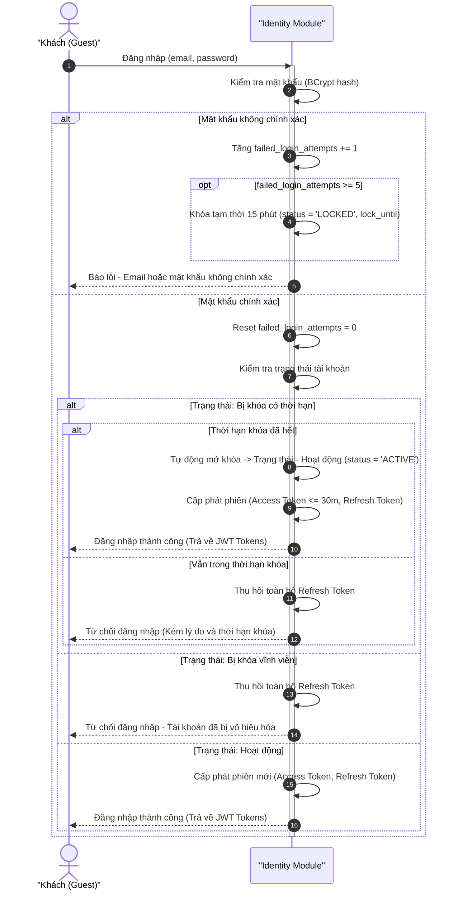

- **Mô tả ngắn gọn:** Khách nhập mật khẩu $\to$ Identity xác thực hash $\to$ kiểm tra trạng thái tài khoản. Nếu bị khóa thì từ chối và thu hồi refresh token. Nếu bình thường (hoặc đã hết hạn khóa) thì cấp phát JWT tokens.
- **Quy tắc quan trọng:** Tài khoản bị khóa bị chặn toàn bộ API xác thực (`3.1.1`). 5 lần sai liên tiếp bị khóa 15 phút.

---

### SD-02 (Course Module): Quản lý chế độ truy cập & Ghi danh khóa học

- **Mục đích nghiệp vụ:** Ghi danh tự do khóa Public, gửi yêu cầu + duyệt khóa Private, bảo vệ tuyệt đối khóa Only Me. Mọi thay đổi ghi danh ghi nhận sự kiện `EnrollmentChanged(action)` vào bảng `crs_outbox_event` cùng transaction để Outbox Dispatcher phát tán bất đồng bộ.
- **Mã FR liên quan:** `FR-CRS-06`, `FR-CRS-08`, `FR-CRS-10`, `Mục 3.2.2`, `Mục 3.2.3`, `NFR-09`.
- **Actor và Lifelines:** `Student`, `Owner`, `Identity`, `Course`, `Outbox Dispatcher`, `Notification`, `Discovery`.

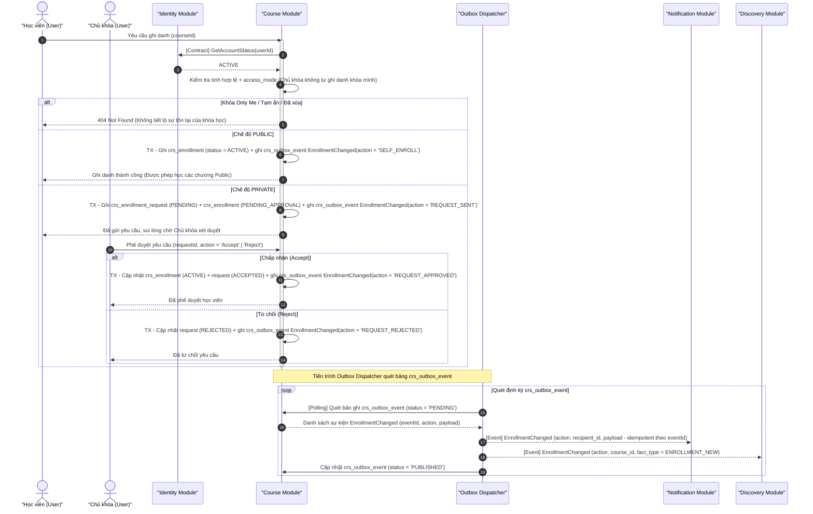

- **Mô tả ngắn gọn:** Khóa Public vào học ngay; Khóa Private vào hàng đợi chờ duyệt. Dữ liệu ghi danh và sự kiện `EnrollmentChanged(action)` được lưu cùng Transaction vào bảng Outbox. Tiến trình Outbox Dispatcher quét bảng phát tán sang Notification và Discovery.
- **Quy tắc quan trọng:** Khóa Only Me chặn tuyệt đối mọi hành vi ghi danh. Sự kiện đồng bộ qua `EnrollmentChanged` kèm tham số `action` rõ ràng (`SELF_ENROLL`, `REQUEST_SENT`, `REQUEST_APPROVED`, `REQUEST_REJECTED`).

---

### SD-03 (Content Module): Tổ chức cấu trúc phân cấp & Cấu hình bài kiểm tra

- **Mục đích nghiệp vụ:** Chủ khóa xây dựng cấu trúc Course $\to$ Chapter $\to$ Block, cấu hình bài thi xáo trộn từ ngân hàng câu hỏi, đăng tải chương. **Bỏ ValidateCloList và không lưu trọng số $w_{ik}$ ở Content**; việc liên kết CLO và lưu trọng số hoàn toàn do **Assessment Module** quản lý thông qua Contract `GetAssessableBlocks`.
- **Mã FR liên quan:** `FR-CNT-01`, `FR-CNT-04`, `FR-CNT-10`, `FR-CNT-12`, `FR-CNT-16`, `FR-AST-13`.
- **Actor và Lifelines:** `Owner`, `Content`, `Course`, `Assessment`, `Notification`, `Discovery`.

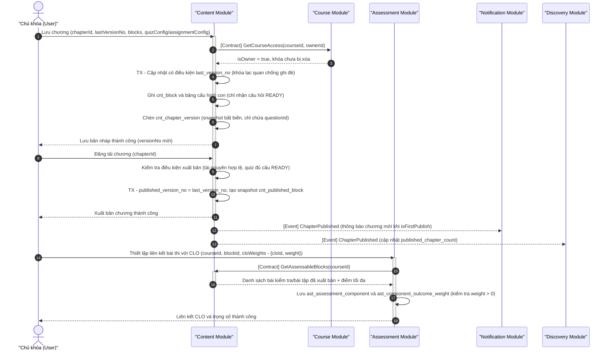

- **Mô tả ngắn gọn:** Content quản lý nội dung bản nháp và bản xuất bản bất biến. Content không lưu trọng số CLO. Chủ khóa liên kết CLO trực tiếp với Assessment Module; Assessment lấy danh sách bài thi qua Contract `GetAssessableBlocks`.
- **Quy tắc quan trọng:** Bỏ `ValidateCloList` và không lưu $w_{ik}$ ở Content. Chỉ bài kiểm tra/bài tập đã xuất bản mới được liên kết CLO.

---

### SD-04 (Learning Module): Truy cập học tập ma trận Khóa - Chương & Tiến độ

- **Mục đích nghiệp vụ:** Kiểm tra quyền đọc theo ma trận Khóa–Chương qua Contract `CheckChapterAccess` (chương Protected yêu cầu Passcode), phục vụ nội dung đã xuất bản qua Contract `GetPublishedChapterContent`, ghi nhận Block hoàn thành và tự động tính % tiến độ cho học viên Đang học.
- **Mã FR liên quan:** `FR-CRS-07`, `FR-LRN-01`, `FR-LRN-03`, `FR-LRN-15`, `FR-LRN-16`, `Mục 3.2.2`, `Mục 3.4.1`.
- **Actor và Lifelines:** `Client` (Student / Guest), `Learning`, `Course`, `Content`.

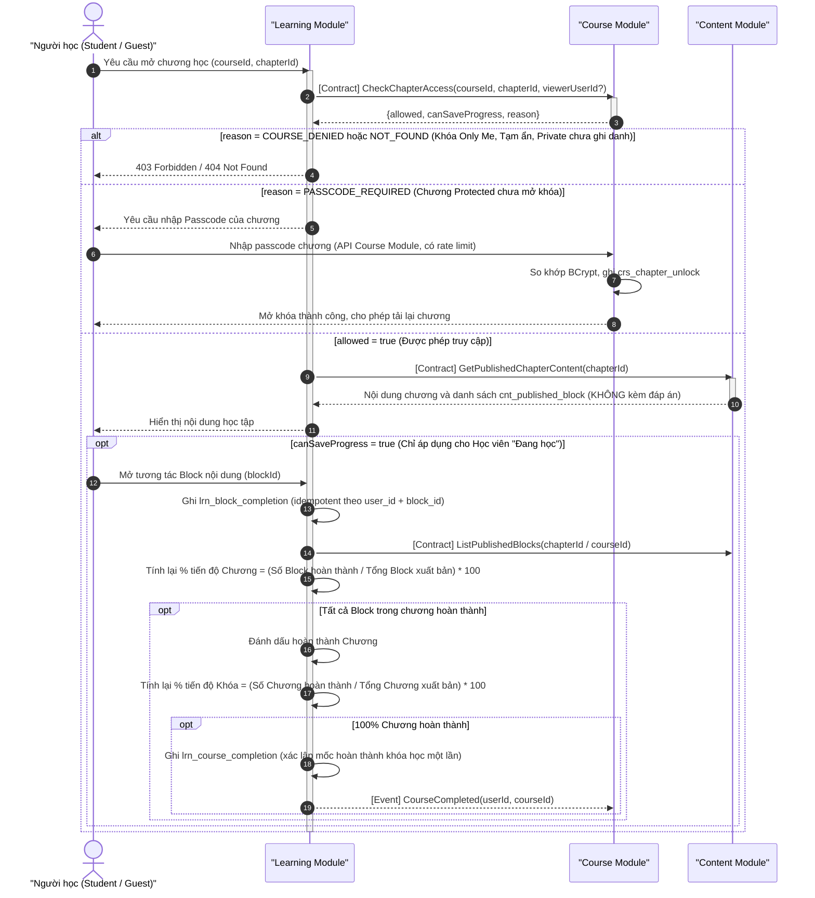

- **Mô tả ngắn gọn:** Sử dụng `CheckChapterAccess` để phân định quyền đọc/hỏi passcode. Lấy nội dung bài giảng bằng `GetPublishedChapterContent`. Chỉ học viên Đang học mới được ghi nhận tiến độ % hoàn thành.
- **Quy tắc quan trọng:** Khách chỉ đọc chương Public của khóa Public và tuyệt đối không lưu tiến độ (`FR-LRN-16`). Mở block là hoàn thành block.

---

### SD-05 (Assessment Module): Nộp bài thi, Chấm tự động & Tính chuẩn đầu ra CLO

- **Mục đích nghiệp vụ:** Nộp bài kiểm tra $\to$ Assessment chấm tự động **đồng bộ** $\to$ học viên nhận điểm ngay. Sự kiện đi qua Outbox cập nhật tiến độ học tập và gửi thông báo. Mức đạt CLO theo chuẩn AUN-QA được tính khi truy vấn Bảng điểm (không tính lúc nộp).
- **Mã FR liên quan:** `FR-LRN-08`, `FR-AST-01`, `FR-AST-02`, `FR-AST-03`, `FR-AST-14`, `FR-AST-15`, `FR-CNT-13`, `Mục 3.5.2`, `NFR-09`, `NFR-10`.
- **Actor và Lifelines:** `Trigger` (Student / System khi hết giờ), `Learning`, `Assessment`, `Outbox Dispatcher`, `Notification`.

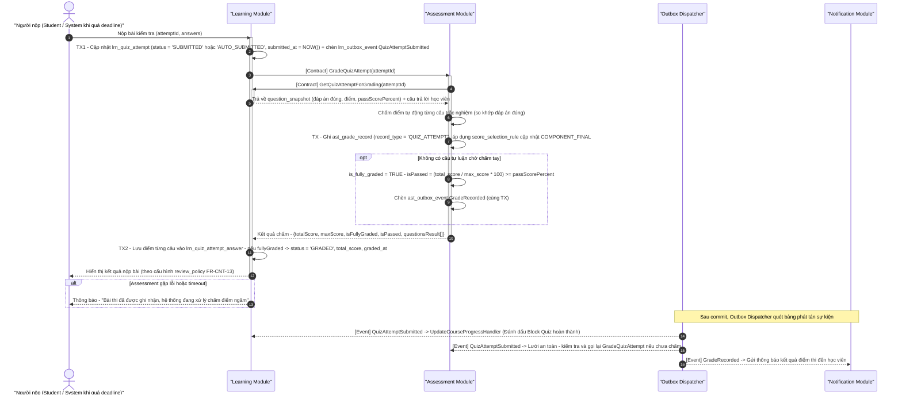

**Nhánh tính mức đạt Chuẩn đầu ra CLO/PLO theo chuẩn AUN-QA (khi xem Sổ điểm):**

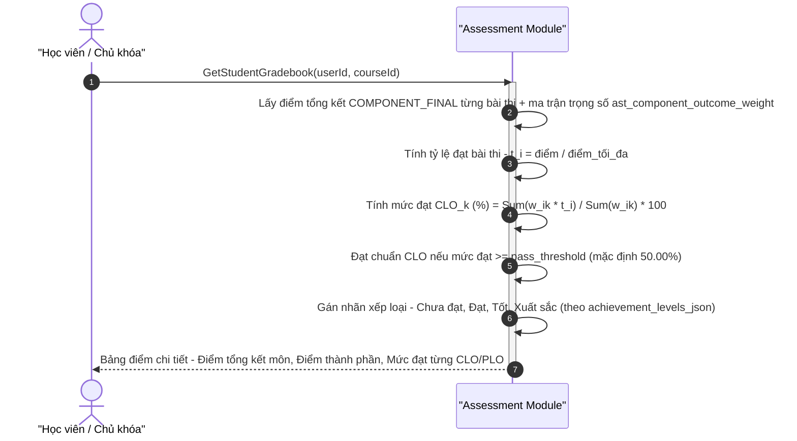

- **Mô tả ngắn gọn:** Nộp bài $\to$ Assessment chấm điểm tự động đồng bộ $\to$ ghi nhận điểm ngay. Outbox kích hoạt cập nhật tiến độ học tập. Chuẩn đầu ra CLO được tính toán động khi truy vấn Sổ điểm dựa trên ma trận trọng số $w_{ik}$.
- **Quy tắc quan trọng:** Ngưỡng đạt bài thi đơn lẻ tính theo `pass_score` (%); Ngưỡng đạt Chuẩn đầu ra CLO tính theo `pass_threshold` (mặc định 50%). Hoàn thành tiến độ và Đạt chuẩn CLO là 2 kết quả độc lập.

---

### SD-06 (Discovery Module): Khám phá, Tìm kiếm, Lọc & Bảng xếp hạng Top 10

- **Mục đích nghiệp vụ:** Discovery phục vụ trang chủ, tìm kiếm, lọc, Top 10 từ **read model riêng `dsc_course_entry` và `dsc_course_activity_fact`**, **tuyệt đối không gọi Course Module trong luồng đọc**. Read model được đồng bộ bất đồng bộ từ các module qua Outbox.
- **Mã FR liên quan:** `FR-DSC-01..10`, `Mục 3.6.1`, `NFR-16`.
- **Actor và Lifelines:** `Client`, `Discovery`, `Learning`, `Outbox Dispatcher`.

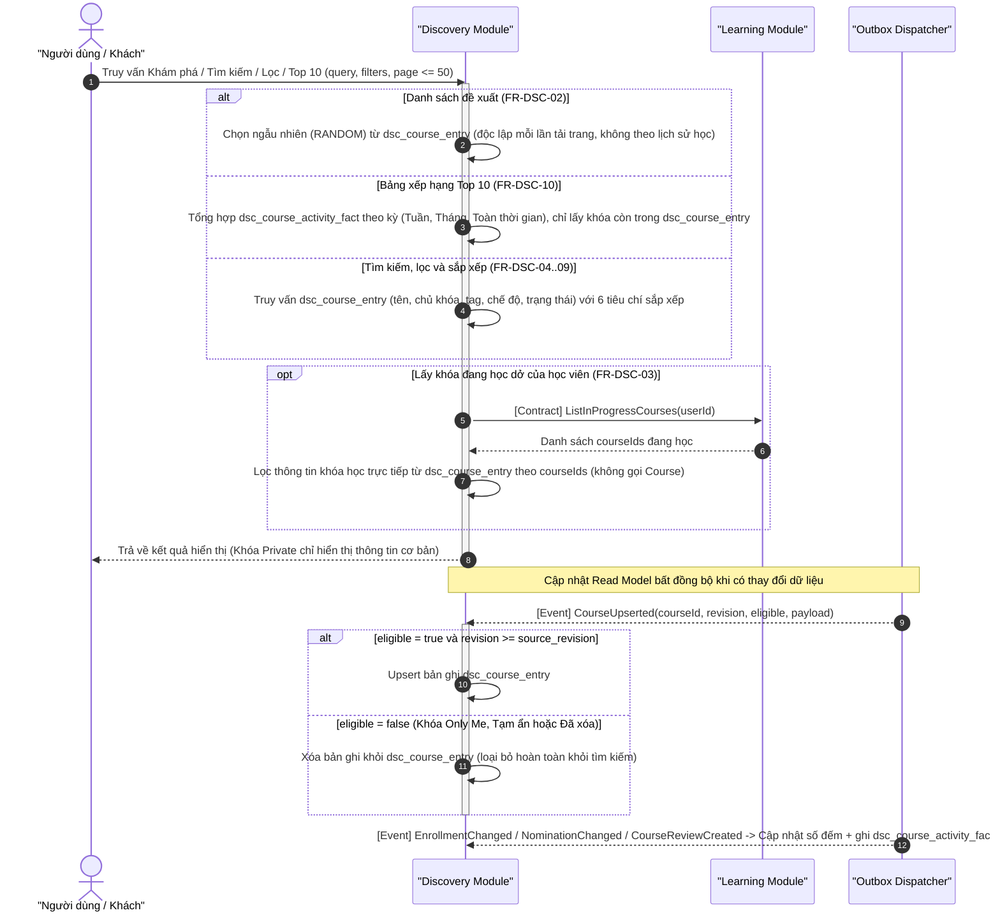

- **Mô tả ngắn gọn:** Toàn bộ thao tác tìm kiếm, lọc, xem Top 10 đều đọc trực tiếp từ bảng Read Model `dsc_course_entry` của Discovery, hoàn toàn không gọi Course Module. Khóa Only Me hoặc Tạm ẩn tự động bị loại bỏ khỏi Read Model.
- **Quy tắc quan trọng:** Bảng xếp hạng Top 10 tính theo số hoạt động phát sinh mới trong kỳ từ bảng fact. Khóa đề xuất được bốc ngẫu nhiên độc lập.

---

### SD-07 (Profile Module): Quản lý hồ sơ cá nhân & Thiết lập quyền riêng tư

- **Mục đích nghiệp vụ:** Người dùng cập nhật hồ sơ cá nhân (kiểm tra tài khoản qua `GetAccountStatus`). Người xem tra cứu hồ sơ công khai; danh sách khóa học lấy qua Course Module với bộ lọc `audience = PUBLIC` (khóa Only Me không bao giờ hiển thị).
- **Mã FR liên quan:** `FR-PRF-01..07`, `FR-PRF-06`.
- **Actor và Lifelines:** `User`, `Viewer`, `Profile`, `Identity`, `Course`, `Discovery`.

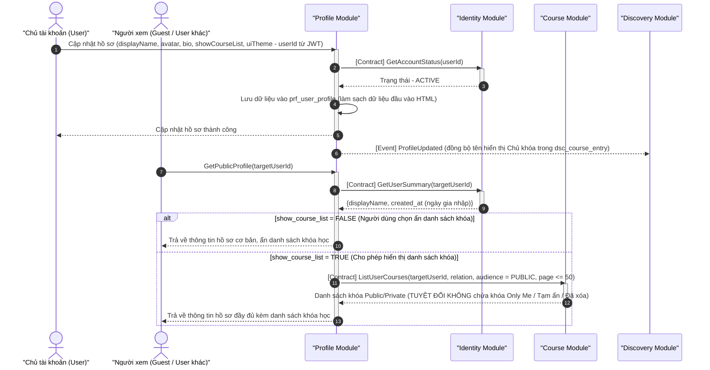

- **Mô tả ngắn gọn:** Xác thực trạng thái tài khoản qua `GetAccountStatus`. Khi xem hồ sơ công khai, gọi `ListUserCourses(audience = PUBLIC)` để bảo đảm khóa Only Me không bao giờ lộ ra ngoài.
- **Quy tắc quan trọng:** Khóa học `ONLY_ME` luôn luôn bị ẩn trên hồ sơ công khai bất kể người dùng cấu hình thế nào (`FR-PRF-06`).

---

### SD-08 (Notification Module): Tiếp nhận Domain Event & Quản trị thông báo hệ thống

- **Mục đích nghiệp vụ:** Tạo thông báo in-app từ Domain Event (idempotent), gửi email (3 loại xác minh/reset/khóa tài khoản). Admin phát loa Broadcast toàn hệ thống. **Giao diện người dùng lấy thông báo qua cơ chế Polling định kỳ (không dùng đẩy thời gian thực)**.
- **Mã FR liên quan:** `FR-NTF-01..07`.
- **Actor và Lifelines:** `Admin`, `Source` (Module phát event / Outbox Dispatcher), `Notification`, `Identity`, `Email Service`, `User`.

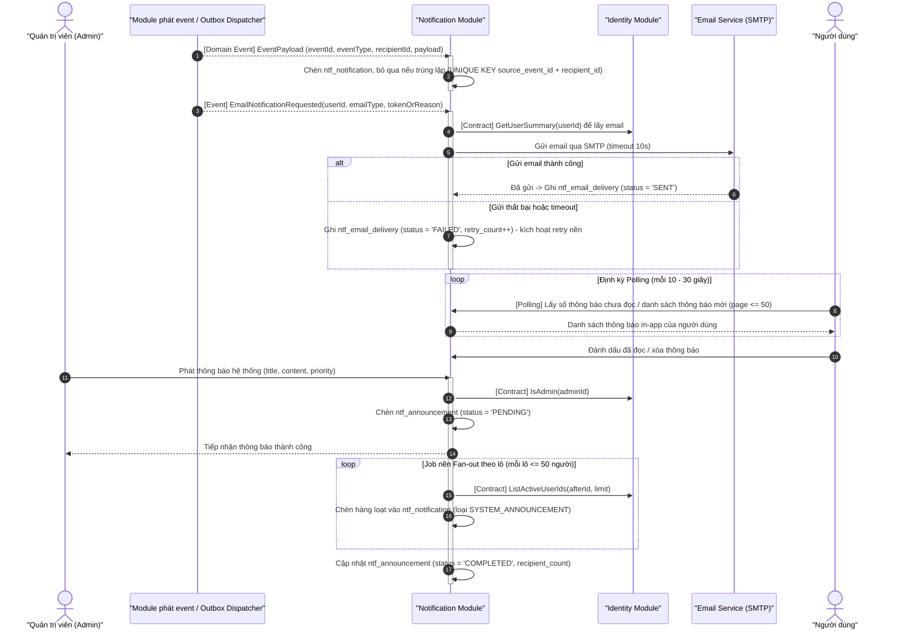

- **Mô tả ngắn gọn:** Tiếp nhận sự kiện tạo thông báo in-app (chống trùng lặp qua UK). Gửi email có retry queue. **Người dùng lấy thông báo mới qua cơ chế Polling định kỳ**. Admin phát thông báo toàn trường chạy job fan-out theo lô.
- **Quy tắc quan trọng:** Lỗi gửi email bên ngoài không bao giờ làm rollback giao dịch học tập chính (`FR-NTF-01`). Không dùng WebSocket đẩy thời gian thực để giảm tải và tránh rò rỉ kết nối.

---

### SD-09 (Moderation Module): Xử lý báo cáo vi phạm, Chế tài & Ghi Audit Log

- **Mục đích nghiệp vụ:** Tiếp nhận báo cáo vi phạm (chống spam), Admin thẩm định trong hàng đợi, thực thi chế tài (Tạm ẩn khóa học / Khóa tài khoản) và bắt buộc ghi nhật ký kiểm toán **Audit Log bất biến (Immutable)** trong cùng Transaction.
- **Mã FR liên quan:** `FR-MOD-01`, `FR-MOD-04`, `FR-MOD-07`, `FR-MOD-10`, `FR-MOD-13`.
- **Actor và Lifelines:** `Reporter`, `Admin`, `Moderation Module`, `Course Module`, `Identity Module`, `Notification Module`.

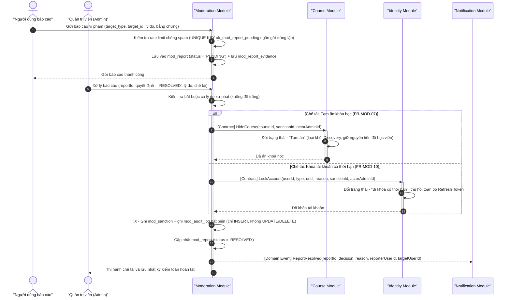

- **Mô tả ngắn gọn:** Tiếp nhận báo cáo qua bộ lọc spam `uk_mod_report_pending` $\to$ Admin xử lý bắt buộc có lý do $\to$ áp dụng chế tài qua Contract $\to$ ghi Audit Log bất biến.
- **Quy tắc quan trọng:** Khóa Only Me không thể bị báo cáo hay tạm ẩn. Admin không thể tự khóa nick chính mình (`3.9.1`). Bảng Audit Log là bất biến.

---

### SD-10 (AI Module): Sinh nội dung AI & Quét kiểm duyệt tự động

- **Mục đích nghiệp vụ:** Chủ khóa dùng AI sinh câu hỏi (luôn ở trạng thái Nháp, duyệt mới thành Sẵn sàng - Human-in-the-loop). Mô hình PhoBERT quét ngầm phân loại mức độ độc hại sau khi lưu; vượt ngưỡng cảnh báo thì tự động gắn cờ tạo báo cáo chuyển Admin xử lý (AI không tự ý xóa bài/xử phạt).
- **Mã FR liên quan:** `FR-AI-01`, `FR-AI-02`, `FR-AI-03`, `FR-MOD-03`, `Mục 3.10.1`, `NFR-13`, `NFR-22`.
- **Actor và Lifelines:** `Owner`, `AI`, `LLM`, `Content`, `Source` (Learning/Course), `PhoBERT`, `Moderation`.

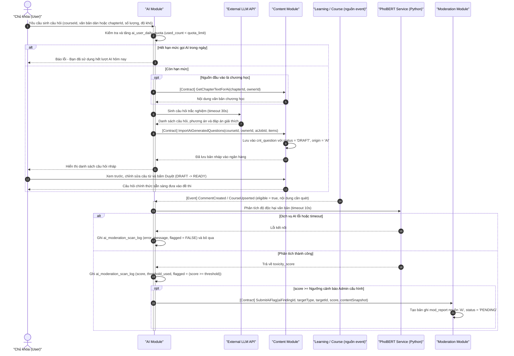

- **Mô tả ngắn gọn:** Sinh quiz bằng LLM $\to$ lưu bản Nháp $\to$ Chủ khóa duyệt mới đưa vào ngân hàng đề. Quét PhoBERT nhận sự kiện chạy nền; nếu phát hiện vi phạm thì tạo báo cáo gắn cờ gửi về hàng đợi Admin, AI không tự ý xóa dữ liệu.
- **Quy tắc quan trọng:** Khóa Only Me không bao giờ bị quét. Quota gọi AI được kiểm soát chặt chẽ theo ngày.
