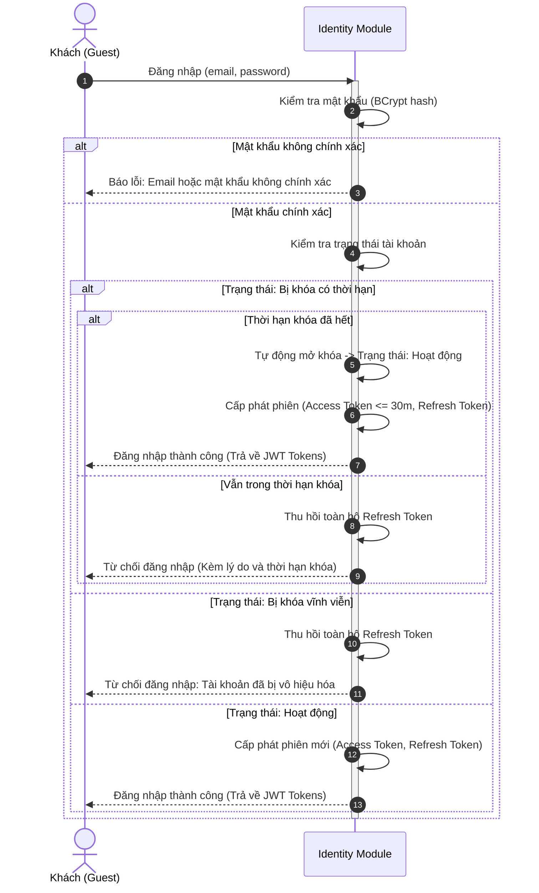
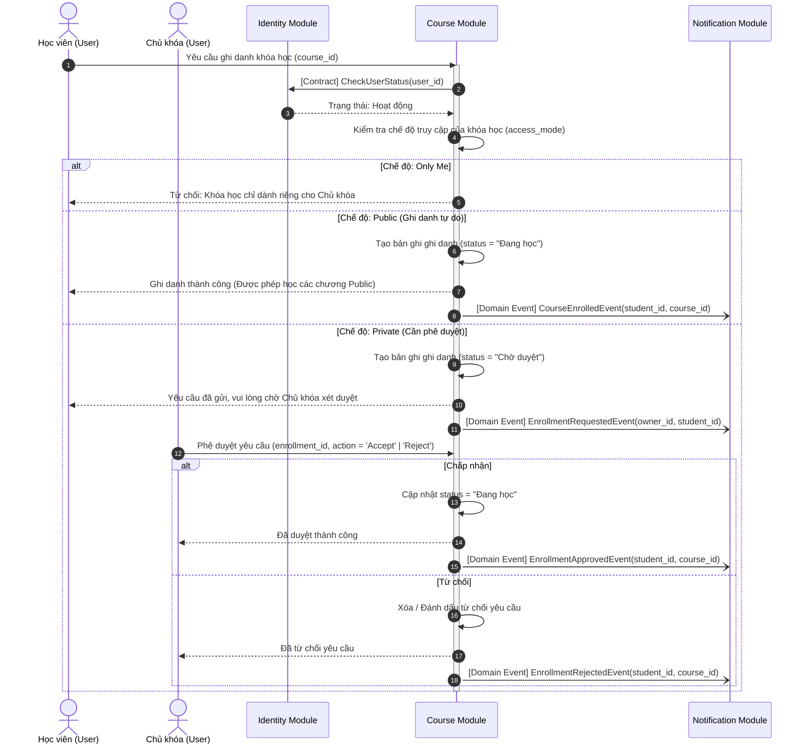
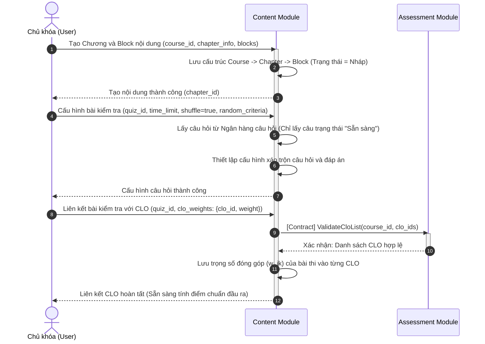
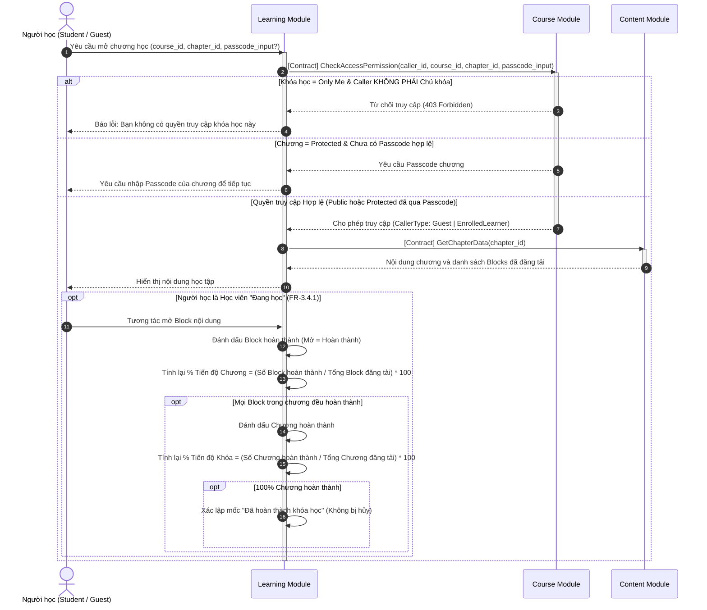
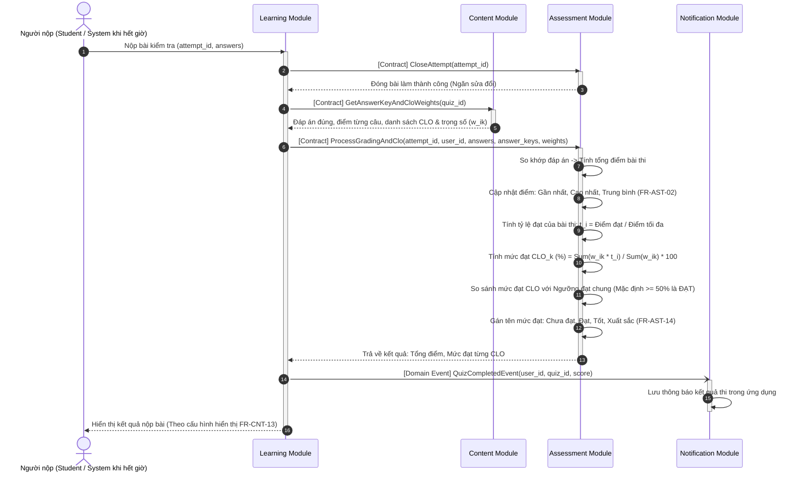
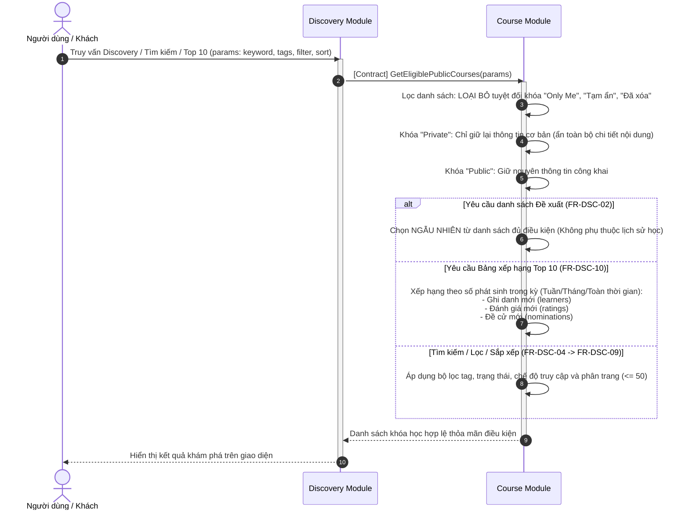
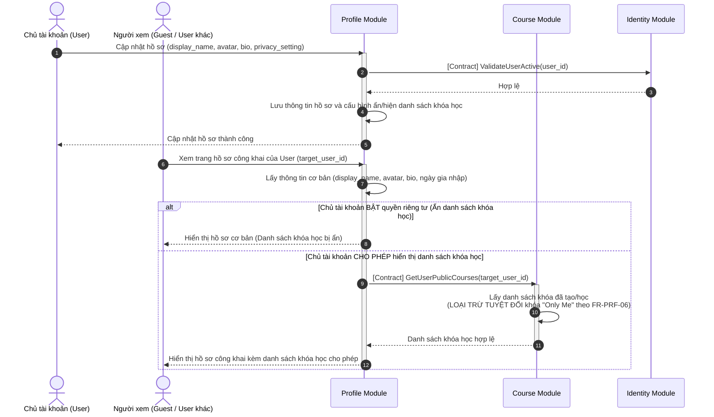
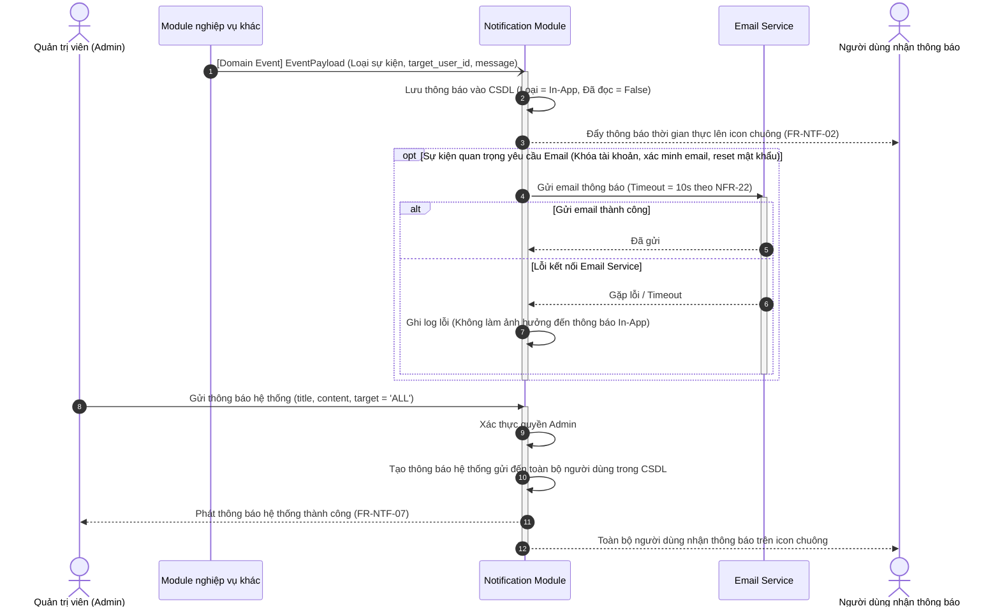
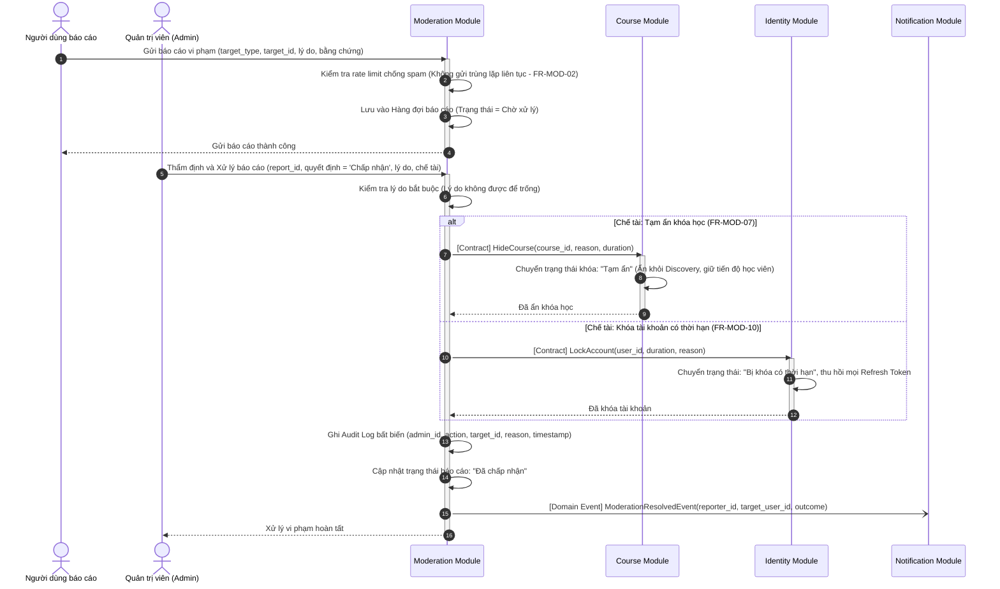
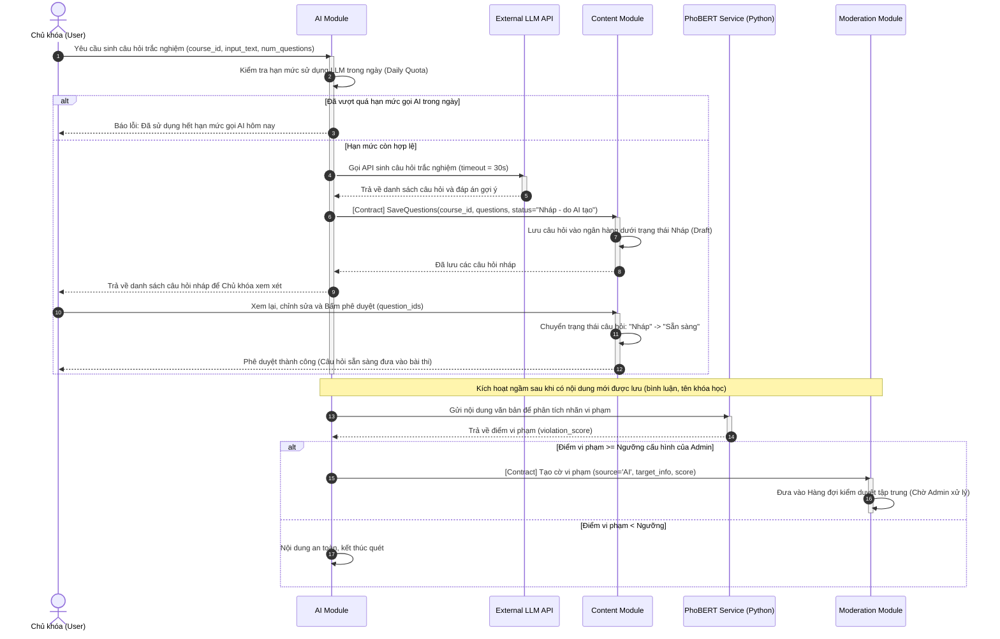

# TÀI LIỆU THIẾT KẾ UML SEQUENCE DIAGRAM
## 10 PHÂN HỆ CỐT LÕI - HỆ THỐNG QUẢN LÝ KHÓA HỌC VÀ HỌC TẬP TRỰC TUYẾN

> **Căn cứ tài liệu:** `DAC_TA_YEU_CAU_HE_THONG.md`  
> **Phiên bản:** Chuẩn tinh gọn 1:1 đại diện cho 10 Module của hệ thống.  
> **Nguyên tắc thiết kế:** Giao tiếp đồng bộ qua **Contract công khai**, bất đồng bộ qua **Domain Event**; kiểm tra phân quyền đa tầng tại Backend; nguyên tắc AI **Human-in-the-loop**.

---

## MỤC LỤC 10 SEQUENCE DIAGRAMS

1. [SD-01 (Identity Module): Xác thực đăng nhập & Kiểm tra trạng thái tài khoản](#sd-01-identity-module-xác-thực-đăng-nhập--kiểm-tra-trạng-thái-tài-khoản)
2. [SD-02 (Course Module): Quản lý chế độ truy cập & Ghi danh khóa học](#sd-02-course-module-quản-lý-chế-độ-truy-cập--ghi-danh-khóa-học)
3. [SD-03 (Content Module): Tổ chức cấu trúc phân cấp & Cấu hình bài kiểm tra](#sd-03-content-module-tổ-chức-cấu-trúc-phân-cấp--cấu-hình-bài-kiểm-tra)
4. [SD-04 (Learning Module): Truy cập học tập ma trận Khóa - Chương & Tiến độ](#sd-04-learning-module-truy-cập-học-tập-ma-trận-khóa---chương--tiến-độ)
5. [SD-05 (Assessment Module): Nộp bài thi, Chấm tự động & Tính chuẩn đầu ra CLO](#sd-05-assessment-module-nộp-bài-thi-chấm-tự-động--tính-chuẩn-đầu-ra-clo)
6. [SD-06 (Discovery Module): Khám phá, Tìm kiếm, Lọc & Bảng xếp hạng Top 10](#sd-06-discovery-module-khám-phá-tìm-kiếm-lọc--bảng-xếp-hạng-top-10)
7. [SD-07 (Profile Module): Quản lý hồ sơ cá nhân & Thiết lập quyền riêng tư](#sd-07-profile-module-quản-lý-hồ-sơ-cá-nhân--thiết-lập-quyền-riêng-tư)
8. [SD-08 (Notification Module): Tiếp nhận Domain Event & Quản trị thông báo hệ thống](#sd-08-notification-module-tiếp-nhận-domain-event--quản-trị-thông-báo-hệ-thống)
9. [SD-09 (Moderation Module): Xử lý báo cáo vi phạm, Chế tài & Ghi Audit Log](#sd-09-moderation-module-xử-lý-báo-cáo-vi-phạm-chế-tài--ghi-audit-log)
10. [SD-10 (AI Module): Sinh nội dung AI & Quét kiểm duyệt tự động](#sd-10-ai-module-sinh-nội-dung-ai--quét-kiểm-duyệt-tự-động)

---

### SD-01 (Identity Module): Xác thực đăng nhập & Kiểm tra trạng thái tài khoản

- **Mục đích nghiệp vụ:** Xác thực người dùng qua email/mật khẩu (BCrypt), kiểm tra trạng thái khóa tài khoản đa tầng, tự động mở khóa nếu hết hạn và cấp phát JWT Token.
- **Mã FR liên quan:** `FR-IDN-03`, `FR-IDN-05`, `Mục 3.1.1`, `NFR-04`, `NFR-05`.
- **Actor và Lifelines:** `Guest`, `Identity Module`.

- **Mô tả ngắn gọn:** Khách nhập mật khẩu $\to$ Identity xác thực hash $\to$ kiểm tra trạng thái tài khoản. Nếu bị khóa thì từ chối và thu hồi refresh token. Nếu bình thường (hoặc đã hết hạn khóa) thì cấp phát JWT tokens.
- **Quy tắc quan trọng:** Tài khoản bị khóa bị chặn toàn bộ API xác thực (`3.1.1`).

---

### SD-02 (Course Module): Quản lý chế độ truy cập & Ghi danh khóa học

- **Mục đích nghiệp vụ:** Xử lý việc ghi danh tự do đối với khóa Public, quy trình gửi yêu cầu duyệt đối với khóa Private và bảo vệ tính bí mật của khóa Only Me.
- **Mã FR liên quan:** `FR-CRS-06`, `FR-CRS-08`, `FR-CRS-10`, `Mục 3.2.2`, `Mục 3.2.3`.
- **Actor và Lifelines:** `Student`, `Owner`, `Identity Module`, `Course Module`, `Notification Module`.

- **Mô tả ngắn gọn:** Khóa Public vào học ngay (Đang học). Khóa Private chuyển trạng thái Chờ duyệt $\to$ Chủ khóa nhận thông báo và bấm Duyệt/Từ chối.
- **Quy tắc quan trọng:** Khóa Only Me không ai được ghi danh, kể cả Admin (`3.1.1`, `3.2.2`).

---

### SD-03 (Content Module): Tổ chức cấu trúc phân cấp & Cấu hình bài kiểm tra

- **Mục đích nghiệp vụ:** Chủ khóa xây dựng cấu trúc Course $\to$ Chapter $\to$ Block, cấu hình bài thi xáo trộn từ ngân hàng câu hỏi và liên kết trọng số đóng góp vào Chuẩn đầu ra (CLO).
- **Mã FR liên quan:** `FR-CNT-01`, `FR-CNT-04`, `FR-CNT-10`, `FR-CNT-12`, `FR-AST-13`.
- **Actor và Lifelines:** `Owner`, `Content Module`, `Assessment Module`.

- **Mô tả ngắn gọn:** Soạn chương & block $\to$ bốc câu hỏi "Sẵn sàng" từ ngân hàng đưa vào bài thi $\to$ gọi Assessment Module xác thực danh sách CLO $\to$ lưu trọng số $w_{ik}$.
- **Quy tắc quan trọng:** Phải liên kết với CLO thì sau này bài thi mới được ghi nhận điểm vào chuẩn đầu ra (`FR-CNT-12`).

---

### SD-04 (Learning Module): Truy cập học tập ma trận Khóa - Chương & Tiến độ

- **Mục đích nghiệp vụ:** Kiểm tra quyền đọc nội dung theo ma trận kết hợp Khóa - Chương (chương Protected yêu cầu passcode). Mở Block là hoàn thành và tự động tính % tiến độ Chương/Khóa.
- **Mã FR liên quan:** `FR-CRS-07`, `FR-LRN-01`, `FR-LRN-03`, `FR-LRN-15`, `FR-LRN-16`, `Mục 3.2.2`, `Mục 3.4.1`.
- **Actor và Lifelines:** `Student` / `Guest`, `Learning Module`, `Course Module`, `Content Module`.

- **Mô tả ngắn gọn:** Kiểm tra quyền hiệu lực $\to$ nếu chương Protected thì hỏi Passcode $\to$ mở bài là tính xong Block $\to$ cập nhật tiến độ Chương và Khóa.
- **Quy tắc quan trọng:** Khách chỉ đọc chương Public của khóa Public và không lưu tiến độ (`FR-LRN-16`).

---

### SD-05 (Assessment Module): Nộp bài thi, Chấm tự động & Tính chuẩn đầu ra CLO

- **Mục đích nghiệp vụ:** Đóng bài làm, tự động chấm điểm trắc nghiệm khách quan, cập nhật lịch sử điểm và áp dụng công thức trọng số AUN-QA để tính mức đạt CLO so khớp ngưỡng đạt chung (50%).
- **Mã FR liên quan:** `FR-AST-01`, `FR-AST-02`, `FR-AST-08`, `FR-AST-14`, `FR-AST-15`, `Mục 3.5.2`, `NFR-09`.
- **Actor và Lifelines:** `Student` / `System`, `Learning Module`, `Content Module`, `Assessment Module`, `Notification Module`.

- **Mô tả ngắn gọn:** Thu bài $\to$ chấm tự động $\to$ nhân trọng số tính mức đạt $\text{CLO}_k$ $\to$ so sánh ngưỡng 50% $\to$ bắn Domain Event báo kết quả.
- **Quy tắc quan trọng:** Hoàn thành khóa học (tiến độ) và Đạt chuẩn đầu ra CLO là hai kết quả độc lập (`3.4.1`, `3.5.2`).

---

### SD-06 (Discovery Module): Khám phá, Tìm kiếm, Lọc & Bảng xếp hạng Top 10

- **Mục đích nghiệp vụ:** Hiển thị trang chủ, tìm kiếm, lọc và Bảng xếp hạng Top 10. Đảm bảo quy tắc bảo vệ dữ liệu công khai và thuật toán đề xuất ngẫu nhiên.
- **Mã FR liên quan:** `FR-DSC-01`, `FR-DSC-02`, `FR-DSC-04`, `FR-DSC-10`, `Mục 3.6.1`.
- **Actor và Lifelines:** `Client` (Guest / User), `Discovery Module`, `Course Module`.

- **Mô tả ngắn gọn:** Discovery lọc sạch khóa Only Me, Tạm ẩn, Đã xóa. Đề xuất chọn ngẫu nhiên từ pool hợp lệ. Top 10 tính theo số phát sinh mới trong kỳ.
- **Quy tắc quan trọng:** Khóa Only Me không bao giờ xuất hiện ở Discovery (`3.6.1`).

---

### SD-07 (Profile Module): Quản lý hồ sơ cá nhân & Thiết lập quyền riêng tư

- **Mục đích nghiệp vụ:** Người dùng cập nhật hồ sơ (tên, avatar, bio) và cấu hình ẩn/hiện danh sách khóa học cá nhân (luôn loại trừ khóa Only Me).
- **Mã FR liên quan:** `FR-PRF-01`, `FR-PRF-04`, `FR-PRF-06`.
- **Actor và Lifelines:** `User`, `Viewer`, `Profile Module`, `Course Module`, `Identity Module`.

- **Mô tả ngắn gọn:** Cập nhật thông tin cá nhân $\to$ đặt quyền riêng tư Ẩn/Hiện. Khi người khác xem hồ sơ, khóa Only Me luôn bị ẩn hoàn toàn.
- **Quy tắc quan trọng:** Khóa Only Me không bao giờ hiển thị trên hồ sơ công khai (`FR-PRF-06`).

---

### SD-08 (Notification Module): Tiếp nhận Domain Event & Quản trị thông báo hệ thống

- **Mục đích nghiệp vụ:** Tạo thông báo in-app và gửi email từ Domain Event sau khi nghiệp vụ chính hoàn tất. Admin gửi thông báo hệ thống diện rộng (Broadcast).
- **Mã FR liên quan:** `FR-NTF-01`, `FR-NTF-02`, `FR-NTF-03`, `FR-NTF-07`.
- **Actor và Lifelines:** `Admin`, `OtherModule`, `Notification Module`, `Email Service`, `User`.

- **Mô tả ngắn gọn:** Nhận Domain Event $\to$ lưu thông báo chuông in-app và gửi email. Admin có chức năng Broadcast thông báo đến toàn bộ người dùng.
- **Quy tắc quan trọng:** Gửi thông báo thất bại không làm rollback nghiệp vụ chính (`FR-NTF-01`).

---

### SD-09 (Moderation Module): Xử lý báo cáo vi phạm, Chế tài & Ghi Audit Log

- **Mục đích nghiệp vụ:** Người dùng gửi báo cáo (chống spam), Admin thẩm định trong hàng đợi, thực thi chế tài (Ẩn khóa / Khóa tài khoản) và ghi Audit Log bất biến.
- **Mã FR liên quan:** `FR-MOD-01`, `FR-MOD-04`, `FR-MOD-07`, `FR-MOD-10`, `FR-MOD-13`.
- **Actor và Lifelines:** `Reporter`, `Admin`, `Moderation Module`, `Course Module`, `Identity Module`, `Notification Module`.

- **Mô tả ngắn gọn:** Tiếp nhận báo cáo qua bộ lọc spam $\to$ Admin xử lý bắt buộc có lý do $\to$ áp dụng chế tài (ẩn khóa hoặc khóa tài khoản) $\to$ ghi Audit Log bất biến.
- **Quy tắc quan trọng:** Khóa Only Me không thể bị báo cáo hay tạm ẩn (`FR-MOD-01`, `FR-MOD-07`). Admin không thể tự khóa nick chính mình (`3.9.1`).

---

### SD-10 (AI Module): Sinh nội dung AI & Quét kiểm duyệt tự động

- **Mục đích nghiệp vụ:** Chủ khóa dùng External LLM sinh câu hỏi (trạng thái "Nháp", duyệt mới thành "Sẵn sàng"). Dịch vụ PhoBERT chạy ngầm quét vi phạm, đẩy cờ vào hàng đợi Admin (AI không tự động xóa/phạt).
- **Mã FR liên quan:** `FR-AI-01`, `FR-AI-03`, `FR-MOD-03`, `Mục 3.10.1`, `NFR-13`.
- **Actor và Lifelines:** `Owner`, `AI Module`, `LLM API`, `Content Module`, `PhoBERT Service`, `Moderation Module`.

- **Mô tả ngắn gọn:** Sinh quiz bằng LLM ngoài (luôn ở trạng thái Nháp $\to$ Chủ khóa duyệt mới được dùng). PhoBERT quét ngầm bình luận $\to$ vi phạm thì đẩy vào hàng đợi cho Admin, AI không tự xóa.
- **Quy tắc quan trọng:** Khóa Only Me không bao giờ bị AI quét kiểm duyệt (`FR-AI-03`). Hết quota AI thì bị chặn (`3.10.1`).
