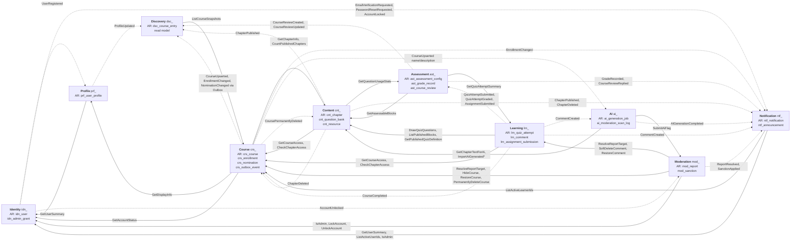
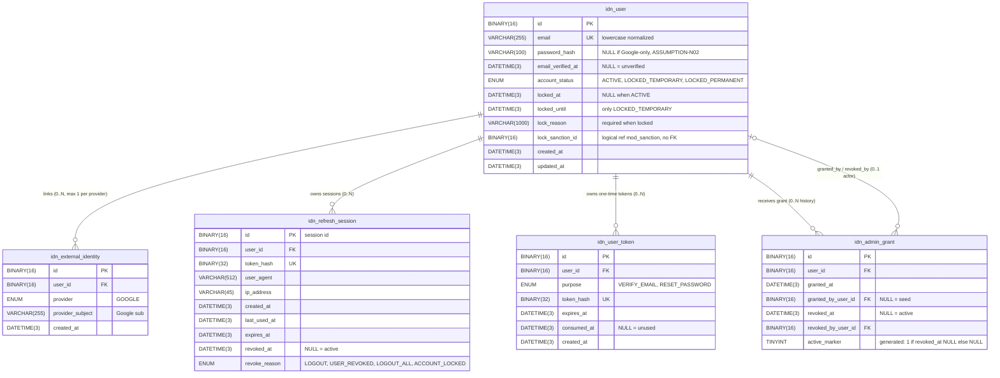
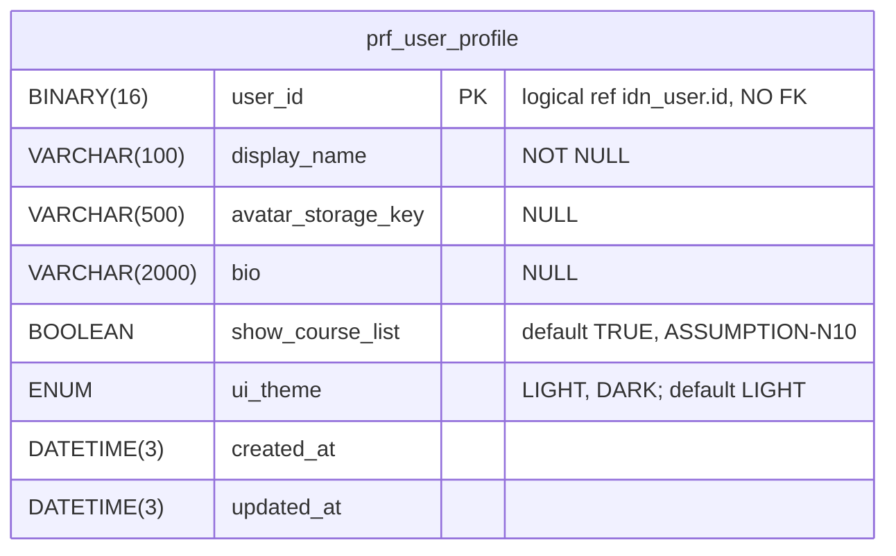
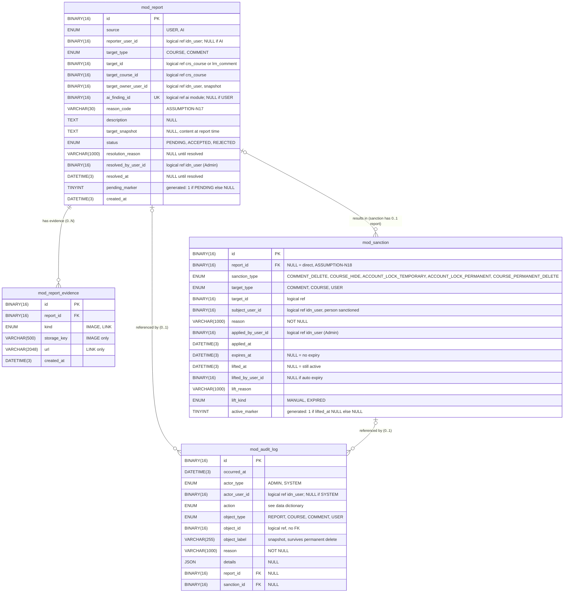
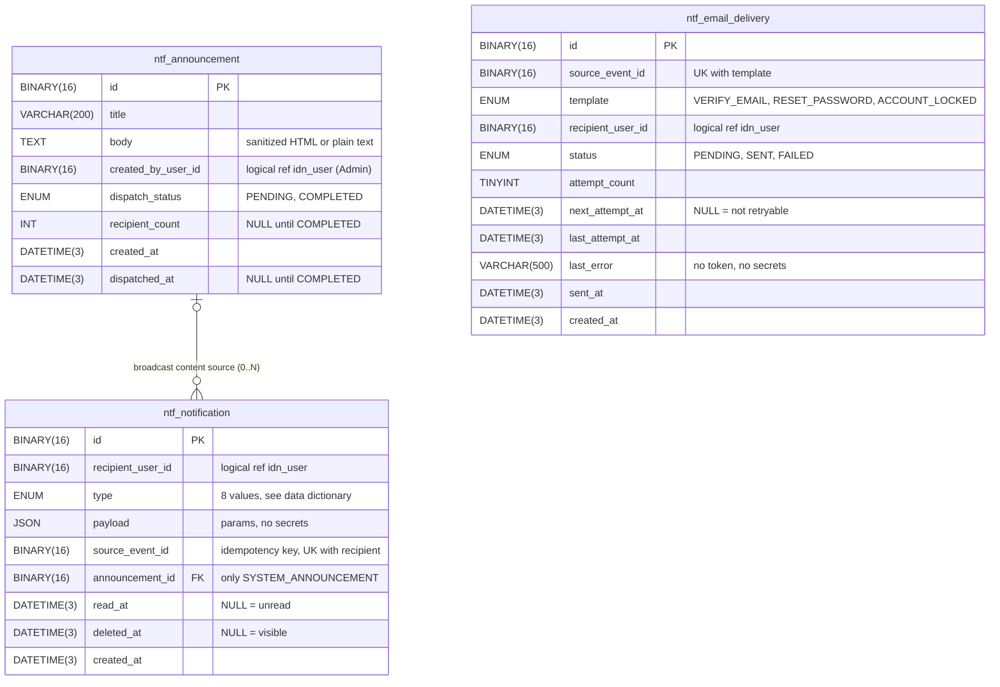
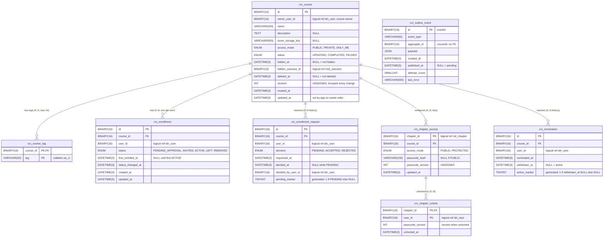

# BRAINMEMO LMS – TÀI LIỆU THIẾT KẾ CƠ SỞ DỮ LIỆU HOÀN CHỈNH

> **Trạng thái tài liệu:** Bản thiết kế cơ sở dữ liệu hoàn chỉnh (10 module, 56 bảng).
> **Kiến trúc:** Modular Monolith, một cơ sở dữ liệu MySQL, tích hợp Object Storage (Cloudflare R2 / MinIO).

## Mục lục

1. [Phần 1 – Tổng quan thiết kế CSDL](#phần-1-tổng-quan-thiết-kế-cơ-sở-dữ-liệu)
2. [Phần 2 – Kiến trúc dữ liệu và Giao tiếp liên module](#phần-2-kiến-trúc-dữ-liệu-và-giao-tiếp-liên-module)
3. [Phần 3 – Thiết kế chi tiết 10 module](#phần-3-thiết-kế-chi-tiết-10-module)
   - [3.1 Identity (`idn_`) – 5 bảng](#31-module-identity-idn_--5-bảng)
   - [3.2 Profile (`prf_`) – 1 bảng](#32-module-profile-prf_--1-bảng)
   - [3.3 Moderation (`mod_`) – 4 bảng](#33-module-moderation-mod_--4-bảng)
   - [3.4 Notification (`ntf_`) – 3 bảng](#34-module-notification-ntf_--3-bảng)
   - [3.5 Course (`crs_`) – 8 bảng](#35-module-course-crs_--8-bảng)
   - [3.6 Content (`cnt_`) – 15 bảng](#36-module-content-cnt_--15-bảng)
   - [3.7 Learning (`lrn_`) – 7 bảng](#37-module-learning-lrn_--7-bảng)
   - [3.8 Assessment (`ast_`) – 7 bảng](#38-module-assessment-ast_--7-bảng)
   - [3.9 Discovery (`dsc_`) – 3 bảng](#39-module-discovery-dsc_--3-bảng)
   - [3.10 AI (`ai_`) – 3 bảng](#310-module-ai-ai_--3-bảng)
4. [Phần 4 – Object Storage và giao tiếp liên module](#phần-4-thiết-kế-lưu-trữ-object-storage-và-giao-tiếp-liên-module)
5. [Phần 5 – Tổng hợp và kiểm tra](#phần-5-tổng-hợp-và-kiểm-tra)

---

# PHẦN 1. TỔNG QUAN THIẾT KẾ CƠ SỞ DỮ LIỆU

## 1.1. Mục đích

Tài liệu này là bản thiết kế cơ sở dữ liệu của hệ thống **BrainMemo LMS** (hệ thống quản lý học tập tích hợp AI). Mục tiêu:

- Là **một nguồn duy nhất** để nhóm đọc, review, chốt các điểm còn `[CẦN XÁC NHẬN]` và làm đầu vào cho giai đoạn viết DDL/migration và code.
- Phản ánh đầy đủ 10 module và 56 bảng..
- Truy vết được từng bảng về FR/NFR của đặc tả.

## 1.2. Kiến trúc: Modular Monolith, một MySQL database `[ASSUMPTION-D01]`

- Một ứng dụng (Modular Monolith), **một MySQL database**, chia **10 module** sở hữu dữ liệu riêng. Đáp ứng NFR-15 (một DB để backup/restore), NFR-16 (module độc lập), NFR-18 (mở rộng).
- Mỗi module có prefix bảng riêng. Không bắt buộc mỗi module là một database vật lý.
- Module chỉ giao tiếp qua **Contract công khai (đồng bộ)** hoặc **Domain Event (bất đồng bộ)**; không tham chiếu implementation hay bảng nội bộ của module khác.

| # | Module | Prefix | Số bảng | Vai trò dữ liệu chính |
|:-:|:--|:--|:-:|:--|
| 1 | Identity | `idn_` | 5 | Tài khoản, phiên, token, role Admin, trạng thái khóa hiện tại |
| 2 | Profile | `prf_` | 1 | Hồ sơ hiển thị, riêng tư, giao diện |
| 3 | Moderation | `mod_` | 4 | Báo cáo, chế tài, lịch sử, audit log |
| 4 | Notification | `ntf_` | 3 | Thông báo in-app, broadcast, theo dõi email |
| 5 | Course | `crs_` | 8 | Khóa học, ghi danh, truy cập chương, đề cử, Outbox |
| 6 | Content | `cnt_` | 15 | Chapter/Block, ngân hàng câu hỏi, cấu hình quiz/bài tập, tài nguyên |
| 7 | Learning | `lrn_` | 7 | Tiến độ, bookmark, bình luận, lượt làm quiz, bài nộp |
| 8 | Assessment | `ast_` | 7 | Cấu hình đánh giá, CLO/PLO, điểm, đánh giá khóa học |
| 9 | Discovery | `dsc_` | 3 | Read model tìm kiếm, fact Top 10, lịch sử tìm kiếm |
| 10 | AI | `ai_` | 3 | Job sinh nội dung, log quét vi phạm, quota |
| | **Tổng** | | **56** | |

## 1.3. Quy ước kỹ thuật chung

| Hạng mục | Quy ước | Nhãn |
|:--|:--|:--|
| Khóa chính | UUIDv7, kiểu `BINARY(16)`, do ứng dụng sinh. Dùng thống nhất toàn hệ thống (không trộn BIGINT) | `[ĐỀ XUẤT]` |
| Thời gian | `DATETIME(3)` lưu UTC; chuyển múi giờ ở tầng ứng dụng. `created_at`/`updated_at` chỉ có ở bảng cần | `[ĐỀ XUẤT]` |
| Trạng thái cố định | Dùng `ENUM`; không tạo bảng danh mục cho tập trạng thái cố định | `[ĐỀ XUẤT]` |
| Xóa mềm | `deleted_at` cho đối tượng được yêu cầu xóa mềm (Course, Comment, Chapter, Notification, Resource) | `[SPEC]` NFR-11 |
| Bí mật | Mật khẩu, passcode, token, mật khẩu bài thi chỉ lưu hash (BCrypt cho mật khẩu/passcode; SHA-256 cho token). Không lưu plaintext, kể cả trong event/Outbox/log | `[SPEC]` NFR-04 |
| Collation tag | Cột tag dùng `utf8mb4_0900_as_ci` (phân biệt dấu tiếng Việt, không phân biệt hoa/thường) để "má" khác "ma" | `[ĐỀ XUẤT]` |
| Collation email | `utf8mb4_0900_ai_ci`, chuẩn hóa chữ thường ở ứng dụng | `[ĐỀ XUẤT]` |
| Cột sinh tự động | Cột `*_marker` (generated, VIRTUAL) dùng để tạo UNIQUE có điều kiện: MySQL cho phép nhiều NULL trong UNIQUE | `[ĐỀ XUẤT]` |
| Phân trang | Mọi API danh sách ≤ 50 bản ghi/trang | `[SPEC]` NFR-03 |
| Không DDL | CHECK và index mô tả bằng lời; chưa viết SQL | Quy ước dự án |

### 1.3.1. Quy ước nhãn

| Nhãn | Ý nghĩa |
|:--|:--|
| `[SPEC]` | Đặc tả gốc quy định rõ |
| `[ĐỀ XUẤT]` | Đề xuất kỹ thuật, chưa phải yêu cầu |
| `[ASSUMPTION-Dxx]` | Giả định/quyết định lấy từ Decision Log v3 |
| `[ASSUMPTION-Nxx]` | Giả định do quá trình thiết kế phát hiện (N01..N74, xem 1.5) |
| `[CẦN XÁC NHẬN]` | Nhóm phải quyết định trước khi chốt |
| `[PENDING]` | Điểm đặc tả chưa nói; thiết kế tạm theo mặc định ghi rõ |

Ký hiệu trong Data Dictionary: **NN** = NOT NULL; **UK** = UNIQUE; **FK** = khóa ngoại (chỉ nội bộ module).

## 1.4. Nguyên tắc quản lý liên module

1. **Sở hữu dữ liệu:** mỗi bảng thuộc đúng một module. Chỉ module sở hữu được ghi vào bảng của mình.
2. **Không FK vật lý xuyên module.** Mọi liên kết chéo chỉ lưu **ID logic `BINARY(16)`**, ghi rõ ở cột. FK vật lý chỉ giữa các bảng cùng module.
3. **Không JOIN xuyên module.** Dữ liệu module khác lấy qua Contract (đồng bộ) hoặc event (bất đồng bộ).
4. **Contract đồng bộ:** dùng khi cần kết quả ngay để quyết định nghiệp vụ (kiểm quyền, kiểm tra trạng thái, lệnh chế tài). Người gọi không phụ thuộc cấu trúc bảng của bên cung cấp.
5. **Domain Event bất đồng bộ:** dùng cho thông báo và read model. Bên nhận phải **idempotent** theo `eventId`.
6. **Outbox chọn lọc `[ASSUMPTION-D19]`:** không mặc định cho cả 10 module. Chỉ **Course** có Outbox (`crs_outbox_event`), vì event của Course quyết định ai thấy khóa, ghi danh, đề cử (NFR-09). Các module còn lại không Outbox; phương án B được ghi ở từng module.
7. **Không lưu token plaintext trong Outbox/event/log.**
8. **Read model có thể dựng lại:** Discovery và các bảng chỉ mục (`cnt_published_block`) phải dựng lại được từ nguồn.
9. **Lỗi thông báo không rollback nghiệp vụ chính** (FR-NTF-01).
10. **Một DB nhưng vẫn tuân thủ ranh giới:** việc Moderation gọi Contract trong cùng transaction là cho phép nhờ một DB (D01, N21); nếu sau này tách DB phải chuyển sang saga/Outbox (NFR-18).


---

# PHẦN 2. KIẾN TRÚC DỮ LIỆU VÀ GIAO TIẾP LIÊN MODULE

## 2.1. Sơ đồ giao tiếp 10 module

Chú giải:
- **Mũi tên liền** = Contract đồng bộ (chiều từ bên gọi sang bên cung cấp, nhãn là tên Contract chính).
- **Mũi tên đứt** = Domain Event bất đồng bộ (chiều từ bên phát sang bên nhận).
- **Aggregate Root (AR):** Thực thể gốc đứng đầu mỗi cụm dữ liệu. Các module bên ngoài chỉ tương tác qua AR, không can thiệp trực tiếp vào các thực thể/bảng con bên trong
- Sơ đồ chỉ nêu các luồng chính; danh sách đầy đủ ở Phần 4.



## 2.2. Aggregate Root chính theo module

| Module | Aggregate Root | Thực thể con / liên quan | Ghi chú |
|:--|:--|:--|:--|
| Identity | `idn_user` | `idn_external_identity`, `idn_refresh_session`, `idn_user_token` | `idn_admin_grant` là aggregate riêng (lịch sử cấp/thu hồi) |
| Profile | `prf_user_profile` | – | 1–1 logic với `idn_user` |
| Moderation | `mod_report` | `mod_report_evidence` | `mod_sanction`, `mod_audit_log` có vòng đời riêng |
| Notification | `ntf_notification` | – | `ntf_announcement` là nguồn broadcast; `ntf_email_delivery` là hàng đợi email |
| Course | `crs_course` | `crs_course_tag`, `crs_chapter_access`→`crs_chapter_unlock` | `crs_enrollment`, `crs_enrollment_request`, `crs_nomination` theo (khóa, người) |
| Content | `cnt_chapter` | `cnt_block`, `cnt_chapter_version`, `cnt_published_block` | `cnt_question_bank`→`cnt_question`→option/tag; `cnt_resource` |
| Learning | `lrn_quiz_attempt` | `lrn_quiz_attempt_answer` | `lrn_comment` (tự tham chiếu); các bảng tiến độ độc lập |
| Assessment | `ast_assessment_config` | `ast_assessment_component`→`ast_component_outcome_weight`↔`ast_clo` | `ast_grade_record`, `ast_course_review` |
| Discovery | `dsc_course_entry` | – | Read model, dựng lại được; `dsc_course_activity_fact` |
| AI | `ai_generation_job` | – | `ai_moderation_scan_log`, `ai_user_daily_quota` độc lập |

## 2.3. Tóm tắt luồng nghiệp vụ liên module chính

| Luồng | Mô tả ngắn |
|:--|:--|
| Báo cáo → chế tài | Người dùng/AI tạo `mod_report`; Admin xử lý; Moderation gọi Contract Identity/Course/Learning trong một transaction; phát `ReportResolved` |
| Ẩn khóa → Discovery | Moderation gọi `HideCourse`; Course phát `CourseUpserted(eligible=false)` qua Outbox; Discovery gỡ khóa khỏi read model (D18) |
| Ghi danh | Course đổi `crs_enrollment` + chèn Outbox cùng transaction; phát `EnrollmentChanged` cho Notification/Discovery |
| Đăng tải chương | Content đặt con trỏ `published_version_no`, dựng lại `cnt_published_block`; phát `ChapterPublished` |
| Làm quiz | Learning gọi `DrawQuizQuestions`, lưu snapshot đề vào `lrn_quiz_attempt`; phát event nộp/chấm cho Assessment |
| Sinh nội dung AI | AI gọi LLM; kết quả nhập vào Content ở trạng thái Nháp qua Contract; chủ khóa duyệt trước khi đăng tải |

---

# PHẦN 3. THIẾT KẾ CHI TIẾT 10 MODULE

> **Cách đọc Data Dictionary:** 4 cột *Tên cột | Kiểu dữ liệu | Ràng buộc | Mô tả chi tiết*. Cột "Ràng buộc" gộp: khóa (PK/UK/FK), nullability (NN/NULL) và giá trị mặc định. `created_at` mặc định `CURRENT_TIMESTAMP(3)`; `updated_at` tự cập nhật khi đổi dòng (trừ khi ghi chú khác).

---

## 3.1. MODULE IDENTITY (`idn_`) – 5 bảng

### 3.1.1. Mục đích

Quản lý xác thực và tài khoản: đăng ký, đăng nhập (email và Google), xác minh email, quên/đổi mật khẩu, phiên đăng nhập và refresh token, role Admin, và **trạng thái khóa tài khoản hiện tại**. Identity là nguồn sự thật của trạng thái khóa (D04); lịch sử chế tài thuộc Moderation. Không tạo role Instructor; Chủ khóa là quan hệ, không phải role.

Phạm vi đối chiếu: FR-IDN-01..11; mục 3.1.1, 3.9.1–3.9.2; NFR-04, 05, 06, 07, 09, 12, 16, 18.

### 3.1.2. ERD



### 3.1.3. Danh sách bảng

| # | Bảng | Mục đích | FR/NFR chính |
|:-:|:--|:--|:--|
| 1 | `idn_user` | Tài khoản và trạng thái khóa hiện tại | FR-IDN-01, 03, 04; 3.1.1; NFR-05 |
| 2 | `idn_external_identity` | Liên kết đăng nhập Google | FR-IDN-06 |
| 3 | `idn_refresh_session` | Phiên đăng nhập, refresh token (hash), thu hồi | FR-IDN-05, 09, 10 |
| 4 | `idn_user_token` | Token một lần: xác minh email, đặt lại mật khẩu | FR-IDN-02, 07 |
| 5 | `idn_admin_grant` | Lịch sử cấp/thu hồi role Admin; bảo đảm Admin cuối | FR-IDN-11 |

### 3.1.4. Data Dictionary

#### 3.1.4.1. `idn_user`: tài khoản và trạng thái khóa hiện tại

| Tên cột | Kiểu dữ liệu | Ràng buộc | Mô tả chi tiết |
|:--|:--|:--|:--|
| `id` | BINARY(16) | PK, NN, app sinh UUIDv7 | ID người dùng; các module khác tham chiếu logic |
| `email` | VARCHAR(255) | UK, NN | Chuẩn hóa chữ thường ở ứng dụng; collation `utf8mb4_0900_ai_ci` |
| `password_hash` | VARCHAR(100) | NULL, mặc định NULL | BCrypt; NULL nếu tài khoản chỉ dùng Google (N02) |
| `email_verified_at` | DATETIME(3) | NULL, mặc định NULL | NULL = chưa xác minh. Không thêm trạng thái tài khoản thứ 4 (N01) |
| `account_status` | ENUM('ACTIVE','LOCKED_TEMPORARY','LOCKED_PERMANENT') | NN, mặc định 'ACTIVE' | Ba trạng thái theo mục 3.1.1 |
| `locked_at` | DATETIME(3) | NULL, mặc định NULL | Thời điểm khóa hiện tại |
| `locked_until` | DATETIME(3) | NULL, mặc định NULL | Chỉ dùng cho `LOCKED_TEMPORARY` |
| `lock_reason` | VARCHAR(1000) | NULL, mặc định NULL | Lý do khóa (bắt buộc khi khóa, mục 3.9.1) |
| `lock_sanction_id` | BINARY(16) | NULL, mặc định NULL | ID logic tới `mod_sanction.id` (không FK); để idempotent và đối chiếu |
| `created_at` | DATETIME(3) | NN, mặc định now | Ngày gia nhập (Profile đọc qua Contract) |
| `updated_at` | DATETIME(3) | NN, mặc định now, tự cập nhật | Thời điểm cập nhật gần nhất |

**Index:** UK(`email`); IX(`account_status`,`locked_until`) cho job tự gỡ khóa hết hạn.

**Check Constraint:**
- `account_status`='ACTIVE' ⇒ `locked_at`, `locked_until`, `lock_reason`, `lock_sanction_id` đều NULL.
- `account_status`='LOCKED_TEMPORARY' ⇒ `locked_at`, `locked_until`, `lock_reason` NOT NULL.
- `account_status`='LOCKED_PERMANENT' ⇒ `locked_until` NULL; `locked_at`, `lock_reason` NOT NULL.

#### 3.1.4.2. `idn_external_identity`: liên kết Google

| Tên cột | Kiểu dữ liệu | Ràng buộc | Mô tả chi tiết |
|:--|:--|:--|:--|
| `id` | BINARY(16) | PK, NN | – |
| `user_id` | BINARY(16) | FK → `idn_user.id` (RESTRICT), NN | FK nội bộ module |
| `provider` | ENUM('GOOGLE') | NN, thuộc UK(a) và UK(b) | Chỉ Google theo FR-IDN-06 |
| `provider_subject` | VARCHAR(255) | NN, thuộc UK(a) | Claim `sub` của Google |
| `created_at` | DATETIME(3) | NN, mặc định now | – |

**Index:** UK(a) = (`provider`,`provider_subject`); UK(b) = (`user_id`,`provider`).

**Check Constraint:** không có (ENUM đã giới hạn giá trị).

#### 3.1.4.3. `idn_refresh_session`: phiên đăng nhập

| Tên cột | Kiểu dữ liệu | Ràng buộc | Mô tả chi tiết |
|:--|:--|:--|:--|
| `id` | BINARY(16) | PK, NN | Session id; dùng khi thu hồi từng phiên (FR-IDN-09) |
| `user_id` | BINARY(16) | FK → `idn_user.id`, NN | Chủ phiên |
| `token_hash` | BINARY(32) | UK, NN | SHA-256 của refresh token (rotation tại chỗ, xem Business Rules) |
| `user_agent` | VARCHAR(512) | NULL, mặc định NULL | Để người dùng nhận biết phiên |
| `ip_address` | VARCHAR(45) | NULL, mặc định NULL | IPv4/IPv6 dạng chuỗi |
| `created_at` | DATETIME(3) | NN, mặc định now | – |
| `last_used_at` | DATETIME(3) | NN, mặc định now | Cập nhật mỗi lần refresh |
| `expires_at` | DATETIME(3) | NN | TTL là cấu hình (N04) |
| `revoked_at` | DATETIME(3) | NULL, mặc định NULL | NULL = còn hiệu lực |
| `revoke_reason` | ENUM('LOGOUT','USER_REVOKED','LOGOUT_ALL','ACCOUNT_LOCKED') | NULL, mặc định NULL | Các lý do có trong đặc tả (FR-IDN-04, 09, 10; mục 3.1.1) |

**Index:** UK(`token_hash`); IX(`user_id`,`revoked_at`,`expires_at`). Job dọn dòng hết hạn quá lâu (tùy chọn).

**Check Constraint:** `revoked_at` NULL ⇔ `revoke_reason` NULL.

#### 3.1.4.4. `idn_user_token`: token xác minh email / đặt lại mật khẩu

| Tên cột | Kiểu dữ liệu | Ràng buộc | Mô tả chi tiết |
|:--|:--|:--|:--|
| `id` | BINARY(16) | PK, NN | Cũng là `tokenId` trong event |
| `user_id` | BINARY(16) | FK → `idn_user.id`, NN | Chủ token |
| `purpose` | ENUM('VERIFY_EMAIL','RESET_PASSWORD') | NN | Gộp hai loại token vì cùng cấu trúc |
| `token_hash` | BINARY(32) | UK, NN | SHA-256; token thô không lưu |
| `expires_at` | DATETIME(3) | NN | TTL là cấu hình (N04) |
| `consumed_at` | DATETIME(3) | NULL, mặc định NULL | NULL = chưa dùng |
| `created_at` | DATETIME(3) | NN, mặc định now | – |

**Index:** UK(`token_hash`); IX(`user_id`,`purpose`,`consumed_at`,`expires_at`).

**Check Constraint:** không có CHECK ở DB; quy tắc "phát hành token mới thì vô hiệu token cũ cùng `purpose`" nằm ở application layer.

#### 3.1.4.5. `idn_admin_grant`: cấp/thu hồi role Admin

| Tên cột | Kiểu dữ liệu | Ràng buộc | Mô tả chi tiết |
|:--|:--|:--|:--|
| `id` | BINARY(16) | PK, NN | – |
| `user_id` | BINARY(16) | FK → `idn_user.id`, NN | Người nhận role Admin |
| `granted_at` | DATETIME(3) | NN, mặc định now | Thời điểm cấp |
| `granted_by_user_id` | BINARY(16) | FK → `idn_user.id`, NULL, mặc định NULL | Người cấp; NULL = dữ liệu seed |
| `revoked_at` | DATETIME(3) | NULL, mặc định NULL | NULL = còn hiệu lực |
| `revoked_by_user_id` | BINARY(16) | FK → `idn_user.id`, NULL, mặc định NULL | Người thu hồi |
| `active_marker` | TINYINT (generated, VIRTUAL) | NULL; thuộc UK(`user_id`,`active_marker`) | Bằng 1 nếu `revoked_at` NULL, ngược lại NULL. MySQL cho nhiều NULL trong unique ⇒ tối đa một grant active mỗi user |

**Index:** UK(`user_id`,`active_marker`); **IX_admin_grant_active(`active_marker`,`user_id`)** (index duy nhất được thêm ở lần rà soát kỹ thuật Đợt 1, để truy vấn khóa dòng chỉ khóa đúng các dòng active).

**Check Constraint:** `revoked_at` NULL ⇒ `revoked_by_user_id` NULL.

### 3.1.5. Cardinality

| Quan hệ | Cardinality | Giải thích |
|:--|:--|:--|
| `idn_user` – `idn_external_identity` | 1 – 0..N | Mỗi provider tối đa 1 liên kết/user (UK) |
| `idn_user` – `idn_refresh_session` | 1 – 0..N | Mỗi phiên đăng nhập một dòng |
| `idn_user` – `idn_user_token` | 1 – 0..N | Nhiều lần phát hành token |
| `idn_user` – `idn_admin_grant` (người nhận) | 1 – 0..N | Giữ lịch sử; tối đa một dòng active |
| `idn_user` – `idn_admin_grant` (người thực hiện) | 0..1 – 0..N | `granted_by`/`revoked_by`; NULL khi seed |

Không có FK ra ngoài module; `lock_sanction_id` là ID logic.

### 3.1.6. Business Rules

| Quy tắc | DB bảo đảm | Application layer |
|:--|:--|:--|
| Email duy nhất (FR-IDN-01) | UK(`email`) | Chuẩn hóa chữ thường |
| Không lưu plaintext mật khẩu/token (NFR-04) | Chỉ có cột `*_hash` | Không log mật khẩu/token |
| Token dùng một lần, có hạn | UK(`token_hash`) | Cập nhật có điều kiện (`consumed_at IS NULL` và chưa hết hạn), thành công khi đúng 1 dòng |
| Trạng thái khóa nhất quán, lý do bắt buộc | CHECK ở 3.1.4.1 | – |
| Khóa tài khoản thu hồi mọi phiên | – | Cùng một transaction: đổi `account_status` + đặt `revoked_at` mọi phiên active (`ACCOUNT_LOCKED`) |
| Khóa có thời hạn tự gỡ | IX(`account_status`,`locked_until`) | Job định kỳ + kiểm tra lười lúc đăng nhập/kiểm tra quyền; phát `AccountUnlocked` |
| Thứ tự kiểm tra: trạng thái → role → quyền tài nguyên | – | Identity cung cấp hai bước đầu; bước ba thuộc Course/Learning |
| Chặn ngay tài khoản bị khóa (NFR-05) | – | Kiểm tra `account_status` ở mỗi request xác thực, không chỉ dựa vào hạn access token |
| Admin cuối, không tự khóa mình (FR-IDN-11, 3.9.1) | UK(`user_id`,`active_marker`) | Transaction + khóa dòng grant (xem 3.1.6.2); nằm trong `LockAccount`/thu hồi role |
| Admin đầu tiên là dữ liệu seed | – | Migration seed: `idn_user` + `idn_admin_grant` với `granted_by` NULL |
| Giới hạn đăng nhập 5 lần/phút/IP (NFR-07) | – | Rate limiter, không bảng (C3) |
| Refresh rotation đồng thời | UK(`token_hash`) | Cập nhật có điều kiện, chỉ 1 request thắng (xem 3.1.6.3) |

#### 3.1.6.1. Chuyển trạng thái tài khoản

| Từ → Đến | Điều kiện | Căn cứ |
|:--|:--|:--|
| ACTIVE → LOCKED_TEMPORARY | `LockAccount` từ Moderation | FR-MOD-10 |
| ACTIVE → LOCKED_PERMANENT | `LockAccount` từ Moderation | FR-MOD-11 |
| LOCKED_TEMPORARY → ACTIVE | Hết hạn tự động hoặc Admin mở sớm | 3.1.1, FR-MOD-12 |
| LOCKED_PERMANENT → ACTIVE | Chỉ Admin mở thủ công | 3.9.1, FR-MOD-12 |
| LOCKED_TEMPORARY → LOCKED_PERMANENT | Đặc tả không nói | `[CẦN XÁC NHẬN] N05`; mặc định `LockAccount` trả `ALREADY_LOCKED` |

Khi mở khóa, các cột `lock_*` về NULL. Lịch sử các lần khóa do Moderation giữ.

#### 3.1.6.2. Không thể thu hồi đồng thời khiến hết Admin `[ĐỀ XUẤT]`

Vấn đề: kiểm tra "còn Admin khác" rồi mới thu hồi (check-then-act) bị race: hai Admin cùng thu hồi nhau, cả hai thấy "còn người kia" nên cùng thành công và hệ thống còn 0 Admin. Race tương tự giữa "thu hồi Admin" và "khóa tài khoản của Admin".

- **Phương án A (khuyến nghị):** mọi thao tác làm giảm số Admin dùng được (thu hồi role, khóa tài khoản Admin) chạy trong một transaction: (1) BEGIN; (2) đọc **toàn bộ** grant `active_marker = 1` bằng khóa ghi (`FOR UPDATE`), sắp theo `id` để mọi transaction khóa cùng thứ tự, tránh deadlock; (3) kiểm tra bất biến sau thao tác; (4) thực hiện thay đổi, COMMIT. Transaction thứ hai bị chặn ở bước 2 cho tới khi transaction đầu commit, rồi thấy chỉ còn 1 Admin và từ chối. Bắt deadlock (nếu có) và thử lại một lần.
- **Phương án B:** dòng khóa chuyên dụng (sentinel) làm mutex; thêm bảng chỉ để làm khóa nên không khuyến nghị.
- Kiểm tra "Admin cuối" của khóa tài khoản **phải nằm trong `LockAccount` của Identity** và dùng cùng cơ chế khóa. Contract `IsLastAdmin` chỉ để kiểm tra sớm, **không** thay cho kiểm tra nguyên tử.
- Cấp Admin trùng: UK(`user_id`,`active_marker`) báo trùng khóa thì coi là thành công idempotent.
- `[ASSUMPTION-N14] [CẦN XÁC NHẬN]` "Admin cuối cùng": (i) còn ít nhất 1 grant chưa thu hồi; (ii) chặt hơn: sau thao tác còn ít nhất 1 Admin có `account_status = ACTIVE`. Thiết kế tạm dùng (ii); nếu nhóm chọn (i) chỉ bỏ điều kiện trạng thái ở bước 3.

#### 3.1.6.3. Rotation refresh token với hai request đồng thời `[ĐỀ XUẤT]`

FR-IDN-05 chỉ yêu cầu refresh token và khả năng thu hồi; rotation là đề xuất.

- **Phương án A (khuyến nghị): rotation tại chỗ, cập nhật có điều kiện.** Refresh = một lệnh cập nhật theo điều kiện `token_hash = hash(cũ) AND revoked_at IS NULL AND expires_at > now`, đặt `token_hash` mới và `last_used_at`; thành công khi đúng **1 dòng** bị ảnh hưởng. Hai request cùng token cũ: row lock khiến chỉ một request thắng; request thua nhận 0 dòng và trả 401 (không xóa phiên). Client dùng single-flight.
- **Phương án B:** không rotation; không có race nhưng token bị lộ dùng được đến hết hạn.
- Không thêm `previous_token_hash`/cửa sổ ân hạn và không phát hiện tái sử dụng token cũ (đặc tả không yêu cầu).
- Race đăng xuất/thu hồi với refresh được xử lý bằng cùng cơ chế (điều kiện `revoked_at IS NULL`). `LockAccount` thu hồi phiên trong cùng transaction với đổi `account_status`; refresh kiểm tra `account_status` trước và cập nhật có điều kiện sau, nên không cấp token mới sau khi khóa commit.

#### 3.1.6.4. Quyết định Outbox: KHÔNG Outbox cho Identity `[ASSUMPTION-D19]`

- Email chứa token: payload Outbox ghi vào DB sẽ chứa token thô, vi phạm NFR-04. Vì vậy gửi ngay, retry **trong bộ nhớ** (vài lần, backoff ngắn); kết quả cuối ghi vào `ntf_email_delivery` (không chứa token).
- Nếu thất bại hoặc mất event: người dùng tự yêu cầu lại. Đặt lại mật khẩu gọi lại FR-IDN-07 (token mới vô hiệu token cũ). Xác minh email: **đặc tả không có chức năng gửi lại** `[ASSUMPTION-N15] [CẦN XÁC NHẬN]`.
- Phương án B (nếu nhóm không chấp nhận N15): Outbox với token dẫn xuất HMAC(secret, `tokenId`‖`purpose`‖hạn); thêm bảng `idn_outbox_event` nhưng token thô trở nên "tính lại được" từ secret. Không khuyến nghị.
- NFR-09 chỉ liệt kê ghi danh, nộp bài, chấm điểm, tiến độ/CLO; nhất quán trong module dựa vào transaction cục bộ (khóa tài khoản + thu hồi phiên; thu hồi Admin + kiểm tra Admin cuối; tiêu thụ token).

### 3.1.7. Contract và Domain Event

| Loại | Tên | Chi tiết | Đối tác |
|:--|:--|:--|:--|
| Contract cung cấp | `GetAccountStatus(userId)`, `IsAdmin(userId)`, `IsLastAdmin(userId)` | `IsLastAdmin` chỉ để kiểm tra sớm | Mọi module, Moderation |
| Contract cung cấp | `GetUserSummary(userIds[])` | id, trạng thái, `created_at`, email liên lạc | Profile, Notification |
| Contract cung cấp `[ĐỀ XUẤT]` | `ListActiveUserIds(afterId, limit≤50)` | Duyệt phân trang tài khoản ACTIVE cho broadcast | Notification |
| Contract nhận lệnh | `LockAccount(userId, type, until, reason, sanctionId, actorAdminId)` | Idempotent theo `sanctionId`; lỗi `LAST_ADMIN`, `SELF_LOCK`, `ALREADY_LOCKED` | Moderation |
| Contract nhận lệnh | `UnlockAccount(userId, reason, actorAdminId)` | Xóa `lock_*`; phát `AccountUnlocked(kind=MANUAL)` | Moderation |
| Event phát | `UserRegistered` | `{eventId, userId, occurredAt}` | Profile |
| Event phát | `EmailVerificationRequested`, `PasswordResetRequested` | `{eventId, userId, tokenId, rawToken (chỉ trong bộ nhớ), occurredAt}`; **rawToken không bao giờ ghi xuống DB/log** | Notification |
| Event phát | `AccountLocked` | `{eventId, userId, type, until, sanctionId, occurredAt}` | Notification (email FR-NTF-03) |
| Event phát | `AccountUnlocked` | `{eventId, userId, sanctionId, kind (MANUAL hoặc AUTO_EXPIRED), occurredAt}` | Moderation (đóng sanction) |
| Event tiêu thụ | – | Identity không tiêu thụ event; Moderation tác động qua Contract lệnh (3.9.2) | – |


---

## 3.2. MODULE PROFILE (`prf_`) – 1 bảng

### 3.2.1. Mục đích

Sở hữu hồ sơ hiển thị của người dùng: tên hiển thị, avatar, giới thiệu, quyền riêng tư (ẩn/hiện danh sách khóa) và cài đặt giao diện. Identity sở hữu thông tin đăng nhập; Profile **không** lưu mật khẩu hay xác minh. Danh sách khóa học trên hồ sơ (FR-PRF-05) **không lưu ở Profile** mà lấy từ Course/Learning/Assessment qua Contract.

Phạm vi đối chiếu: FR-PRF-01..07; NFR-05, 07, 08, 16, 18, 20.

### 3.2.2. ERD

Profile chỉ có một bảng; liên kết 1–1 tới `idn_user` là **tham chiếu logic** (ID `user_id`), không có FK vật lý và không vẽ đường nối.



### 3.2.3. Danh sách bảng

| # | Bảng | Mục đích | FR/NFR chính |
|:-:|:--|:--|:--|
| 1 | `prf_user_profile` | Hồ sơ hiển thị, riêng tư, giao diện của mỗi người dùng | FR-PRF-01..04, 06, 07 |

v3 liệt kê ba ứng viên (`UserProfile`, `ProfilePrivacySetting`, `UserPreference`); gộp thành **một bảng** vì cả ba 1–1 với user, cùng vòng đời và truy vấn, mỗi thiết lập chỉ một cột. Khi trả hồ sơ công khai, ứng dụng chỉ chiếu các trường công khai (không trả `ui_theme`).

### 3.2.4. Data Dictionary: `prf_user_profile`

| Tên cột | Kiểu dữ liệu | Ràng buộc | Mô tả chi tiết |
|:--|:--|:--|:--|
| `user_id` | BINARY(16) | PK, NN | Trùng `idn_user.id`; ID logic, **không FK** |
| `display_name` | VARCHAR(100) | NN, mặc định theo hàm xác định (xem Business Rules) | Tên hiển thị công khai; không duy nhất. Độ dài tối đa 100 là giả định N09 |
| `avatar_storage_key` | VARCHAR(500) | NULL, mặc định NULL | Khóa tệp trong kho lưu trữ; không dùng `cnt_resource` (thuộc Content, gắn khóa học) |
| `bio` | VARCHAR(2000) | NULL, mặc định NULL | Giới thiệu; độ dài tối đa 2000 là giả định N09 |
| `show_course_list` | BOOLEAN | NN, mặc định TRUE | Ẩn/hiện danh sách khóa học trên hồ sơ công khai (N10) |
| `ui_theme` | ENUM('LIGHT','DARK') | NN, mặc định 'LIGHT' | Cài đặt giao diện (N13) |
| `created_at` | DATETIME(3) | NN, mặc định now | – |
| `updated_at` | DATETIME(3) | NN, mặc định now | Cập nhật khi người dùng sửa hồ sơ |

**Index:** chỉ PK(`user_id`). Tìm theo tên Chủ khóa (FR-DSC-04) do read model của Discovery đảm nhiệm.

**Check Constraint:** độ dài `display_name` sau trim ≥ 1.

### 3.2.5. Cardinality

| Quan hệ | Cardinality | Giải thích |
|:--|:--|:--|
| `idn_user` (Identity) – `prf_user_profile` | 1 – 1 (logic) | Mỗi user đúng một hồ sơ nhờ PK = `user_id`; không FK xuyên module |

### 3.2.6. Business Rules

| Quy tắc | DB bảo đảm | Application layer |
|:--|:--|:--|
| Mỗi user tối đa một hồ sơ | PK(`user_id`) | Tạo "chèn nếu chưa có"; trùng khóa thì đọc lại (xem 3.2.6.1) |
| Chỉ chủ hồ sơ được sửa (NFR-05) | – | `user_id` lấy từ JWT, không nhận từ body |
| Tên không rỗng | CHECK sau trim | Chuẩn hóa/làm sạch (NFR-07) |
| Ngày gia nhập hiển thị mặc định (FR-PRF-03) | – | Lấy `created_at` từ Identity qua Contract, **không sao chép** |
| Khóa Only Me không bao giờ hiện (FR-PRF-06) | – | Course lọc điều kiện hiển thị khi trả danh sách; Profile không giữ danh sách |
| Avatar ≤ 5 MB, đúng định dạng (NFR-08) | – | Kiểm tra nội dung thực tế khi upload |
| Hồ sơ tồn tại cho mọi user | – | Event `UserRegistered` + self-heal có xác nhận từ Identity |

#### 3.2.6.1. Tạo đồng thời và self-heal `[ĐỀ XUẤT]`

- Tạo hồ sơ là "chèn nếu chưa có" theo PK `user_id`; handler `UserRegistered` và đường self-heal dùng chung một thao tác. Hai request đồng thời: một bên thành công, bên kia báo trùng khóa thì bắt lỗi và **đọc lại** (không coi là lỗi).
- Chỉ tự tạo khi Identity xác nhận user tồn tại (`GetUserSummary`), tránh tạo hồ sơ cho ID bịa. Không tồn tại → 404, không ghi DB. Hồ sơ tài khoản bị khóa vẫn tồn tại.
- Khi hồ sơ thiếu lúc đọc: **Phương án A (khuyến nghị)** tạo và lưu ngay khi đọc (ghi trên GET chỉ xảy ra một lần mỗi user); phương án B trả hồ sơ mặc định tính tạm và chỉ lưu khi người dùng ghi (mỗi lần đọc lại gọi Identity).

#### 3.2.6.2. `display_name` mặc định `[ĐỀ XUẤT]` `[CẦN XÁC NHẬN N08]`

- FR-IDN-01 đăng ký chỉ có email và mật khẩu nên chưa có tên khi tạo hồ sơ.
- **Phương án A (khuyến nghị):** "Người dùng " + 6 ký tự hex lấy từ phần ngẫu nhiên của `user_id` (không phải phần thời gian của UUIDv7). Hàm **xác định** nên đường event và self-heal cho cùng kết quả (idempotent) và **không lộ email**. Không yêu cầu duy nhất.
- Phương án B: lấy từ email/Google; thân thiện hơn nhưng làm lộ một phần email và phụ thuộc đường tạo.

### 3.2.7. Contract và Domain Event

| Loại | Tên | Chi tiết |
|:--|:--|:--|
| Contract cung cấp | `GetPublicProfile(userId)` | Dùng được cho Khách; trả tên, avatar, bio, ngày gia nhập (từ Identity), cờ hiện danh sách |
| Contract cung cấp | `GetDisplayInfo(userIds[])` | Theo lô, trả tên và avatar, cho Learning (bình luận), Course (Chủ khóa), Assessment (đánh giá) |
| Contract gọi ra | Identity `GetUserSummary`; Course/Learning lấy danh sách khóa (FR-PRF-05) | – |
| Event tiêu thụ | `UserRegistered` (Identity) | Idempotent theo PK |
| Event phát | `ProfileUpdated {eventId, userId, displayName, avatarStorageKey, occurredAt}` | Discovery cập nhật tên Chủ khóa trong read model |

**Outbox:** không. Đây không phải luồng NFR-09; `ProfileUpdated` chỉ nuôi read model dựng lại được (D17/D18). Nhất quán dựa vào PK, idempotency của handler và self-heal.

---

## 3.3. MODULE MODERATION (`mod_`) – 4 bảng

### 3.3.1. Mục đích

Tiếp nhận báo cáo vi phạm (từ người dùng và cờ AI) vào **một hàng đợi duy nhất**, để Admin thẩm định; áp dụng 5 loại chế tài; lưu lịch sử chế tài và **audit log bất biến**. AI chỉ gắn cờ, không tự xử phạt (NFR-13). Chỉ có Admin xử lý (C4); người báo cáo là Học viên, Chủ khóa hoặc Admin.

Phạm vi đối chiếu: FR-MOD-01..15; mục 3.9.1, 3.9.2; FR-LRN-14, FR-AI-03, FR-CRS-04/05, FR-IDN-11, 3.1.1; NFR-05, 09, 11, 12, 13, 16, 18.

### 3.3.2. ERD



### 3.3.3. Danh sách bảng và quyết định tách bảng

| # | Bảng | Mục đích | FR/NFR chính |
|:-:|:--|:--|:--|
| 1 | `mod_report` | Báo cáo và hàng đợi chung (nguồn USER hoặc AI) | FR-MOD-01..05 |
| 2 | `mod_report_evidence` | Bằng chứng đính kèm (ảnh/link) | FR-MOD-01 |
| 3 | `mod_sanction` | Chế tài và vòng đời (áp dụng, gỡ, hết hạn) | FR-MOD-06..12; 3.9.1 |
| 4 | `mod_audit_log` | Nhật ký bất biến mọi thao tác xử lý | FR-MOD-13, 14; NFR-11, 12 |

| Câu hỏi | Quyết định | Lý do |
|:--|:--|:--|
| Có cần `ModerationCase` (gom nhiều báo cáo cùng đối tượng)? | **Không** `[ĐỀ XUẤT]` | Đặc tả không có khái niệm case; FR-MOD-04 quyết định trên từng báo cáo. Phương án B (có case) chỉ cần nếu nhóm muốn xử lý gộp (N18) |
| `Report` và `AIFlag` | Một bảng `mod_report` với `source` USER/AI | FR-MOD-03: "gom vào **một** hàng đợi"; v3 4.9: dùng trạng thái trên Report, không tạo bảng hàng đợi riêng. Nhãn/độ tin cậy của AI nằm ở module AI (tham chiếu `ai_finding_id`) |
| `Sanction` có tách khỏi `Report`? | **Có** | Một báo cáo có thể kèm 0..N chế tài; chế tài có vòng đời riêng (gỡ, hết hạn) mà báo cáo (cuối cùng) không có |
| `AuditLog` có trùng `Sanction`/`Report`? | **Có tách** | `Sanction`/`Report` là trạng thái; `AuditLog` là nhật ký bất biến, giữ nguyên cả khi khóa bị xóa vĩnh viễn (FR-MOD-09, NFR-12) |

### 3.3.4. Data Dictionary

#### 3.3.4.1. `mod_report`: báo cáo và hàng đợi

| Tên cột | Kiểu dữ liệu | Ràng buộc | Mô tả chi tiết |
|:--|:--|:--|:--|
| `id` | BINARY(16) | PK, NN | – |
| `source` | ENUM('USER','AI') | NN | Nguồn báo cáo (lọc hàng đợi FR-MOD-03) |
| `reporter_user_id` | BINARY(16) | NULL, mặc định NULL | ID logic Identity; NULL nếu nguồn AI |
| `target_type` | ENUM('COURSE','COMMENT') | NN | Đối tượng bị báo cáo (FR-MOD-01); không có loại khác |
| `target_id` | BINARY(16) | NN | ID logic Course hoặc Learning (comment) |
| `target_course_id` | BINARY(16) | NN | ID logic khóa học chứa đối tượng (= `target_id` nếu COURSE); phục vụ lọc/ngữ cảnh |
| `target_owner_user_id` | BINARY(16) | NN | Người bị báo cáo (chủ khóa/tác giả bình luận), **chụp lại lúc báo cáo** qua Contract |
| `ai_finding_id` | BINARY(16) | UK, NULL, mặc định NULL | ID logic bản ghi quét của module AI; NULL nếu nguồn USER |
| `reason_code` | VARCHAR(30) | NN | Mã lý do (FR-MOD-01 "chọn lý do"); danh mục do ứng dụng quản lý (N17); nguồn AI dùng mã cố định |
| `description` | TEXT | NULL, mặc định NULL | Mô tả của người báo cáo |
| `target_snapshot` | TEXT | NULL, mặc định NULL | Nội dung tại thời điểm báo cáo (nội dung bình luận hoặc tên/giới thiệu khóa) để truy vết khi bị sửa/xóa (N20) |
| `status` | ENUM('PENDING','ACCEPTED','REJECTED') | NN, mặc định 'PENDING' | Đúng 3 trạng thái FR-MOD-04, không thêm trạng thái |
| `resolution_reason` | VARCHAR(1000) | NULL, mặc định NULL | Lý do bắt buộc khi xử lý (cả chấp nhận và từ chối) |
| `resolved_by_user_id` | BINARY(16) | NULL, mặc định NULL | Admin xử lý; ID logic Identity |
| `resolved_at` | DATETIME(3) | NULL, mặc định NULL | Thời điểm xử lý |
| `pending_marker` | TINYINT (generated, VIRTUAL) | NULL; thuộc UK(c) | Bằng 1 nếu PENDING, ngược lại NULL; chống trùng báo cáo đang chờ |
| `created_at` | DATETIME(3) | NN, mặc định now | – |

**Index:**
- UK(a): `ai_finding_id` (một cờ AI chỉ tạo một báo cáo, idempotent).
- UK(c): (`reporter_user_id`,`target_type`,`target_id`,`pending_marker`): mỗi người tối đa 1 báo cáo **đang chờ** trên cùng đối tượng. NULL ở cột nào cũng không cản trở (báo cáo AI và báo cáo đã xử lý). `[CẦN XÁC NHẬN N16]`
- IX_queue(`status`,`source`,`target_type`,`created_at`); IX_target(`target_type`,`target_id`).

**Check Constraint:**
- (`source`='USER') ⇔ (`reporter_user_id` NOT NULL).
- (`source`='AI') ⇔ (`ai_finding_id` NOT NULL).
- (`status`='PENDING') ⇔ (`resolved_at`, `resolved_by_user_id`, `resolution_reason` đều NULL).
- (`target_type`='COURSE') ⇒ `target_id` = `target_course_id`.

#### 3.3.4.2. `mod_report_evidence`: bằng chứng đính kèm

| Tên cột | Kiểu dữ liệu | Ràng buộc | Mô tả chi tiết |
|:--|:--|:--|:--|
| `id` | BINARY(16) | PK, NN | – |
| `report_id` | BINARY(16) | FK → `mod_report.id` (RESTRICT), NN | FK nội bộ module |
| `kind` | ENUM('IMAGE','LINK') | NN | Ảnh hoặc liên kết |
| `storage_key` | VARCHAR(500) | NULL, mặc định NULL | Khóa tệp ảnh (≤ 5 MB, kiểm tra nội dung thực, NFR-08); chỉ khi IMAGE |
| `url` | VARCHAR(2048) | NULL, mặc định NULL | Liên kết bằng chứng; chỉ khi LINK; hiển thị như văn bản, không tự truy cập |
| `created_at` | DATETIME(3) | NN, mặc định now | – |

**Index:** IX(`report_id`).

**Check Constraint:** `kind`='IMAGE' ⇒ `storage_key` NOT NULL và `url` NULL; `kind`='LINK' ⇒ `url` NOT NULL và `storage_key` NULL.

Số lượng bằng chứng tối đa mỗi báo cáo là quy tắc ứng dụng; quyền xem ảnh: chỉ Admin xử lý (giả định, N17).

#### 3.3.4.3. `mod_sanction`: chế tài và vòng đời

| Tên cột | Kiểu dữ liệu | Ràng buộc | Mô tả chi tiết |
|:--|:--|:--|:--|
| `id` | BINARY(16) | PK, NN | Cũng là `sanctionId` truyền sang Identity/Course |
| `report_id` | BINARY(16) | FK → `mod_report.id`, NULL, mặc định NULL | Báo cáo dẫn tới chế tài; NULL = Admin xử lý trực tiếp (N18) |
| `sanction_type` | ENUM('COMMENT_DELETE','COURSE_HIDE','ACCOUNT_LOCK_TEMPORARY','ACCOUNT_LOCK_PERMANENT','COURSE_PERMANENT_DELETE') | NN | Đúng 5 chế tài của bảng 3.9.1; không có cảnh cáo/cấm bình luận/cấm tạo khóa/đóng băng ví |
| `target_type` | ENUM('COMMENT','COURSE','USER') | NN | Đối tượng bị tác động |
| `target_id` | BINARY(16) | NN | ID logic Learning/Course/Identity |
| `subject_user_id` | BINARY(16) | NN | Người bị xử lý (để thông báo); ID logic Identity |
| `reason` | VARCHAR(1000) | NN | Lý do bắt buộc (3.9.1) |
| `applied_by_user_id` | BINARY(16) | NN | Admin áp dụng; ID logic Identity |
| `applied_at` | DATETIME(3) | NN, mặc định now | – |
| `expires_at` | DATETIME(3) | NULL, mặc định NULL | Hạn: bắt buộc cho khóa tạm; tùy chọn cho tạm ẩn; NULL cho loại còn lại |
| `lifted_at` | DATETIME(3) | NULL, mặc định NULL | NULL = đang hiệu lực |
| `lifted_by_user_id` | BINARY(16) | NULL, mặc định NULL | NULL nếu gỡ tự động |
| `lift_reason` | VARCHAR(1000) | NULL, mặc định NULL | Lý do gỡ (bắt buộc khi gỡ thủ công, FR-MOD-12) |
| `lift_kind` | ENUM('MANUAL','EXPIRED') | NULL, mặc định NULL | Cách gỡ |
| `active_marker` | TINYINT (generated, VIRTUAL) | NULL; thuộc UK(d) | Bằng 1 nếu `lifted_at` NULL, ngược lại NULL; chỉ một chế tài đang hiệu lực mỗi (loại, đối tượng) |

**Index:**
- UK(d): (`sanction_type`,`target_id`,`active_marker`).
- IX(`target_type`,`target_id`); IX(`active_marker`,`sanction_type`) cho dashboard; IX(`expires_at`,`active_marker`) cho job hết hạn.

**Check Constraint:**
- `sanction_type`='ACCOUNT_LOCK_TEMPORARY' ⇒ `expires_at` NOT NULL.
- `sanction_type` IN ('ACCOUNT_LOCK_PERMANENT','COMMENT_DELETE','COURSE_PERMANENT_DELETE') ⇒ `expires_at` NULL.
- `sanction_type`='COURSE_PERMANENT_DELETE' ⇒ `lifted_at` NULL luôn.
- `lifted_at` NULL ⇔ `lift_kind` NULL.

Ghi chú:
- Trạng thái hiệu lực là **suy ra**, không lưu cột riêng: đang hiệu lực khi `lifted_at` NULL; hết hạn nhưng chưa đóng khi `expires_at` < now và `lifted_at` NULL.
- Hai khóa tài khoản đồng thời (khác loại) không bị UK(d) chặn: ràng buộc nằm ở ứng dụng và ở Identity (`LockAccount` trả `ALREADY_LOCKED`, N05).

#### 3.3.4.4. `mod_audit_log`: nhật ký bất biến

| Tên cột | Kiểu dữ liệu | Ràng buộc | Mô tả chi tiết |
|:--|:--|:--|:--|
| `id` | BINARY(16) | PK, NN | – |
| `occurred_at` | DATETIME(3) | NN, mặc định now | Thời gian thao tác |
| `actor_type` | ENUM('ADMIN','SYSTEM') | NN | SYSTEM cho thao tác tự động (hết hạn) |
| `actor_user_id` | BINARY(16) | NULL, mặc định NULL | Người thực hiện; NULL nếu SYSTEM (CHECK) |
| `action` | ENUM('REPORT_ACCEPTED','REPORT_REJECTED','COMMENT_DELETED','COMMENT_RESTORED','COURSE_HIDDEN','COURSE_RESTORED','COURSE_PERMANENTLY_DELETED','ACCOUNT_LOCKED_TEMPORARY','ACCOUNT_LOCKED_PERMANENT','ACCOUNT_UNLOCKED') | NN | Hành động; "kết quả" xử lý báo cáo thể hiện qua `REPORT_ACCEPTED`/`REPORT_REJECTED`. Việc nối thêm `ADMIN_ROLE_GRANTED`/`ADMIN_ROLE_REVOKED` là thay đổi nhỏ nếu nhóm chọn N07 |
| `object_type` | ENUM('REPORT','COURSE','COMMENT','USER') | NN | Loại đối tượng |
| `object_id` | BINARY(16) | NN | ID logic, không FK |
| `object_label` | VARCHAR(255) | NULL, mặc định NULL | Nhãn chụp lại (tên khóa, email rút gọn) để log còn nghĩa khi dữ liệu gốc bị xóa vĩnh viễn |
| `reason` | VARCHAR(1000) | NN | Lý do (thao tác SYSTEM ghi lý do chuẩn "hết hạn") |
| `details` | JSON | NULL, mặc định NULL | Dữ liệu bổ sung (hạn, trạng thái trước); **không chứa mật khẩu/token** (NFR-12) |
| `report_id` | BINARY(16) | FK → `mod_report.id` (RESTRICT), NULL | Liên kết nội bộ |
| `sanction_id` | BINARY(16) | FK → `mod_sanction.id` (RESTRICT), NULL | Liên kết nội bộ |

**Index:** IX(`occurred_at`); IX(`actor_user_id`,`occurred_at`); IX(`object_type`,`object_id`,`occurred_at`); IX(`action`,`occurred_at`).

**Check Constraint:** `actor_type`='SYSTEM' ⇔ `actor_user_id` NULL.

**Bất biến:** tài khoản DB của ứng dụng chỉ có quyền INSERT/SELECT trên bảng này (không UPDATE/DELETE); ngoài ra không có đường API sửa/xóa.

### 3.3.5. Cardinality

| Quan hệ | Cardinality | Giải thích |
|:--|:--|:--|
| `mod_report` – `mod_report_evidence` | 1 – 0..N | Ảnh/link bằng chứng; báo cáo AI thường không có |
| `mod_report` – `mod_sanction` | 0..1 – 0..N | Mỗi chế tài thuộc tối đa một báo cáo (NULL nếu xử lý trực tiếp, N18); một báo cáo có thể kèm nhiều chế tài |
| `mod_report` – `mod_audit_log` | 0..1 – 0..N | Log của thao tác xử lý báo cáo |
| `mod_sanction` – `mod_audit_log` | 0..1 – 0..N | Log áp dụng/gỡ chế tài |

Mọi tham chiếu tới User/Course/Comment/AI là ID logic.

### 3.3.6. Business Rules

| Quy tắc | DB bảo đảm | Application layer |
|:--|:--|:--|
| Chỉ báo cáo Course/Comment mình có quyền truy cập; Only Me không bị báo cáo (FR-MOD-01) | CHECK `target_type` | Contract `ResolveReportTarget` (Course cho khóa, Learning cho bình luận) trả: tồn tại, người báo cáo có quyền, khóa có phải Only Me, `courseId`, người sở hữu, nội dung chụp |
| Chống báo cáo trùng (FR-MOD-02) | UK(c) trên báo cáo đang chờ | Bắt lỗi trùng khóa thành thông báo thân thiện; rate limit báo cáo (NFR-07) |
| Quyết định cuối cùng, không kháng nghị (FR-MOD-04) | CHECK nhất quán `resolved_*` | Cập nhật có điều kiện `WHERE status='PENDING'`, thành công khi đúng 1 dòng |
| Lý do bắt buộc (FR-MOD-04, 3.9.1) | NOT NULL/CHECK trên `resolution_reason`, `reason` | – |
| Chỉ Admin xử lý (ma trận phân quyền) | – | Identity `IsAdmin` mỗi API |
| AI không tự xử phạt (NFR-13) | `source`='AI' chỉ sinh báo cáo PENDING | Không có đường mã nào áp chế tài từ nguồn AI khi chưa có quyết định Admin |
| Admin không tự khóa mình, không khóa Admin cuối (3.9.1) | – | Kiểm tra nguyên tử trong Identity `LockAccount` |
| Tạm ẩn không áp dụng Only Me | – | Course từ chối `HideCourse` |
| Xóa vĩnh viễn: khóa phải ở Đã xóa/Tạm ẩn, cần xác nhận, có audit (FR-MOD-09) | – | Course kiểm tra trạng thái; API yêu cầu cờ xác nhận; ghi audit **trong cùng transaction** |
| Khôi phục khóa về trạng thái trước khi ẩn (FR-MOD-08) | – | Course giữ trạng thái chủ khóa đặt nên chỉ xóa `hidden_at`/`hidden_sanction_id` |
| Hết hạn tạm ẩn tự khôi phục (FR-MOD-08) | IX(`expires_at`,`active_marker`) | Job của Moderation gọi `RestoreCourse`, rồi đóng chế tài bằng cập nhật có điều kiện `lifted_at IS NULL` (idempotent khi Admin gỡ cùng lúc) |
| Đóng chế tài khóa tạm khi Identity tự gỡ | – | Moderation tiêu thụ `AccountUnlocked(kind=AUTO_EXPIRED)`, tìm theo `sanctionId`, idempotent |
| Khóa tài khoản không ẩn khóa học của người đó (3.9.1) | – | Moderation không gọi Course khi khóa tài khoản |
| Mọi thao tác ghi audit (FR-MOD-13) | – | Ghi `mod_audit_log` cùng transaction với thay đổi trạng thái |
| Phân trang ≤ 50 (NFR-03) | Index queue | API hàng đợi/audit |

#### 3.3.6.1. Vòng đời

- **Báo cáo:** `PENDING → ACCEPTED` (kèm 0..N chế tài) hoặc `PENDING → REJECTED`; hai trạng thái sau là cuối cùng.
- **Chế tài:** đang hiệu lực (`lifted_at` NULL) → gỡ thủ công (`lift_kind=MANUAL`) hoặc hết hạn (`lift_kind=EXPIRED`). `COURSE_PERMANENT_DELETE` không có bước gỡ.

#### 3.3.6.2. Bảng chế tài (mục 3.9.1)

| Chế tài | Đối tượng | Hạn | Áp dụng (Contract) | Gỡ | Gỡ bởi |
|:--|:--|:--|:--|:--|:--|
| COMMENT_DELETE | Bình luận | Không | Learning `SoftDeleteComment`; trả lời lồng bên trong bị ẩn theo | Learning `RestoreComment` | Admin |
| COURSE_HIDE | Khóa (trừ Only Me) | Tùy chọn | Course `HideCourse` | Course `RestoreCourse` (về trạng thái trước khi ẩn) | Admin hoặc hệ thống khi hết hạn |
| ACCOUNT_LOCK_TEMPORARY | Tài khoản | Bắt buộc | Identity `LockAccount` | Identity tự gỡ hoặc `UnlockAccount` | Hết hạn (Identity) hoặc Admin |
| ACCOUNT_LOCK_PERMANENT | Tài khoản | Không | Identity `LockAccount` | `UnlockAccount` | Chỉ Admin |
| COURSE_PERMANENT_DELETE | Khóa | Không | Course `PermanentlyDeleteCourse` (khóa phải Đã xóa hoặc Tạm ẩn; có xác nhận) | Không gỡ được | – |

#### 3.3.6.3. Luồng áp chế tài (một transaction, một DB) `[ASSUMPTION-N21]`

BEGIN → cập nhật `mod_report` (điều kiện PENDING) → chèn `mod_sanction` → gọi Contract đồng bộ (Identity/Course/Learning) → chèn `mod_audit_log` → COMMIT → phát `ReportResolved` sau commit. Nếu Contract từ chối (`LAST_ADMIN`, `ALREADY_LOCKED`, khóa Only Me…), cả transaction rollback, không để chế tài dở dang. Cách làm này dựa trên một DB (D01); nếu sau này tách DB phải chuyển sang saga/Outbox (NFR-18).

### 3.3.7. Contract và Domain Event

| Loại | Tên | Chi tiết | Đối tác |
|:--|:--|:--|:--|
| Contract cung cấp | `SubmitAiFlag(aiFindingId, targetType, targetId, ...)` | Tạo `mod_report` nguồn AI, idempotent theo `ai_finding_id`; **không** áp chế tài | AI |
| Contract gọi ra | Identity `IsAdmin`, `LockAccount`, `UnlockAccount`, `IsLastAdmin` | `IsLastAdmin` chỉ kiểm tra sớm | Identity |
| Contract gọi ra | Course `ResolveReportTarget`, `HideCourse`, `RestoreCourse`, `PermanentlyDeleteCourse` | Course là chủ dữ liệu trạng thái khóa | Course |
| Contract gọi ra | Learning `ResolveReportTarget` (bình luận), `SoftDeleteComment`, `RestoreComment` | Learning sở hữu `lrn_comment` | Learning |
| Event phát | `ReportResolved {eventId, reportId, source, decision, reason, reporterUserId?, reportedUserId, sanctions[]}` | Một event cho mỗi quyết định; kèm 0..N chế tài | Notification |
| Event phát | `SanctionApplied {eventId, sanctionId, subjectUserId, type, reason, expiresAt?}` | **Chỉ** khi chế tài áp trực tiếp không qua báo cáo (N18) | Notification |
| Event tiêu thụ | `AccountUnlocked` (Identity) | Đóng chế tài khóa tạm | Identity |
| Không phát | Event cho Discovery | Course tự phát event trạng thái khóa (D18, C5) | – |

**Quyết định Outbox:** phương án A (khuyến nghị) **không Outbox**: các tác động quan trọng chạy đồng bộ trong cùng transaction nên không cần Outbox để bảo đảm nhất quán; `ReportResolved` phát sau commit, lỗi thông báo không rollback (FR-NTF-01). Rủi ro: sập giữa commit và handler thì mất thông báo kết quả; chế tài vẫn đúng và có trong audit. Phương án B: `mod_outbox_event` chỉ cho `ReportResolved` nếu nhóm yêu cầu thông báo được bảo đảm tới nơi (FR-MOD-05).


---

## 3.4. MODULE NOTIFICATION (`ntf_`) – 3 bảng

### 3.4.1. Mục đích

Tạo và quản lý thông báo trong ứng dụng (chuông), thông báo hệ thống (broadcast do Admin gửi) và theo dõi gửi email cho **đúng 3 loại**: xác minh email, đặt lại mật khẩu, khóa tài khoản. Notification là **bên tiêu thụ thuần túy** của domain event, không phát event. Không tạo `NotificationPreference` vì đặc tả không có cài đặt nhận thông báo.

Phạm vi đối chiếu: FR-NTF-01..07; FR-MOD-05; FR-IDN-02/07 (email); mục 3.9.1; NFR-03, 05, 09, 16, 18.

### 3.4.2. ERD



`ntf_email_delivery` đứng riêng vì không có quan hệ nội bộ với hai bảng còn lại.

### 3.4.3. Danh sách bảng

| # | Bảng | Mục đích | FR/NFR chính |
|:-:|:--|:--|:--|
| 1 | `ntf_notification` | Thông báo in-app, một dòng cho mỗi người nhận | FR-NTF-01, 02, 04, 05, 06 |
| 2 | `ntf_announcement` | Nội dung broadcast của Admin và trạng thái fan-out | FR-NTF-07 |
| 3 | `ntf_email_delivery` | Theo dõi gửi email 3 template, retry | FR-NTF-03 |

### 3.4.4. Data Dictionary

#### 3.4.4.1. `ntf_notification`: thông báo trong ứng dụng

Một dòng cho mỗi người nhận (fan-out khi tạo). Nội dung hiển thị được dựng ở ứng dụng từ `type` + `payload`; broadcast lấy nội dung từ `ntf_announcement` để không nhân bản văn bản cho mọi người nhận.

| Tên cột | Kiểu dữ liệu | Ràng buộc | Mô tả chi tiết |
|:--|:--|:--|:--|
| `id` | BINARY(16) | PK, NN | – |
| `recipient_user_id` | BINARY(16) | NN, thuộc UK(a) | ID logic Identity |
| `type` | ENUM('ENROLLMENT_INVITE_JOIN','ENROLLMENT','COMMENT','GRADE_FEEDBACK','NEW_CHAPTER','REPORT_RESULT','SANCTION','SYSTEM_ANNOUNCEMENT') | NN | Tám loại ứng với 7 nhóm sự kiện FR-NTF-01 + broadcast FR-NTF-07; biến thể (mời/duyệt/từ chối, bình luận mới/trả lời) nằm trong `payload.subtype` |
| `payload` | JSON | NN | Tham số hiển thị và ID liên quan (khóa, chương, bình luận, báo cáo...), **không chứa token/mật khẩu** |
| `source_event_id` | BINARY(16) | NN, thuộc UK(a) | `eventId` của event nguồn (hoặc `announcement.id`); khóa idempotency |
| `announcement_id` | BINARY(16) | FK → `ntf_announcement.id`, NULL, mặc định NULL | Chỉ khi SYSTEM_ANNOUNCEMENT (CHECK) |
| `read_at` | DATETIME(3) | NULL, mặc định NULL | NULL = chưa đọc |
| `deleted_at` | DATETIME(3) | NULL, mặc định NULL | NULL = hiển thị; xóa mềm để giữ khóa chống trùng khi event bị phát lại |
| `created_at` | DATETIME(3) | NN, mặc định now | – |

**Index:** UK(a) = (`source_event_id`,`recipient_user_id`); IX_inbox(`recipient_user_id`,`deleted_at`,`created_at`); IX_unread(`recipient_user_id`,`read_at`,`deleted_at`) cho số chưa đọc.

**Check Constraint:** `type`='SYSTEM_ANNOUNCEMENT' ⇔ `announcement_id` NOT NULL.

Vì sao xóa mềm: nếu xóa cứng, event phát lại sau đó sẽ tạo lại thông báo đã bị người dùng xóa. UK theo (`source_event_id`,`recipient_user_id`) còn giúp xử lý lại an toàn khi fan-out nhiều người nhận bị gián đoạn giữa chừng. Thời hạn lưu/dọn thông báo: N25 (chưa dọn).

#### 3.4.4.2. `ntf_announcement`: thông báo hệ thống (broadcast)

| Tên cột | Kiểu dữ liệu | Ràng buộc | Mô tả chi tiết |
|:--|:--|:--|:--|
| `id` | BINARY(16) | PK, NN | Dùng làm `source_event_id` của các dòng fan-out |
| `title` | VARCHAR(200) | NN | Tiêu đề |
| `body` | TEXT | NN | Nội dung; làm sạch ở server (NFR-07) |
| `created_by_user_id` | BINARY(16) | NN | Admin gửi; ID logic Identity |
| `dispatch_status` | ENUM('PENDING','COMPLETED') | NN, mặc định 'PENDING' | Cho phép job tiếp tục fan-out nếu gián đoạn |
| `recipient_count` | INT | NULL, mặc định NULL | Số người nhận khi hoàn tất |
| `created_at` | DATETIME(3) | NN, mặc định now | – |
| `dispatched_at` | DATETIME(3) | NULL, mặc định NULL | Hoàn tất lúc nào |

**Index:** IX(`dispatch_status`,`created_at`).

**Check Constraint:** không có.

Đối tượng nhận mặc định: mọi tài khoản ACTIVE tại thời điểm gửi (N24). **Phương án fan-out:** (A, khuyến nghị) chèn một dòng `ntf_notification` cho mỗi người nhận, trạng thái đọc/xóa thống nhất với loại khác; (B) chỉ lưu announcement và bảng trạng thái theo người dùng khi đọc, nhưng người mới đăng ký sẽ thấy thông báo cũ và truy vấn phức tạp hơn.

#### 3.4.4.3. `ntf_email_delivery`: theo dõi gửi email (chỉ 3 template)

| Tên cột | Kiểu dữ liệu | Ràng buộc | Mô tả chi tiết |
|:--|:--|:--|:--|
| `id` | BINARY(16) | PK, NN | – |
| `source_event_id` | BINARY(16) | NN, thuộc UK(b) | `eventId` của event Identity; chống gửi trùng |
| `template` | ENUM('VERIFY_EMAIL','RESET_PASSWORD','ACCOUNT_LOCKED') | NN, thuộc UK(b) | Đúng 3 loại theo FR-NTF-03; không email cho loại khác |
| `recipient_user_id` | BINARY(16) | NN | ID logic; địa chỉ email lấy tại thời điểm gửi qua Identity `GetUserSummary`, không nhân bản |
| `status` | ENUM('PENDING','SENT','FAILED') | NN, mặc định 'PENDING' | Trạng thái gửi |
| `attempt_count` | TINYINT | NN, mặc định 0 | Số lần thử |
| `next_attempt_at` | DATETIME(3) | NULL, mặc định NULL | Lần thử kế tiếp; NULL = không retry bền vững |
| `last_attempt_at` | DATETIME(3) | NULL, mặc định NULL | – |
| `last_error` | VARCHAR(500) | NULL, mặc định NULL | Mã/thông điệp lỗi rút gọn; **không chứa token, link xác thực, mật khẩu** |
| `sent_at` | DATETIME(3) | NULL, mặc định NULL | Thời điểm gửi thành công |
| `created_at` | DATETIME(3) | NN, mặc định now | – |

**Index:** UK(b) = (`source_event_id`,`template`); IX(`status`,`next_attempt_at`) cho job retry.

**Check Constraint:**
- `template` IN ('VERIFY_EMAIL','RESET_PASSWORD') ⇒ `next_attempt_at` NULL.
- `status`='SENT' ⇔ `sent_at` NOT NULL.

**Cơ chế gửi và retry:**

| Template | Nội dung chứa token? | Retry | Khi thất bại cuối |
|:--|:--|:--|:--|
| VERIFY_EMAIL, RESET_PASSWORD | Có (token thô chỉ trong bộ nhớ, từ event) | Trong bộ nhớ, vài lần, backoff ngắn; **không** retry qua DB vì sẽ phải lưu token | `status=FAILED`; người dùng yêu cầu lại (FR-IDN-07; xác minh: N15) |
| ACCOUNT_LOCKED | Không | Bền vững: job quét `status=PENDING` và `next_attempt_at ≤ now`, backoff tăng dần, giới hạn số lần | `status=FAILED` sau lần cuối; không rollback khóa tài khoản (FR-NTF-01) |

Gửi email luôn chạy ngoài luồng request và không làm rollback nghiệp vụ chính.

### 3.4.5. Cardinality

| Quan hệ | Cardinality | Giải thích |
|:--|:--|:--|
| `ntf_announcement` – `ntf_notification` | 0..1 – 0..N | Mỗi broadcast sinh N dòng (một mỗi người nhận); thông báo loại khác không có announcement |
| `ntf_notification` – User (Identity) | N – 1 (logic) | `recipient_user_id`, không FK |
| `ntf_email_delivery` – User (Identity) | N – 1 (logic) | `recipient_user_id`, không FK |

### 3.4.6. Business Rules

| Quy tắc | DB bảo đảm | Application layer |
|:--|:--|:--|
| Không tạo thông báo trùng từ event phát lại (FR-NTF-01) | UK(`source_event_id`,`recipient_user_id`) | Chèn "bỏ qua nếu trùng" từng người nhận |
| Gửi sau nghiệp vụ chính; lỗi không rollback | – | Handler chạy sau commit, transaction riêng, bắt và log lỗi |
| Email chỉ cho 3 loại | ENUM `template` | Không có mã gửi email cho loại khác (kể cả broadcast) |
| Không gửi trùng email | UK(`source_event_id`,`template`) | – |
| Người dùng chỉ xem/đánh dấu/xóa thông báo của mình (NFR-05) | – | Điều kiện `recipient_user_id` = JWT |
| Đánh dấu tất cả đã đọc | IX_unread | Cập nhật theo `recipient_user_id` và `read_at IS NULL` |
| Broadcast chỉ Admin | – | Identity `IsAdmin` |
| Fan-out broadcast có thể tiếp tục khi gián đoạn | UK idempotency + `dispatch_status` | Job xử lý bản ghi PENDING theo lô ≤ 50 qua `ListActiveUserIds` |
| Không log token/mật khẩu (NFR-04) | `last_error` giới hạn | Che dữ liệu nhạy cảm trước khi ghi log |
| Phân trang ≤ 50 (NFR-03) | IX_inbox | API danh sách |

#### 3.4.6.1. Bảng sự kiện → thông báo

Nguyên tắc: mỗi kênh có **một** nguồn sự kiện để tránh trùng.

| Event | Phát bởi | Người nhận | In-app (`type`) | Email |
|:--|:--|:--|:--|:--|
| `EmailVerificationRequested` | Identity | Người dùng | Không (C6, N22) | VERIFY_EMAIL |
| `PasswordResetRequested` | Identity | Người dùng | Không (C6, N22) | RESET_PASSWORD |
| `AccountLocked` | Identity | Người bị khóa | Không (in-app đến từ event Moderation bên dưới) | ACCOUNT_LOCKED |
| `ReportResolved` | Moderation | Người báo cáo (nguồn USER); người bị báo cáo; báo cáo AI chỉ gửi người bị xử lý (FR-MOD-05) | REPORT_RESULT (`payload.role`, kèm lý do và chế tài) | Không |
| `SanctionApplied` | Moderation | Người bị xử lý | SANCTION | Không (khóa tài khoản đã có email từ `AccountLocked`) |
| `EnrollmentChanged` | Course | Học viên hoặc Chủ khóa tùy `action` (N23, N43) | ENROLLMENT_INVITE_JOIN / ENROLLMENT | Không |
| Bình luận mới/trả lời (`CommentCreated`) | Learning | Chủ khóa; tác giả bình luận gốc (N23) | COMMENT | Không |
| Điểm và nhận xét (`GradeRecorded`) | Assessment | Học viên | GRADE_FEEDBACK | Không |
| `ChapterPublished` (khi `isFirstPublish`) | Content | Học viên đang học: lấy qua Course `ListActiveLearnerIds` (N26, N59) | NEW_CHAPTER | Không |
| Broadcast | Hành động Admin tại Notification | Mọi tài khoản ACTIVE (N24) | SYSTEM_ANNOUNCEMENT | Không |

Ghi chú: tên event của Course/Content/Learning/Assessment được điền theo các đợt thiết kế sau (Course: `EnrollmentChanged`; Content: `ChapterPublished`); biểu đồ chi tiết ở Phần 4.

### 3.4.7. Contract và Domain Event

| Loại | Tên | Chi tiết |
|:--|:--|:--|
| Event tiêu thụ | Danh sách ở bảng 3.4.6.1 | Handler idempotent theo (`eventId`, người nhận) |
| Event phát | Không | Notification là bên tiêu thụ thuần túy |
| Contract gọi ra | Identity `GetUserSummary` (email), `ListActiveUserIds`, `IsAdmin` | `ListActiveUserIds` là Contract mới thêm ở Identity |
| Contract gọi ra | Course `ListActiveLearnerIds(courseId, afterId, limit≤50)` | Cho NEW_CHAPTER |
| Contract cung cấp | `CreateSystemAnnouncement` (API của Admin), API người dùng (danh sách, đã đọc, xóa) | Không phải Contract liên module |

**Quyết định Outbox:** Notification **không có Outbox** vì không phát event. Quyết định Outbox thuộc **bên phát** (Course cho ghi danh). Phía nhận bảo đảm nhất quán bằng UK idempotency; `ntf_email_delivery` là hàng đợi công việc cho email **không chứa token** (không phải Outbox sự kiện nghiệp vụ); `ntf_announcement` (có `dispatch_status`) là hàng đợi công việc cục bộ của luồng broadcast. Rủi ro còn lại: sập tiến trình giữa commit của bên phát và handler thì mất thông báo in-app; chấp nhận theo FR-NTF-01 (best-effort).

---

## Tổng kết Bước 1

| Module | Số bảng | Trạng thái |
|:--|:-:|:--|
| Identity | 5 | Hoàn tất |
| Profile | 1 | Hoàn tất |
| Moderation | 4 | Hoàn tất |
| Notification | 3 | Hoàn tất |
| **Cộng Bước 1** | **13** | |
| Course, Content, Learning, Assessment, Discovery, AI | 43 | Chờ Bước 2 |

---

## 3.5. MODULE COURSE (`crs_`) – 8 bảng

### 3.5.1. Mục đích

Course sở hữu: thông tin khóa học (FR-CRS-01..03), xóa mềm và trạng thái (04, 05), chế độ truy cập khóa và chương (06, 07), ghi danh (08..13), thống kê cơ bản (14) và đề cử (15, 16). Course cũng là nơi **thực thi quyền hiệu lực** (giao của khóa và chương) qua Contract `GetCourseAccess`/`CheckChapterAccess`, và là module duy nhất của Phần 3 có **Outbox** (D19).

Hai trục không được nhầm: **chế độ truy cập** (`access_mode`: Public/Private/Only Me) và **trạng thái** (`status`, cộng `hidden_at`, `deleted_at`).

Phạm vi đối chiếu: FR-CRS-01..16; mục 3.2.1 (trạng thái khóa), 3.2.2 (chế độ truy cập, quy tắc kết hợp khóa–chương), 3.2.3 (trạng thái ghi danh), 3.2.4 (đề cử); FR-MOD-07/08/09 và 3.9.1 (tạm ẩn, xóa vĩnh viễn); FR-LRN-15/16 (kiểm tra quyền học, Guest); FR-PRF-05; NFR-05, 09, 11, 12, 16, 18.

Không thuộc Course: nội dung Chapter/Block (Content), tiến độ/bình luận (Learning), đánh giá sao (Assessment), read model Top 10/tìm kiếm (Discovery).

### 3.5.2. ERD



`crs_outbox_event` cố ý không có FK (event phải còn sau khi khóa bị xóa vĩnh viễn).

### 3.5.3. Danh sách bảng

| # | Bảng | Mục đích |
|:-:|:--|:--|
| 1 | `crs_course` | Khóa học: thông tin, chế độ truy cập, trạng thái, tạm ẩn, xóa mềm |
| 2 | `crs_course_tag` | Tag nhiều giá trị của khóa |
| 3 | `crs_enrollment` | Quan hệ hiện tại học viên – khóa (đúng 5 trạng thái) |
| 4 | `crs_enrollment_request` | Lịch sử yêu cầu tham gia khóa Private và kết quả duyệt |
| 5 | `crs_chapter_access` | Chế độ truy cập chương Public/Protected, passcode hash (D02) |
| 6 | `crs_chapter_unlock` | Học viên đã nhập đúng passcode chương |
| 7 | `crs_nomination` | Đề cử khóa học, giữ cả đề cử đã thu hồi |
| 8 | `crs_outbox_event` | Outbox sự kiện của Course (NFR-09) |


### 3.5.6. Data Dictionary

#### 3.5.6.1. `crs_course`

| Tên cột | Kiểu dữ liệu | Ràng buộc | Mô tả chi tiết |
|:--|:--|:--|:--|
| `id` | BINARY(16) | PK, NN, app sinh UUIDv7 | ID khóa học |
| `owner_user_id` | BINARY(16) | NN | ID logic Identity. Chủ khóa là **quan hệ**, không phải role |
| `name` | VARCHAR(200) | NN | Tên khóa (AI quét khi tạo/sửa, FR-AI-03) |
| `description` | TEXT | NULL, mặc định NULL | Mô tả/giới thiệu; làm sạch HTML ở server (NFR-07); độ dài tối đa là quy tắc ứng dụng |
| `cover_storage_key` | VARCHAR(500) | NULL, mặc định NULL | Khóa tệp ảnh bìa (≤ 5 MB, NFR-08), không dùng `cnt_resource`. Ảnh bìa của khóa Private hiển thị công khai như thông tin cơ bản; của khóa Only Me chỉ chủ khóa tải được |
| `access_mode` | ENUM('PUBLIC','PRIVATE','ONLY_ME') | NN, không default | Ứng dụng bắt buộc chọn khi tạo (giá trị mặc định trên giao diện: chưa quy định) |
| `status` | ENUM('UPDATING','COMPLETED','PAUSED') | NN, mặc định 'UPDATING' | 3 trạng thái do chủ khóa đặt (FR-CRS-05) |
| `hidden_at` | DATETIME(3) | NULL, mặc định NULL | Có giá trị = đang Tạm ẩn |
| `hidden_sanction_id` | BINARY(16) | NULL, mặc định NULL | ID logic `mod_sanction.id` (không FK); để idempotent khi gọi `HideCourse`/`RestoreCourse` |
| `deleted_at` | DATETIME(3) | NULL, mặc định NULL | Xóa mềm (FR-CRS-04, NFR-11) |
| `revision` | INT UNSIGNED | NN, mặc định 1 | Tăng 1 mỗi lần thay đổi bất kỳ; event mang số này để bên nhận bỏ event cũ đến muộn |
| `created_at` | DATETIME(3) | NN, mặc định now | Ngày tạo |
| `updated_at` | DATETIME(3) | NN, mặc định now (không tự cập nhật) | Ngày cập nhật: **ứng dụng** đặt khi chủ khóa đổi thông tin/trạng thái/chế độ/tag; không đổi khi Tạm ẩn/khôi phục để không làm khóa "mới cập nhật" giả (chốt ở đợt Discovery) |

**Index:** IX_owner(`owner_user_id`,`deleted_at`,`created_at`).

**Check Constraint:**
- `hidden_at` NULL ⇔ `hidden_sanction_id` NULL.
- `access_mode`='ONLY_ME' ⇒ `hidden_at` NULL (Tạm ẩn không áp dụng khóa Only Me).

#### 3.5.6.2. `crs_course_tag`

| Tên cột | Kiểu dữ liệu | Ràng buộc | Mô tả chi tiết |
|:--|:--|:--|:--|
| `course_id` | BINARY(16) | PK (thành phần), FK → `crs_course.id` (CASCADE), NN | Khóa học |
| `tag` | VARCHAR(50) COLLATE utf8mb4_0900_as_ci | PK (thành phần), NN | Tag tự do (N37); ứng dụng chuẩn hóa khoảng trắng; không có bảng danh mục tag vì đặc tả không có quản lý tag |

**Index:** IX(`tag`,`course_id`).

**Check Constraint:** không có ở DB; tối đa 10 tag/khóa là quy tắc ứng dụng (N37).

#### 3.5.6.3. `crs_enrollment`: quan hệ hiện tại học viên – khóa

| Tên cột | Kiểu dữ liệu | Ràng buộc | Mô tả chi tiết |
|:--|:--|:--|:--|
| `id` | BINARY(16) | PK, NN | – |
| `course_id` | BINARY(16) | FK → `crs_course.id` (CASCADE), NN, thuộc UK(a) | Khóa học |
| `user_id` | BINARY(16) | NN, thuộc UK(a) | ID logic Identity. **Chủ khóa không có dòng ở đây** (N34) |
| `status` | ENUM('PENDING_APPROVAL','INVITED','ACTIVE','LEFT','REMOVED') | NN | Đúng 5 trạng thái 3.2.3 (Chờ duyệt, Đã mời, Đang học, Đã rời, Bị xóa); không thêm trạng thái thứ 6 |
| `first_enrolled_at` | DATETIME(3) | NULL, mặc định NULL | Lần **đầu** thành ACTIVE; giữ nguyên khi rời/ghi danh lại. Cho Discovery biết "ghi danh lại" (D17) |
| `status_changed_at` | DATETIME(3) | NN, mặc định now | Lần đổi trạng thái gần nhất |
| `created_at` | DATETIME(3) | NN, mặc định now | – |
| `updated_at` | DATETIME(3) | NN, mặc định now | – |

**Index:** UK(a) = (`course_id`,`user_id`); IX(`course_id`,`status`,`status_changed_at`) cho danh sách và đếm; IX(`user_id`,`status`,`status_changed_at`) cho "khóa của tôi".

**Check Constraint:** `status` IN ('ACTIVE','LEFT','REMOVED') ⇒ `first_enrolled_at` NOT NULL.

#### 3.5.6.4. `crs_enrollment_request`: lịch sử yêu cầu tham gia khóa Private

| Tên cột | Kiểu dữ liệu | Ràng buộc | Mô tả chi tiết |
|:--|:--|:--|:--|
| `id` | BINARY(16) | PK, NN | – |
| `course_id` | BINARY(16) | FK → `crs_course.id` (CASCADE), NN, thuộc UK(b) | FK tới khóa (**không** tới enrollment, vì dòng enrollment có thể bị xóa khi từ chối, N31) |
| `user_id` | BINARY(16) | NN, thuộc UK(b) | Người xin vào; ID logic Identity |
| `decision` | ENUM('PENDING','ACCEPTED','REJECTED') | NN, mặc định 'PENDING' | Kết quả; hai giá trị sau là cuối cùng |
| `requested_at` | DATETIME(3) | NN, mặc định now | Thời điểm xin vào |
| `decided_at` | DATETIME(3) | NULL, mặc định NULL | NULL khi PENDING |
| `decided_by_user_id` | BINARY(16) | NULL, mặc định NULL | Chủ khóa quyết định (ID logic Identity) |
| `pending_marker` | TINYINT (generated, VIRTUAL) | NULL; thuộc UK(b) | Bằng 1 nếu PENDING, ngược lại NULL; mỗi người tối đa 1 yêu cầu đang chờ mỗi khóa |

**Index:** UK(b) = (`course_id`,`user_id`,`pending_marker`); IX(`course_id`,`decision`,`requested_at`).

**Check Constraint:** `decision`='PENDING' ⇔ `decided_at` NULL và `decided_by_user_id` NULL.

Đặc tả không yêu cầu lý do từ chối nên không có cột lý do.

#### 3.5.6.5. `crs_chapter_access`: chế độ truy cập chương (D02)

| Tên cột | Kiểu dữ liệu | Ràng buộc | Mô tả chi tiết |
|:--|:--|:--|:--|
| `chapter_id` | BINARY(16) | PK, NN | ID logic `cnt_chapter.id`, không FK |
| `course_id` | BINARY(16) | FK → `crs_course.id` (CASCADE), NN | Khóa chứa chương; Course kiểm chứng với Content `GetChapterInfo` khi tạo dòng |
| `access_mode` | ENUM('PUBLIC','PROTECTED') | NN | Chương **không** có Only Me (FR-CRS-07) |
| `passcode_hash` | VARCHAR(100) | NULL, mặc định NULL | BCrypt; không lưu plaintext, không xem lại được (chủ khóa chỉ đặt lại); NULL nếu PUBLIC |
| `passcode_version` | INT UNSIGNED | NN, mặc định 0 | Tăng 1 mỗi khi đặt/đổi/gỡ passcode |
| `updated_at` | DATETIME(3) | NN, mặc định now | – |

**Index:** IX(`course_id`).

**Check Constraint:** `access_mode`='PROTECTED' ⇔ `passcode_hash` NOT NULL.

**Dòng tạo "lười":** chương không có dòng = Public. Chỉ tạo khi chủ khóa đặt cấu hình.

#### 3.5.6.6. `crs_chapter_unlock`: học viên đã nhập đúng passcode

| Tên cột | Kiểu dữ liệu | Ràng buộc | Mô tả chi tiết |
|:--|:--|:--|:--|
| `chapter_id` | BINARY(16) | PK (thành phần), FK → `crs_chapter_access.chapter_id` (CASCADE), NN | Chương đã mở khóa |
| `user_id` | BINARY(16) | PK (thành phần), NN | ID logic Identity |
| `passcode_version` | INT UNSIGNED | NN | Version passcode lúc mở khóa |
| `unlocked_at` | DATETIME(3) | NN, mặc định now | – |

**Index:** IX(`user_id`).

**Check Constraint:** không có ở DB. Mở khóa **còn hiệu lực** khi dòng tồn tại, `passcode_version` bằng version hiện tại và chương đang PROTECTED. Đổi passcode tăng version nên mọi unlock cũ tự vô hiệu mà không phải xóa hàng loạt. Nhập lại đúng thì cập nhật dòng.

#### 3.5.6.7. `crs_nomination`: đề cử

| Tên cột | Kiểu dữ liệu | Ràng buộc | Mô tả chi tiết |
|:--|:--|:--|:--|
| `id` | BINARY(16) | PK, NN | – |
| `course_id` | BINARY(16) | FK → `crs_course.id` (CASCADE), NN, thuộc UK(c) | Khóa được đề cử |
| `user_id` | BINARY(16) | NN, thuộc UK(c) | Học viên Đang học hoặc chủ khóa (3.2.4); ID logic Identity |
| `nominated_at` | DATETIME(3) | NN, mặc định now | Thời điểm đề cử (Top 10, FR-DSC-10) |
| `withdrawn_at` | DATETIME(3) | NULL, mặc định NULL | Thời điểm thu hồi; NULL = đang hiệu lực |
| `active_marker` | TINYINT (generated, VIRTUAL) | NULL; thuộc UK(c) | Bằng 1 nếu `withdrawn_at` NULL; mỗi người tối đa 1 đề cử đang hiệu lực mỗi khóa |

**Index:** UK(c) = (`course_id`,`user_id`,`active_marker`); IX(`course_id`,`active_marker`) cho số đề cử; IX(`course_id`,`nominated_at`) cho số phát sinh theo kỳ.

**Check Constraint:** `withdrawn_at` NULL hoặc `withdrawn_at` ≥ `nominated_at`.

#### 3.5.6.8. `crs_outbox_event` (NFR-09, D19)

| Tên cột | Kiểu dữ liệu | Ràng buộc | Mô tả chi tiết |
|:--|:--|:--|:--|
| `id` | BINARY(16) | PK, NN | Chính là `eventId` (khóa idempotency cho bên nhận) |
| `event_type` | VARCHAR(60) | NN | `CourseUpserted`, `CoursePermanentlyDeleted`, `EnrollmentChanged`, `NominationChanged` |
| `aggregate_id` | BINARY(16) | NN | Course ID (không FK) |
| `payload` | JSON | NN | Không chứa passcode/mật khẩu/token. Event của khóa không đủ điều kiện công khai **không mang nội dung khóa** (xem 3.5.9) |
| `created_at` | DATETIME(3) | NN, mặc định now | – |
| `published_at` | DATETIME(3) | NULL, mặc định NULL | NULL = chưa phát |
| `attempt_count` | SMALLINT UNSIGNED | NN, mặc định 0 | Số lần phát |
| `last_error` | VARCHAR(500) | NULL, mặc định NULL | Không chứa dữ liệu nhạy cảm |

**Index:** IX(`published_at`,`created_at`) cho bộ phát.

**Check Constraint:** không có. Bản đã phát được dọn sau thời gian cấu hình (C).

### 3.5.7. Cardinality

| Quan hệ | Cardinality | Giải thích |
|:--|:--|:--|
| `crs_course` – `crs_course_tag` | 1 – 0..N | Tag nhiều giá trị |
| `crs_course` – `crs_enrollment` | 1 – 0..N | Một dòng cho mỗi (khóa, học viên) nhờ UK |
| `crs_course` – `crs_enrollment_request` | 1 – 0..N | Mỗi lần xin vào một dòng; tối đa một dòng PENDING mỗi người |
| `crs_course` – `crs_chapter_access` | 1 – 0..N | Chỉ chương có cấu hình mới có dòng |
| `crs_chapter_access` – `crs_chapter_unlock` | 1 – 0..N | Mỗi (chương, người) một dòng |
| `crs_course` – `crs_nomination` | 1 – 0..N | Giữ cả đề cử đã thu hồi; tối đa 1 đang hiệu lực mỗi người |

Mọi tham chiếu User/Content/Moderation là ID logic. Không FK ra ngoài module.

### 3.5.8. Business Rules

#### 3.5.8.1. Thứ tự đánh giá quyền (Contract `GetCourseAccess` và `CheckChapterAccess`)

Bảo đảm quy tắc "quyền hiệu lực = giao của khóa và chương" và thứ tự 3.1.1 (trạng thái tài khoản → role → quyền tài nguyên; hai bước đầu do Identity, bước ba do Course).

| Bước | Điều kiện | Kết quả |
|:--|:--|:--|
| 1 | Khóa không tồn tại | `NOT_FOUND` |
| 2 | Người xem là **chủ khóa** | Cho phép mọi thao tác chủ khóa (kể cả khi Tạm ẩn); không cần passcode. Khóa Đã xóa: dữ liệu giữ nhưng không có chức năng nghiệp vụ nào (N29) |
| 3 | `access_mode` = ONLY_ME | Từ chối mọi người khác, kể cả Admin và `purpose=MODERATION_REVIEW` |
| 4 | Đang Tạm ẩn hoặc Đã xóa | Từ chối người không phải chủ khóa (kể cả học viên đã ghi danh; dữ liệu ghi danh giữ nguyên) |
| 5 | PUBLIC | Ai cũng xem thông tin; người chưa ghi danh hoặc Khách đọc chương Public **không lưu dữ liệu**; học viên ACTIVE đọc và lưu tiến độ |
| 6 | PRIVATE | Mọi người xem thông tin cơ bản; chỉ học viên ACTIVE vào nội dung |
| 7 (chương) | Chương PROTECTED | Chủ khóa luôn qua; học viên ACTIVE qua khi unlock còn hiệu lực; người khác `PASSCODE_REQUIRED` hoặc `NOT_ENROLLED` |

Khi đổi khóa sang Private/Only Me: quyền đọc đổi ngay vì Contract luôn tính lại, dữ liệu ghi danh giữ nguyên (khớp 3.2.2). **Không** có cache quyền.

#### 3.5.8.2. Chuyển trạng thái ghi danh

| Từ → Đến | Điều kiện | Căn cứ |
|:--|:--|:--|
| (không có) → ACTIVE | Học viên tự ghi danh, khóa **PUBLIC**, khóa còn hiển thị | FR-CRS-08 |
| (không có) → PENDING_APPROVAL | Khóa **PRIVATE**; tạo request PENDING | FR-CRS-10 |
| (không có) → INVITED | Chủ khóa mời (khóa Public hoặc Private) | FR-CRS-09 |
| INVITED → ACTIVE | Học viên chấp nhận | FR-CRS-09 |
| PENDING_APPROVAL → ACTIVE | Chủ khóa chấp nhận; request ACCEPTED | FR-CRS-10 |
| PENDING_APPROVAL → LEFT hoặc xóa dòng | Chủ khóa từ chối; request REJECTED. Về LEFT nếu `first_enrolled_at` có giá trị, ngược lại xóa dòng | D05, N31 |
| ACTIVE → LEFT | Học viên rời; tiến độ giữ | FR-CRS-11 |
| LEFT → ACTIVE | Tự ghi danh lại khóa **Public** (khôi phục tiến độ) | FR-CRS-11 |
| LEFT → PENDING_APPROVAL hoặc INVITED | Khóa Private: phải xin lại hoặc được mời | FR-CRS-11 |
| ACTIVE → REMOVED | Chủ khóa xóa học viên | FR-CRS-13 |
| REMOVED → INVITED | Chỉ chủ khóa mời lại; không tự vào Public, không tự xin Private | D06, N32 |
| Mọi chuyển khác | Từ chối (ví dụ INVITED → LEFT: chưa có chức năng từ chối lời mời, N33) | – |

Mọi chuyển trạng thái là **cập nhật có điều kiện** `WHERE status = :trạng_thái_mong_đợi` (thành công khi đúng 1 dòng), nên hai thao tác đồng thời không tạo trạng thái dở. Tự ghi danh là "chèn nếu chưa có", trùng khóa thì đọc lại (idempotent).

#### 3.5.8.3. Bảng quy tắc

| Quy tắc | DB bảo đảm | Application layer |
|:--|:--|:--|
| Mọi người dùng đăng nhập, không bị khóa, được tạo khóa (FR-CRS-01) | – | Identity `GetAccountStatus` |
| Chỉ chủ khóa sửa/xóa khóa (NFR-05) | – | `owner_user_id` so với JWT |
| Một dòng ghi danh mỗi (khóa, học viên) | UK(`course_id`,`user_id`) | Chèn nếu chưa có |
| Chủ khóa không ghi danh khóa của mình (N34) | – | Kiểm tra khi tạo dòng |
| Khóa Only Me, Tạm ẩn, Đã xóa không cho ghi danh mới (3.2.2) | – | Kiểm tra trạng thái hiệu lực |
| Một yêu cầu PENDING mỗi người mỗi khóa | UK(b) | Báo trùng thân thiện |
| Đề cử: chỉ học viên **đang** ACTIVE hoặc chủ khóa tại thời điểm đề cử | – | Kiểm tra cùng transaction (enrollment cùng module) |
| Đề cử giữ nguyên khi học viên rời/bị xóa | – | Không động tới `crs_nomination` khi đổi enrollment |
| Đề cử không tính xếp hạng khi khóa không đủ điều kiện công khai | – | Discovery lọc theo cờ `eligible` |
| Mỗi người một đề cử hiệu lực mỗi khóa; thu hồi rồi đề cử lại được | UK(c) | Thu hồi = đặt `withdrawn_at`; đề cử lại = **chèn dòng mới** |
| Tạm ẩn không áp dụng Only Me; không cho đổi sang Only Me khi đang ẩn | CHECK Only Me ⇒ `hidden_at` NULL | `HideCourse` trả lỗi (N30) |
| Khôi phục khóa về trạng thái trước khi ẩn (FR-MOD-08) | – | `status` không bị ghi đè nên chỉ xóa `hidden_at`/`hidden_sanction_id` |
| Xóa vĩnh viễn chỉ khi Đã xóa hoặc Tạm ẩn, có xác nhận (3.9.1) | – | Course kiểm tra; audit ghi bởi Moderation cùng transaction |
| Passcode không plaintext; đổi passcode vô hiệu unlock cũ (3.2.2) | `passcode_hash`, `passcode_version` | So hash BCrypt; tăng version khi đổi |
| Nhập sai passcode nhiều lần | – | Khuyến nghị rate limit theo (user, chương) (N36) |
| Chương ONLY_ME không tồn tại | ENUM 2 giá trị | – |
| Cấu hình chương bị bỏ qua khi khóa Only Me | – | Bước 3 của 3.5.8.1 |
| Chương phải thuộc khóa khi tạo cấu hình | – | Content `GetChapterInfo` |
| Khóa tài khoản chủ khóa không ẩn khóa (3.9.1) | – | Không có logic nào theo `account_status` |
| Ghi event cùng transaction với thay đổi (NFR-09) | `crs_outbox_event` | Chèn outbox trong transaction: tạo/sửa khóa, đổi chế độ/trạng thái, ẩn/khôi phục, xóa mềm, đổi enrollment, đề cử |
| Phân trang ≤ 50 (NFR-03) | Index | API danh sách |
| Thống kê cơ bản (FR-CRS-14) | – | Gom: ACTIVE và đề cử đếm ở Course; chương đã đăng tải từ Content; hoàn thành và bình luận từ Learning |

#### 3.5.8.4. Xóa vĩnh viễn lan truyền (N38)

Một DB, nhưng mỗi module chỉ được xóa dữ liệu của mình. Luồng: Moderation gọi `PermanentlyDeleteCourse` → Course trong **một transaction** xóa mọi dòng `crs_*` của khóa (CASCADE) và chèn outbox `CoursePermanentlyDeleted` → các module khác (Content, sau này Learning, Assessment, Discovery, AI) xóa phần của mình và tệp lưu trữ khi nhận event, idempotent. Trong lúc chờ, mọi truy cập đã bị chặn vì Course trả `NOT_FOUND`. Tệp ảnh bìa: khóa tệp nằm trong payload event; bộ dọn tệp xóa sau commit.

### 3.5.9. Contract và Domain Event

#### 3.5.9.1. Contract do Course cung cấp (đồng bộ)

| Tên | Tham số → kết quả | Người gọi | Trạng thái |
|:--|:--|:--|:--|
| `GetCourseAccess` | (`courseId`, `viewerUserId?`, `purpose`=NORMAL hoặc MODERATION_REVIEW) → {tồn tại, trạng thái hiệu lực, `accessMode`, `ownerUserId`, `isOwner`, `enrollmentStatus?`, `canViewInfo`, `canReadContent`, `canLearn`, `reasonCode`} | Content, Learning, Assessment, Discovery, Moderation | Đề xuất |
| `CheckChapterAccess` | (`courseId`, `chapterId`, `viewerUserId?`) → {`allowed`, `canSaveProgress`, `reason`: OK/COURSE_DENIED/PASSCODE_REQUIRED/NOT_ENROLLED}. Khách: `canSaveProgress=false` | Content, Learning | Đề xuất |
| `GetCourseSummaries` | (`courseIds[]`, `viewerUserId?`) → tên, ảnh bìa, chủ khóa, chế độ, trạng thái, tag; khóa người xem không được xem trả `visible=false` và **không kèm nội dung** | Learning, Assessment, Notification, Profile | Đề xuất |
| `ListUserCourses` | (`userId`, `relation`=OWNED hoặc ENROLLED_ACTIVE, `audience`=SELF hoặc PUBLIC, `afterId`, `limit`≤50). Audience PUBLIC chỉ trả khóa Public/Private, không Tạm ẩn/Đã xóa/Only Me | Profile (FR-PRF-05/06), Discovery (khóa đang học dở) | Đề xuất (N42) |
| `ResolveReportTarget` | (`courseId`, `reporterUserId`) → {tồn tại, người báo cáo có quyền truy cập, `accessMode`, `ownerUserId`, snapshot tên và mô tả} | Moderation | Khớp giả định Đợt 2 |
| `HideCourse` | (`courseId`, `sanctionId`, `actorAdminId`) → OK, `ONLY_ME_NOT_ALLOWED`, `ALREADY_HIDDEN`, `INVALID_STATE` (đã xóa) hoặc `NOT_FOUND`. Idempotent theo `sanctionId` | Moderation | Khớp |
| `RestoreCourse` | (`courseId`, `sanctionId`, `actor`=ADMIN hoặc SYSTEM) → OK (idempotent; chỉ gỡ khi `hidden_sanction_id` khớp) | Moderation | Khớp |
| `PermanentlyDeleteCourse` | (`courseId`, `actorAdminId`) → OK + tên khóa (cho audit), `INVALID_STATE` (chưa Đã xóa/Tạm ẩn) hoặc `NOT_FOUND` | Moderation | Khớp |
| `ListActiveLearnerIds` | (`courseId`, `afterId`, `limit`≤50) → ID học viên ACTIVE | Notification | Khớp giả định Đợt 2 |
| `ListCourseSnapshots` | (`afterId`, `limit`≤50) → chỉ khóa **đủ điều kiện công khai** (Public/Private, không ẩn/xóa) | Discovery (dựng lại read model) | Định hướng, chốt ở đợt Discovery |
| `ListEnrollmentFacts`, `ListNominationFacts` | Phân trang theo thời gian; sự kiện ghi danh/đề cử có timestamp | Discovery (dựng lại Top 10) | Định hướng, chốt ở đợt Discovery |

#### 3.5.9.2. Contract Course gọi ra

| Tên | Chủ sở hữu | Mục đích |
|:--|:--|:--|
| `GetAccountStatus` | Identity | Chặn tài khoản khóa tạo khóa |
| `GetChapterInfo`, `CountPublishedChapters` | Content | Kiểm chứng chương thuộc khóa; thống kê số chương |
| Số học viên đã hoàn thành, số bình luận | Learning | FR-CRS-14 |
| `GetDisplayInfo` | Profile | Tên chủ khóa trong danh sách |

#### 3.5.9.3. Domain Event do Course phát (qua `crs_outbox_event`)

| Event | Payload chính | Người nhận | Ghi chú |
|:--|:--|:--|:--|
| `CourseUpserted` | `eventId`, `courseId`, `revision`, `occurredAt`, `eligible`, `changedFields[]`; **chỉ khi `eligible=true`** kèm snapshot {`ownerUserId`, `name`, `description`, `coverStorageKey`, `accessMode`, `status`, `tags[]`, `createdAt`, `updatedAt`} | Discovery; AI (quét tên/giới thiệu khi `changedFields` có `name`/`description`) | Phát khi tạo, sửa, đổi chế độ/trạng thái, Tạm ẩn/khôi phục, xóa mềm. `eligible` = Public/Private và không ẩn, không xóa. Khi `eligible=false` **không mang tên/mô tả và không nói lý do** → không lộ khóa Only Me/Tạm ẩn (D18). Bên nhận so `revision`, bỏ event cũ |
| `CoursePermanentlyDeleted` | `eventId`, `courseId`, `coverStorageKey?` | Content (xóa dữ liệu và tệp), Discovery, và các module sau | Xem 3.5.8.4 |
| `EnrollmentChanged` | `eventId`, `courseId`, `ownerUserId`, `userId`, `action`, `fromStatus`, `toStatus`, `isFirstActivation`, `occurredAt` | Notification, Discovery | `action` ∈ SELF_ENROLL, SELF_REENROLL, INVITE_SENT, INVITE_ACCEPTED, REQUEST_SENT, REQUEST_APPROVED, REQUEST_REJECTED, LEFT, REMOVED. `isFirstActivation` cho Top 10 biết ghi danh mới hay ghi danh lại |
| `NominationChanged` | `eventId`, `courseId`, `userId`, `action`=NOMINATED hoặc WITHDRAWN, `occurredAt` | Discovery | Raw fact; cách trừ/cộng ở Discovery (D17) |

#### 3.5.9.4. Event Course tiêu thụ

| Event | Từ | Xử lý |
|:--|:--|:--|
| `ChapterDeleted` | Content | Xóa `crs_chapter_access` và `crs_chapter_unlock` của chương; idempotent; nếu mất event chỉ để lại dòng mồ côi vô hại |

#### 3.5.9.5. Người nhận thông báo ghi danh (N43, trả lời N23)

| `action` | Người nhận | Loại thông báo (Notification) / `payload.subtype` |
|:--|:--|:--|
| INVITE_SENT | Học viên được mời | `ENROLLMENT_INVITE_JOIN` / INVITED |
| REQUEST_SENT | Chủ khóa | `ENROLLMENT_INVITE_JOIN` / REQUEST_RECEIVED |
| REQUEST_APPROVED | Học viên | `ENROLLMENT_INVITE_JOIN` / REQUEST_APPROVED |
| REQUEST_REJECTED | Học viên | `ENROLLMENT_INVITE_JOIN` / REQUEST_REJECTED |
| INVITE_ACCEPTED, SELF_ENROLL, SELF_REENROLL | Chủ khóa | `ENROLLMENT` / NEW_LEARNER |
| LEFT, REMOVED | Không gửi (đặc tả chỉ nêu "lời mời/duyệt tham gia, ghi danh") | – `[CẦN XÁC NHẬN]` |

### 3.5.10. Quyết định Outbox và nhất quán

- **Có Outbox ở Course `[ASSUMPTION-D19]`**, vì: (a) NFR-09 nêu rõ ghi danh phải nhất quán với event liên quan; (b) mất `CourseUpserted(eligible=false)` có thể để Discovery tiếp tục hiển thị khóa đã Only Me/Tạm ẩn (D18), là rủi ro lộ dữ liệu; (c) mất `CoursePermanentlyDeleted` làm dữ liệu mồ côi.
- **Phương án B (không Outbox):** event phát in-process sau commit, giảm một bảng nhưng sập tiến trình giữa chừng thì mất event; chỉ chấp nhận được nếu Discovery tự đối chiếu định kỳ bằng `ListCourseSnapshots` (vẫn khuyến nghị làm cả hai).
- Bộ phát đọc dòng chưa phát, phát, đánh dấu `published_at`; bên nhận idempotent theo `eventId`; thứ tự được bảo đảm bằng `revision` (event mang trạng thái đầy đủ nên bên nhận chỉ cần giữ bản mới nhất).
- Notification không rollback nghiệp vụ khi lỗi (FR-NTF-01) vì chạy sau commit.

---

## 3.6. MODULE CONTENT (`cnt_`) – 15 bảng

### 3.6.1. Mục đích

Content sở hữu cấu trúc **Course → Chapter → Block** (không có Page), 10 loại Block, ngân hàng câu hỏi (6 loại câu hỏi, 3 trạng thái, 3 cách đo độ khó), cấu hình bài kiểm tra/bài tập, lưu nháp/đăng tải/lịch sử và tài nguyên đính kèm (FR-CNT-01..18). Quyền truy cập chương **không** thuộc Content (thuộc Course, D02); CLO mapping thuộc Assessment (D03).

Phạm vi đối chiếu: FR-CNT-01..18; mục 3.3.1 (loại Block, loại câu hỏi, độ khó, trạng thái câu hỏi); FR-CRS-07 (chỉ để biết quyền chương thuộc Course); FR-AI-01/02 (nội dung AI ở trạng thái Nháp); 3.4.1 (quy tắc "Block đã đăng tải" cho tiến độ); NFR-08, 10, 13, 16, 18.

### 3.6.2. ERD

```mermaid
erDiagram
    cnt_chapter ||--o{ cnt_block : "working copy (0..N)"
    cnt_chapter ||--o{ cnt_chapter_version : "snapshots (1..N)"
    cnt_chapter ||--o{ cnt_published_block : "published index (0..N)"
    cnt_block ||--o| cnt_quiz_config : "QUIZ only (0..1)"
    cnt_block ||--o| cnt_assignment_config : "ASSIGNMENT only (0..1)"
    cnt_block ||--o{ cnt_quiz_question : "manual list (0..N)"
    cnt_block ||--o{ cnt_quiz_random_rule : "random rules (0..N)"
    cnt_block ||--o{ cnt_quiz_prerequisite : "prerequisites (0..N)"
    cnt_question ||--o{ cnt_quiz_question : "used in (0..N)"
    cnt_question_bank ||--o{ cnt_question : "contains (0..N)"
    cnt_question ||--o{ cnt_question_option : "answers (0..N)"
    cnt_question ||--o{ cnt_question_tag : "tagged (0..N)"
    cnt_resource |o--o{ cnt_block : "media for block (0..1 per block)"
    cnt_resource |o--o{ cnt_published_block : "media for published block"
    cnt_question |o--o{ cnt_block : "QUESTION block refs (0..1 per block)"

    cnt_chapter {
        BINARY(16) id PK
        BINARY(16) course_id "logical ref crs_course"
        INT position
        VARCHAR(200) title
        VARCHAR(1000) description "NULL"
        ENUM status "DRAFT, PUBLISHED"
        INT last_version_no "UNSIGNED, latest snapshot"
        INT published_version_no "UNSIGNED, NULL = never published"
        DATETIME(3) first_published_at "NULL"
        DATETIME(3) last_published_at "NULL"
        DATETIME(3) deleted_at "NULL, soft delete"
        DATETIME(3) created_at
        DATETIME(3) updated_at
    }
    cnt_chapter_version {
        BINARY(16) id PK
        BINARY(16) chapter_id FK
        INT version_no "UNSIGNED, UK with chapter_id"
        JSON snapshot "immutable"
        INT restored_from_version_no "NULL"
        DATETIME(3) created_at
        DATETIME(3) published_at "NULL = never published"
    }
    cnt_block {
        BINARY(16) id PK "stable across saves"
        BINARY(16) chapter_id FK
        ENUM block_type "10 values"
        INT position
        VARCHAR(200) title "NULL"
        MEDIUMTEXT body "NULL"
        BINARY(16) resource_id FK "NULL"
        BINARY(16) question_id FK "NULL"
        JSON flashcards "NULL"
        BINARY(16) ai_job_id UK "logical ref ai module, NULL"
        ENUM ai_review_status "NOT_APPLICABLE, PENDING, APPROVED"
        DATETIME(3) created_at
        DATETIME(3) updated_at
    }
    cnt_published_block {
        BINARY(16) block_id PK
        BINARY(16) chapter_id FK
        ENUM block_type
        INT position
        BINARY(16) resource_id FK "NULL"
        BINARY(16) question_id "NULL"
        INT version_no "UNSIGNED"
    }
    cnt_resource {
        BINARY(16) id PK
        BINARY(16) course_id "logical ref crs_course"
        ENUM kind "IMAGE, VIDEO, AUDIO, PDF, ARCHIVE, OTHER"
        VARCHAR(255) original_filename
        VARCHAR(100) content_type "detected from content"
        BIGINT size_bytes "UNSIGNED"
        VARCHAR(500) storage_key UK
        DATETIME(3) created_at
        DATETIME(3) deleted_at "NULL"
    }
    cnt_question_bank {
        BINARY(16) id PK
        BINARY(16) course_id UK "logical ref crs_course, 1 bank per course"
        ENUM difficulty_scheme "EASY_HARD, LEVEL_1_5, COGNITIVE_4, NULL"
        DATETIME(3) created_at
    }
    cnt_question {
        BINARY(16) id PK
        BINARY(16) bank_id FK
        ENUM question_type "6 values"
        BOOLEAN allow_multiple "MULTIPLE_CHOICE only"
        TEXT stem
        TEXT explanation "NULL"
        TEXT reference_answer "NULL, essay types"
        TINYINT difficulty_code "UNSIGNED, NULL"
        DECIMAL(6,2) default_points
        ENUM status "DRAFT, READY, ARCHIVED"
        ENUM origin "MANUAL, AI"
        BINARY(16) ai_job_id "logical ref ai module, NULL"
        SMALLINT ai_item_no "NULL"
        DATETIME(3) created_at
        DATETIME(3) updated_at
    }
    cnt_question_option {
        BINARY(16) id PK
        BINARY(16) question_id FK
        SMALLINT position
        TEXT content
        TEXT match_content "NULL, MATCHING right side"
        TINYINT blank_no "NULL, FILL_BLANK"
        BOOLEAN is_correct
    }
    cnt_question_tag {
        BINARY(16) question_id PK, FK
        VARCHAR(50) tag PK "collation as_ci"
    }
    cnt_quiz_config {
        BINARY(16) block_id PK, FK
        DATETIME(3) open_at "NULL"
        DATETIME(3) close_at "NULL"
        SMALLINT time_limit_minutes "NULL"
        SMALLINT max_attempts "NULL = unlimited"
        DECIMAL(6,2) pass_score "NULL, display only"
        ENUM result_display "4 values"
        BOOLEAN shuffle_questions
        BOOLEAN shuffle_options
        VARCHAR(100) password_hash "NULL"
        DATETIME(3) updated_at
    }
    cnt_quiz_question {
        BINARY(16) quiz_block_id PK, FK
        BINARY(16) question_id PK, FK
        INT position
        DECIMAL(6,2) points
    }
    cnt_quiz_random_rule {
        BINARY(16) id PK
        BINARY(16) quiz_block_id FK
        SMALLINT position
        SMALLINT pick_count
        DECIMAL(6,2) points_each
        VARCHAR(50) filter_tag "NULL"
        TINYINT filter_difficulty_code "NULL"
        ENUM filter_question_type "NULL"
    }
    cnt_quiz_prerequisite {
        BINARY(16) id PK
        BINARY(16) quiz_block_id FK
        ENUM target_kind "CHAPTER, BLOCK"
        BINARY(16) target_id "logical in module"
    }
    cnt_quiz_exception {
        BINARY(16) id PK
        BINARY(16) course_id "logical ref crs_course"
        BINARY(16) quiz_block_id "logical in module, NO FK"
        BINARY(16) user_id "logical ref idn_user"
        SMALLINT extra_minutes "NULL"
        SMALLINT extra_attempts "NULL"
        DATETIME(3) extended_close_at "NULL"
        DATETIME(3) created_at
        DATETIME(3) updated_at
    }
    cnt_assignment_config {
        BINARY(16) block_id PK, FK
        DATETIME(3) due_at "NULL"
        DECIMAL(6,2) max_points "NULL = ungraded"
        INT max_file_size_bytes "UNSIGNED"
        DATETIME(3) updated_at
    }
```


### 3.6.3. Danh sách bảng

| # | Bảng | Mục đích |
|:-:|:--|:--|
| 1 | `cnt_chapter` | Chương: bản làm việc (tiêu đề, thứ tự), con trỏ bản đăng tải, xóa mềm |
| 2 | `cnt_chapter_version` | Bản chụp bất biến mỗi lần Lưu (lịch sử và bản đã đăng tải) |
| 3 | `cnt_block` | Block ở bản làm việc (10 loại) |
| 4 | `cnt_published_block` | Chỉ mục Block đang đăng tải (read model dựng lại được) |
| 5 | `cnt_resource` | Tài nguyên đính kèm của khóa |
| 6 | `cnt_question_bank` | Ngân hàng câu hỏi (mỗi khóa một) |
| 7 | `cnt_question` | Câu hỏi (6 loại, 3 trạng thái) |
| 8 | `cnt_question_option` | Đáp án đa mục đích cho các loại câu hỏi |
| 9 | `cnt_question_tag` | Tag của câu hỏi |
| 10 | `cnt_quiz_config` | Cấu hình bài kiểm tra |
| 11 | `cnt_quiz_question` | Danh sách câu hỏi thủ công của bài kiểm tra |
| 12 | `cnt_quiz_random_rule` | Quy tắc bốc ngẫu nhiên theo thuộc tính |
| 13 | `cnt_quiz_prerequisite` | Điều kiện tiên quyết của bài kiểm tra |
| 14 | `cnt_quiz_exception` | Ngoại lệ theo học viên (dữ liệu sống) |
| 15 | `cnt_assignment_config` | Cấu hình bài tập |


### 3.6.4. Data Dictionary

#### 3.6.4.1. `cnt_chapter`

| Tên cột | Kiểu dữ liệu | Ràng buộc | Mô tả chi tiết |
|:--|:--|:--|:--|
| `id` | BINARY(16) | PK, NN, app sinh UUIDv7 | Course tham chiếu logic (`crs_chapter_access.chapter_id`) |
| `course_id` | BINARY(16) | NN | ID logic `crs_course.id`; kiểm tra quyền chủ khóa qua Course Contract |
| `position` | INT | NN | Thứ tự chương trong khóa; ứng dụng ghi lại toàn bộ thứ tự khi sắp xếp, nên không đặt UK |
| `title` | VARCHAR(200) | NN | Tiêu đề (bản làm việc) |
| `description` | VARCHAR(1000) | NULL, mặc định NULL | Mô tả (bản làm việc) |
| `status` | ENUM('DRAFT','PUBLISHED') | NN, mặc định 'DRAFT' | Đúng 2 trạng thái FR-CNT-01 |
| `last_version_no` | INT UNSIGNED | NN, mặc định 1 | Số bản chụp mới nhất; đồng thời là **khóa lạc quan** khi Lưu (client gửi số đang dựa trên) |
| `published_version_no` | INT UNSIGNED | NULL, mặc định NULL | Bản chụp đang đăng tải; NULL = chưa từng đăng tải |
| `first_published_at` | DATETIME(3) | NULL, mặc định NULL | Lần đăng tải **đầu** (khóa "mới ra mắt" FR-DSC-09; "chương mới" N26) |
| `last_published_at` | DATETIME(3) | NULL, mặc định NULL | Lần đăng tải gần nhất |
| `deleted_at` | DATETIME(3) | NULL, mặc định NULL | Xóa mềm có hiệu lực ngay (N44); giữ ID cho tiến độ/bình luận cũ |
| `created_at` | DATETIME(3) | NN, mặc định now | – |
| `updated_at` | DATETIME(3) | NN, mặc định now, tự cập nhật | – |

**Index:** IX(`course_id`,`deleted_at`,`position`); IX(`course_id`,`status`,`deleted_at`).

**Check Constraint:**
- `status`='PUBLISHED' ⇔ `published_version_no` NOT NULL.
- `published_version_no` NOT NULL ⇒ `first_published_at` NOT NULL.
- `published_version_no` ≤ `last_version_no`.

#### 3.6.4.2. `cnt_chapter_version`: bản chụp (lịch sử + bản đã đăng tải)

| Tên cột | Kiểu dữ liệu | Ràng buộc | Mô tả chi tiết |
|:--|:--|:--|:--|
| `id` | BINARY(16) | PK, NN | – |
| `chapter_id` | BINARY(16) | FK → `cnt_chapter.id` (CASCADE), NN, thuộc UK(a) | Chương |
| `version_no` | INT UNSIGNED | NN, thuộc UK(a) | Tăng dần theo chương |
| `snapshot` | JSON | NN | Toàn bộ chương tại thời điểm Lưu (cấu trúc ở 3.6.6.2.1). **Không sửa sau khi tạo** |
| `restored_from_version_no` | INT UNSIGNED | NULL, mặc định NULL | Nếu bản này sinh ra do "khôi phục" |
| `created_at` | DATETIME(3) | NN, mặc định now | Thời điểm Lưu (đặc tả không yêu cầu lưu người thực hiện: chỉ chủ khóa chỉnh sửa) |
| `published_at` | DATETIME(3) | NULL, mặc định NULL | Đặt **một lần** khi bản này được đăng tải |

**Index:** UK(a) = (`chapter_id`,`version_no`); IX(`chapter_id`,`published_at`).

**Check Constraint:** không có CHECK; bất biến bảo đảm bằng quyền: ứng dụng chỉ có quyền INSERT và cập nhật đúng cột `published_at`.

##### 3.6.4.2.1. Cấu trúc `snapshot` (tham chiếu, schemaVersion=1)

Snapshot được lưu trữ dưới dạng JSON bất biến (schemaVersion=1), chứa cấu trúc toàn bộ chương gồm: thông tin chương (title, description) và mảng blocks. Mỗi block giữ nguyên cấu hình, nội dung hoặc tham chiếu resourceId/questionId (chỉ lưu tham chiếu câu hỏi, tuyệt đối không lưu nội dung đáp án trong snapshot để chống lộ đề).


Bản chụp chỉ chứa **tham chiếu** câu hỏi (`questionId`), **không** chứa nội dung/đáp án câu hỏi → đáp án không lộ khi phục vụ nội dung cho học viên.

#### 3.6.4.3. `cnt_block`: Block ở bản làm việc

| Tên cột | Kiểu dữ liệu | Ràng buộc | Mô tả chi tiết |
|:--|:--|:--|:--|
| `id` | BINARY(16) | PK, NN | **Ổn định** qua các lần Lưu/khôi phục; Learning gắn tiến độ vào ID này |
| `chapter_id` | BINARY(16) | FK → `cnt_chapter.id` (CASCADE), NN | Chương chứa Block |
| `block_type` | ENUM('RICH_TEXT','IMAGE','VIDEO','AUDIO','FILE','MARKDOWN','FLASHCARD','QUESTION','ASSIGNMENT','QUIZ') | NN | Đúng 10 loại 3.3.1 |
| `position` | INT | NN | Thứ tự trong chương |
| `title` | VARCHAR(200) | NULL, mặc định NULL | Tên bài kiểm tra/bài tập; chú thích cho Block media |
| `body` | MEDIUMTEXT | NULL, mặc định NULL | Rich text (HTML đã làm sạch, NFR-07), Markdown, mô tả bài kiểm tra/bài tập |
| `resource_id` | BINARY(16) | FK → `cnt_resource.id` (RESTRICT), NULL, mặc định NULL | Cho IMAGE/VIDEO/AUDIO/FILE |
| `question_id` | BINARY(16) | FK → `cnt_question.id` (RESTRICT), NULL, mặc định NULL | Cho Block QUESTION (câu hỏi làm tại chỗ) |
| `flashcards` | JSON | NULL, mặc định NULL | Mảng thẻ 2 mặt `{front, back}`; không có truy vấn nào cần tách bảng |
| `ai_job_id` | BINARY(16) | UK, NULL, mặc định NULL | ID logic job AI (không FK); chống nhập trùng |
| `ai_review_status` | ENUM('NOT_APPLICABLE','PENDING','APPROVED') | NN, mặc định 'NOT_APPLICABLE' | Cờ duyệt nội dung AI (N56) |
| `created_at` | DATETIME(3) | NN, mặc định now | – |
| `updated_at` | DATETIME(3) | NN, mặc định now, tự cập nhật | – |

**Index:** IX(`chapter_id`,`position`); IX(`resource_id`); IX(`question_id`); UK(`ai_job_id`).

**Check Constraint (theo loại Block):**
- RICH_TEXT/MARKDOWN ⇒ `body` NOT NULL.
- IMAGE/VIDEO/AUDIO/FILE ⇒ `resource_id` NOT NULL.
- FLASHCARD ⇒ `flashcards` NOT NULL.
- QUESTION ⇒ `question_id` NOT NULL.
- QUIZ/ASSIGNMENT ⇒ `title` NOT NULL.
- `ai_review_status` khác NOT_APPLICABLE ⇒ `block_type`='FLASHCARD' và `ai_job_id` NOT NULL.

Loại tài nguyên khớp loại Block (ảnh cho IMAGE...) kiểm ở ứng dụng.

#### 3.6.4.4. `cnt_published_block`: chỉ mục Block đang đăng tải (read model dựng lại được)

| Tên cột | Kiểu dữ liệu | Ràng buộc | Mô tả chi tiết |
|:--|:--|:--|:--|
| `block_id` | BINARY(16) | PK, NN | Không FK tới `cnt_block` (Block có thể đã bị bỏ khỏi bản nháp) |
| `chapter_id` | BINARY(16) | FK → `cnt_chapter.id` (CASCADE), NN | Chương |
| `block_type` | ENUM như `cnt_block.block_type` | NN | Learning quyết định cách tính hoàn thành (3.4.1) |
| `position` | INT | NN | Thứ tự trong chương |
| `resource_id` | BINARY(16) | FK → `cnt_resource.id` (RESTRICT), NULL, mặc định NULL | Phục vụ kiểm quyền tải tệp và ngăn xóa tài nguyên đang dùng |
| `question_id` | BINARY(16) | NULL, mặc định NULL | ID cùng module (không FK) |
| `version_no` | INT UNSIGNED | NN | Bản chụp nguồn |

**Index:** IX(`chapter_id`,`position`); IX(`resource_id`).

**Check Constraint:** không có. Khi đăng tải: xóa toàn bộ dòng của chương rồi chèn lại từ bản chụp (cùng transaction). Khi xóa chương: xóa dòng tương ứng.

#### 3.6.4.5. `cnt_resource`: tài nguyên đính kèm (FR-CNT-18)

| Tên cột | Kiểu dữ liệu | Ràng buộc | Mô tả chi tiết |
|:--|:--|:--|:--|
| `id` | BINARY(16) | PK, NN | – |
| `course_id` | BINARY(16) | NN | ID logic Course (chủ sở hữu tệp theo khóa) |
| `kind` | ENUM('IMAGE','VIDEO','AUDIO','PDF','ARCHIVE','OTHER') | NN | Phân loại theo nội dung thực; `OTHER` = định dạng khác được phép; `ARCHIVE` gồm .zip |
| `original_filename` | VARCHAR(255) | NN | Tên gốc |
| `content_type` | VARCHAR(100) | NN | Loại do **server** xác định từ nội dung (NFR-08), không tin MIME do client gửi |
| `size_bytes` | BIGINT UNSIGNED | NN | Kích thước tệp |
| `storage_key` | VARCHAR(500) | UK, NN | Khóa tệp trong kho lưu trữ |
| `created_at` | DATETIME(3) | NN, mặc định now | – |
| `deleted_at` | DATETIME(3) | NULL, mặc định NULL | Xóa mềm; chỉ cho phép khi không còn Block làm việc/đã đăng tải dùng (N55) |

**Index:** UK(`storage_key`); IX(`course_id`,`deleted_at`,`created_at`).

**Check Constraint:** `size_bytes` ≤ 20 971 520; `kind`='IMAGE' ⇒ `size_bytes` ≤ 5 242 880 (NFR-08).

**Quyền tải tệp:** chủ khóa luôn được; người khác chỉ được khi có ít nhất một dòng `cnt_published_block` dùng tệp đó mà họ có quyền (khóa/chương) qua Course Contract. Tệp chỉ có trong bản nháp: chỉ chủ khóa. Đảm bảo "tệp thuộc khóa Private/chương Protected/Only Me không truy cập công khai" (NFR-08). Ảnh bìa khóa, avatar, bằng chứng báo cáo **không** dùng bảng này.

#### 3.6.4.6. `cnt_question_bank`

| Tên cột | Kiểu dữ liệu | Ràng buộc | Mô tả chi tiết |
|:--|:--|:--|:--|
| `id` | BINARY(16) | PK, NN | – |
| `course_id` | BINARY(16) | UK, NN | ID logic Course; mỗi khóa đúng một ngân hàng; tạo khi cần lần đầu |
| `difficulty_scheme` | ENUM('EASY_HARD','LEVEL_1_5','COGNITIVE_4') | NULL, mặc định NULL | Một trong ba cách đo độ khó (3.3.1), chọn cho **cả ngân hàng** để lọc nhất quán (N49); NULL = không dùng độ khó |
| `created_at` | DATETIME(3) | NN, mặc định now | – |

**Index:** UK(`course_id`).

**Check Constraint:** không có.

Ý nghĩa mã `difficulty_code`: EASY_HARD 1=Dễ, 2=Trung bình, 3=Khó; LEVEL_1_5: 1..5; COGNITIVE_4: 1=Nhận biết, 2=Thông hiểu, 3=Vận dụng, 4=Vận dụng cao. Đổi thang khi đã có câu hỏi: ứng dụng yêu cầu xóa/gán lại độ khó trước.

#### 3.6.4.7. `cnt_question`

| Tên cột | Kiểu dữ liệu | Ràng buộc | Mô tả chi tiết |
|:--|:--|:--|:--|
| `id` | BINARY(16) | PK, NN | – |
| `bank_id` | BINARY(16) | FK → `cnt_question_bank.id` (RESTRICT), NN | Ngân hàng chứa câu hỏi |
| `question_type` | ENUM('MULTIPLE_CHOICE','TRUE_FALSE','FILL_BLANK','MATCHING','SHORT_ESSAY','ESSAY') | NN | Đúng 6 loại 3.3.1 |
| `allow_multiple` | BOOLEAN | NN, mặc định FALSE | Trắc nghiệm một hay nhiều đáp án; chỉ có nghĩa với MULTIPLE_CHOICE |
| `stem` | TEXT | NN | Nội dung câu hỏi (HTML đã làm sạch) |
| `explanation` | TEXT | NULL, mặc định NULL | Giải thích |
| `reference_answer` | TEXT | NULL, mặc định NULL | Đáp án tham khảo cho SHORT_ESSAY/ESSAY (chấm tay, FR-AST-03) |
| `difficulty_code` | TINYINT UNSIGNED | NULL, mặc định NULL | Theo thang của ngân hàng; tùy chọn |
| `default_points` | DECIMAL(6,2) | NN, mặc định 1.00 | Điểm mặc định (FR-CNT-04); điểm trong từng bài kiểm tra ở `cnt_quiz_question` |
| `status` | ENUM('DRAFT','READY','ARCHIVED') | NN, mặc định 'DRAFT' | Nháp/Sẵn sàng/Lưu trữ; chỉ READY được thêm vào bài kiểm tra |
| `origin` | ENUM('MANUAL','AI') | NN, mặc định 'MANUAL' | AI luôn tạo ở DRAFT (FR-AI-01) |
| `ai_job_id` | BINARY(16) | NULL, mặc định NULL, thuộc UK(b) | ID logic job AI (không FK) |
| `ai_item_no` | SMALLINT UNSIGNED | NULL, mặc định NULL, thuộc UK(b) | Số thứ tự trong job; idempotent khi nhập |
| `created_at` | DATETIME(3) | NN, mặc định now | – |
| `updated_at` | DATETIME(3) | NN, mặc định now, tự cập nhật | – |

**Index:** UK(b) = (`ai_job_id`,`ai_item_no`); IX(`bank_id`,`status`,`question_type`); IX(`bank_id`,`difficulty_code`).

**Check Constraint:**
- `origin`='AI' ⇔ `ai_job_id` NOT NULL và `ai_item_no` NOT NULL.
- `allow_multiple`=FALSE nếu `question_type` ≠ 'MULTIPLE_CHOICE'.
- `default_points` ≥ 0.

#### 3.6.4.8. `cnt_question_option`: đáp án đa mục đích (N48)

| Tên cột | Kiểu dữ liệu | Ràng buộc | Mô tả chi tiết |
|:--|:--|:--|:--|
| `id` | BINARY(16) | PK, NN | – |
| `question_id` | BINARY(16) | FK → `cnt_question.id` (CASCADE), NN | Câu hỏi |
| `position` | SMALLINT UNSIGNED | NN | Thứ tự gốc |
| `content` | TEXT | NN | Nội dung lựa chọn / đáp án chấp nhận / vế trái ghép cặp |
| `match_content` | TEXT | NULL, mặc định NULL | Vế phải của cặp (MATCHING) |
| `blank_no` | TINYINT UNSIGNED | NULL, mặc định NULL | Số thứ tự ô trống (FILL_BLANK); nhiều dòng cùng số = các đáp án chấp nhận được |
| `is_correct` | BOOLEAN | NN, mặc định FALSE | Lựa chọn đúng |

**Index:** IX(`question_id`,`position`).

**Check Constraint:** không có ở DB; ràng buộc theo loại là quy tắc ứng dụng, kiểm lại khi chuyển câu hỏi sang READY.

| Loại câu hỏi | Cách biểu diễn |
|:--|:--|
| MULTIPLE_CHOICE | N dòng (`content`, `is_correct`); `allow_multiple` quyết định một hay nhiều dòng đúng; ≥ 2 lựa chọn, ≥ 1 đúng |
| TRUE_FALSE | Đúng 2 dòng ("Đúng", "Sai"), đúng một dòng `is_correct` |
| FILL_BLANK | Mỗi dòng là một đáp án chấp nhận cho ô `blank_no`; `is_correct`=TRUE |
| MATCHING | Mỗi dòng là một cặp (`content` ↔ `match_content`); `is_correct`=TRUE |
| SHORT_ESSAY, ESSAY | **Không có dòng**; chấm tay |

Phương án B: một cột JSON `answer_data` trên `cnt_question`: ít bảng hơn nhưng không kiểm toàn vẹn và khó thống kê theo đáp án.

#### 3.6.4.9. `cnt_question_tag`

| Tên cột | Kiểu dữ liệu | Ràng buộc | Mô tả chi tiết |
|:--|:--|:--|:--|
| `question_id` | BINARY(16) | PK (thành phần), FK → `cnt_question.id` (CASCADE), NN | Câu hỏi |
| `tag` | VARCHAR(50) COLLATE utf8mb4_0900_as_ci | PK (thành phần), NN | Tag tự do (chủ đề, chương, kỹ năng...; FR-CNT-04) |

**Index:** IX(`tag`,`question_id`).

**Check Constraint:** không có.

#### 3.6.4.10. `cnt_quiz_config`: cấu hình bài kiểm tra (bản làm việc; sao vào bản chụp khi Lưu)

| Tên cột | Kiểu dữ liệu | Ràng buộc | Mô tả chi tiết |
|:--|:--|:--|:--|
| `block_id` | BINARY(16) | PK, FK → `cnt_block.id` (CASCADE), NN | Block loại QUIZ (ứng dụng kiểm) |
| `open_at` | DATETIME(3) | NULL, mặc định NULL | Mở bài ("hẹn giờ tự đăng" hiểu là tự mở, N46) |
| `close_at` | DATETIME(3) | NULL, mặc định NULL | Đóng bài |
| `time_limit_minutes` | SMALLINT UNSIGNED | NULL, mặc định NULL | Thời gian làm bài mỗi lượt |
| `max_attempts` | SMALLINT UNSIGNED | NULL, mặc định 1 | Số lần được làm; NULL = không giới hạn |
| `pass_score` | DECIMAL(6,2) | NULL, mặc định NULL | "Điểm ngưỡng đạt" FR-CNT-11: **chỉ hiển thị**, không dùng tính CLO/đạt khóa (D13, N47) |
| `result_display` | ENUM('AFTER_EACH_ANSWER','AFTER_SUBMIT','AFTER_CLOSE','AFTER_GRADING') | NN, mặc định 'AFTER_SUBMIT' | 4 thời điểm FR-CNT-13 |
| `shuffle_questions` | BOOLEAN | NN, mặc định FALSE | Đảo thứ tự câu hỏi mỗi bài làm (FR-CNT-09) |
| `shuffle_options` | BOOLEAN | NN, mặc định FALSE | Đảo thứ tự đáp án mỗi bài làm |
| `password_hash` | VARCHAR(100) | NULL, mặc định NULL | BCrypt; mật khẩu bài thi (FR-CNT-14) |
| `updated_at` | DATETIME(3) | NN, mặc định now | – |

**Index:** PK(`block_id`).

**Check Constraint:**
- `open_at` NULL ⇔ `close_at` NULL.
- `open_at` < `close_at` khi có.
- `open_at` NOT NULL hoặc `time_limit_minutes` NOT NULL (phải có ít nhất một giới hạn thời gian, N46).
- `max_attempts` > 0; `time_limit_minutes` > 0.
- `result_display`='AFTER_CLOSE' ⇒ `close_at` NOT NULL.

Thời hạn thực tế của một lượt: nhỏ nhất của (bắt đầu + `time_limit_minutes` + ngoại lệ) và (`close_at` hoặc `extended_close_at`); **Learning lưu hạn đó vào lượt làm lúc bắt đầu**.

#### 3.6.4.11. `cnt_quiz_question`: danh sách thủ công (FR-CNT-10 mục 1 và 3)

| Tên cột | Kiểu dữ liệu | Ràng buộc | Mô tả chi tiết |
|:--|:--|:--|:--|
| `quiz_block_id` | BINARY(16) | PK (thành phần), FK → `cnt_block.id` (CASCADE), NN | Bài kiểm tra |
| `question_id` | BINARY(16) | PK (thành phần), FK → `cnt_question.id` (RESTRICT), NN | Câu hỏi READY lúc thêm |
| `position` | INT | NN | Thứ tự thủ công |
| `points` | DECIMAL(6,2) | NN | Điểm của câu **trong bài này**, khởi tạo từ `default_points` (N51) |

**Index:** PK(`quiz_block_id`,`question_id`); IX(`question_id`) cho FR-CNT-08.

**Check Constraint:** `points` > 0.

#### 3.6.4.12. `cnt_quiz_random_rule`: lấy ngẫu nhiên theo thuộc tính (FR-CNT-10 mục 2)

| Tên cột | Kiểu dữ liệu | Ràng buộc | Mô tả chi tiết |
|:--|:--|:--|:--|
| `id` | BINARY(16) | PK, NN | – |
| `quiz_block_id` | BINARY(16) | FK → `cnt_block.id` (CASCADE), NN | Bài kiểm tra |
| `position` | SMALLINT UNSIGNED | NN | Thứ tự nhóm |
| `pick_count` | SMALLINT UNSIGNED | NN | Số câu lấy |
| `points_each` | DECIMAL(6,2) | NN | Điểm mỗi câu của nhóm |
| `filter_tag` | VARCHAR(50) COLLATE utf8mb4_0900_as_ci | NULL, mặc định NULL | Lọc theo tag |
| `filter_difficulty_code` | TINYINT UNSIGNED | NULL, mặc định NULL | Lọc độ khó |
| `filter_question_type` | ENUM như `cnt_question.question_type` | NULL, mặc định NULL | Lọc loại |

**Index:** IX(`quiz_block_id`,`position`).

**Check Constraint:** `pick_count` > 0.

Không có bộ lọc nào = lấy từ toàn ngân hàng. Chỉ câu READY được bốc; không bốc trùng câu đã có trong danh sách thủ công hoặc nhóm khác của cùng lượt.

#### 3.6.4.13. `cnt_quiz_prerequisite`: điều kiện tiên quyết (FR-CNT-14)

| Tên cột | Kiểu dữ liệu | Ràng buộc | Mô tả chi tiết |
|:--|:--|:--|:--|
| `id` | BINARY(16) | PK, NN | – |
| `quiz_block_id` | BINARY(16) | FK → `cnt_block.id` (CASCADE), NN, thuộc UK | Bài kiểm tra |
| `target_kind` | ENUM('CHAPTER','BLOCK') | NN, thuộc UK | Phải hoàn thành một chương hoặc một Block trước |
| `target_id` | BINARY(16) | NN, thuộc UK | ID cùng module (logic, kiểm cùng khóa ở ứng dụng, N58) |

**Index:** UK = (`quiz_block_id`,`target_kind`,`target_id`).

**Check Constraint:** không có ở DB. "Hoàn thành" theo quy tắc 3.4.1 do **Learning** đánh giá.

#### 3.6.4.14. `cnt_quiz_exception`: ngoại lệ theo học viên (FR-CNT-15, **dữ liệu sống**)

| Tên cột | Kiểu dữ liệu | Ràng buộc | Mô tả chi tiết |
|:--|:--|:--|:--|
| `id` | BINARY(16) | PK, NN | – |
| `course_id` | BINARY(16) | NN | ID logic Course; để kiểm quyền chủ khóa và dọn khi xóa khóa |
| `quiz_block_id` | BINARY(16) | NN, thuộc UK | **Không FK** tới `cnt_block` để sống sót khi Block bị bỏ khỏi bản nháp mà bản đã đăng tải còn dùng |
| `user_id` | BINARY(16) | NN, thuộc UK | ID logic Identity |
| `extra_minutes` | SMALLINT UNSIGNED | NULL, mặc định NULL | Thêm thời gian |
| `extra_attempts` | SMALLINT UNSIGNED | NULL, mặc định NULL | Thêm lượt |
| `extended_close_at` | DATETIME(3) | NULL, mặc định NULL | Dời hạn đóng riêng học viên |
| `created_at` | DATETIME(3) | NN, mặc định now | – |
| `updated_at` | DATETIME(3) | NN, mặc định now, tự cập nhật | – |

**Index:** UK = (`quiz_block_id`,`user_id`); IX(`course_id`).

**Check Constraint:** ít nhất một trong ba cột giá trị (`extra_minutes`, `extra_attempts`, `extended_close_at`) NOT NULL.

Chỉ tạo khi `quiz_block_id` là bài kiểm tra đang đăng tải (kiểm ở ứng dụng qua `cnt_published_block`). Chỉ áp dụng bài kiểm tra (N54).

#### 3.6.4.15. `cnt_assignment_config`: cấu hình bài tập

| Tên cột | Kiểu dữ liệu | Ràng buộc | Mô tả chi tiết |
|:--|:--|:--|:--|
| `block_id` | BINARY(16) | PK, FK → `cnt_block.id` (CASCADE), NN | Block loại ASSIGNMENT |
| `due_at` | DATETIME(3) | NULL, mặc định NULL | Thời hạn nộp |
| `max_points` | DECIMAL(6,2) | NULL, mặc định NULL | "Điểm (nếu có)": NULL = không chấm điểm, không thành phần đánh giá |
| `max_file_size_bytes` | INT UNSIGNED | NN, mặc định 20 971 520 | Giới hạn dung lượng bài nộp |
| `updated_at` | DATETIME(3) | NN, mặc định now | – |

**Index:** PK(`block_id`).

**Check Constraint:** `max_file_size_bytes` ≤ 20 971 520 (NFR-08).

Mô tả bài tập ở `cnt_block.body`. "Chỗ nộp" hiểu là nộp tệp; định dạng cho phép và số tệp: chốt ở đợt Learning.

### 3.6.5. Cardinality và giải thích quan hệ

| Quan hệ | Cardinality | Giải thích |
|:--|:--|:--|
| `cnt_chapter` – `cnt_block` | 1 – 0..N | Bản làm việc |
| `cnt_chapter` – `cnt_chapter_version` | 1 – 1..N | Luôn có bản 1 (tạo cùng chương) |
| `cnt_chapter` – `cnt_published_block` | 1 – 0..N | Rỗng khi chưa đăng tải |
| `cnt_block` – `cnt_quiz_config` / `cnt_assignment_config` | 1 – 0..1 | Theo `block_type` |
| `cnt_block` – `cnt_quiz_question` – `cnt_question` | N – N | Bài kiểm tra ↔ câu hỏi, có cột điểm và thứ tự |
| `cnt_block` – `cnt_quiz_random_rule` / `cnt_quiz_prerequisite` | 1 – 0..N | – |
| `cnt_question_bank` – `cnt_question` | 1 – 0..N | – |
| `cnt_question` – `cnt_question_option` / `cnt_question_tag` | 1 – 0..N | – |
| `cnt_resource` – `cnt_block` | 0..1 – 0..N | Một tệp có thể dùng ở nhiều Block |
| `cnt_question` – `cnt_block` (QUESTION) | 0..1 – 0..N | – |

Mọi tham chiếu Course/User/AI là ID logic. `cnt_quiz_exception.quiz_block_id` và `cnt_quiz_prerequisite.target_id` là tham chiếu logic **trong cùng module**, cố ý không FK (giải thích ở 3.6.6.14, 3.6.6.13).

### 3.6.6. Business Rules

#### 3.6.6.1. Vòng đời và các thao tác

**Lưu (FR-CNT-16), một transaction:**
1. Kiểm tra chủ khóa và trạng thái khóa qua Course `GetCourseAccess` (khóa Đã xóa: từ chối).
2. Cập nhật có điều kiện `cnt_chapter.last_version_no = :số_client_đang_dựa_trên` (khóa lạc quan: hai tab cùng sửa thì tab sau báo xung đột, không ghi đè mất nội dung, NFR-09/20).
3. Ghi lại bản làm việc: chèn/sửa/xóa `cnt_block` và các bảng cấu hình con theo dữ liệu gửi lên (Block ID do client giữ).
4. Dựng JSON `snapshot` từ bản làm việc, chèn `cnt_chapter_version` (`version_no`+1), tăng `last_version_no`.

Hệ thống **không tự lưu**: thay đổi chưa bấm Lưu chỉ nằm ở trình duyệt (FR-CNT-16).

**Đăng tải, một transaction:**
1. Kiểm tra điều kiện đăng được (3.6.8.3). Nếu `last_version_no` = `published_version_no` thì không có gì để đăng.
2. Đặt `published_version_no` = `last_version_no`, `status`='PUBLISHED', `published_at` của bản chụp, `first_published_at` (nếu chưa), `last_published_at`.
3. Xóa và dựng lại `cnt_published_block` của chương từ bản chụp.
4. Sau commit phát `ChapterPublished`.

**Khôi phục (FR-CNT-17):** chọn bản vK, kiểm tra tham chiếu còn hợp lệ (tài nguyên chưa bị xóa; câu hỏi tồn tại), ghi đè bản làm việc bằng nội dung vK (Block ID giữ nguyên), tạo bản chụp mới với `restored_from_version_no`=K. Khôi phục **chỉ về bản nháp**; học viên chỉ thấy khi đăng tải lại.

**Xóa chương (N44):** `deleted_at` đặt ngay, xóa dòng `cnt_published_block`, phát `ChapterDeleted`. Không có "hủy đăng tải" (đặc tả chỉ có 2 trạng thái Nháp/Đã đăng tải và không mô tả chiều ngược lại).

**Chuyển trạng thái câu hỏi (N50):** DRAFT ↔ READY; DRAFT/READY → ARCHIVED; ARCHIVED → DRAFT. Câu hỏi AI vào DRAFT; chủ khóa xem, sửa và chuyển READY mới dùng được (FR-AI-01, NFR-13).

#### 3.6.6.2. Bảng quy tắc

| Quy tắc | DB bảo đảm | Application layer |
|:--|:--|:--|
| Chỉ chủ khóa soạn nội dung (3.3) | – | Course `GetCourseAccess.isOwner` mỗi API |
| Chương Nháp hoặc Block chưa đăng tải không tới tay học viên | – | Contract đọc **chỉ** từ bản chụp được trỏ tới |
| Chương PUBLISHED ⇔ có bản đăng tải | CHECK ở 3.6.6.1 | – |
| Khóa lạc quan khi Lưu | `last_version_no` | Cập nhật có điều kiện, thành công khi đúng 1 dòng |
| Bản chụp bất biến | Chỉ INSERT và đặt `published_at` | Không có API sửa |
| Block ID ổn định | PK | Client gửi ID; server từ chối ID thuộc chương khác |
| Trường bắt buộc theo loại Block | CHECK ở 3.6.6.3 | – |
| Câu hỏi đủ điều kiện theo loại (≥ 2 lựa chọn, ≥ 1 đúng...) | – | Kiểm khi chuyển READY |
| Chỉ câu hỏi READY được thêm vào bài kiểm tra | – | Kiểm lúc thêm và lúc đăng tải |
| Đủ câu trong nhóm random (D11) | – | Kiểm lúc đăng tải; lúc bắt đầu lượt, `DrawQuizQuestions` trả `NOT_ENOUGH_QUESTIONS` và Learning **không** tạo lượt |
| Bốc ngẫu nhiên lúc bắt đầu mỗi lượt (D10) | – | `DrawQuizQuestions`; Learning lưu câu, thứ tự, đáp án, điểm của lượt |
| Cấu hình thời gian/số lần hợp lệ | CHECK ở 3.6.6.10 | – |
| Mật khẩu bài thi không plaintext | `password_hash` | `VerifyQuizPassword` so BCrypt; rate limit |
| Ngoại lệ một dòng mỗi (bài, học viên) | UK | Chỉ cho bài đã đăng tải |
| Điểm ngưỡng chỉ hiển thị (D13) | – | Không dùng ở nơi tính CLO/đạt khóa |
| CLO mapping không ở Content (D03) | Không có bảng | `GetAssessableBlocks` |
| Nội dung AI không tự xuất bản (NFR-13) | `status`/`ai_review_status` | Từ chối đăng tải khi còn Block flashcard `PENDING` |
| Nội dung Block rich text/Markdown làm sạch (NFR-07) | – | Làm sạch HTML ở server khi Lưu |
| Tệp ≤ 5 MB ảnh, ≤ 20 MB tệp; kiểm nội dung thực (NFR-08) | CHECK | Phát hiện loại từ nội dung tệp lúc tải lên |
| Chỉ xóa tài nguyên không còn được dùng | FK RESTRICT từ `cnt_block` và `cnt_published_block` | Ứng dụng đặt `deleted_at` khi không còn tham chiếu |
| Phân trang ≤ 50 (NFR-03) | Index | API ngân hàng câu hỏi |
| Mất event không làm hỏng nghiệp vụ | – | Event phát sau commit (N59) |

#### 3.6.6.3. Điều kiện để đăng tải chương

1. Mọi Block flashcard AI đã `APPROVED` hoặc đã xóa.
2. Mọi tài nguyên được tham chiếu tồn tại và chưa xóa.
3. Với mỗi bài kiểm tra: danh sách thủ công và nhóm random đủ câu READY; cấu hình thời gian hợp lệ.
4. Với mỗi Block QUESTION: câu hỏi tồn tại.

Chương rỗng (không Block) được phép đăng tải; Learning không tính vào tỷ lệ (3.4.1).

#### 3.6.6.4. Thống kê/trạng thái dùng cho module khác

- "Khóa có từ 1 chương đã đăng tải" (FR-DSC-09 "mới ra mắt"): `first_published_at` nhỏ nhất theo khóa, qua `ChapterPublished`/`ListPublishedChapters`.
- Số chương (FR-CRS-14): `CountPublishedChapters` đếm chương PUBLISHED chưa xóa (cách đếm chương Nháp: chốt cùng nhóm, mặc định không đếm).

### 3.6.7. Contract và Domain Event

#### 3.6.7.1. Contract do Content cung cấp (đồng bộ)

| Tên | Tham số → kết quả | Người gọi | Trạng thái |
|:--|:--|:--|:--|
| `GetChapterInfo` | (`chapterIds[]`) → `courseId`, trạng thái, đã xóa, tiêu đề, `position` | Course | Đề xuất |
| `ListPublishedChapters`, `CountPublishedChapters` | (`courseId`) → danh sách có thứ tự (chưa xóa, đã đăng tải) / số lượng | Course, Learning, Discovery | Đề xuất |
| `GetPublishedChapterContent` | (`chapterId`) → nội dung từ bản đã đăng tải, **không kèm đáp án**. Người gọi phải đã qua `CheckChapterAccess` | Learning, API đọc | Đề xuất |
| `ListPublishedBlocks` | (`courseId` hoặc `chapterId`, phân trang ≤ 50) → {`blockId`, `chapterId`, `type`} | Learning (tiến độ, 3.4.1) | Đề xuất |
| `GetPublishedBlock` | (`blockId`) → loại, `chapterId`, `courseId` | Learning, Assessment | Đề xuất |
| `GetAssessableBlocks` | (`courseId`) → bài kiểm tra và bài tập đã đăng tải: `blockId`, loại, tên, điểm tối đa (tổng điểm bài kiểm tra; `max_points` bài tập, NULL = không chấm) | Assessment (D03) | Đề xuất |
| `GetPublishedQuizDefinition` | (`quizBlockId`) → cấu hình **đóng băng** (thời gian, số lần, đảo câu/đáp án, hiển thị kết quả, `pass_score`, tiên quyết, `hasPassword`) | Learning | Đề xuất |
| `VerifyQuizPassword` | (`quizBlockId`, mật khẩu) → đúng/sai; có rate limit | Learning | Đề xuất |
| `GetQuizExceptions` | (`quizBlockId`, `userId`) → ngoại lệ | Learning | Đề xuất |
| `DrawQuizQuestions` | (`quizBlockId`) → danh sách câu của **một lượt** (thủ công + bốc ngẫu nhiên) kèm toàn bộ nội dung, đáp án, điểm, theo thứ tự gốc; hoặc `NOT_ENOUGH_QUESTIONS`. **Content không đảo thứ tự**; Learning đảo theo cờ và lưu thứ tự | Learning | Đề xuất (D10) |
| `GetAssignmentDefinition` | (`assignmentBlockId`) → mô tả, `due_at`, `max_points`, giới hạn dung lượng | Learning, Assessment | Đề xuất |
| `GetQuestionsByIds` | (`questionIds[]`, `includeAnswerKey`) → loại, tag, độ khó, điểm mặc định, đáp án | Assessment (thống kê FR-AST-16) | Đề xuất |
| `GetQuestionForPractice`, `EvaluatePracticeAnswer` | (`blockId`...) cho Block QUESTION, dùng được cho Khách, không lưu | Learning | Định hướng (D16, chốt ở đợt Learning) |
| `ImportAiGeneratedQuestions` | (`courseId`, `requesterUserId`, `aiJobId`, `items[]`) → tạo câu hỏi `DRAFT`, `origin='AI'`, idempotent theo (`aiJobId`,`itemNo`) | AI | Định hướng (chốt ở đợt AI) |
| `ImportAiGeneratedFlashcards` | (`chapterId`, `requesterUserId`, `aiJobId`, `cards[]`) → thêm Block flashcard vào **bản làm việc** của chương, `ai_review_status='PENDING'` | AI | Định hướng |
| `GetChapterTextForAi` | (`chapterId`, `requesterUserId`) → văn bản chương, chỉ cho chủ khóa | AI | Định hướng (FR-AI-01) |

#### 3.6.7.2. Contract Content gọi ra

| Tên | Chủ sở hữu | Mục đích |
|:--|:--|:--|
| `GetCourseAccess`, `CheckChapterAccess` | Course | Kiểm tra chủ khóa; quyền đọc nội dung đã đăng tải |
| `GetQuestionUsageStats` | Assessment | Số lượt làm, tỷ lệ đúng (FR-CNT-08); Content chỉ trả "câu nằm trong bài nào" |

#### 3.6.7.3. Domain Event do Content phát (không Outbox, N59)

| Event | Payload | Người nhận | Ghi chú |
|:--|:--|:--|:--|
| `ChapterPublished` | `eventId`, `chapterId`, `courseId`, `versionNo`, `isFirstPublish`, `addedBlockIds[]`, `removedBlockIds[]`, `occurredAt` | Notification ("chương mới" khi `isFirstPublish`, N26), Discovery, Learning/Assessment (nếu cần) | `removedBlockIds` cho Assessment biết thành phần đánh giá đã bị gỡ khỏi bản đăng tải |
| `ChapterDeleted` | `eventId`, `chapterId`, `courseId`, `wasPublished`, `occurredAt` | Course (dọn chế độ truy cập), Learning, Discovery | – |

#### 3.6.7.4. Event Content tiêu thụ

| Event | Từ | Xử lý |
|:--|:--|:--|
| `CoursePermanentlyDeleted` | Course | Xóa mọi dòng `cnt_*` của khóa theo thứ tự: bảng con → `cnt_block` → `cnt_question` → `cnt_resource`..., xóa tệp trong kho; idempotent |

### 3.6.8. Quyết định Outbox và nhất quán

- **Không Outbox ở Content `[ASSUMPTION-D19]`.** Event Content phục vụ thông báo "chương mới" (best-effort theo FR-NTF-01) và read model Discovery có thể dựng lại bằng `ListPublishedChapters`. Không có event nào quyết định quyền xem hay lộ dữ liệu (khác Course).
- Nhất quán **trong module** dựa vào transaction cục bộ: Lưu (bản làm việc + bản chụp + con trỏ), Đăng tải (con trỏ + chỉ mục), Khôi phục.
- **Phương án B:** thêm `cnt_outbox_event` nếu nhóm yêu cầu thông báo "chương mới" phải bảo đảm tới nơi; không khuyến nghị.


---

## 3.7. MODULE LEARNING (`lrn_`) – 7 bảng

### 3.7.1. Mục đích

Learning sở hữu dữ liệu học tập của học viên: tiến độ (hoàn thành Block, hoàn thành khóa; FR-LRN-03, mục 3.4.1), bookmark (FR-LRN-02), bình luận (FR-LRN-10..13), lượt làm bài kiểm tra kèm snapshot đề và câu trả lời (FR-LRN-04..08, NFR-10), bài nộp bài tập (FR-LRN-09).

Không thuộc Learning: nội dung và cấu hình bài kiểm tra/bài tập (Content), quyền truy cập khóa–chương (Course), điểm tổng hợp và CLO/PLO (Assessment). Question Block không tính điểm, không tính CLO (D16). Khách không tạo dữ liệu học tập (FR-LRN-16): không có cột nào dành cho Khách, ứng dụng chặn trước khi ghi.

### 3.7.2. ERD

```mermaid
erDiagram
    lrn_quiz_attempt ||--o{ lrn_quiz_attempt_answer : "has answers (1..N)"
    lrn_comment ||--o{ lrn_comment : "replies (max 1 level)"

    lrn_block_completion {
        BINARY(16) id PK
        BINARY(16) user_id "logical ref idn_user"
        BINARY(16) course_id "logical ref crs_course"
        BINARY(16) chapter_id "logical ref cnt_chapter"
        BINARY(16) block_id "logical ref cnt_block"
        ENUM block_type "snapshot at completion"
        DATETIME(3) completed_at
    }
    lrn_course_completion {
        BINARY(16) id PK
        BINARY(16) user_id "logical ref idn_user"
        BINARY(16) course_id "logical ref crs_course"
        DATETIME(3) completed_at
    }
    lrn_bookmark {
        BINARY(16) id PK
        BINARY(16) user_id "logical ref idn_user"
        BINARY(16) course_id "logical ref crs_course"
        BINARY(16) chapter_id "logical ref cnt_chapter"
        DATETIME(3) created_at
        DATETIME(3) updated_at
    }
    lrn_comment {
        BINARY(16) id PK
        BINARY(16) course_id "logical ref crs_course"
        BINARY(16) chapter_id "NULL = course level"
        BINARY(16) user_id "author, logical ref idn_user"
        BINARY(16) parent_comment_id FK "self, NULL = root"
        TEXT content
        BOOLEAN is_pinned
        DATETIME(3) pinned_at
        BINARY(16) pinned_by_user_id
        DATETIME(3) edited_at
        DATETIME(3) deleted_at
        DATETIME(3) created_at
        DATETIME(3) updated_at
    }
    lrn_quiz_attempt {
        BINARY(16) id PK
        BINARY(16) user_id "logical ref idn_user"
        BINARY(16) course_id "logical ref crs_course"
        BINARY(16) quiz_block_id "logical ref cnt_block"
        INT attempt_no
        ENUM status "IN_PROGRESS, SUBMITTED, AUTO_SUBMITTED, GRADED"
        DATETIME(3) started_at
        DATETIME(3) deadline_at
        DATETIME(3) submitted_at
        DATETIME(3) graded_at
        DECIMAL(6,2) total_score
        DECIMAL(6,2) max_score
        JSON question_snapshot
        DATETIME(3) created_at
    }
    lrn_quiz_attempt_answer {
        BINARY(16) id PK
        BINARY(16) attempt_id FK
        BINARY(16) question_id "logical ref cnt_question"
        INT question_position
        JSON answer_payload
        TINYINT is_correct
        DECIMAL(6,2) points_earned
        DECIMAL(6,2) max_points
        DATETIME(3) answered_at
        DATETIME(3) graded_at
        BINARY(16) graded_by_user_id
        TEXT grader_feedback
    }
    lrn_assignment_submission {
        BINARY(16) id PK
        BINARY(16) user_id "logical ref idn_user"
        BINARY(16) course_id "logical ref crs_course"
        BINARY(16) assignment_block_id "logical ref cnt_block"
        ENUM status "DRAFT, SUBMITTED, GRADED"
        MEDIUMTEXT text_content
        JSON files
        BOOLEAN is_late
        DATETIME(3) submitted_at
        DATETIME(3) created_at
        DATETIME(3) updated_at
    }
```

FK vật lý chỉ có hai: `lrn_quiz_attempt_answer.attempt_id` và `lrn_comment.parent_comment_id` (cùng module, N73). Mọi cột `user_id`, `course_id`, `chapter_id`, `block_id`, `question_id` là ID logic, không FK.

### 3.7.3. Danh sách bảng

| STT | Tên bảng | Mục đích |
|:-:|:--|:--|
| 1 | `lrn_block_completion` | Ghi nhận từng Block đã hoàn thành của từng học viên (mục 3.4.1) |
| 2 | `lrn_course_completion` | Mốc hoàn thành 100% chương đã đăng tải lần đầu; không bị hủy |
| 3 | `lrn_bookmark` | Bookmark một chương mỗi khóa (FR-LRN-02) |
| 4 | `lrn_comment` | Bình luận và trả lời một cấp, ghim, xóa mềm |
| 5 | `lrn_quiz_attempt` | Lượt làm bài kiểm tra và snapshot đề bất biến |
| 6 | `lrn_quiz_attempt_answer` | Câu trả lời thực tế, điểm từng câu, nhận xét chấm tay |
| 7 | `lrn_assignment_submission` | Bài nộp bài tập (text, tệp, trạng thái) |

### 3.7.4. Data Dictionary

#### 3.7.4.1. `lrn_block_completion`

| Tên cột | Kiểu dữ liệu | Ràng buộc | Mô tả chi tiết |
|:--|:--|:--|:--|
| `id` | BINARY(16) | PK, NN | UUIDv7 do ứng dụng sinh |
| `user_id` | BINARY(16) | NN | ID logic `idn_user.id` |
| `course_id` | BINARY(16) | NN | ID logic `crs_course.id` (denormalize để tính tiến độ nhanh) |
| `chapter_id` | BINARY(16) | NN | ID logic `cnt_chapter.id` |
| `block_id` | BINARY(16) | NN | ID logic `cnt_block.id` (Block ID ổn định theo D08) |
| `block_type` | ENUM('RICH_TEXT','IMAGE','VIDEO','AUDIO','FILE','MARKDOWN','FLASHCARD','QUESTION','ASSIGNMENT','QUIZ') | NN | Chụp loại Block lúc hoàn thành, phục vụ thống kê kể cả khi Block bị gỡ khỏi bản đăng tải |
| `completed_at` | DATETIME(3) | NN, mặc định `CURRENT_TIMESTAMP(3)` | Thời điểm ghi nhận hoàn thành (mở media / nộp bài / gửi đáp án). Chỉ ghi khi user ở trạng thái Đang học |

**Index/Constraint:**
- UK(`user_id`,`block_id`): mỗi Block chỉ hoàn thành một lần mỗi user (idempotent).
- IX(`user_id`,`course_id`,`completed_at`): tính tiến độ và "lần học gần nhất".
- IX(`course_id`,`user_id`): truy vấn theo khóa.
- Ràng buộc "chỉ ghi cho Đang học" kiểm ở ứng dụng qua Course `GetCourseAccess`; không có CHECK.

#### 3.7.4.2. `lrn_course_completion`

| Tên cột | Kiểu dữ liệu | Ràng buộc | Mô tả chi tiết |
|:--|:--|:--|:--|
| `id` | BINARY(16) | PK, NN | UUIDv7 |
| `user_id` | BINARY(16) | NN | ID logic Identity |
| `course_id` | BINARY(16) | NN | ID logic Course |
| `completed_at` | DATETIME(3) | NN, mặc định `CURRENT_TIMESTAMP(3)` | Thời điểm đạt 100% chương đã đăng tải lần đầu (mục 3.4.1); **không bị hủy** khi có nội dung mới |

**Index/Constraint:**
- UK(`user_id`,`course_id`): mỗi user một mốc hoàn thành mỗi khóa.
- IX(`course_id`,`completed_at`): đếm "số học viên đã hoàn thành" (FR-CRS-14).
- Khi Chủ khóa thêm chương mới, dòng này **không đổi**; chỉ tỷ lệ hiển thị giảm (đúng mục 3.4.1).

#### 3.7.4.3. `lrn_bookmark`

| Tên cột | Kiểu dữ liệu | Ràng buộc | Mô tả chi tiết |
|:--|:--|:--|:--|
| `id` | BINARY(16) | PK, NN | UUIDv7 |
| `user_id` | BINARY(16) | NN | ID logic Identity |
| `course_id` | BINARY(16) | NN | ID logic Course |
| `chapter_id` | BINARY(16) | NN | ID logic `cnt_chapter` đang được đánh dấu |
| `created_at` | DATETIME(3) | NN, mặc định `CURRENT_TIMESTAMP(3)` | Thời điểm tạo |
| `updated_at` | DATETIME(3) | NN, tự cập nhật `ON UPDATE CURRENT_TIMESTAMP(3)` | Đổi chương đánh dấu thì cập nhật dòng này |

**Index/Constraint:**
- UK(`user_id`,`course_id`): mỗi user tối đa một bookmark mỗi khóa (FR-LRN-02).
- IX(`user_id`,`updated_at`): danh sách bookmark cá nhân.

#### 3.7.4.4. `lrn_comment`

| Tên cột | Kiểu dữ liệu | Ràng buộc | Mô tả chi tiết |
|:--|:--|:--|:--|
| `id` | BINARY(16) | PK, NN | UUIDv7 |
| `course_id` | BINARY(16) | NN | ID logic Course chứa bình luận |
| `chapter_id` | BINARY(16) | NULL | NULL = bình luận cấp khóa; có giá trị = bình luận ở chương |
| `user_id` | BINARY(16) | NN | Tác giả (ID logic Identity) |
| `parent_comment_id` | BINARY(16) | FK → `lrn_comment.id` (RESTRICT), NULL | NULL = bình luận gốc; có giá trị = trả lời. Cha phải cùng `course_id`, `chapter_id` và không có `parent_comment_id` (chặn lồng quá một cấp, kiểm ở ứng dụng) |
| `content` | TEXT | NN | Nội dung đã làm sạch HTML (NFR-07) |
| `is_pinned` | BOOLEAN | NN, mặc định FALSE | Ghim bởi Chủ khóa (FR-LRN-13) |
| `pinned_at` | DATETIME(3) | NULL | NULL nếu chưa ghim |
| `pinned_by_user_id` | BINARY(16) | NULL | ID logic Identity của Chủ khóa ghim |
| `edited_at` | DATETIME(3) | NULL | Lần sửa gần nhất (FR-LRN-12); NULL = chưa sửa |
| `deleted_at` | DATETIME(3) | NULL | Xóa mềm (FR-LRN-12, FR-MOD-06, NFR-11); NULL = hiển thị |
| `created_at` | DATETIME(3) | NN, mặc định `CURRENT_TIMESTAMP(3)` | Thời điểm đăng (FR-LRN-10) |
| `updated_at` | DATETIME(3) | NN, tự cập nhật `ON UPDATE CURRENT_TIMESTAMP(3)` | – |

**Index/Constraint:**
- IX(`course_id`,`chapter_id`,`deleted_at`,`created_at`): danh sách bình luận theo khóa/chương.
- IX(`parent_comment_id`,`created_at`): hiển thị trả lời.
- IX(`course_id`,`is_pinned`,`deleted_at`).
- CHECK: `is_pinned`=FALSE ⇔ `pinned_at` NULL và `pinned_by_user_id` NULL.
- "Tối đa một cấp trả lời" kiểm ở ứng dụng (CHECK không đọc được dòng cha).

#### 3.7.4.5. `lrn_quiz_attempt`

| Tên cột | Kiểu dữ liệu | Ràng buộc | Mô tả chi tiết |
|:--|:--|:--|:--|
| `id` | BINARY(16) | PK, NN | UUIDv7 |
| `user_id` | BINARY(16) | NN | ID logic Identity |
| `course_id` | BINARY(16) | NN | ID logic Course (denormalize cho bảng điểm) |
| `quiz_block_id` | BINARY(16) | NN | ID logic `cnt_block` loại QUIZ |
| `attempt_no` | INT UNSIGNED | NN | Số lượt, bắt đầu từ 1, cho mỗi (user, `quiz_block_id`) |
| `status` | ENUM('IN_PROGRESS','SUBMITTED','AUTO_SUBMITTED','GRADED') | NN, mặc định 'IN_PROGRESS' | `AUTO_SUBMITTED` = hệ thống tự nộp khi hết giờ (FR-LRN-08); `GRADED` = mọi câu đã có điểm |
| `started_at` | DATETIME(3) | NN, mặc định `CURRENT_TIMESTAMP(3)` | Thời điểm bắt đầu theo giờ server |
| `deadline_at` | DATETIME(3) | NN | Hạn thực tế của lượt = min(start + timeLimit + ngoại lệ, `close_at`/`extended_close_at`); tính một lần lúc bắt đầu và **không đổi** |
| `submitted_at` | DATETIME(3) | NULL | Thời điểm nộp (chủ động hoặc tự động); NULL khi đang làm |
| `graded_at` | DATETIME(3) | NULL | Thời điểm hoàn tất chấm (tự động và chấm tay nếu có) |
| `total_score` | DECIMAL(6,2) | NULL | Tổng điểm sau khi chấm; NULL khi chưa xong |
| `max_score` | DECIMAL(6,2) | NN | Tổng điểm tối đa của lượt, cố định theo snapshot |
| `question_snapshot` | JSON | NN | Snapshot bất biến: danh sách câu hỏi (nội dung, loại, options đã đảo, đáp án đúng để chấm), điểm mỗi câu, thứ tự đã đảo theo cờ của `cnt_quiz_config`. Giúp F5/mất mạng khôi phục đúng đề (NFR-10). **Chỉ dùng phía server**, không trả nguyên cho client trước thời điểm được hiển thị |
| `created_at` | DATETIME(3) | NN, mặc định `CURRENT_TIMESTAMP(3)` | – |

**Index/Constraint:**
- UK(`user_id`,`quiz_block_id`,`attempt_no`): đánh số lượt tuần tự, chống trùng.
- IX(`user_id`,`course_id`,`quiz_block_id`,`status`): bảng điểm (FR-AST-05, FR-AST-06).
- IX(`status`,`deadline_at`): job tự nộp khi hết giờ.
- CHECK: `status`='IN_PROGRESS' ⇒ `submitted_at` NULL.
- CHECK: `status`='GRADED' ⇒ `graded_at` NOT NULL và `total_score` NOT NULL.

#### 3.7.4.6. `lrn_quiz_attempt_answer`

| Tên cột | Kiểu dữ liệu | Ràng buộc | Mô tả chi tiết |
|:--|:--|:--|:--|
| `id` | BINARY(16) | PK, NN | UUIDv7 |
| `attempt_id` | BINARY(16) | FK → `lrn_quiz_attempt.id` (CASCADE), NN | FK nội bộ module |
| `question_id` | BINARY(16) | NN | ID logic `cnt_question` tại thời điểm bắt đầu lượt; khớp snapshot |
| `question_position` | INT | NN | Vị trí câu trong đề **sau khi đảo** (khác `cnt_quiz_question.position` gốc) |
| `answer_payload` | JSON | NULL | Câu trả lời theo loại: `{"selectedOptionIds":[...]}`, `{"bool":true}`, `{"blanks":["..."]}`, `{"pairs":[{"leftId":"...","rightId":"..."}]}`, `{"text":"..."}`; NULL = chưa trả lời |
| `is_correct` | TINYINT | NULL | 1 = đúng, 0 = sai, NULL = chưa chấm (tự luận chờ chấm tay) |
| `points_earned` | DECIMAL(6,2) | NULL | Điểm đạt của câu; NULL khi chưa chấm |
| `max_points` | DECIMAL(6,2) | NN | Điểm tối đa của câu, chụp từ snapshot |
| `answered_at` | DATETIME(3) | NULL | Lần lưu câu trả lời gần nhất (autosave, NFR-10); NULL = chưa đụng tới (N68) |
| `graded_at` | DATETIME(3) | NULL | Thời điểm chấm câu; NULL = chưa chấm |
| `graded_by_user_id` | BINARY(16) | NULL | NULL khi tự động chấm (MULTIPLE_CHOICE, TRUE_FALSE, FILL_BLANK, MATCHING); có giá trị khi chấm tay (SHORT_ESSAY, ESSAY) |
| `grader_feedback` | TEXT | NULL | Nhận xét của Chủ khóa cho câu (FR-AST-04) |

**Index/Constraint:**
- UK(`attempt_id`,`question_id`): mỗi câu một dòng trả lời mỗi lượt.
- IX(`question_id`,`is_correct`): thống kê độ khó (FR-AST-16) qua Contract.
- CHECK: `is_correct` IN (0,1) hoặc NULL.
- CHECK: `points_earned` NULL hoặc ≥ 0.

#### 3.7.4.7. `lrn_assignment_submission`

| Tên cột | Kiểu dữ liệu | Ràng buộc | Mô tả chi tiết |
|:--|:--|:--|:--|
| `id` | BINARY(16) | PK, NN | UUIDv7 |
| `user_id` | BINARY(16) | NN | ID logic Identity |
| `course_id` | BINARY(16) | NN | ID logic Course (denormalize) |
| `assignment_block_id` | BINARY(16) | NN | ID logic `cnt_block` loại ASSIGNMENT |
| `status` | ENUM('DRAFT','SUBMITTED','GRADED') | NN, mặc định 'DRAFT' | `DRAFT` = đã tự lưu nhưng chưa nộp (FR-LRN-09); `GRADED` do Learning cập nhật khi nhận tín hiệu hoàn tất chấm từ Assessment qua Contract/Event |
| `text_content` | MEDIUMTEXT | NULL | Nội dung text của bài nộp (nếu bài tập cho phép) |
| `files` | JSON | NULL | Mảng `{storageKey, originalFilename, sizeBytes, contentType}`; giới hạn `max_file_size_bytes` và số tệp kiểm ở ứng dụng theo `cnt_assignment_config` (N67) |
| `is_late` | BOOLEAN | NULL | Tính lúc nộp: `submitted_at` > `due_at`; NULL khi chưa nộp |
| `submitted_at` | DATETIME(3) | NULL | NULL = chưa nộp (đang DRAFT) |
| `created_at` | DATETIME(3) | NN, mặc định `CURRENT_TIMESTAMP(3)` | – |
| `updated_at` | DATETIME(3) | NN, tự cập nhật `ON UPDATE CURRENT_TIMESTAMP(3)` | Cập nhật mỗi lần autosave |

**Index/Constraint:**
- UK(`user_id`,`assignment_block_id`): mỗi user một bản nộp mỗi bài tập (N66: không nộp lại).
- IX(`course_id`,`status`): danh sách bài chờ chấm.
- CHECK: `status`='DRAFT' ⇔ `submitted_at` NULL.
- CHECK: `status`≠'DRAFT' ⇒ `is_late` NOT NULL.

### 3.7.5. Business Rules

#### 3.7.5.1. Quy tắc chuyển trạng thái

Nguồn không có bảng chuyển trạng thái riêng; các bảng dưới đây được suy ra từ ENUM, CHECK và mô tả cột của nguồn `[ĐỀ XUẤT]`.

**`lrn_quiz_attempt.status`**

| Từ → Đến | Điều kiện | Căn cứ |
|:--|:--|:--|
| (chưa có) → IN_PROGRESS | Học viên Đang học; Content `DrawQuizQuestions` thành công (không `NOT_ENOUGH_QUESTIONS`); qua kiểm tra mật khẩu, ngoại lệ, cấu hình đóng băng; `deadline_at` được tính một lần | FR-LRN-04 |
| IN_PROGRESS → SUBMITTED | Học viên chủ động nộp trước `deadline_at`; đặt `submitted_at` | FR-LRN-08 |
| IN_PROGRESS → AUTO_SUBMITTED | Job quét IX(`status`,`deadline_at`) khi quá hạn; đặt `submitted_at` | FR-LRN-08 |
| SUBMITTED / AUTO_SUBMITTED → GRADED | Mọi câu đã có điểm (tự động và chấm tay); đặt `graded_at`, `total_score` | CHECK GRADED |
| Mọi chuyển khác | Từ chối; không quay lại IN_PROGRESS | `[ĐỀ XUẤT]` |

**`lrn_assignment_submission.status`**

| Từ → Đến | Điều kiện | Căn cứ |
|:--|:--|:--|
| (chưa có) → DRAFT | Học viên tự lưu lần đầu (autosave) | FR-LRN-09 |
| DRAFT → SUBMITTED | Học viên nộp; đặt `submitted_at`, `is_late` | FR-LRN-09, CHECK |
| SUBMITTED → GRADED | Chủ khóa chấm xong; cơ chế ghi trạng thái xem PD-01 | FR-AST-03 |
| Mọi chuyển khác | Từ chối; không nộp lại (N66) | N66 |

#### 3.7.5.2. Bảng quy tắc

| Quy tắc | DB bảo đảm | Application layer |
|:--|:--|:--|
| Chỉ ghi tiến độ/bookmark/bình luận/lượt làm/bài nộp khi user Đang học và qua kiểm tra khóa–chương (FR-LRN-15); Khách không lưu gì (FR-LRN-16) | – | Course `GetCourseAccess`, `CheckChapterAccess`; Identity `GetAccountStatus` |
| Mỗi Block hoàn thành một lần mỗi user | UK(`user_id`,`block_id`) | Chèn nếu chưa có |
| Tiến độ khóa tính theo Block đã đăng tải; mốc hoàn thành khóa không bị hủy khi có nội dung mới | UK(`user_id`,`course_id`) ở `lrn_course_completion` | Content `ListPublishedBlocks`; phát `CourseCompleted` đúng một lần khi chèn dòng |
| Mỗi user tối đa một bookmark mỗi khóa | UK(`user_id`,`course_id`) | Đổi chương = cập nhật dòng |
| Trả lời bình luận tối đa một cấp; cha cùng khóa/chương | FK nội bộ | Kiểm cha không có `parent_comment_id` |
| Chỉ Chủ khóa ghim/bỏ ghim (FR-LRN-13); sửa bình luận không reset ghim (N69) | CHECK ghim | So `owner` qua Course |
| Người đăng sửa/xóa mềm bình luận của mình; Admin xóa/khôi phục qua Moderation (FR-MOD-06) | `deleted_at` | `SoftDeleteComment`, `RestoreComment` |
| Nội dung bình luận được AI quét sau khi tạo/sửa (FR-AI-03) | – | Phát `CommentCreated`; AI không quét khóa Only Me |
| Bắt đầu lượt: bốc đề lúc bắt đầu mỗi lượt (D10), đảo theo cờ, lưu snapshot; hết `NOT_ENOUGH_QUESTIONS` thì không tạo lượt | UK(`user_id`,`quiz_block_id`,`attempt_no`) | `DrawQuizQuestions`, `VerifyQuizPassword`, `GetQuizExceptions`, `GetPublishedQuizDefinition` |
| `deadline_at` tính một lần và không đổi; đồng hồ theo giờ server (NFR-10) | – | Không có API sửa |
| Autosave ≤ 30 giây; tải lại thì khôi phục từ `question_snapshot` và các dòng answer (NFR-10) | UK(`attempt_id`,`question_id`) | Cập nhật `answer_payload`, `answered_at` |
| Chấm tự động: MULTIPLE_CHOICE, TRUE_FALSE, FILL_BLANK, MATCHING; chấm tay: SHORT_ESSAY, ESSAY (FR-AST-03). Cách chấm điền khuyết/ghép cặp/đa đáp án thuộc phía chấm, không lưu cờ ở Content (N61) | CHECK `is_correct`, `points_earned` | Dùng `question_snapshot` để chấm |
| Bài tập: một bản nộp mỗi user mỗi bài (N66); số tệp và định dạng do ứng dụng quy định (N67); `is_late` tính lúc nộp | UK, CHECK | `GetAssignmentDefinition` (`due_at`, `max_file_size_bytes`) |
| Question Block không tính điểm; hoàn thành Block ghi vào `lrn_block_completion` (D16) | – | Không tạo bảng kết quả Question Block (xem PD-02) |
| Khóa tài khoản chặn ghi mới, không sửa dữ liệu lịch sử | – | `GetAccountStatus` (xem PD-05) |
| Khi khóa bị xóa vĩnh viễn: dọn `lrn_*` của khóa theo event, idempotent (N72) | – | Xử lý `CoursePermanentlyDeleted` |
| Phân trang ≤ 50 (NFR-03) | Index | API danh sách |

### 3.7.6. Contract và Domain Event

#### 3.7.6.1. Contract do Learning cung cấp (đồng bộ)

| Tên | Tham số → kết quả | Người gọi | Trạng thái |
|:--|:--|:--|:--|
| `GetCourseProgress` | (`userId`, `courseId`) → {completedBlockIds[], totalPublishedBlocks, percent, lastActivityAt} | Profile (FR-PRF-05), Course (FR-CRS-14) | Đề xuất |
| `IsBlockCompleted` | (`userId`, `blockId`) → bool | Content, Assessment | Đề xuất |
| `GetQuizAttemptSummary` | (`attemptId`) → {userId, quizBlockId, status, totalScore, maxScore, gradedAt, answers[{questionId, position, pointsEarned, maxPoints, isCorrect}]} | Assessment (tính điểm thành phần, thống kê FR-AST-16) | Đề xuất |
| `GetAssignmentSubmission` | (`submissionId`) → {userId, assignmentBlockId, status, submittedAt, files, isLate} | Assessment | Đề xuất |
| `ResolveReportTarget` (bình luận) | (`commentId`, `reporterUserId`) → {tồn tại, có quyền truy cập, courseId, authorUserId, snapshot nội dung} | Moderation (FR-MOD-01) | Đề xuất (chốt ở Moderation) |
| `SoftDeleteComment`, `RestoreComment` | (`commentId`, `actorAdminId`) → OK hoặc NOT_FOUND | Moderation (FR-MOD-06) | Đề xuất |
| `ListActiveLearnerIds` | (kế thừa từ Course 3.5.9.1) → ID học viên ACTIVE | Notification | Đã có ở Course |
| `MarkAssignmentGraded` | (`submissionId`, `gradedAt`) → OK | Assessment | Đề xuất (chốt PD-01) |
| `GetCourseLearningStats` | (`courseId`) → { completedLearnerCount, commentCount } | Course | Đề xuất (chốt PD-03) |

> **Ghi chú:** `GetCourseLearningStats` đếm số học viên hoàn thành từ index của `lrn_course_completion` và số bình luận chưa xóa từ `lrn_comment` để phục vụ thống kê `FR-CRS-14` mà không cần bảng cache.


Course cần số học viên đã hoàn thành và số bình luận cho FR-CRS-14, nhưng nguồn chưa đặt tên Contract đếm tương ứng của Learning (xem PD-03).

#### 3.7.6.2. Contract Learning gọi ra

| Contract | Chủ sở hữu | Mục đích |
|:--|:--|:--|
| `GetCourseAccess`, `CheckChapterAccess` | Course | Kiểm quyền trước khi ghi tiến độ, bookmark, bình luận, lượt làm, bài nộp |
| `GetAccountStatus`, `GetUserSummary` | Identity | Chặn tài khoản bị khóa; lấy thông tin người dùng |
| `ListPublishedBlocks`, `GetChapterInfo`, `GetPublishedChapterContent` | Content | Đếm Block đã đăng tải cho công thức tiến độ; lấy nội dung chương |
| `DrawQuizQuestions`, `VerifyQuizPassword`, `GetQuizExceptions`, `GetPublishedQuizDefinition` | Content | Bắt đầu lượt: bốc đề, xác thực mật khẩu, đọc ngoại lệ, đọc cấu hình |
| `GetAssignmentDefinition` | Content | Kiểm bài nộp theo `due_at`, `max_file_size_bytes` |

#### 3.7.6.3. Domain Event do Learning phát (không Outbox)

| Event | Payload chính | Người nhận | Ghi chú |
|:--|:--|:--|:--|
| `BlockCompleted` | `{eventId, userId, courseId, chapterId, blockId, completedAt}` | Course, Assessment (nếu cần), Discovery | Best-effort; lỡ event thì tính lại từ `lrn_block_completion` |
| `ChapterCompleted` | `{eventId, userId, courseId, chapterId, completedAt}` | Assessment (tiến độ CLO), Course | Suy ra khi mọi Block trong chương đã hoàn thành |
| `CourseCompleted` | `{eventId, userId, courseId, completedAt}` | Course (FR-CRS-14), Profile (FR-PRF-05) | Phát **một lần**, đúng lúc ghi `lrn_course_completion` |
| `QuizAttemptStarted` | `{eventId, attemptId, userId, quizBlockId, startedAt, deadlineAt}` | Assessment (theo dõi), Discovery | – |
| `QuizAttemptSubmitted` | `{eventId, attemptId, userId, quizBlockId, submittedAt, autoSubmitted, totalScore?}` | Assessment | `totalScore` NULL nếu còn câu chờ chấm tay |
| `QuizAttemptGraded` | `{eventId, attemptId, userId, quizBlockId, gradedAt, totalScore, maxScore}` | Assessment | Sau khi mọi câu đã chấm |
| `AssignmentSubmitted` | `{eventId, submissionId, userId, assignmentBlockId, submittedAt, isLate}` | Assessment | – |
| `CommentCreated` | `{eventId, commentId, courseId, chapterId?, authorUserId, parentCommentId?, content, createdAt}` | AI (FR-AI-03), Notification, Discovery (nếu cần đếm) | AI không quét khóa Only Me |
| `CommentDeleted` | `{eventId, commentId, deletedByUserId, reason?}` | Moderation, Discovery, Notification | Xem PD-06, PD-10 |

#### 3.7.6.4. Domain Event Learning tiêu thụ

| Event | Từ | Xử lý |
|:--|:--|:--|
| `AccountLocked` | Identity | Chặn ghi tiến độ/nộp bài, kiểm ở ứng dụng qua `GetAccountStatus`; không sửa dữ liệu lịch sử (xem PD-05) |
| `CoursePermanentlyDeleted` | Course | Dọn dữ liệu `lrn_*` của khóa, idempotent (N72) |

### 3.7.7. Quyết định Outbox

**Learning: KHÔNG Outbox** `[ASSUMPTION-D19]`. Event phục vụ thông báo và read model, dựng lại được; mất event không phá nghiệp vụ vì tiến độ vẫn tính được từ `lrn_block_completion`. Phương án B (nếu nhóm yêu cầu Assessment không được bỏ sót lượt nộp): thêm `lrn_outbox_event` chỉ cho `QuizAttemptSubmitted` và `AssignmentSubmitted`; hiện chưa cần.

---

## 3.8. MODULE ASSESSMENT (`ast_`) – 7 bảng

### 3.8.1. Mục đích

Assessment sở hữu cấu hình đánh giá của khóa (FR-AST-07..09, 11, 14), thành phần tính điểm (bài kiểm tra/bài tập), CLO/PLO và trọng số (FR-AST-10..13), điểm từng lần và điểm tổng kết thành phần (FR-AST-01..04), và đánh giá khóa học (FR-AST-17..19). Điểm tổng kết khóa, xếp loại, mức đạt CLO/PLO (FR-AST-05, 15) và thống kê (FR-AST-16) **tính từ dữ liệu nguồn**, không có bảng tổng hợp riêng.

Không thuộc Assessment: nội dung và đáp án bài kiểm tra (Content), lượt làm và câu trả lời (Learning), hiển thị sao trung bình ở trang tìm kiếm (Discovery giữ read model). Question Block không là thành phần tính điểm (D16).

### 3.8.2. ERD

```mermaid
erDiagram
    ast_assessment_component ||--o{ ast_component_outcome_weight : "weights (0..N)"
    ast_clo ||--o{ ast_component_outcome_weight : "referenced by (0..N)"
    ast_assessment_component ||--o{ ast_grade_record : "graded into (0..N)"

    ast_assessment_config {
        BINARY(16) id PK
        BINARY(16) course_id UK "logical ref crs_course"
        DECIMAL(5,2) pass_threshold "default 50.00"
        ENUM score_selection_rule "HIGHEST, LATEST, AVERAGE"
        JSON grade_scale_json "NULL = default"
        JSON achievement_levels_json "NULL = default 4 levels"
        JSON bloom_scale_json "NULL = Bloom off"
        BOOLEAN plo_enabled "default FALSE"
        DATETIME(3) created_at
        DATETIME(3) updated_at
    }
    ast_assessment_component {
        BINARY(16) id PK
        BINARY(16) course_id "logical ref crs_course"
        ENUM source_kind "QUIZ, ASSIGNMENT"
        BINARY(16) source_block_id "logical ref cnt_block"
        VARCHAR(200) title "snapshot"
        DECIMAL(6,2) max_score
        DECIMAL(6,2) course_weight
        DATETIME(3) created_at
        DATETIME(3) updated_at
    }
    ast_clo {
        BINARY(16) id PK
        BINARY(16) course_id "logical ref crs_course"
        VARCHAR(30) code "e.g. CLO1"
        TEXT description
        VARCHAR(50) bloom_level_code
        JSON linked_plo_ids "NULL, array of PLO ids"
        DATETIME(3) created_at
        DATETIME(3) updated_at
    }
    ast_plo {
        BINARY(16) id PK
        BINARY(16) course_id "logical ref crs_course"
        VARCHAR(30) code
        TEXT description
        DATETIME(3) created_at
        DATETIME(3) updated_at
    }
    ast_component_outcome_weight {
        BINARY(16) id PK
        BINARY(16) component_id FK
        BINARY(16) clo_id FK
        DECIMAL(6,2) weight
        DATETIME(3) created_at
    }
    ast_grade_record {
        BINARY(16) id PK
        BINARY(16) user_id "logical ref idn_user"
        BINARY(16) course_id "logical ref crs_course"
        BINARY(16) component_id FK
        ENUM record_type "QUIZ_ATTEMPT, ASSIGNMENT_SUBMISSION, COMPONENT_FINAL"
        BINARY(16) source_attempt_id "logical ref lrn_quiz_attempt, NULL"
        BINARY(16) source_submission_id "logical ref lrn_assignment_submission, NULL"
        DECIMAL(6,2) score "NULL = not graded"
        DECIMAL(6,2) max_score "NULL for COMPONENT_FINAL"
        BOOLEAN is_fully_graded "default FALSE"
        DATETIME(3) graded_at "NULL = not finished"
        TEXT feedback "NULL"
        TINYINT final_marker "generated, 1 if COMPONENT_FINAL else NULL"
        DATETIME(3) created_at
        DATETIME(3) updated_at
    }
    ast_course_review {
        BINARY(16) id PK
        BINARY(16) course_id "logical ref crs_course"
        BINARY(16) user_id "logical ref idn_user"
        TINYINT rating "1..5"
        TEXT comment_text "NULL"
        TEXT reply_text "NULL"
        DATETIME(3) replied_at "NULL"
        BINARY(16) replied_by_user_id "NULL"
        DATETIME(3) created_at
        DATETIME(3) updated_at
    }
```

FK vật lý chỉ nằm giữa các bảng cùng module: `ast_component_outcome_weight` (→ component, → clo) và `ast_grade_record.component_id`. Quan hệ CLO–PLO (N:N) không có bảng nối mà biểu diễn bằng JSON `ast_clo.linked_plo_ids` (N62).

### 3.8.3. Danh sách bảng

| STT | Tên bảng | Mục đích |
|:-:|:--|:--|
| 1 | `ast_assessment_config` | Cấu hình đánh giá của khóa: ngưỡng đạt, quy tắc chọn điểm, thang xếp loại, mức đạt, Bloom, bật/tắt PLO |
| 2 | `ast_assessment_component` | Thành phần tính điểm (bài kiểm tra/bài tập) kèm trọng số trong điểm tổng kết |
| 3 | `ast_clo` | Chuẩn đầu ra học phần (CLO) |
| 4 | `ast_plo` | Chuẩn đầu ra chương trình (PLO), tùy chọn |
| 5 | `ast_component_outcome_weight` | Trọng số đóng góp của thành phần cho từng CLO |
| 6 | `ast_grade_record` | Điểm từng lần (raw) và điểm tổng kết thành phần |
| 7 | `ast_course_review` | Đánh giá sao, nhận xét và phản hồi của Chủ khóa |

### 3.8.4. Data Dictionary

#### 3.8.4.1. `ast_assessment_config`

| Tên cột | Kiểu dữ liệu | Ràng buộc | Mô tả chi tiết |
|:--|:--|:--|:--|
| `id` | BINARY(16) | PK, NN | UUIDv7 |
| `course_id` | BINARY(16) | UK, NN | ID logic `crs_course.id`; mỗi khóa một cấu hình |
| `pass_threshold` | DECIMAL(5,2) | NN, mặc định 50.00 | Ngưỡng đạt chung (FR-AST-08), dùng cho điểm tổng kết và mọi CLO/PLO; 0 ≤ giá trị ≤ 100 |
| `score_selection_rule` | ENUM('HIGHEST','LATEST','AVERAGE') | NN, mặc định 'HIGHEST' | Quy tắc chọn điểm thành phần khi làm nhiều lượt (FR-AST-07) |
| `grade_scale_json` | JSON | NULL | Mẫu xếp loại (FR-AST-09), dạng `[{min,max,label}]`; NULL = dùng mặc định |
| `achievement_levels_json` | JSON | NULL | Các mức đạt CLO/PLO (FR-AST-14), dạng `[{code,label,minPct,maxPct}]`; NULL = mặc định 4 mức |
| `bloom_scale_json` | JSON | NULL | Thang Bloom (FR-AST-11), dạng `{type,levels:[{code,label}]}`; NULL = không dùng Bloom |
| `plo_enabled` | BOOLEAN | NN, mặc định FALSE | Bật/tắt tầng PLO (FR-AST-12) |
| `created_at` | DATETIME(3) | NN, mặc định `CURRENT_TIMESTAMP(3)` | – |
| `updated_at` | DATETIME(3) | NN, tự cập nhật `ON UPDATE CURRENT_TIMESTAMP(3)` | – |

**Index/Constraint:**
- UK(`course_id`).
- CHECK: `pass_threshold` BETWEEN 0 AND 100.

#### 3.8.4.2. `ast_assessment_component`

| Tên cột | Kiểu dữ liệu | Ràng buộc | Mô tả chi tiết |
|:--|:--|:--|:--|
| `id` | BINARY(16) | PK, NN | UUIDv7 |
| `course_id` | BINARY(16) | NN | ID logic Course (denormalize) |
| `source_kind` | ENUM('QUIZ','ASSIGNMENT') | NN | Question Block **không** là thành phần tính điểm (D16) |
| `source_block_id` | BINARY(16) | NN | ID logic `cnt_block` |
| `title` | VARCHAR(200) | NN | Tên thành phần, chụp tại thời điểm gắn; không đổi khi Chủ khóa đổi tên Block về sau |
| `max_score` | DECIMAL(6,2) | NN | Điểm tối đa cấu hình của thành phần (tổng điểm quiz; `max_points` bài tập; nếu bài tập không chấm thì không tạo thành phần); CHECK > 0 |
| `course_weight` | DECIMAL(6,2) | NN | Trọng số trong điểm tổng kết khóa (FR-AST-07); CHECK ≥ 0 |
| `created_at` | DATETIME(3) | NN, mặc định `CURRENT_TIMESTAMP(3)` | – |
| `updated_at` | DATETIME(3) | NN, tự cập nhật `ON UPDATE CURRENT_TIMESTAMP(3)` | – |

**Index/Constraint:**
- UK(`course_id`,`source_block_id`): mỗi Block là một thành phần duy nhất của khóa.
- IX(`course_id`,`course_weight`): kiểm tổng trọng số (không bắt buộc bằng 100, chỉ cảnh báo).
- CHECK: `max_score` > 0; `course_weight` ≥ 0.

#### 3.8.4.3. `ast_clo`

| Tên cột | Kiểu dữ liệu | Ràng buộc | Mô tả chi tiết |
|:--|:--|:--|:--|
| `id` | BINARY(16) | PK, NN | UUIDv7 |
| `course_id` | BINARY(16) | NN | ID logic Course |
| `code` | VARCHAR(30) | NN | Mã CLO, ví dụ `CLO1` |
| `description` | TEXT | NN | Nội dung mô tả |
| `bloom_level_code` | VARCHAR(50) | NULL | Giá trị diễn giải qua `ast_assessment_config.bloom_scale_json`; NULL = chưa gán (N74) |
| `linked_plo_ids` | JSON | NULL | Mảng `BINARY(16)` chứa ID logic PLO gắn với CLO (FR-AST-12); NULL = chưa gắn PLO nào `[ASSUMPTION-N62]` |
| `created_at` | DATETIME(3) | NN, mặc định `CURRENT_TIMESTAMP(3)` | – |
| `updated_at` | DATETIME(3) | NN, tự cập nhật `ON UPDATE CURRENT_TIMESTAMP(3)` | – |

**Index/Constraint:**
- UK(`course_id`,`code`).
- IX(`course_id`).

`[ASSUMPTION-N62]` Quan hệ CLO–PLO là N:N nhưng nằm trong giới hạn 7 bảng nên biểu diễn bằng JSON `linked_plo_ids`. Nếu nhóm chấp nhận thêm bảng, tách thành `ast_clo_plo_link` sẽ kiểm tra toàn vẹn tốt hơn.

#### 3.8.4.4. `ast_plo`

| Tên cột | Kiểu dữ liệu | Ràng buộc | Mô tả chi tiết |
|:--|:--|:--|:--|
| `id` | BINARY(16) | PK, NN | UUIDv7 |
| `course_id` | BINARY(16) | NN | ID logic Course |
| `code` | VARCHAR(30) | NN | Mã PLO |
| `description` | TEXT | NN | Nội dung mô tả |
| `created_at` | DATETIME(3) | NN, mặc định `CURRENT_TIMESTAMP(3)` | – |
| `updated_at` | DATETIME(3) | NN, tự cập nhật `ON UPDATE CURRENT_TIMESTAMP(3)` | – |

**Index/Constraint:**
- UK(`course_id`,`code`).
- Chỉ có hiệu lực khi `ast_assessment_config.plo_enabled`=TRUE (kiểm ở ứng dụng).

#### 3.8.4.5. `ast_component_outcome_weight`

| Tên cột | Kiểu dữ liệu | Ràng buộc | Mô tả chi tiết |
|:--|:--|:--|:--|
| `id` | BINARY(16) | PK, NN | UUIDv7 |
| `component_id` | BINARY(16) | FK → `ast_assessment_component.id` (CASCADE), NN | FK nội bộ |
| `clo_id` | BINARY(16) | FK → `ast_clo.id` (RESTRICT), NN | FK nội bộ; ứng dụng kiểm component và CLO cùng `course_id` |
| `weight` | DECIMAL(6,2) | NN | Trọng số đóng góp của thành phần cho CLO (công thức mục 3.5.2); CHECK > 0 |
| `created_at` | DATETIME(3) | NN, mặc định `CURRENT_TIMESTAMP(3)` | – |

**Index/Constraint:**
- UK(`component_id`,`clo_id`): mỗi cặp (thành phần, CLO) một trọng số.
- IX(`clo_id`): tính mức đạt CLO.
- CHECK: `weight` > 0.

#### 3.8.4.6. `ast_grade_record`

| Tên cột | Kiểu dữ liệu | Ràng buộc | Mô tả chi tiết |
|:--|:--|:--|:--|
| `id` | BINARY(16) | PK, NN | UUIDv7 |
| `user_id` | BINARY(16) | NN | ID logic Identity |
| `course_id` | BINARY(16) | NN | ID logic Course (denormalize) |
| `component_id` | BINARY(16) | FK → `ast_assessment_component.id` (RESTRICT), NN | FK nội bộ |
| `record_type` | ENUM('QUIZ_ATTEMPT','ASSIGNMENT_SUBMISSION','COMPONENT_FINAL') | NN | `QUIZ_ATTEMPT`/`ASSIGNMENT_SUBMISSION` = điểm một lần làm; `COMPONENT_FINAL` = điểm tổng kết thành phần sau khi áp `score_selection_rule` |
| `source_attempt_id` | BINARY(16) | NULL | ID logic `lrn_quiz_attempt.id` khi `record_type`='QUIZ_ATTEMPT'; NULL cho loại khác |
| `source_submission_id` | BINARY(16) | NULL | ID logic `lrn_assignment_submission.id` khi `record_type`='ASSIGNMENT_SUBMISSION'; NULL cho loại khác |
| `score` | DECIMAL(6,2) | NULL | Điểm đạt; NULL khi chưa chấm xong. Với `COMPONENT_FINAL` ở quy tắc AVERAGE lưu điểm trung bình (N71) |
| `max_score` | DECIMAL(6,2) | NULL | Điểm tối đa; với `COMPONENT_FINAL` là NULL, dùng `component.max_score` (N65) |
| `is_fully_graded` | BOOLEAN | NN, mặc định FALSE | TRUE khi không còn câu/feedback nào chờ chấm tay |
| `graded_at` | DATETIME(3) | NULL | Thời điểm hoàn tất; NULL = chưa xong |
| `feedback` | TEXT | NULL | Nhận xét của Chủ khóa cho bài/lượt (FR-AST-04) |
| `final_marker` | TINYINT | NULL, cột sinh tự động STORED | `CASE WHEN record_type='COMPONENT_FINAL' THEN 1 ELSE NULL END`; dùng cho UK ở dưới. Nguồn chỉ mô tả cột này trong phần Index (xem PD-12) |
| `created_at` | DATETIME(3) | NN, mặc định `CURRENT_TIMESTAMP(3)` | – |
| `updated_at` | DATETIME(3) | NN, tự cập nhật `ON UPDATE CURRENT_TIMESTAMP(3)` | – |

**Index/Constraint:**
- UK(`user_id`,`component_id`,`record_type`,`source_attempt_id`,`source_submission_id`): chống trùng raw record.
- UK(`user_id`,`component_id`,`final_marker`): mỗi (user, thành phần) chỉ có một điểm tổng kết. Cần cột này vì MySQL cho phép nhiều NULL trong UNIQUE, nên UK thứ nhất không chặn được trùng `COMPONENT_FINAL` (hai nguồn đều NULL).
- IX(`course_id`,`user_id`,`record_type`): bảng điểm (FR-AST-05).
- IX(`component_id`,`record_type`,`score`): thống kê (FR-AST-16).
- CHECK: `record_type`='QUIZ_ATTEMPT' ⇔ `source_attempt_id` NOT NULL và `source_submission_id` NULL.
- CHECK: `record_type`='ASSIGNMENT_SUBMISSION' ⇔ `source_submission_id` NOT NULL và `source_attempt_id` NULL.
- CHECK: `record_type`='COMPONENT_FINAL' ⇔ cả hai nguồn NULL và `max_score` NULL.

#### 3.8.4.7. `ast_course_review`

| Tên cột | Kiểu dữ liệu | Ràng buộc | Mô tả chi tiết |
|:--|:--|:--|:--|
| `id` | BINARY(16) | PK, NN | UUIDv7 |
| `course_id` | BINARY(16) | NN | ID logic Course |
| `user_id` | BINARY(16) | NN | Học viên đánh giá; phải Đang học (ứng dụng kiểm qua Course) |
| `rating` | TINYINT | NN | Số sao 1..5 |
| `comment_text` | TEXT | NULL | Nhận xét |
| `reply_text` | TEXT | NULL | Trả lời của Chủ khóa (FR-AST-18); NULL = chưa trả lời |
| `replied_at` | DATETIME(3) | NULL | NULL = chưa trả lời |
| `replied_by_user_id` | BINARY(16) | NULL | ID logic Identity của Chủ khóa |
| `created_at` | DATETIME(3) | NN, mặc định `CURRENT_TIMESTAMP(3)` | – |
| `updated_at` | DATETIME(3) | NN, tự cập nhật `ON UPDATE CURRENT_TIMESTAMP(3)` | Học viên sửa đánh giá (FR-AST-17) hoặc Chủ khóa sửa trả lời |

**Index/Constraint:**
- UK(`course_id`,`user_id`): mỗi học viên một đánh giá mỗi khóa, được sửa nhưng không tạo mới.
- IX(`course_id`,`rating`): tính trung bình (FR-AST-19).
- CHECK: `rating` BETWEEN 1 AND 5.
- CHECK: `reply_text` IS NULL ⇔ `replied_at` IS NULL và `replied_by_user_id` IS NULL.

### 3.8.5. Business Rules

#### 3.8.5.1. Quy tắc chuyển trạng thái

Assessment không có cột trạng thái dạng ENUM; vòng đời nằm ở `ast_grade_record` (cờ `is_fully_graded`, `graded_at`) và `ast_course_review` (có/chưa có trả lời). Suy ra từ CHECK và mô tả cột của nguồn `[ĐỀ XUẤT]`.

| Đối tượng | Từ → Đến | Điều kiện | Căn cứ |
|:--|:--|:--|:--|
| Điểm một lần (`QUIZ_ATTEMPT`) | (chưa có) → `is_fully_graded`=FALSE, `score` NULL | Nhận `QuizAttemptSubmitted` mà còn câu chờ chấm tay | FR-AST-01 |
| Điểm một lần | → `is_fully_graded`=TRUE, `graded_at` có giá trị | Nhận `QuizAttemptGraded` (đọc `GetQuizAttemptSummary`) | N70 |
| Điểm một lần (`ASSIGNMENT_SUBMISSION`) | (chưa có) → chưa chấm; → TRUE khi Chủ khóa chấm xong | `AssignmentSubmitted`; chấm tay FR-AST-03 | FR-AST-03 |
| Điểm tổng kết (`COMPONENT_FINAL`) | (chưa có) → có dòng; sau đó cập nhật tại chỗ | Áp `score_selection_rule` lên các bản ghi một lần đã chấm xong; luôn đúng một dòng mỗi (user, thành phần) | FR-AST-07, N71 |
| Đánh giá khóa | (chưa có) → đã đánh giá → có trả lời | Học viên Đang học tạo/sửa; Chủ khóa trả lời; sửa không tạo dòng mới | FR-AST-17, 18 |

#### 3.8.5.2. Bảng quy tắc

| Quy tắc | DB bảo đảm | Application layer |
|:--|:--|:--|
| Mỗi khóa một cấu hình đánh giá; ngưỡng đạt chung 50% mặc định, không có ngưỡng riêng từng mục tiêu (FR-AST-08) | UK(`course_id`), CHECK 0–100 | Tạo cấu hình mặc định khi cần |
| Thành phần chỉ gồm bài kiểm tra/bài tập đã đăng tải và có điểm tối đa; Question Block không là thành phần (D16) | ENUM `source_kind`, UK(`course_id`,`source_block_id`) | Content `GetAssessableBlocks`; `ChapterPublished.removedBlockIds` báo Block bị gỡ (xem PD-04) |
| Tổng `course_weight` không bắt buộc bằng 100, chỉ cảnh báo | CHECK ≥ 0 | Cảnh báo ở giao diện |
| Điểm bài nhiều lần làm theo `score_selection_rule` (cao nhất/gần nhất/trung bình); lưu thành `COMPONENT_FINAL` | UK `final_marker` | Tính lại khi có điểm mới |
| `pass_score` ở Content chỉ hiển thị, không dùng tính CLO/đạt khóa (D13) | – | Không đọc ở nơi tính |
| Mức đạt CLO tính từ trọng số thành phần và tỷ lệ đạt (mục 3.5.2); đạt khi ≥ `pass_threshold` | UK(`component_id`,`clo_id`) | Tính khi cần; không lưu bảng tổng hợp |
| Mặc định bài kiểm tra không tự ghi điểm vào CLO nếu chưa được liên kết (FR-CNT-12) | – | Không có dòng `ast_component_outcome_weight` thì không đóng góp |
| PLO chỉ có hiệu lực khi `plo_enabled`=TRUE; CLO gắn một hoặc nhiều PLO (N62) | – | Kiểm ở ứng dụng |
| Chấm tay và nhận xét do Chủ khóa; hiển thị dưới bài làm (FR-AST-03, 04) | `feedback` | Chỉ Chủ khóa của khóa |
| Một đánh giá mỗi học viên mỗi khóa, được sửa; chỉ học viên Đang học (FR-AST-17) | UK(`course_id`,`user_id`) | Course `GetCourseAccess` |
| Sao trung bình và số lượt tính từ `ast_course_review`; Discovery giữ bản sao để sắp xếp (FR-AST-19) | IX(`course_id`,`rating`) | Event `CourseReviewCreated/Updated` |
| `bloom_level_code` là chuỗi; đổi thang Bloom thì yêu cầu gán lại CLO (N74) | – | Ứng dụng |
| `GradeRecorded` phát sau khi hoàn tất chấm (N70) | `is_fully_graded` | Phát khi TRUE |
| Khi khóa bị xóa vĩnh viễn: dọn `ast_*` của khóa theo event, idempotent (N72) | – | Xử lý `CoursePermanentlyDeleted` |
| Truy vết thay đổi điểm (NFR-12) | – | Chưa có bảng lịch sử riêng, xem PD-11 |

### 3.8.6. Contract và Domain Event

#### 3.8.6.1. Contract do Assessment cung cấp (đồng bộ)

| Tên | Tham số → kết quả | Người gọi | Trạng thái |
|:--|:--|:--|:--|
| `GetQuestionUsageStats` | (`questionIds[]`) → [{questionId, quizCount, attemptCount, correctRate}] | Content (FR-CNT-08) | Đề xuất |
| `GetStudentGradebook` | (`userId`, `courseId`) → {components[], totalGrade, classification, cloAchievements[], ploAchievements[]} | Profile, Course (FR-PRF-05) | Đề xuất |
| `GetCloAttainmentStats` | (`courseId`) → [{cloId, passRate, distribution}] | Course (FR-CRS-14 mở rộng) | Đề xuất |

#### 3.8.6.2. Contract Assessment gọi ra

| Contract | Chủ sở hữu | Mục đích |
|:--|:--|:--|
| `GetAssessableBlocks` | Content | Sinh danh sách thành phần từ Block đã đăng tải |
| `GetPublishedQuizDefinition` | Content | Đọc cấu hình (`pass_score` chỉ để hiển thị, D13) |
| `GetQuizAttemptSummary`, `GetAssignmentSubmission` | Learning | Lấy điểm từng câu/lượt và bài nộp |
| `GetUserSummary` | Identity | Thông tin người đánh giá |
| `GetCourseAccess` | Course | Kiểm tra học viên Đang học khi đánh giá |

#### 3.8.6.3. Domain Event do Assessment phát (không Outbox)

| Event | Payload chính | Người nhận | Ghi chú |
|:--|:--|:--|:--|
| `GradeRecorded` | `{eventId, gradeRecordId, userId, courseId, componentId, recordType, score, maxScore, gradedAt}` | Discovery (cập nhật có điều kiện nếu cần), Notification (điểm và nhận xét) | Phát sau khi chấm xong (N70) |
| `ComponentFinalRecorded` | `{eventId, userId, courseId, componentId, finalScore, selectionRule}` | Notification | Khi chọn xong điểm thành phần |
| `CloAttainmentUpdated` | `{eventId, userId, courseId, cloId, attainmentPct, level, achieved}` | Profile, Notification | Khi tính lại (thường theo event nộp bài) |
| `CourseGradeComputed` | `{eventId, userId, courseId, totalGrade, classification, allCloAchieved}` | Discovery (đếm "đã đạt chuẩn" nếu mở rộng), Profile | – |
| `CourseReviewCreated` | `{eventId, reviewId, courseId, userId, rating, createdAt}` | Discovery (`REVIEW_NEW`, cập nhật `review_count`, `avg_rating`), Notification (Chủ khóa) | Chỉ phát khi tạo mới |
| `CourseReviewUpdated` | `{eventId, reviewId, courseId, userId, rating, updatedAt}` | Discovery | Sửa không tạo fact mới, chỉ cập nhật `avg_rating` |
| `CourseReviewReplied` | `{eventId, reviewId, courseId, ownerUserId, repliedAt}` | Notification (học viên) | – |

Người nhận Notification của các event trên chưa có trong bảng 3.4.6.1 (xem PD-06).

#### 3.8.6.4. Domain Event Assessment tiêu thụ

| Event | Từ | Xử lý |
|:--|:--|:--|
| `QuizAttemptSubmitted`, `QuizAttemptGraded` | Learning | Tạo/cập nhật `ast_grade_record` (`QUIZ_ATTEMPT`), tính lại `COMPONENT_FINAL` |
| `AssignmentSubmitted` | Learning | Tạo `ast_grade_record` (`ASSIGNMENT_SUBMISSION`) chờ chấm |
| `QuizAttemptStarted`, `BlockCompleted`, `ChapterCompleted` | Learning | Theo dõi/tiến độ CLO nếu cần |
| `CoursePermanentlyDeleted` | Course | Dọn dữ liệu `ast_*` của khóa, idempotent (N72) |

### 3.8.7. Quyết định Outbox

**Assessment: KHÔNG Outbox** `[ASSUMPTION-D19]`, cùng lý do với Learning: `ast_grade_record` là nguồn sự thật và có thể đối chiếu lại với Learning qua `GetQuizAttemptSummary`.

---

## 3.9. MODULE DISCOVERY (`dsc_`) – 3 bảng

### 3.9.1. Mục đích

Discovery phục vụ trang chủ, tìm kiếm, lọc, sắp xếp và Top 10 (FR-DSC-01..10) bằng **read model** của riêng nó, dựng và cập nhật từ event, có thể dựng lại từ Course/Assessment/Learning. Discovery là bên tiêu thụ thuần: không đọc bảng nội bộ của module khác (NFR-16).

Quy tắc hiển thị (mục 3.6.1): chỉ khóa **Public/Private**, trạng thái Đang cập nhật/Đã hoàn thành/Tạm dừng; **tuyệt đối không** Only Me, Tạm ẩn, Đã xóa. Khóa không còn đủ điều kiện thì bị **xóa** khỏi `dsc_course_entry` (event `CourseUpserted` với `eligible=false`).

### 3.9.2. ERD

```mermaid
erDiagram
    dsc_course_entry ||--o{ dsc_course_activity_fact : "logical by course_id, no FK"

    dsc_course_entry {
        BINARY(16) course_id PK "logical ref crs_course"
        BINARY(16) owner_user_id "logical ref idn_user"
        VARCHAR(100) owner_display_name "snapshot"
        VARCHAR(200) name
        TEXT description "NULL"
        VARCHAR(500) cover_storage_key "NULL"
        ENUM access_mode "PUBLIC, PRIVATE"
        ENUM course_status "UPDATING, COMPLETED, PAUSED"
        JSON tag_list "NULL"
        INT learner_count "default 0"
        INT review_count "default 0"
        DECIMAL(3,2) avg_rating "NULL"
        INT nomination_count "default 0"
        INT comment_count "default 0"
        INT published_chapter_count "default 0"
        DATETIME(3) last_updated_at "owner edits only"
        DATETIME(3) first_published_at "NULL"
        INT source_revision "UNSIGNED, from Course"
        DATETIME(3) synced_at
    }
    dsc_course_activity_fact {
        BINARY(16) id PK
        BINARY(16) course_id "logical ref crs_course"
        ENUM activity_type "ENROLLMENT_NEW, REVIEW_NEW, NOMINATION_NEW, NOMINATION_WITHDRAWN"
        BINARY(16) user_id "logical ref idn_user, NULL"
        BINARY(16) source_event_id UK "idempotency key"
        DATETIME(3) occurred_at
    }
    dsc_search_history {
        BINARY(16) id PK
        BINARY(16) user_id "logical ref idn_user"
        VARCHAR(500) query_text
        DATETIME(3) created_at
    }
```

Đường nối giữa `dsc_course_entry` và `dsc_course_activity_fact` chỉ là liên hệ **logic** qua `course_id`, không có FK: fact phải còn tồn tại khi dòng read model bị xóa vì khóa tạm không đủ điều kiện. `dsc_search_history` đứng độc lập.

### 3.9.3. Danh sách bảng

| STT | Tên bảng | Mục đích |
|:-:|:--|:--|
| 1 | `dsc_course_entry` | Read model tìm kiếm/lọc/sắp xếp khóa Public/Private đủ điều kiện, mỗi khóa một dòng |
| 2 | `dsc_course_activity_fact` | Fact sự kiện có timestamp (ghi danh mới, đánh giá mới, đề cử) để tính Top 10 theo kỳ |
| 3 | `dsc_search_history` | Lịch sử tìm kiếm của người dùng đã đăng nhập |

### 3.9.4. Data Dictionary

#### 3.9.4.1. `dsc_course_entry`

| Tên cột | Kiểu dữ liệu | Ràng buộc | Mô tả chi tiết |
|:--|:--|:--|:--|
| `course_id` | BINARY(16) | PK, NN | ID logic `crs_course.id`; **1:1 với Course**, chỉ chứa khóa Public/Private, không Tạm ẩn, không Đã xóa, **tuyệt đối không Only Me** (mục 3.6.1) |
| `owner_user_id` | BINARY(16) | NN | ID logic Identity |
| `owner_display_name` | VARCHAR(100) | NN | Snapshot từ Profile qua event `ProfileUpdated` (FR-DSC-04 tìm theo Chủ khóa) |
| `name` | VARCHAR(200) | NN | Tên khóa (hỗ trợ tìm kiếm) |
| `description` | TEXT | NULL | Mô tả công khai |
| `cover_storage_key` | VARCHAR(500) | NULL | Khóa tệp ảnh bìa (bản sao từ `crs_course.cover_storage_key` qua `CourseUpserted`) |
| `access_mode` | ENUM('PUBLIC','PRIVATE') | NN | Chỉ 2 giá trị; **không** lưu ONLY_ME (FR-DSC-07) |
| `course_status` | ENUM('UPDATING','COMPLETED','PAUSED') | NN | Ba trạng thái 1–3 của mục 3.2.1; không lưu Tạm ẩn/Đã xóa (FR-DSC-08) |
| `tag_list` | JSON | NULL | Mảng tag; hỗ trợ lọc (FR-DSC-06) |
| `learner_count` | INT UNSIGNED | NN, mặc định 0 | Số học viên Đang học hiện tại (từ `EnrollmentChanged` của Course) |
| `review_count` | INT UNSIGNED | NN, mặc định 0 | Số đánh giá (từ event của Assessment) |
| `avg_rating` | DECIMAL(3,2) | NULL | Sao trung bình 1.00–5.00; NULL khi chưa có đánh giá (FR-AST-19) |
| `nomination_count` | INT UNSIGNED | NN, mặc định 0 | Số đề cử đang hiệu lực (từ `NominationChanged`) |
| `comment_count` | INT UNSIGNED | NN, mặc định 0 | Số bình luận hiển thị (từ event của Learning; xem PD-10) |
| `published_chapter_count` | INT UNSIGNED | NN, mặc định 0 | Số chương đã đăng tải (từ `ChapterPublished`; xem PD-04) |
| `last_updated_at` | DATETIME(3) | NN | `updated_at` của Course khi Chủ khóa sửa (không đổi khi Tạm ẩn/khôi phục); dùng sắp xếp "mới cập nhật" (FR-DSC-09 mục 1) |
| `first_published_at` | DATETIME(3) | NULL | Nhỏ nhất của `first_published_at` trên các chương; dùng sắp xếp "mới ra mắt" (FR-DSC-09 mục 2) |
| `source_revision` | INT UNSIGNED | NN | `revision` của Course; dùng bỏ event cũ đến muộn |
| `synced_at` | DATETIME(3) | NN, mặc định `CURRENT_TIMESTAMP(3)` | Lần đồng bộ gần nhất (audit) |

**Index/Constraint:**
- PK(`course_id`).
- IX(`access_mode`,`course_status`,`last_updated_at`): trang chủ.
- IX(`name`,`owner_display_name`): tìm kiếm; có thể dùng MySQL FULLTEXT nếu triển khai (không bắt buộc ở đây).
- IX(`last_updated_at`), IX(`first_published_at`), IX(`review_count`), IX(`nomination_count`), IX(`learner_count`), IX(`comment_count`): sắp xếp (FR-DSC-09).

#### 3.9.4.2. `dsc_course_activity_fact`

| Tên cột | Kiểu dữ liệu | Ràng buộc | Mô tả chi tiết |
|:--|:--|:--|:--|
| `id` | BINARY(16) | PK, NN | UUIDv7 |
| `course_id` | BINARY(16) | NN | ID logic Course |
| `activity_type` | ENUM('ENROLLMENT_NEW','REVIEW_NEW','NOMINATION_NEW','NOMINATION_WITHDRAWN') | NN | Loại fact. `ENROLLMENT_NEW` gồm cả ghi danh lại Public `[ASSUMPTION-N63]` |
| `user_id` | BINARY(16) | NULL | ID logic Identity; NULL nếu nguồn không có user (không xảy ra ở đặc tả hiện tại) |
| `source_event_id` | BINARY(16) | UK, NN | `eventId` của event nguồn; **khóa idempotency**, chống xử lý trùng |
| `occurred_at` | DATETIME(3) | NN | Thời điểm phát sinh theo event; dùng lọc Top 10 tuần/tháng |

**Index/Constraint:**
- UK(`source_event_id`).
- IX(`course_id`,`activity_type`,`occurred_at`): Top 10 (FR-DSC-10).
- IX(`activity_type`,`occurred_at`).

`[ASSUMPTION-N63]` Ghi danh lại Public: đặc tả chưa chốt (P0 #7). Thiết kế lưu fact `ENROLLMENT_NEW` cho **mọi** lần chuyển sang ACTIVE; quy tắc cộng/trừ (kể cả thu hồi đề cử) quyết định lúc truy vấn.

`[ASSUMPTION-N64]` Đề cử bị thu hồi: lưu `NOMINATION_WITHDRAWN` là một fact riêng. Truy vấn Top 10 chọn cách xử lý (đếm dương: chỉ `NOMINATED`; đếm ròng: `NOMINATED − WITHDRAWN`), chốt cùng P0 #7.

#### 3.9.4.3. `dsc_search_history`

| Tên cột | Kiểu dữ liệu | Ràng buộc | Mô tả chi tiết |
|:--|:--|:--|:--|
| `id` | BINARY(16) | PK, NN | UUIDv7 |
| `user_id` | BINARY(16) | NN | ID logic Identity; chỉ lưu cho người dùng đã đăng nhập (FR-DSC-05) |
| `query_text` | VARCHAR(500) | NN | Chuỗi đã tìm; chuẩn hóa trim ở ứng dụng |
| `created_at` | DATETIME(3) | NN, mặc định `CURRENT_TIMESTAMP(3)` | – |

**Index/Constraint:**
- IX(`user_id`,`created_at`): "lịch sử gần đây".
- Dọn dòng cũ theo chính sách cấu hình (nguồn viện dẫn N25; xem PD-13), nằm ngoài phạm vi schema.

### 3.9.5. Business Rules

#### 3.9.5.1. Quy tắc chuyển trạng thái

Discovery không có cột trạng thái vòng đời; "trạng thái" của một khóa trong read model là **có dòng / không có dòng**, suy ra từ nguồn `[ĐỀ XUẤT]`.

| Từ → Đến | Điều kiện | Căn cứ |
|:--|:--|:--|
| (không có dòng) → có dòng | Nhận `CourseUpserted` với `eligible=true` | 3.6.1 |
| có dòng → cập nhật | Nhận `CourseUpserted` `eligible=true` mà `revision` ≥ `source_revision` | Chống event cũ |
| có dòng → bỏ qua event | `revision` < `source_revision` | Chống event cũ đến muộn |
| có dòng → (không có dòng) | `CourseUpserted` với `eligible=false` (Only Me, Tạm ẩn, Đã xóa) | 3.6.1, D18 |
| có dòng → (không có dòng) | `CoursePermanentlyDeleted`: xóa cả `dsc_course_entry` và `dsc_course_activity_fact` của khóa | Xóa vĩnh viễn |
| `dsc_course_activity_fact` | Chỉ chèn (append-only), UK `source_event_id` chặn xử lý trùng | Idempotent |

#### 3.9.5.2. Bảng quy tắc

| Quy tắc | DB bảo đảm | Application layer |
|:--|:--|:--|
| Không bao giờ lưu khóa Only Me, Tạm ẩn, Đã xóa | ENUM `access_mode` 2 giá trị; ENUM `course_status` 3 giá trị | Xóa dòng khi `eligible=false`; event `eligible=false` không mang tên/mô tả (D18) |
| Bỏ event cũ đến muộn | `source_revision` | So `revision` trước khi ghi |
| Mỗi event chỉ xử lý một lần | UK(`source_event_id`) ở fact | Handler idempotent theo `eventId` |
| Tên Chủ khóa tìm được (FR-DSC-04) | `owner_display_name` | Cập nhật khi `ProfileUpdated`; có thể gọi `GetDisplayInfo` |
| Top 10 tuần/tháng tính theo **số phát sinh trong kỳ**; chỉ tính khóa đủ điều kiện hiển thị (FR-DSC-10) | IX(`course_id`,`activity_type`,`occurred_at`) | Truy vấn fact lọc theo `occurred_at`, nối với `dsc_course_entry` |
| Cách tính ghi danh lại (N63) và đề cử thu hồi (N64) | – | Quyết định ở truy vấn, không đổi schema |
| Sắp xếp theo 6 tiêu chí (FR-DSC-09) | 6 index sắp xếp | `last_updated_at` chỉ đổi khi Chủ khóa sửa |
| Lịch sử tìm kiếm chỉ cho người dùng đăng nhập | – | Khách không ghi (FR-DSC-05) |
| Dựng lại read model khi lệch | – | `ListCourseSnapshots`, `ListEnrollmentFacts`, `ListNominationFacts` (định hướng) |
| Khóa bị xóa vĩnh viễn: xóa entry và fact của khóa | – | Xử lý `CoursePermanentlyDeleted` |
| Phân trang ≤ 50 (NFR-03) | Index | `SearchCourses`, `ListHomeSections`, `GetTop10` |

### 3.9.6. Contract và Domain Event

#### 3.9.6.1. Contract/API do Discovery cung cấp

| Module cung cấp | Tên | Tham số → kết quả | Người gọi | Trạng thái |
|:--|:--|:--|:--|:--|
| Discovery | `SearchCourses`, `ListHomeSections` | (query, filters, page ≤ 50) → danh sách khóa rút gọn | API đọc (Profile: chưa xác định) | API công khai |
| Discovery | `GetTop10` | (`metric`, `window`) → danh sách top 10 | API trang chủ | API công khai |

#### 3.9.6.2. Contract Discovery gọi ra

| Contract | Chủ sở hữu | Mục đích |
|:--|:--|:--|
| `ListCourseSnapshots`, `ListEnrollmentFacts`, `ListNominationFacts` | Course | Dựng lại read model và fact (định hướng) |
| `GetDisplayInfo` | Profile | Cập nhật `owner_display_name` khi có `ProfileUpdated` |

#### 3.9.6.3. Domain Event Discovery tiêu thụ (Discovery không phát event)

| Event | Từ | Xử lý |
|:--|:--|:--|
| `CourseUpserted` | Course | Upsert `dsc_course_entry`; `eligible=false` thì xóa dòng; so `revision` |
| `CoursePermanentlyDeleted` | Course | Xóa `dsc_course_entry` và `dsc_course_activity_fact` của khóa |
| `ChapterPublished` | Content | Cập nhật `published_chapter_count`, `first_published_at` |
| `EnrollmentChanged` | Course | Cập nhật `learner_count`; ghi fact `ENROLLMENT_NEW` khi chuyển sang ACTIVE |
| `NominationChanged` | Course | Cập nhật `nomination_count`; ghi fact `NOMINATION_NEW`/`NOMINATION_WITHDRAWN` |
| `ProfileUpdated` | Profile | Cập nhật `owner_display_name` |
| `CourseReviewCreated` | Assessment | Ghi fact `REVIEW_NEW`; cập nhật `review_count`, `avg_rating` |
| `CourseReviewUpdated` | Assessment | Chỉ cập nhật `avg_rating`, không tạo fact |
| `CommentCreated`, `CommentDeleted` | Learning | Cập nhật `comment_count` (xem PD-10) |

Một số event Discovery được liệt kê là người nhận (`BlockCompleted`, `QuizAttemptStarted`, `GradeRecorded`, `CourseGradeComputed`) hiện không có cột nào tiêu thụ; ghi ở PD-10.

### 3.9.7. Quyết định Outbox

**Discovery: KHÔNG Outbox** `[ASSUMPTION-D19]` vì Discovery là bên tiêu thụ thuần và read model dựng lại được từ Course/Assessment/Learning.

---

## 3.10. MODULE AI (`ai_`) – 3 bảng

### 3.10.1. Mục đích

AI sở hữu ba loại dữ liệu vận hành: job sinh câu hỏi/flashcard (FR-AI-01, FR-AI-02), log quét vi phạm bằng PhoBERT chạy cục bộ (FR-AI-03) và hạn mức gọi LLM mỗi ngày mỗi người dùng. AI **không lưu nội dung sinh ra** (Content nhận và giữ ở trạng thái Nháp/PENDING) và **không tự xử phạt** (chỉ gắn cờ cho Admin, NFR-13). Khóa Only Me không bị quét dưới bất kỳ hình thức nào.

### 3.10.2. ERD

Ba bảng đứng độc lập, không có quan hệ giữa chúng; liên kết với module khác chỉ bằng ID logic.

```mermaid
erDiagram
    ai_generation_job {
        BINARY(16) id PK
        BINARY(16) user_id "logical ref idn_user"
        BINARY(16) course_id "logical ref crs_course"
        ENUM job_type "QUIZ, FLASHCARD"
        ENUM source_kind "PASTED_TEXT, CHAPTER"
        MEDIUMTEXT source_text "NULL"
        BINARY(16) source_chapter_id "logical ref cnt_chapter, NULL"
        JSON generation_params
        ENUM status "PENDING, RUNNING, COMPLETED, FAILED"
        INT result_count "NULL"
        VARCHAR(500) error_message "NULL"
        DATETIME(3) started_at "NULL"
        DATETIME(3) completed_at "NULL"
        DATETIME(3) created_at
    }
    ai_moderation_scan_log {
        BINARY(16) id PK
        ENUM scan_type "COMMENT, COURSE_NAME, COURSE_DESCRIPTION"
        BINARY(16) target_id "logical ref lrn_comment or crs_course"
        BINARY(16) target_course_id "logical ref crs_course, NULL"
        TEXT content_snapshot
        VARCHAR(50) model_name "default PhoBERT"
        VARCHAR(50) model_version "NULL"
        DECIMAL(5,4) score "NULL"
        DECIMAL(5,4) threshold_used "NULL"
        BOOLEAN flagged "default FALSE"
        BINARY(16) moderation_report_id "logical ref mod_report, NULL"
        DATETIME(3) scanned_at
        VARCHAR(500) error_message "NULL"
    }
    ai_user_daily_quota {
        BINARY(16) id PK
        BINARY(16) user_id "logical ref idn_user"
        DATE quota_date
        INT used_count
        INT quota_limit
        DATETIME(3) created_at
        DATETIME(3) updated_at
    }
```

### 3.10.3. Danh sách bảng

| STT | Tên bảng | Mục đích |
|:-:|:--|:--|
| 1 | `ai_generation_job` | Job sinh Quiz/Flashcard của Chủ khóa (kết quả nhập sang Content ở trạng thái Nháp) |
| 2 | `ai_moderation_scan_log` | Log quét vi phạm PhoBERT và liên kết tới báo cáo trong Moderation |
| 3 | `ai_user_daily_quota` | Hạn mức lượt gọi LLM mỗi ngày mỗi người dùng |

### 3.10.4. Data Dictionary

#### 3.10.4.1. `ai_generation_job`

| Tên cột | Kiểu dữ liệu | Ràng buộc | Mô tả chi tiết |
|:--|:--|:--|:--|
| `id` | BINARY(16) | PK, NN | UUIDv7; chính là `aiJobId` mà Content dùng khi nhập kết quả (idempotent theo `aiJobId` + `itemNo`) |
| `user_id` | BINARY(16) | NN | Chủ khóa yêu cầu (ID logic Identity) |
| `course_id` | BINARY(16) | NN | ID logic Course |
| `job_type` | ENUM('QUIZ','FLASHCARD') | NN | FR-AI-01 (quiz) / FR-AI-02 (flashcard) |
| `source_kind` | ENUM('PASTED_TEXT','CHAPTER') | NN | Nguồn đầu vào: văn bản dán hoặc chương thuộc khóa của chủ (mục 3.10.1 đặc tả) |
| `source_text` | MEDIUMTEXT | NULL | Văn bản dán; NULL khi `source_kind`='CHAPTER' |
| `source_chapter_id` | BINARY(16) | NULL | ID logic `cnt_chapter`; NULL khi 'PASTED_TEXT'; phải thuộc khóa của chủ, kiểm qua Content `GetChapterTextForAi` |
| `generation_params` | JSON | NN | Tham số sinh: `{count, difficulty, typeFilter?}` cho quiz; `{count}` cho flashcard |
| `status` | ENUM('PENDING','RUNNING','COMPLETED','FAILED') | NN, mặc định 'PENDING' | Vòng đời job |
| `result_count` | INT UNSIGNED | NULL | Số item sinh ra khi hoàn tất |
| `error_message` | VARCHAR(500) | NULL | Lý do lỗi; không chứa nội dung nhạy cảm |
| `started_at` | DATETIME(3) | NULL | NULL = chưa gọi LLM |
| `completed_at` | DATETIME(3) | NULL | – |
| `created_at` | DATETIME(3) | NN, mặc định `CURRENT_TIMESTAMP(3)` | – |

**Index/Constraint:**
- IX(`user_id`,`created_at`): "job gần đây của tôi".
- IX(`status`,`created_at`): job chờ xử lý.
- CHECK: `source_kind`='PASTED_TEXT' ⇔ `source_text` NOT NULL và `source_chapter_id` NULL.
- CHECK: `source_kind`='CHAPTER' ⇔ `source_chapter_id` NOT NULL và `source_text` NULL.
- CHECK: `status`='COMPLETED' ⇒ `result_count` NOT NULL và `completed_at` NOT NULL.
- **Không** lưu token/mật khẩu; **không** lưu kết quả sinh ra: nội dung đó do Content nhập qua `ImportAiGeneratedQuestions`/`ImportAiGeneratedFlashcards`, giữ nhãn `DRAFT`/`PENDING` (NFR-13).

#### 3.10.4.2. `ai_moderation_scan_log`

| Tên cột | Kiểu dữ liệu | Ràng buộc | Mô tả chi tiết |
|:--|:--|:--|:--|
| `id` | BINARY(16) | PK, NN | UUIDv7 |
| `scan_type` | ENUM('COMMENT','COURSE_NAME','COURSE_DESCRIPTION') | NN | Chỉ 3 loại FR-AI-03 quét; không quét khóa Only Me (ứng dụng kiểm trước khi gọi) |
| `target_id` | BINARY(16) | NN | ID logic đối tượng: `lrn_comment.id` hoặc `crs_course.id` |
| `target_course_id` | BINARY(16) | NULL | ID logic Course chứa đối tượng; NULL khi `scan_type` là 'COURSE_NAME'/'COURSE_DESCRIPTION' (khi đó `target_id` đã là khóa) |
| `content_snapshot` | TEXT | NN | Nội dung đã quét, chụp tại thời điểm quét; không đổi dù đối tượng bị sửa |
| `model_name` | VARCHAR(50) | NN, mặc định 'PhoBERT' | Tên mô hình (xem PD-08 về độ dài ở ERD nguồn) |
| `model_version` | VARCHAR(50) | NULL | Phiên bản mô hình |
| `score` | DECIMAL(5,4) | NULL | Điểm vi phạm 0.0000–1.0000 do mô hình trả về; NULL nếu quét lỗi |
| `threshold_used` | DECIMAL(5,4) | NULL | Ngưỡng cấu hình lúc quét (Admin cấu hình) |
| `flagged` | BOOLEAN | NN, mặc định FALSE | TRUE = vượt ngưỡng, đủ điều kiện chuyển sang Moderation |
| `moderation_report_id` | BINARY(16) | NULL | ID logic `mod_report.id` sau khi `SubmitAiFlag` thành công; NULL nếu không bị gắn cờ hoặc chưa đẩy |
| `scanned_at` | DATETIME(3) | NN, mặc định `CURRENT_TIMESTAMP(3)` | – |
| `error_message` | VARCHAR(500) | NULL | Lỗi dịch vụ PhoBERT; khi đó `score` NULL, `flagged`=FALSE, bỏ qua (FR-AI-03) |

**Index/Constraint:**
- IX(`scan_type`,`target_id`,`scanned_at`).
- IX(`flagged`,`moderation_report_id`,`scanned_at`): dashboard kiểm duyệt (FR-MOD-15).
- IX(`target_course_id`).
- CHECK: `flagged`=FALSE hoặc `score` NOT NULL.
- CHECK: `moderation_report_id` NOT NULL ⇒ `flagged`=TRUE.

#### 3.10.4.3. `ai_user_daily_quota`

| Tên cột | Kiểu dữ liệu | Ràng buộc | Mô tả chi tiết |
|:--|:--|:--|:--|
| `id` | BINARY(16) | PK, NN | UUIDv7 |
| `user_id` | BINARY(16) | NN | ID logic Identity |
| `quota_date` | DATE | NN | Ngày theo UTC ("mỗi ngày", mục 3.10.1 đặc tả) |
| `used_count` | INT UNSIGNED | NN, mặc định 0 | Số lượt gọi LLM đã dùng trong ngày |
| `quota_limit` | INT UNSIGNED | NN | Hạn mức Admin cấu hình, chụp lúc tạo dòng; không đổi giữa ngày dù Admin đổi cấu hình |
| `created_at` | DATETIME(3) | NN, mặc định `CURRENT_TIMESTAMP(3)` | – |
| `updated_at` | DATETIME(3) | NN, tự cập nhật `ON UPDATE CURRENT_TIMESTAMP(3)` | – |

**Index/Constraint:**
- UK(`user_id`,`quota_date`).
- CHECK: `used_count` ≤ `quota_limit` (lớp bảo hiểm; chính yếu là cập nhật có điều kiện ở ứng dụng).
- Tăng quota là **cập nhật có điều kiện** `used_count` < `quota_limit` để hai request đồng thời không vượt hạn mức.

### 3.10.5. Business Rules

#### 3.10.5.1. Quy tắc chuyển trạng thái

Nguồn chỉ nêu ENUM `status` và CHECK; bảng chuyển dưới đây được suy ra `[ĐỀ XUẤT]`.

**`ai_generation_job.status`**

| Từ → Đến | Điều kiện | Căn cứ |
|:--|:--|:--|
| (chưa có) → PENDING | Chủ khóa tạo job; còn hạn mức trong ngày; chương (nếu có) thuộc khóa của chủ | FR-AI-01, 02 |
| PENDING → RUNNING | Bắt đầu gọi LLM; đặt `started_at` | – |
| RUNNING → COMPLETED | Sinh xong; đặt `result_count`, `completed_at` | CHECK COMPLETED |
| PENDING/RUNNING → FAILED | Lỗi dịch vụ LLM; ghi `error_message` (không chứa dữ liệu nhạy cảm) | – |
| Mọi chuyển khác | Từ chối | `[ĐỀ XUẤT]` |

**Quét vi phạm (`ai_moderation_scan_log`):** mỗi lần quét là một dòng bất biến, không có trạng thái. Kết quả: (a) quét lỗi → `score` NULL, `flagged`=FALSE, bỏ qua; (b) dưới ngưỡng → `flagged`=FALSE; (c) vượt ngưỡng → `flagged`=TRUE, gọi `SubmitAiFlag` đồng bộ, thành công thì ghi `moderation_report_id`.

#### 3.10.5.2. Bảng quy tắc

| Quy tắc | DB bảo đảm | Application layer |
|:--|:--|:--|
| Chỉ Chủ khóa tạo job; nguồn là văn bản dán hoặc chương của khóa mình | CHECK `source_kind` | Content `GetChapterTextForAi` kiểm chủ khóa |
| Mỗi người dùng có hạn mức lượt gọi LLM mỗi ngày (UTC) | UK(`user_id`,`quota_date`), CHECK `used_count` ≤ `quota_limit` | Cập nhật có điều kiện; `GetDailyQuota` |
| `quota_limit` chụp lúc tạo dòng, không đổi giữa ngày | – | Đọc cấu hình Admin khi tạo dòng |
| Nội dung AI sinh luôn Nháp, chỉ xuất bản sau khi Chủ khóa duyệt (NFR-13) | – | AI không lưu kết quả; Content nhập `DRAFT`/`PENDING`, idempotent theo (`aiJobId`,`itemNo`) |
| Chỉ quét 3 loại: bình luận, tên khóa, giới thiệu khóa, khi tạo hoặc sửa (FR-AI-03) | ENUM `scan_type` | Nhận `CommentCreated`, `CourseUpserted` (có `name`/`description` trong `changedFields`) |
| Khóa Only Me không bị quét (NFR-13) | – | Chỉ quét khi `eligible=true`; event `eligible=false` không mang nội dung |
| Lỗi PhoBERT: bỏ qua, không chặn nghiệp vụ | CHECK `flagged` | Ghi `error_message`, `score` NULL |
| AI chỉ gắn cờ, **không tự xử phạt** (NFR-13) | CHECK `moderation_report_id` ⇒ `flagged` | Chỉ gọi `SubmitAiFlag`; quyết định thuộc Admin ở Moderation |
| `content_snapshot` bất biến để truy vết | – | Chụp tại lúc quét |
| `SubmitAiFlag` lỗi: thử lại trong bộ nhớ hoặc job quét lại, không Outbox | – | Xem 3.10.7 |
| Phân trang ≤ 50 (NFR-03) | Index | API danh sách |

### 3.10.6. Contract và Domain Event

#### 3.10.6.1. Contract do AI cung cấp (đồng bộ)

| Tên | Tham số → kết quả | Người gọi | Trạng thái |
|:--|:--|:--|:--|
| `GetDailyQuota` | (`userId`) → {used, limit, remaining} | Content (kiểm trước khi gọi AI), Profile | Đề xuất |

#### 3.10.6.2. Contract AI gọi ra

| Contract | Chủ sở hữu | Mục đích |
|:--|:--|:--|
| `GetChapterTextForAi` | Content | Lấy văn bản chương khi `source_kind`='CHAPTER' |
| `SubmitAiFlag` | Moderation | Đẩy cờ vi phạm vào hàng đợi (tạo `mod_report` nguồn AI, không áp chế tài) |
| `ImportAiGeneratedQuestions`, `ImportAiGeneratedFlashcards` | Content | Nhập kết quả sinh ở trạng thái Nháp (theo 3.6.9.1 và Phần 2; nguồn 4 module không liệt kê, xem PD-07) |
| `IsAdmin` | Identity | Nguồn ghi "không dùng"; chỉ nhắc AI không tự xử lý |

#### 3.10.6.3. Domain Event do AI phát (không Outbox)

| Event | Payload chính | Người nhận | Ghi chú |
|:--|:--|:--|:--|
| `AIGenerationCompleted` | `{eventId, jobId, userId, courseId, jobType, resultCount, completedAt}` | Content (có thể gọi `ImportAiGenerated*` nhập DRAFT; xem PD-07), Notification (Chủ khóa) | – |
| `AIFlagRaised` | `{eventId, scanLogId, targetType, targetId, targetCourseId, score, thresholdUsed, scannedAt}` | Moderation (đã gọi `SubmitAiFlag` đồng bộ; event chỉ để audit) | **AI không tự xử phạt**, NFR-13 |

#### 3.10.6.4. Domain Event AI tiêu thụ

| Event | Từ | Xử lý |
|:--|:--|:--|
| `CourseUpserted` (có `name`/`description` trong `changedFields`) | Course | Quét tên/giới thiệu và ghi `ai_moderation_scan_log`, chỉ khi `eligible=true` |
| `CommentCreated` | Learning | Quét bình luận bằng PhoBERT; AI không quét khóa Only Me |
| `CoursePermanentlyDeleted` | Course | Nguồn chưa khai báo xử lý cho `ai_*` (xem PD-09) |

### 3.10.7. Quyết định Outbox

**AI: KHÔNG Outbox** `[ASSUMPTION-D19]`: `ai_moderation_scan_log` ghi trực tiếp khi quét; nếu chuyển `SubmitAiFlag` lỗi thì thử lại trong bộ nhớ hoặc job quét lại.

---

# PHẦN 4. THIẾT KẾ LƯU TRỮ OBJECT STORAGE VÀ GIAO TIẾP LIÊN MODULE

> Nhãn trong Phần 4: phần **nguồn quy định** là cột, kiểu, ràng buộc và quy tắc đã ghi ở Phần 3 hoặc đặc tả; phần **đề xuất** là cấu trúc thư mục bucket, Presigned URL và quy ước đặt khóa (`[ĐỀ XUẤT]`). Phần 4 **không thêm bảng hay cột mới**; không có bảng metadata lưu trữ.

## 4.1. Nguyên tắc lưu trữ tệp

- Tệp nhị phân nằm ở Object Storage (Cloudflare R2 hoặc MinIO, bucket `brainmemo-media`); CSDL chỉ giữ **khóa tệp** (`storage_key`) kiểu `VARCHAR(500)`, không giữ nội dung tệp `[ĐỀ XUẤT]`.
- Mỗi tệp thuộc đúng một module sở hữu; module khác không đọc trực tiếp bucket mà xin quyền qua Contract/API của module sở hữu (NFR-16).
- NFR-08 (nguồn quy định): chỉ nhận định dạng cho phép (gồm .zip), kiểm tra nội dung thực của tệp, ảnh ≤ 5 MB, tệp đính kèm ≤ 20 MB; tệp thuộc khóa Private, chương Protected hoặc khóa Only Me không được truy cập công khai khi chưa có quyền.
- Cơ chế kiểm soát truy cập đề xuất: bucket **không** mở công khai; server kiểm quyền rồi cấp **Presigned URL** có hạn dùng ngắn (thời hạn là cấu hình) `[ĐỀ XUẤT]`. NFR-08 nêu yêu cầu "không truy cập công khai khi chưa có quyền", không nêu riêng Presigned URL.
- Không lưu tên khóa tệp có thông tin cá nhân (email, tên thật); khóa là mã không đoán được `[ĐỀ XUẤT]`.

## 4.2. Thống kê cột lưu khóa tệp trong 56 bảng

| # | Cột | Bảng | Module sở hữu | Loại tài nguyên | Quy tắc nguồn quy định | Kiểm soát truy cập (đề xuất) |
|:-:|:--|:--|:--|:--|:--|:--|
| 1 | `avatar_storage_key` VARCHAR(500) NULL | `prf_user_profile` | Profile | Ảnh avatar | ≤ 5 MB (NFR-08); không dùng `cnt_resource`; định dạng cho phép chưa quy định (N13) | Avatar hiển thị ở hồ sơ công khai (cả Khách, FR-PRF-06): có thể phục vụ qua phân vùng `public/`; chốt cách phục vụ ở mục 4.5 |
| 2 | `cover_storage_key` VARCHAR(500) NULL | `crs_course` | Course | Ảnh bìa khóa | ≤ 5 MB (NFR-08); không dùng `cnt_resource`; bìa khóa Private hiển thị công khai như thông tin cơ bản; bìa khóa Only Me chỉ chủ khóa tải được | Presigned URL sau khi Course `GetCourseAccess`/`GetCourseSummaries` cho phép; khóa Only Me chỉ chủ khóa |
| 3 | `storage_key` VARCHAR(500) UK, NN | `cnt_resource` | Content | Tài nguyên của khóa: IMAGE, VIDEO, AUDIO, PDF, ARCHIVE (.zip), OTHER | ảnh ≤ 5 242 880 byte, mọi tệp ≤ 20 971 520 byte (CHECK); `content_type` do server xác định từ nội dung | Chủ khóa luôn tải được; người khác chỉ khi có `cnt_published_block` dùng tệp và qua quyền khóa/chương của Course; tệp chỉ có trong bản nháp: chỉ chủ khóa (Content `AuthorizeResourceDownload`) |
| 4 | `storage_key` VARCHAR(500) NULL | `mod_report_evidence` | Moderation | Ảnh bằng chứng báo cáo (`kind`='IMAGE') | ≤ 5 MB; CHECK `kind`='IMAGE' ⇒ `storage_key` NOT NULL và `url` NULL | Chỉ Admin xử lý báo cáo (giả định N17) |
| 5 | `files` JSON NULL, khóa con `storageKey` | `lrn_assignment_submission` | Learning | Tệp bài nộp của học viên | Mỗi phần tử `{storageKey, originalFilename, sizeBytes, contentType}`; tệp ≤ `max_file_size_bytes` ≤ 20 MB của `cnt_assignment_config`; số tệp và định dạng do ứng dụng quy định (N67) | Chỉ học viên nộp bài và Chủ khóa của khóa (người chấm) |
| 6 | `cover_storage_key` VARCHAR(500) NULL | `dsc_course_entry` | Discovery | **Bản sao** khóa ảnh bìa (read model, nguồn là `crs_course`) | Không sở hữu tệp; chỉ có với khóa Public/Private đủ điều kiện | Như dòng 2; Discovery không cấp quyền, chỉ hiển thị khóa tệp |

Ghi chú:
- Dòng 5 là **khóa con trong JSON**, không phải cột; vì vậy CSDL không có UK/FK cho các khóa này và không đối chiếu được bằng ràng buộc; dọn tệp phải dựa vào event.
- Dòng 6 là dữ liệu sao chép từ `CourseUpserted.coverStorageKey`. Chủ sở hữu tệp vẫn là Course.
- Khóa tệp còn xuất hiện trong payload event: `ProfileUpdated.avatarStorageKey`, `CourseUpserted.coverStorageKey` (chỉ khi `eligible=true`), `CoursePermanentlyDeleted.coverStorageKey`.
- 50 bảng còn lại không có cột lưu khóa tệp.

## 4.3. Cây thư mục bucket `brainmemo-media` `[ĐỀ XUẤT]`

Tài liệu nguồn **không** quy định cấu trúc thư mục; nguồn chỉ quy định cột `storage_key` và UK của `cnt_resource`. Cây dưới đây là đề xuất để các module đặt khóa nhất quán.

```
brainmemo-media/
├── public/
│   └── avatars/{userId}/{objectId}.{ext}                 ← prf_user_profile.avatar_storage_key
├── courses/
│   └── {courseId}/
│       ├── cover/{objectId}.{ext}                        ← crs_course.cover_storage_key
│       └── resources/{resourceId}/{objectId}.{ext}       ← cnt_resource.storage_key
├── submissions/
│   └── {courseId}/{assignmentBlockId}/{userId}/{objectId}.{ext}   ← lrn_assignment_submission.files[].storageKey
└── moderation/
    └── {reportId}/{objectId}.{ext}                       ← mod_report_evidence.storage_key
```

| Phân vùng | Chủ sở hữu | Nội dung | Truy cập | Dọn tệp |
|:--|:--|:--|:--|:--|
| `public/` | Profile | Avatar | Có thể phục vụ trực tiếp qua CDN hoặc Presigned URL (chốt ở 4.5) | Khi người dùng đổi avatar, bộ dọn xóa tệp cũ sau commit |
| `courses/{courseId}/cover/` | Course | Ảnh bìa | Presigned URL sau kiểm quyền | Khi `CoursePermanentlyDeleted` (khóa tệp có trong payload) |
| `courses/{courseId}/resources/` | Content | Tài nguyên đính kèm | Presigned URL sau `AuthorizeResourceDownload` | Khi `CoursePermanentlyDeleted` Content xóa dòng `cnt_*` rồi xóa tệp (3.6.9.4) |
| `submissions/` | Learning | Tệp bài nộp | Presigned URL; chỉ học viên nộp và Chủ khóa | Khi `CoursePermanentlyDeleted`, Learning dọn `lrn_*` và tệp (N72) |
| `moderation/` | Moderation | Ảnh bằng chứng | Presigned URL; chỉ Admin | Theo N20 (chưa có nội dung gốc), xem mục 5.4 |

Quy ước đặt khóa `[ĐỀ XUẤT]`:
- `{objectId}` là UUIDv7 sinh bởi ứng dụng; không dùng tên tệp gốc làm khóa (tên gốc nằm ở `original_filename`/`originalFilename`).
- `storage_key` lưu **đường dẫn tương đối** trong bucket (không kèm tên bucket hay domain) để đổi nhà cung cấp R2/MinIO không phải sửa dữ liệu.
- Phân vùng theo `courseId` giúp dọn cả khóa theo tiền tố khi khóa bị xóa vĩnh viễn.

## 4.4. Luồng tải lên và tải xuống `[ĐỀ XUẤT]`

| Bước | Tải lên | Tải xuống |
|:--|:--|:--|
| 1 | Server kiểm quyền (Course/Identity) và giới hạn kích thước | Server kiểm quyền theo bảng ở 4.2 |
| 2 | Kiểm tra **nội dung thực** của tệp và loại cho phép (NFR-08), không tin MIME do client | Server cấp Presigned URL ngắn hạn |
| 3 | Ghi tệp vào đúng phân vùng, sinh `storage_key` | Client tải trực tiếp từ kho bằng URL đó |
| 4 | Ghi `storage_key` vào bảng sở hữu trong transaction | Khóa/chương đổi sang Private/Protected/Only Me thì quyền đổi ngay vì Contract luôn tính lại, không cache quyền |
| 5 | Lỗi giữa chừng: tệp mồ côi do bộ dọn xử lý | – |

## 4.5. Điểm cần nhóm chốt về lưu trữ

- Avatar phục vụ **công khai** (`public/`) hay qua Presigned URL: nguồn nói hồ sơ công khai hiển thị được cho Khách (FR-PRF-06) nhưng chưa nêu cách phục vụ ảnh.
- Ảnh bìa khóa **không** đặt ở `public/` vì bìa khóa Only Me chỉ chủ khóa tải được; nếu nhóm muốn bìa khóa Public/Private phục vụ công khai qua CDN, cần cơ chế đổi quyền khi khóa chuyển sang Only Me.
- Số tệp tối đa và định dạng cho phép của bài nộp, định dạng avatar: do ứng dụng quy định (N67, N13).
- Xử lý ảnh bằng chứng và `target_snapshot` khi khóa bị xóa vĩnh viễn: thuộc N20.

## 4.6. Cross-module Reference Registry (ID logic giữa các module)

Mọi cột dưới đây là `BINARY(16)` **không FK**; liên kết chỉ bằng ID logic. FK vật lý chỉ tồn tại giữa các bảng cùng module.

| Module nguồn | Bảng.cột | Tham chiếu tới | Module đích |
|:--|:--|:--|:--|
| Identity | `idn_user.lock_sanction_id` | `mod_sanction.id` | Moderation |
| Profile | `prf_user_profile.user_id` | `idn_user.id` | Identity |
| Moderation | `mod_report.reporter_user_id`, `resolved_by_user_id` | `idn_user.id` | Identity |
| Moderation | `mod_report.target_id` | `crs_course.id` hoặc `lrn_comment.id` | Course, Learning |
| Moderation | `mod_report.target_course_id` | `crs_course.id` | Course |
| Moderation | `mod_report.ai_finding_id` | `ai_moderation_scan_log.id` (bản ghi quét) | AI |
| Moderation | `mod_sanction.target_id` | `lrn_comment.id`, `crs_course.id` hoặc `idn_user.id` | Learning, Course, Identity |
| Moderation | `mod_sanction.subject_user_id`, `applied_by_user_id` | `idn_user.id` | Identity |
| Moderation | `mod_audit_log.object_id` | Đối tượng bị tác động | Nhiều module |
| Notification | `ntf_notification.recipient_user_id`, `ntf_announcement.created_by_user_id`, `ntf_email_delivery.recipient_user_id` | `idn_user.id` | Identity |
| Course | `crs_course.owner_user_id`; `crs_enrollment.user_id`; `crs_enrollment_request.user_id`, `decided_by_user_id`; `crs_chapter_unlock.user_id`; `crs_nomination.user_id` | `idn_user.id` | Identity |
| Course | `crs_course.hidden_sanction_id` | `mod_sanction.id` | Moderation |
| Course | `crs_chapter_access.chapter_id` | `cnt_chapter.id` | Content |
| Content | `cnt_chapter.course_id`; `cnt_resource.course_id`; `cnt_question_bank.course_id`; `cnt_quiz_exception.course_id` | `crs_course.id` | Course |
| Content | `cnt_quiz_exception.user_id` | `idn_user.id` | Identity |
| Content | `cnt_block.ai_job_id`, `cnt_question.ai_job_id` | `ai_generation_job.id` | AI |
| Learning | `user_id`, `pinned_by_user_id`, `graded_by_user_id` (các bảng `lrn_*`) | `idn_user.id` | Identity |
| Learning | `course_id` (các bảng `lrn_*`) | `crs_course.id` | Course |
| Learning | `chapter_id`, `block_id`, `quiz_block_id`, `assignment_block_id`, `question_id` | `cnt_chapter.id`, `cnt_block.id`, `cnt_question.id` | Content |
| Assessment | `course_id`; `user_id`; `replied_by_user_id` | `crs_course.id`; `idn_user.id` | Course, Identity |
| Assessment | `ast_assessment_component.source_block_id` | `cnt_block.id` | Content |
| Assessment | `ast_grade_record.source_attempt_id`, `source_submission_id` | `lrn_quiz_attempt.id`, `lrn_assignment_submission.id` | Learning |
| Discovery | `dsc_course_entry.course_id`; `dsc_course_activity_fact.course_id` | `crs_course.id` | Course |
| Discovery | `owner_user_id`; `dsc_course_activity_fact.user_id`; `dsc_search_history.user_id` | `idn_user.id` | Identity |
| Discovery | `dsc_course_activity_fact.source_event_id` | `eventId` của event nguồn (Course qua `crs_outbox_event.id`; Assessment) | Course, Assessment |
| AI | `ai_generation_job.user_id`; `ai_user_daily_quota.user_id` | `idn_user.id` | Identity |
| AI | `ai_generation_job.course_id`; `ai_moderation_scan_log.target_course_id` | `crs_course.id` | Course |
| AI | `ai_generation_job.source_chapter_id` | `cnt_chapter.id` | Content |
| AI | `ai_moderation_scan_log.target_id` | `lrn_comment.id` hoặc `crs_course.id` | Learning, Course |
| AI | `ai_moderation_scan_log.moderation_report_id` | `mod_report.id` | Moderation |
| Notification | `ntf_notification.source_event_id`, `ntf_email_delivery.source_event_id` | `eventId` của event nguồn | Nhiều module |

## 4.7. Contract đồng bộ toàn hệ thống

Trạng thái: **Đã có** = kế thừa/đã chốt ở đợt trước; **Đề xuất** = đề xuất thiết kế; **Định hướng** = chưa chốt chi tiết.

| Module cung cấp | Contract | Người gọi | Trạng thái |
|:--|:--|:--|:--|
| Identity | `GetAccountStatus`, `IsAdmin`, `IsLastAdmin` | Mọi module, Moderation | Đề xuất |
| Identity | `GetUserSummary` | Profile, Notification, Learning, Assessment | Đề xuất |
| Identity | `ListActiveUserIds` | Notification (broadcast) | Đề xuất |
| Identity | `LockAccount`, `UnlockAccount` | Moderation | Đề xuất |
| Profile | `GetPublicProfile` | API đọc (cả Khách) | Đề xuất |
| Profile | `GetDisplayInfo` | Course, Learning, Assessment, Discovery | Đề xuất |
| Moderation | `SubmitAiFlag` | AI | Đề xuất |
| Course | `GetCourseAccess`, `CheckChapterAccess` | Content, Learning, Assessment, Discovery, Moderation | Đề xuất |
| Course | `GetCourseSummaries`, `ListUserCourses` | Learning, Assessment, Notification, Profile, Discovery | Đề xuất |
| Course | `ResolveReportTarget` (khóa), `HideCourse`, `RestoreCourse`, `PermanentlyDeleteCourse` | Moderation | Đề xuất / khớp |
| Course | `ListActiveLearnerIds` | Notification, Learning (kế thừa) | Đã có |
| Course | `ListCourseSnapshots`, `ListEnrollmentFacts`, `ListNominationFacts` | Discovery | Định hướng |
| Content | `GetChapterInfo`, `ListPublishedChapters`, `CountPublishedChapters` | Course, Learning, Discovery | Đề xuất |
| Content | `GetPublishedChapterContent`, `ListPublishedBlocks`, `GetPublishedBlock` | Learning, Assessment, API đọc | Đề xuất |
| Content | `GetAssessableBlocks`, `GetPublishedQuizDefinition`, `GetAssignmentDefinition`, `GetQuestionsByIds` | Assessment, Learning | Đề xuất |
| Content | `VerifyQuizPassword`, `GetQuizExceptions`, `DrawQuizQuestions` | Learning | Đề xuất |
| Content | `GetQuestionForPractice`, `EvaluatePracticeAnswer` | Learning | Định hướng (xem PD-02) |
| Content | `ImportAiGeneratedQuestions`, `ImportAiGeneratedFlashcards`, `GetChapterTextForAi` | AI | Định hướng (xem PD-07) |
| Content | `AuthorizeResourceDownload` (API nội bộ) | API tải tệp | Đề xuất |
| Learning | `GetCourseProgress`, `IsBlockCompleted` | Profile, Course, Content, Assessment | Đề xuất |
| Learning | `GetQuizAttemptSummary`, `GetAssignmentSubmission` | Assessment | Đề xuất |
| Learning | `ResolveReportTarget` (bình luận), `SoftDeleteComment`, `RestoreComment` | Moderation | Đề xuất |
| Assessment | `GetQuestionUsageStats` | Content | Đề xuất |
| Assessment | `GetStudentGradebook`, `GetCloAttainmentStats` | Profile, Course | Đề xuất |
| Discovery | `SearchCourses`, `ListHomeSections`, `GetTop10` | API đọc | API công khai |
| AI | `GetDailyQuota` | Content, Profile | Đề xuất |

Lưu ý: Notification không cung cấp Contract liên module (chỉ API người dùng và Admin).

## 4.8. Domain Event bất đồng bộ toàn hệ thống

| Event | Phát bởi | Người nhận | Qua Outbox |
|:--|:--|:--|:-:|
| `UserRegistered` | Identity | Profile | Không |
| `EmailVerificationRequested`, `PasswordResetRequested` | Identity | Notification (email; token thô chỉ trong bộ nhớ) | Không |
| `AccountLocked` | Identity | Notification (email) | Không |
| `AccountUnlocked` | Identity | Moderation (đóng chế tài) | Không |
| `ProfileUpdated` | Profile | Discovery | Không |
| `ReportResolved`, `SanctionApplied` | Moderation | Notification | Không |
| `CourseUpserted` | Course | Discovery; AI (quét tên/giới thiệu) | **Có** |
| `CoursePermanentlyDeleted` | Course | Content, Discovery, Learning, Assessment | **Có** |
| `EnrollmentChanged` | Course | Notification, Discovery | **Có** |
| `NominationChanged` | Course | Discovery | **Có** |
| `ChapterPublished` | Content | Notification, Discovery, Learning/Assessment (nếu cần) | Không |
| `ChapterDeleted` | Content | Course (dọn chế độ truy cập), Learning, Discovery | Không |
| `BlockCompleted`, `ChapterCompleted` | Learning | Course, Assessment, Discovery | Không |
| `CourseCompleted` | Learning | Course, Profile | Không |
| `QuizAttemptStarted` | Learning | Assessment, Discovery | Không |
| `QuizAttemptSubmitted`, `QuizAttemptGraded`, `AssignmentSubmitted` | Learning | Assessment | Không |
| `CommentCreated` | Learning | AI, Notification, Discovery | Không |
| `CommentDeleted` | Learning | Moderation, Discovery, Notification | Không |
| `GradeRecorded` | Assessment | Notification, Discovery | Không |
| `ComponentFinalRecorded`, `CloAttainmentUpdated`, `CourseGradeComputed` | Assessment | Notification, Profile, Discovery (tùy event) | Không |
| `CourseReviewCreated`, `CourseReviewUpdated` | Assessment | Discovery, Notification (Chủ khóa) | Không |
| `CourseReviewReplied` | Assessment | Notification | Không |
| `AIGenerationCompleted` | AI | Content, Notification | Không |
| `AIFlagRaised` | AI | Moderation (chỉ audit) | Không |

Quy tắc chung: bên nhận **idempotent theo `eventId`**; Notification không rollback nghiệp vụ khi lỗi (FR-NTF-01). Các điểm lệch về người nhận giữa các module được ghi ở PD-04, PD-05, PD-06, PD-10.

## 4.9. Quyết định Outbox toàn hệ thống `[ASSUMPTION-D19]`

**Toàn hệ thống chỉ có một Outbox: `crs_outbox_event` của module Course.** Chín module còn lại **không** có Outbox.

| Module | Outbox | Lý do ngắn |
|:--|:-:|:--|
| Course | **Có** (`crs_outbox_event`) | Event quyết định ai thấy khóa, ghi danh, đề cử (NFR-09); mất `CourseUpserted(eligible=false)` có thể làm Discovery tiếp tục hiển thị khóa Only Me/Tạm ẩn (rủi ro lộ dữ liệu, D18); mất `CoursePermanentlyDeleted` để lại dữ liệu mồ côi |
| Identity | Không | Token thô không được lưu; người dùng tự yêu cầu lại khi mất event (N15) |
| Profile | Không | `ProfileUpdated` chỉ nuôi read model dựng lại được |
| Moderation | Không | Tác động quan trọng chạy đồng bộ trong một transaction (N21); `ReportResolved` mất thì chế tài vẫn đúng và có audit |
| Notification | Không | Không phát event; bên phát quyết định Outbox |
| Content | Không | Event phục vụ thông báo và read model dựng lại được (N59) |
| Learning | Không | Tiến độ tính lại được từ `lrn_block_completion` |
| Assessment | Không | `ast_grade_record` là nguồn sự thật, đối chiếu lại qua `GetQuizAttemptSummary` |
| Discovery | Không | Bên tiêu thụ thuần, dựng lại được |
| AI | Không | `ai_moderation_scan_log` ghi trực tiếp; `SubmitAiFlag` lỗi thì thử lại hoặc quét lại |

Cơ chế của `crs_outbox_event` (chi tiết ở 3.5.10): ghi event **cùng transaction** với thay đổi nghiệp vụ; bộ phát đọc dòng chưa phát (`published_at` NULL), phát, đánh dấu; bên nhận so `revision` để bỏ event cũ. Bảng cố ý không có FK để event còn sau khi khóa bị xóa vĩnh viễn.

Phương án B (không áp dụng, chỉ ghi nhận): `idn_outbox_event`, `mod_outbox_event`, `cnt_outbox_event`, `lrn_outbox_event` nếu nhóm yêu cầu bảo đảm chuyển event; mỗi phương án thêm bảng và sẽ làm thay đổi con số 56.

---

# PHẦN 5. TỔNG HỢP VÀ KIỂM TRA

## 5.1. ENTITY / TABLE REGISTRY TOÀN HỆ THỐNG

Vai trò: **AR** = Aggregate Root; **Con** = entity con; **LS** = lịch sử/bất biến; **RM** = read model dựng lại được; **Fact** = fact sự kiện; **Sys** = hạ tầng/theo dõi.

| STT | Prefix | Tên bảng | Module sở hữu | Vai trò | Mục đích cốt lõi |
|:-:|:-:|:--|:--|:-:|:--|
| 1 | idn_ | `idn_user` | Identity | AR | Tài khoản, trạng thái khóa hiện tại |
| 2 | idn_ | `idn_external_identity` | Identity | Con | Liên kết đăng nhập Google |
| 3 | idn_ | `idn_refresh_session` | Identity | Con | Phiên đăng nhập, refresh token hash, thu hồi |
| 4 | idn_ | `idn_user_token` | Identity | Con | Token một lần: xác minh email, đặt lại mật khẩu |
| 5 | idn_ | `idn_admin_grant` | Identity | LS | Lịch sử cấp/thu hồi role Admin, bảo đảm Admin cuối |
| 6 | prf_ | `prf_user_profile` | Profile | AR | Hồ sơ hiển thị, riêng tư, giao diện |
| 7 | mod_ | `mod_report` | Moderation | AR | Báo cáo và hàng đợi chung (USER/AI) |
| 8 | mod_ | `mod_report_evidence` | Moderation | Con | Bằng chứng ảnh/link |
| 9 | mod_ | `mod_sanction` | Moderation | AR | Chế tài và vòng đời áp dụng/gỡ/hết hạn |
| 10 | mod_ | `mod_audit_log` | Moderation | LS | Nhật ký bất biến thao tác xử lý |
| 11 | ntf_ | `ntf_notification` | Notification | AR | Thông báo in-app, một dòng mỗi người nhận |
| 12 | ntf_ | `ntf_announcement` | Notification | AR | Nội dung broadcast, trạng thái fan-out |
| 13 | ntf_ | `ntf_email_delivery` | Notification | Sys | Theo dõi gửi email 3 template, retry |
| 14 | crs_ | `crs_course` | Course | AR | Khóa học: thông tin, truy cập, trạng thái, tạm ẩn, xóa mềm |
| 15 | crs_ | `crs_course_tag` | Course | Con | Tag của khóa |
| 16 | crs_ | `crs_enrollment` | Course | Con | Quan hệ hiện tại học viên – khóa (5 trạng thái) |
| 17 | crs_ | `crs_enrollment_request` | Course | LS | Lịch sử yêu cầu tham gia khóa Private |
| 18 | crs_ | `crs_chapter_access` | Course | Con | Chế độ truy cập chương, passcode hash |
| 19 | crs_ | `crs_chapter_unlock` | Course | Con | Học viên đã nhập đúng passcode chương |
| 20 | crs_ | `crs_nomination` | Course | Con | Đề cử, giữ cả đề cử đã thu hồi |
| 21 | crs_ | `crs_outbox_event` | Course | Sys | Outbox sự kiện Course (NFR-09) |
| 22 | cnt_ | `cnt_chapter` | Content | AR | Chương bản làm việc, con trỏ bản đăng tải, xóa mềm |
| 23 | cnt_ | `cnt_chapter_version` | Content | LS | Bản chụp bất biến mỗi lần Lưu |
| 24 | cnt_ | `cnt_block` | Content | Con | Block bản làm việc (10 loại) |
| 25 | cnt_ | `cnt_published_block` | Content | RM | Chỉ mục Block đang đăng tải |
| 26 | cnt_ | `cnt_resource` | Content | AR | Tài nguyên đính kèm của khóa |
| 27 | cnt_ | `cnt_question_bank` | Content | AR | Ngân hàng câu hỏi (mỗi khóa một) |
| 28 | cnt_ | `cnt_question` | Content | Con | Câu hỏi (6 loại, 3 trạng thái) |
| 29 | cnt_ | `cnt_question_option` | Content | Con | Đáp án đa mục đích |
| 30 | cnt_ | `cnt_question_tag` | Content | Con | Tag câu hỏi |
| 31 | cnt_ | `cnt_quiz_config` | Content | Con | Cấu hình bài kiểm tra |
| 32 | cnt_ | `cnt_quiz_question` | Content | Con | Danh sách câu hỏi thủ công của bài kiểm tra |
| 33 | cnt_ | `cnt_quiz_random_rule` | Content | Con | Quy tắc bốc ngẫu nhiên theo thuộc tính |
| 34 | cnt_ | `cnt_quiz_prerequisite` | Content | Con | Điều kiện tiên quyết bài kiểm tra |
| 35 | cnt_ | `cnt_quiz_exception` | Content | Con | Ngoại lệ theo học viên (dữ liệu sống) |
| 36 | cnt_ | `cnt_assignment_config` | Content | Con | Cấu hình bài tập |
| 37 | lrn_ | `lrn_block_completion` | Learning | AR | Block đã hoàn thành của học viên |
| 38 | lrn_ | `lrn_course_completion` | Learning | AR | Mốc hoàn thành khóa lần đầu, không bị hủy |
| 39 | lrn_ | `lrn_bookmark` | Learning | AR | Bookmark một chương mỗi khóa |
| 40 | lrn_ | `lrn_comment` | Learning | AR | Bình luận, trả lời một cấp, ghim, xóa mềm |
| 41 | lrn_ | `lrn_quiz_attempt` | Learning | AR | Lượt làm bài, snapshot đề bất biến |
| 42 | lrn_ | `lrn_quiz_attempt_answer` | Learning | Con | Câu trả lời, điểm từng câu, nhận xét chấm tay |
| 43 | lrn_ | `lrn_assignment_submission` | Learning | AR | Bài nộp bài tập (text, tệp, trạng thái) |
| 44 | ast_ | `ast_assessment_config` | Assessment | AR | Ngưỡng đạt, quy tắc chọn điểm, thang xếp loại, Bloom, PLO |
| 45 | ast_ | `ast_assessment_component` | Assessment | Con | Thành phần tính điểm và trọng số |
| 46 | ast_ | `ast_clo` | Assessment | Con | Chuẩn đầu ra học phần |
| 47 | ast_ | `ast_plo` | Assessment | Con | Chuẩn đầu ra chương trình (tùy chọn) |
| 48 | ast_ | `ast_component_outcome_weight` | Assessment | Con | Trọng số thành phần cho từng CLO |
| 49 | ast_ | `ast_grade_record` | Assessment | AR | Điểm từng lần (raw) và điểm tổng kết thành phần |
| 50 | ast_ | `ast_course_review` | Assessment | AR | Đánh giá sao, nhận xét, phản hồi Chủ khóa |
| 51 | dsc_ | `dsc_course_entry` | Discovery | RM | Read model tìm kiếm/lọc/sắp xếp, mỗi khóa một dòng |
| 52 | dsc_ | `dsc_course_activity_fact` | Discovery | Fact | Fact có timestamp để tính Top 10 theo kỳ |
| 53 | dsc_ | `dsc_search_history` | Discovery | Sys | Lịch sử tìm kiếm người dùng đăng nhập |
| 54 | ai_ | `ai_generation_job` | AI | AR | Job sinh Quiz/Flashcard của Chủ khóa |
| 55 | ai_ | `ai_moderation_scan_log` | AI | LS | Log quét PhoBERT, liên kết báo cáo Moderation |
| 56 | ai_ | `ai_user_daily_quota` | AI | Sys | Hạn mức lượt gọi LLM mỗi ngày mỗi người dùng |

**Kiểm đếm:** 5 + 1 + 4 + 3 + 8 + 15 + 7 + 7 + 3 + 3 = **56 bảng / 10 module**.

---

## 5.2. MA TRẬN TRUY VẾT YÊU CẦU (TRACEABILITY MATRIX)

| Nhóm yêu cầu | Bảng CSDL đảm nhiệm | Cơ chế bảo đảm kỹ thuật |
|:--|:--|:--|
| **FR-IDN-01..04** Đăng ký, xác minh, đăng nhập, đăng xuất | `idn_user`, `idn_user_token` | UK email (`ai_ci`); BCrypt; `email_verified_at` (N01); token SHA-256, một lần, có hạn; event `EmailVerificationRequested` |
| **FR-IDN-05, 09, 10** Refresh token, phiên, đăng xuất mọi thiết bị | `idn_refresh_session` | Hash SHA-256; cột thu hồi; rotation tại chỗ + khóa dòng; thu hồi hàng loạt trong transaction cục bộ |
| **FR-IDN-06** Google | `idn_external_identity` | UK(`provider`,`provider_subject`), UK(`user_id`,`provider`); `password_hash` NULL (N02) |
| **FR-IDN-07, 08** Quên/đổi mật khẩu | `idn_user_token`, `idn_user` | Token một lần; event `PasswordResetRequested`; không in-app (N22); TTL cấu hình (N04) |
| **FR-IDN-11** Role Admin | `idn_admin_grant`, `idn_user` | UK(`user_id`,`active_marker`); khóa dòng + Admin ACTIVE cuối (N14); Contract `IsAdmin`, `IsLastAdmin`; seed Admin đầu |
| **FR-CRS-01..04, 06** Tạo/xem/sửa/xóa mềm, chế độ truy cập khóa | `crs_course`, `crs_course_tag` | ENUM `access_mode`; `deleted_at`; `revision`; tag `as_ci`; Contract `GetCourseAccess`, `GetCourseSummaries`; event `CourseUpserted` (Outbox) |
| **FR-CRS-05** Trạng thái khóa, Tạm ẩn | `crs_course` | `status` + `hidden_at` + `hidden_sanction_id` + `deleted_at`; CHECK Only Me ⇒ không ẩn; idempotent theo `sanctionId` (N28, N30) |
| **FR-CRS-07** Truy cập chương | `crs_chapter_access`, `crs_chapter_unlock` | CHECK Protected ⇔ có hash; `passcode_version`; Contract `CheckChapterAccess`; rate limit passcode (N36) |
| **FR-CRS-08..13** Ghi danh, mời, duyệt, hủy, danh sách, xóa học viên | `crs_enrollment`, `crs_enrollment_request` | UK(`course_id`,`user_id`); UK có `pending_marker`; ENUM 5 trạng thái; IX(`course_id`,`status`,`status_changed_at`); event `EnrollmentChanged` (Outbox) |
| **FR-CRS-14** Thống kê khóa | `crs_enrollment`, `crs_nomination` + Contract Learning/Content | Không bảng cache; đếm theo chỉ mục; IX `lrn_course_completion`(`course_id`,`completed_at`); **PD-03** |
| **FR-CRS-15, 16** Đề cử, thu hồi | `crs_nomination` | UK(`course_id`,`user_id`,`active_marker`); CHECK `withdrawn_at` ≥ `nominated_at`; event `NominationChanged` |
| **FR-CNT-01..03** Chapter/Block, xem trước nháp | `cnt_chapter`, `cnt_block`, `cnt_published_block` | `status` DRAFT/PUBLISHED; CHECK trường bắt buộc theo loại Block; Contract `GetPublishedChapterContent` |
| **FR-CNT-04..08** Ngân hàng câu hỏi, nhập/xuất, lọc, sử dụng | `cnt_question_bank`, `cnt_question`, `cnt_question_option`, `cnt_question_tag` | ENUM loại/trạng thái; IX(`bank_id`,`status`,`question_type`); không xóa câu hỏi, chỉ Lưu trữ (N50); Assessment `GetQuestionUsageStats` |
| **FR-CNT-09..15** Cấu hình/danh sách câu hỏi, CLO, hiển thị, điều kiện, ngoại lệ | `cnt_quiz_config`, `cnt_quiz_question`, `cnt_quiz_random_rule`, `cnt_quiz_prerequisite`, `cnt_quiz_exception`, `cnt_assignment_config` | PK(`quiz_block_id`,`question_id`); UK(`quiz_block_id`,`user_id`) ngoại lệ; `password_hash`; CHECK thời gian/số lần; Contract `DrawQuizQuestions`, `VerifyQuizPassword`, `GetQuizExceptions`; FR-CNT-12 không bảng (Assessment sở hữu, D03) |
| **FR-CNT-16, 17** Lưu nháp, đăng tải, lịch sử | `cnt_chapter`, `cnt_chapter_version`, `cnt_published_block` | Khóa lạc quan `last_version_no`; con trỏ `published_version_no`; UK(`chapter_id`,`version_no`); bản chụp bất biến; event `ChapterPublished` (không Outbox, N59) |
| **FR-CNT-18** Tài nguyên | `cnt_resource` | CHECK kích thước (ảnh ≤ 5 MB, tệp ≤ 20 MB); UK `storage_key`; `AuthorizeResourceDownload` |
| **FR-LRN-01..03, 15** Điều hướng, bookmark, tiến độ, kiểm quyền | `lrn_block_completion`, `lrn_course_completion`, `lrn_bookmark` | UK(`user_id`,`block_id`); UK(`user_id`,`course_id`) ×2; quyền kiểm ở ứng dụng qua `GetCourseAccess`; **PD-04, PD-05** |
| **FR-LRN-04..08** Làm, theo dõi, nộp bài kiểm tra | `lrn_quiz_attempt`, `lrn_quiz_attempt_answer` | UK(`user_id`,`quiz_block_id`,`attempt_no`); UK(`attempt_id`,`question_id`); snapshot đề bất biến; IX(`status`,`deadline_at`) tự nộp; giờ server |
| **FR-LRN-09** Làm/nộp bài tập | `lrn_assignment_submission` | UK(`user_id`,`assignment_block_id`) (N66); CHECK DRAFT ⇔ `submitted_at` NULL; **PD-01** |
| **FR-LRN-10..14** Bình luận, trả lời, sửa/xóa, ghim, báo cáo | `lrn_comment` | FK nội bộ `parent_comment_id` (N73); `deleted_at`; CHECK `is_pinned` ⇔ `pinned_at`; event `CommentCreated/Deleted`; Contract `ResolveReportTarget` |
| **FR-AST-01, 02, 05, 06** Kết quả, điểm cao/gần/TB, bảng điểm | `ast_grade_record` | UK 5 cột chống trùng raw; UK(`user_id`,`component_id`,`final_marker`); CHECK theo `record_type`; IX(`course_id`,`user_id`,`record_type`); **PD-12** |
| **FR-AST-03, 04** Chấm tay, nhận xét | `lrn_quiz_attempt_answer`, `lrn_assignment_submission`, `ast_grade_record` | Cột `graded_by_user_id`, `graded_at`; event `GradeRecorded` sau khi chấm xong (N70); **PD-01** |
| **FR-AST-07..09** Quy tắc điểm, ngưỡng đạt, xếp loại | `ast_assessment_config`, `ast_assessment_component` | UK(`course_id`); CHECK `pass_threshold` 0..100; UK(`course_id`,`source_block_id`); CHECK `max_score` > 0 |
| **FR-AST-10..15** CLO/PLO, Bloom, liên kết, mức đạt | `ast_clo`, `ast_plo`, `ast_component_outcome_weight`, `ast_assessment_config` | UK(`course_id`,`code`); UK(`component_id`,`clo_id`); CHECK `weight` > 0; JSON `linked_plo_ids` (N62); `bloom_level_code` chuỗi (N74); `GetAssessableBlocks`; **PD-04** |
| **FR-AST-16, 20** Thống kê, xuất báo cáo | `ast_grade_record`, `lrn_quiz_attempt_answer` | IX(`component_id`,`record_type`,`score`); IX(`question_id`,`is_correct`); xuất ở ứng dụng, không bảng |
| **FR-AST-17..19** Đánh giá khóa, trả lời, trung bình | `ast_course_review` | UK(`course_id`,`user_id`); CHECK `rating` 1..5; CHECK `reply_text` ⇔ `replied_at`; IX(`course_id`,`rating`); event `CourseReviewCreated` (**PD-13**) |
| **FR-DSC-01..03, 09** Khóa mới, đề xuất, đang học dở, sắp xếp | `dsc_course_entry` | Read model dựng lại được; IX(`access_mode`,`course_status`,`last_updated_at`); IX các cột đếm; cập nhật qua event; **PD-04, PD-10** |
| **FR-DSC-04, 06..08** Tìm kiếm, lọc | `dsc_course_entry` | IX(`name`,`owner_display_name`)/FULLTEXT; chỉ khóa đủ điều kiện công khai; Only Me không vào read model |
| **FR-DSC-05** Lịch sử tìm kiếm | `dsc_search_history` | IX(`user_id`,`created_at`); chỉ người dùng đăng nhập; **PD-13** |
| **FR-DSC-10** Top 10 theo kỳ | `dsc_course_activity_fact` | UK(`source_event_id`) idempotent; IX(`course_id`,`activity_type`,`occurred_at`); fact `NOMINATION_WITHDRAWN` riêng (N64) |
| **FR-PRF-01..04, 07** Tên, avatar, giới thiệu, riêng tư, giao diện | `prf_user_profile` | CHECK độ dài `display_name` sau trim; `show_course_list` default TRUE; ENUM `ui_theme`; `avatar_storage_key`; event `ProfileUpdated` |
| **FR-PRF-05, 06** Khóa cá nhân, hồ sơ công khai | Không bảng (Contract Course/Learning/Identity) | Không lưu bản sao ngày gia nhập; Only Me không hiển thị; self-heal có xác nhận Identity |
| **FR-NTF-01, 02, 04..06** Thông báo từ event, in-app, danh sách, đọc, xóa | `ntf_notification` | UK(`source_event_id`,`recipient_user_id`); IX inbox/unread; `deleted_at`; lỗi không rollback nghiệp vụ; **PD-06** |
| **FR-NTF-03** Email 3 template | `ntf_email_delivery` | `status`; IX(`dispatch_status`,`created_at`); retry bền vững chỉ `ACCOUNT_LOCKED`; token thô không vào DB |
| **FR-NTF-07** Broadcast | `ntf_announcement`, `ntf_notification` | CHECK `type`=SYSTEM_ANNOUNCEMENT ⇔ `announcement_id` NN; fan-out mỗi người một dòng; `ListActiveUserIds`, `IsAdmin` |
| **FR-MOD-01..05** Báo cáo, chống spam, hàng đợi, xử lý, thông báo | `mod_report`, `mod_report_evidence` | UK(`reporter_user_id`,`target_type`,`target_id`,`pending_marker`); UK `ai_finding_id`; CHECK `source`='AI' ⇔ `ai_finding_id` NN; CHECK evidence theo loại; event `ReportResolved` |
| **FR-MOD-06..12** Chế tài: xóa bình luận, ẩn/khôi phục/xóa khóa, khóa/mở tài khoản | `mod_sanction` | `active_marker`; `report_id` nullable (N18); một transaction + Contract đồng bộ (N21); `HideCourse`, `RestoreCourse`, `PermanentlyDeleteCourse`, `LockAccount`, `UnlockAccount`; event `SanctionApplied` |
| **FR-MOD-13, 14** Audit log | `mod_audit_log` | Chỉ INSERT; `details` JSON; giữ khi khóa bị xóa vĩnh viễn; không chứa mật khẩu/token |
| **FR-MOD-15** Dashboard kiểm duyệt | `mod_report`, `mod_sanction`, `ai_moderation_scan_log` | IX theo trạng thái/nguồn; IX(`flagged`,`moderation_report_id`,`scanned_at`) |
| **FR-AI-01, 02** Sinh câu hỏi, flashcard | `ai_generation_job`, `ai_user_daily_quota`, `cnt_question`, `cnt_block` | CHECK `source_kind` ⇔ nguồn; CHECK COMPLETED ⇒ `result_count`; UK(`ai_job_id`,`ai_item_no`) ở Content; `ai_review_status`; UK(`user_id`,`quota_date`); **PD-07** |
| **FR-AI-03** Quét vi phạm | `ai_moderation_scan_log`, `mod_report` | CHECK `flagged`=FALSE hoặc `score` NN; CHECK `moderation_report_id` NN ⇒ `flagged`; `SubmitAiFlag` idempotent; không quét Only Me; **PD-08** |
| **NFR-01..03** Hiệu năng, tải, phân trang ≤ 50 | Mọi bảng đọc nhiều | Index theo truy vấn chính; read model Discovery; không JOIN xuyên module |
| **NFR-04** Xác thực | `idn_user`, `idn_refresh_session`, `idn_user_token` | BCrypt, SHA-256; refresh thu hồi được; không plaintext trong DB/log/event |
| **NFR-05** Phân quyền | `crs_*`, `idn_admin_grant` | Contract `GetCourseAccess`, `CheckChapterAccess`, `IsAdmin`; Only Me kể cả Admin; quyền chương không vượt khóa |
| **NFR-06** Truyền an toàn | Không đảm nhiệm ở CSDL | Thuộc hạ tầng/ứng dụng (TLS, HSTS, cookie, CSRF) |
| **NFR-07** Chống tấn công | `mod_report`, `crs_chapter_unlock` | Rate limiter ngoài DB; `pending_marker` chống spam; truy vấn tham số hóa |
| **NFR-08** Tệp tải lên | `cnt_resource`, `prf_user_profile`, `mod_report_evidence`, `lrn_assignment_submission` | Cột `storage_key` + CHECK kích thước; kiểm nội dung thực ở tầng upload; cấp quyền tải qua Contract (Phần 4) |
| **NFR-09** Toàn vẹn | `crs_outbox_event` + UK idempotent | Outbox chỉ Course (D19); transaction cục bộ; UK `source_event_id`; idempotent theo `eventId` |
| **NFR-10** Bài làm không mất | `lrn_quiz_attempt`, `lrn_quiz_attempt_answer` | Snapshot đề bất biến; `answered_at` (N68); `deadline_at` theo server; `DrawQuizQuestions` |
| **NFR-11** Xóa mềm | `crs_course`, `cnt_chapter`, `cnt_resource`, `lrn_comment`, `ntf_notification` | `deleted_at`; xóa vĩnh viễn chỉ qua `mod_sanction` + `mod_audit_log` |
| **NFR-12** Truy vết | `mod_audit_log`, `mod_sanction`, `idn_admin_grant`, `idn_user.lock_*`, `ast_grade_record` | Cột người thực hiện/thời gian/lý do; audit INSERT-only; truy vết điểm: **PD-11** |
| **NFR-13** Chất lượng AI | `cnt_question`, `cnt_block`, `mod_report`, `ai_moderation_scan_log` | Câu hỏi AI luôn DRAFT; `ai_review_status` chặn đăng tải khi PENDING; AI chỉ gắn cờ; không quét Only Me |
| **NFR-14** Sẵn sàng | Không đảm nhiệm ở CSDL | Thuộc hạ tầng (container, `/health`) |
| **NFR-15** Sao lưu/phục hồi | Toàn bộ 56 bảng | Một MySQL database (D01); đối tượng tệp backup riêng (Phần 4) |
| **NFR-16** Bảo trì (10 module) | Toàn bộ 56 bảng | Prefix theo module; không FK/JOIN xuyên module; ID logic `BINARY(16)`; Registry 4.6 |
| **NFR-17** Kiểm thử | Không đảm nhiệm ở CSDL | UK/CHECK/idempotency làm điểm kiểm thử tích hợp |
| **NFR-18** Mở rộng | Toàn bộ bảng + `crs_outbox_event` | Giao tiếp chỉ qua Contract/event công bố (Phần 4); phương án Outbox/saga khi tách DB |
| **NFR-19, 20, 21** Tương thích, khả dụng, triển khai | Không đảm nhiệm ở CSDL | Thuộc giao diện/hạ tầng; secret không lưu trong DB |
| **NFR-22** Dịch vụ ngoài | `ai_generation_job`, `ai_moderation_scan_log`, `ntf_email_delivery` | Cột `status`/lỗi; timeout ở ứng dụng; lỗi dịch vụ ngoài không rollback nghiệp vụ chính |

---

## 5.3. DANH MỤC PENDING DECISIONS (PD-01 ĐẾN PD-13)

| Mã PD | Vấn đề kỹ thuật | Mâu thuẫn nguồn | Hướng xử lý đề xuất |
|:-:|:--|:--|:--|
| PD-01 | Quyền cập nhật `lrn_assignment_submission.status` = GRADED | Nguồn: Assessment đánh dấu GRADED; nguyên tắc 1.4: chỉ module sở hữu được ghi bảng; `AssignmentGraded` chỉ nhắc ở bảng quan hệ | Learning sở hữu bảng nên Learning ghi GRADED; Assessment phát `GradeRecorded` (hoặc gọi Contract của Learning) để Learning cập nhật; chốt tên Contract/event |
| PD-02 | Cơ chế luyện tập Question Block (`GetQuestionForPractice`, `EvaluatePracticeAnswer`) | Content ghi "chốt ở đợt Learning"; không có trong Contract gọi ra của Learning; Question Block không lưu kết quả | Giữ Contract của Content ở mức định hướng; Learning gọi khi luyện tập; không tạo bảng kết quả; chỉ ghi `lrn_block_completion` (D16) |
| PD-03 | Contract đếm học viên hoàn thành và bình luận cho FR-CRS-14 | Course cần số liệu; Learning chưa đặt tên Contract đếm | Thêm Contract đếm ở Learning (theo `course_id`) dùng IX `lrn_course_completion` và IX `lrn_comment`; Course không cache; mẫu số theo N41 |
| PD-04 | `ChapterDeleted`, `ChapterPublished.removedBlockIds` ở Learning, Assessment, Discovery | Content gửi event, nguồn 4 module chưa khai báo xử lý (bookmark, completion, component, `published_chapter_count`) | Mỗi bên idempotent theo `eventId`: Learning dọn bookmark, tính lại tiến độ (giữ completion lịch sử); Assessment gỡ thành phần khi Block bị gỡ; Discovery cập nhật `published_chapter_count` |
| PD-05 | Chặn tài khoản bị khóa ở Learning (`GetAccountStatus`) | Nguồn: Learning tiêu thụ `AccountLocked/Unlocked`; 3.1.7: event chỉ gửi Notification và Moderation, Identity không tiêu thụ event | Learning không tiêu thụ event khóa; kiểm `GetAccountStatus` ở ứng dụng khi ghi mới; không sửa dữ liệu lịch sử |
| PD-06 | Event nhận còn thiếu ở Notification | 3.4.6.1 thiếu người nhận cho `CourseReviewCreated`, `CourseReviewReplied`, `ComponentFinalRecorded`, `CloAttainmentUpdated`, `AIGenerationCompleted`, `CommentDeleted`; Moderation (3.3.7) chưa nhận `CommentDeleted` | Bổ sung bảng event → người nhận (Chủ khóa/học viên/Chủ job) cho từng event; Moderation nhận `CommentDeleted`; theo N23 |
| PD-07 | Hướng gọi Import nội dung AI | 3.6.9.1 + Phần 2: AI gọi Content đồng bộ; nguồn 6.3: `AIGenerationCompleted` đến Content "có thể gọi" | Chốt AI gọi Contract `ImportAiGeneratedQuestions/Flashcards` sau khi sinh xong (Content nhập DRAFT, idempotent UK(`ai_job_id`,`ai_item_no`)); `AIGenerationCompleted` chỉ để Notification |
| PD-08 | `model_name` và ánh xạ `aiFindingId` | ERD nguồn VARCHAR(500) vs Data Dictionary VARCHAR(50) default 'PhoBERT'; quan hệ `aiFindingId` ↔ `ai_moderation_scan_log.id` chưa nêu | Giữ **VARCHAR(50)**; sửa ERD; `aiFindingId` = `ai_moderation_scan_log.id`, ghi rõ ở `SubmitAiFlag` và `mod_report.ai_finding_id` |
| PD-09 | Dọn `ai_*` khi `CoursePermanentlyDeleted` | N72 chỉ nêu `lrn_*`, `ast_*`; chưa nêu `ai_*` (`source_text`, `content_snapshot`) | AI tiêu thụ event, xóa `ai_generation_job`/`ai_moderation_scan_log` theo `course_id` (kèm tệp, idempotent); `ai_user_daily_quota` giữ vì không gắn khóa |
| PD-10 | `comment_count` ở Discovery và event không dùng | Chỉ có `CommentCreated/Deleted`, chưa có event cho `RestoreComment`; `BlockCompleted`, `QuizAttemptStarted`, `GradeRecorded`, `CourseGradeComputed` không cột nào dùng | Thêm event/Contract khôi phục bình luận để +1 `comment_count`; bỏ 4 event không dùng khỏi danh sách nhận của Discovery |
| PD-11 | Truy vết thay đổi điểm (NFR-12) | 56 bảng không có bảng lịch sử điểm; chỉ có `graded_by_user_id`, `graded_at`, `updated_at` | Ghi nhận giới hạn phạm vi: CSDL hiện tại chỉ lưu trạng thái điểm mới nhất của từng lượt nộp. Yêu cầu truy vết lịch sử sửa điểm của NFR-12 (ai sửa, sửa từ mấy thành mấy, lý do phúc khảo) được quy hoạch bổ sung bảng ast_grade_change_log ở giai đoạn 2 khi triển khai nghiệp vụ phúc khảo |
| PD-12 | `ast_grade_record.final_marker` | Nguồn STORED; 1.3 quy ước marker VIRTUAL; nguồn chỉ mô tả cột ở phần Index | Giữ **STORED** (cần để lập UK); ghi ngoại lệ vào quy ước 1.3; công thức `CASE WHEN record_type='COMPONENT_FINAL' THEN 1 ELSE NULL END` |
| PD-13 | Tên event đánh giá và dọn `dsc_search_history` | Bảng quan hệ nguồn gọi `ReviewCreated`, danh sách event ghi `CourseReviewCreated`; nguồn viện dẫn N25 (thực tế là thời hạn dọn thông báo) | Chuẩn hóa **`CourseReviewCreated`**; dọn `dsc_search_history` theo chính sách cấu hình, ngoài schema; gỡ viện dẫn N25 |

---

## 5.4. BẢNG TỔNG HỢP PENDING ASSUMPTIONS (N01 ĐẾN N74)

Phân loại: **S** = Schema; **R** = Rule; **C** = Config. Remap: N62..N74 tương ứng N28..N40 của Learning/Assessment/Discovery/AI (mục 1.5).

| Mã | Tóm tắt quy tắc | Phân loại | Trạng thái |
|:-:|:--|:-:|:--|
| N01 | Chưa xác minh email: chỉ cờ `email_verified_at`, không thêm trạng thái | R | Đang áp dụng (chờ xác nhận) |
| N02 | Tài khoản Google-only: `password_hash` NULL | R | Đang áp dụng (chờ xác nhận) |
| N03 | Email Google trùng tài khoản local: chưa quyết tự liên kết | R | Đang áp dụng (chờ xác nhận) |
| N04 | TTL token xác minh, đặt lại, refresh là cấu hình ứng dụng | C | Đang áp dụng (chờ xác nhận) |
| N05 | Không nâng khóa tạm lên vĩnh viễn trực tiếp; trả `ALREADY_LOCKED` | R | Đang áp dụng (chờ xác nhận) |
| N06 | Đổi/đặt lại mật khẩu không thu hồi phiên khác | R | Đang áp dụng (chờ xác nhận) |
| N07 | Cấp/thu hồi Admin chỉ ghi `idn_admin_grant`, chưa vào audit | S | Đang áp dụng (chờ xác nhận) |
| N08 | Tên hiển thị mặc định sinh bằng hàm trung tính xác định | R | Đang áp dụng (chờ xác nhận) |
| N09 | Giới hạn tên 100, giới thiệu 2000 ký tự | C | Đang áp dụng (chờ xác nhận) |
| N10 | `show_course_list` mặc định TRUE | R | Đang áp dụng (chờ xác nhận) |
| N11 | Hồ sơ công khai chỉ hiện khóa đủ điều kiện, không Only Me | R | Đang áp dụng (chờ xác nhận) |
| N12 | Ngày gia nhập luôn hiển thị, không có công tắc ẩn | S | Đang áp dụng (chờ xác nhận) |
| N13 | Giao diện chỉ LIGHT/DARK, không "theo hệ thống" | S | Đang áp dụng (chờ xác nhận) |
| N14 | "Admin cuối" hiểu là Admin ACTIVE cuối cùng | R | Đang áp dụng (chờ xác nhận) |
| N15 | Chưa có chức năng gửi lại email xác minh | S | Đang áp dụng (chờ xác nhận) |
| N16 | Chống spam báo cáo bằng UK trên báo cáo đang chờ | S | Đang áp dụng (chờ xác nhận) |
| N17 | Danh mục lý do, số bằng chứng do ứng dụng quản lý | C | Đang áp dụng (chờ xác nhận) |
| N18 | `report_id` nullable; cho xử lý trực tiếp; không ModerationCase | S | Đang áp dụng (chờ xác nhận) |
| N19 | Thông báo kết quả theo đúng FR-MOD-05; gỡ chế tài không thông báo | R | Đang áp dụng (chờ xác nhận) |
| N20 | Giữ audit; đề xuất xóa `target_snapshot` khi xóa vĩnh viễn khóa | R | Đang áp dụng (chờ xác nhận) |
| N21 | Cho phép gọi Contract trong cùng transaction (một DB) | R | Đang áp dụng (chờ xác nhận) |
| N22 | Email xác minh/đặt lại không tạo bản ghi in-app | R | Đang áp dụng (chờ xác nhận) |
| N23 | Người nhận thông báo mời/duyệt/ghi danh/bình luận chốt ở Course/Learning | R | Đang áp dụng (chờ xác nhận) |
| N24 | Broadcast gửi mọi tài khoản ACTIVE, không gửi email | R | Đang áp dụng (chờ xác nhận) |
| N25 | Chưa dọn thông báo; thời hạn lưu là cấu hình | C | Đang áp dụng (chờ xác nhận) |
| N26 | "Chương mới" chốt ở Content: lần đăng tải đầu | R | Đang áp dụng (chờ xác nhận) |
| N27 | AI sở hữu cấu hình ngưỡng/hạn mức; phần còn lại chốt ở đợt AI | S | Đang áp dụng (chờ xác nhận) |
| N28 | Trạng thái khóa: 3 giá trị + `hidden_at` + `deleted_at` | S | Đang áp dụng (chờ xác nhận) |
| N29 | Không có chức năng khôi phục khóa xóa mềm; dữ liệu giữ nguyên | R | Đang áp dụng (chờ xác nhận) |
| N30 | Chặn đổi sang Only Me khi đang Tạm ẩn; khôi phục dùng `status` hiện tại | R | Đang áp dụng (chờ xác nhận) |
| N31 | Từ chối yêu cầu: về Đã rời nếu từng học, ngược lại xóa dòng | S | Đang áp dụng (chờ xác nhận) |
| N32 | Học viên Bị xóa không tự vào lại; chủ khóa có thể mời lại | R | Đang áp dụng (chờ xác nhận) |
| N33 | Chưa có chức năng từ chối/hủy lời mời | S | Đang áp dụng (chờ xác nhận) |
| N34 | Khóa Tạm dừng/Hoàn thành vẫn cho ghi danh; chủ khóa không có enrollment | R | Đang áp dụng (chờ xác nhận) |
| N35 | Chỉ đề cử khi khóa Public/Private, không Tạm ẩn/Đã xóa; mỗi lần một dòng | R | Đang áp dụng (chờ xác nhận) |
| N36 | Giới hạn nhập sai passcode chương bằng rate limit ở ứng dụng | C | Đang áp dụng (chờ xác nhận) |
| N37 | Tối đa 10 tag mỗi khóa, mỗi tag ≤ 50 ký tự | C | Đang áp dụng (chờ xác nhận) |
| N38 | Xóa vĩnh viễn lan truyền bằng event; Course không giữ dấu vết | R | Đang áp dụng (chờ xác nhận) |
| N39 | Course dùng Outbox cho 4 loại event | S | Đang áp dụng (chờ xác nhận) |
| N40 | Admin đọc khóa Private/chương Protected để xử lý báo cáo, trừ Only Me | R | Đang áp dụng (chờ xác nhận) |
| N41 | Tỷ lệ hoàn thành = đã hoàn thành / học viên Đang học hiện tại | R | Đang áp dụng (chờ xác nhận) |
| N42 | Hồ sơ công khai hiện khóa Public/Private, không Only Me/Tạm ẩn/Đã xóa | R | Đang áp dụng (chờ xác nhận) |
| N43 | Người nhận thông báo ghi danh theo bảng 3.5.9.5 | R | Đang áp dụng (chờ xác nhận) |
| N44 | Đăng tải theo Chapter; mỗi lần Lưu một bản chụp; không unpublish | S | Đang áp dụng (chờ xác nhận) |
| N45 | Cấu hình bài kiểm tra/bài tập đóng băng khi đăng tải; ngoại lệ là dữ liệu sống | S | Đang áp dụng (chờ xác nhận) |
| N46 | Thời gian bài kiểm tra: khung `open_at/close_at` và/hoặc `time_limit` | R | Đang áp dụng (chờ xác nhận) |
| N47 | `pass_score` chỉ để hiển thị | R | Đang áp dụng (chờ xác nhận) |
| N48 | 6 loại câu hỏi biểu diễn bằng `cnt_question_option` đa mục đích | S | Đang áp dụng (chờ xác nhận) |
| N49 | Thang độ khó theo ngân hàng, mã số `difficulty_code` | S | Đang áp dụng (chờ xác nhận) |
| N50 | Không xóa câu hỏi, chỉ Lưu trữ; câu nhập Excel mặc định Nháp | R | Đang áp dụng (chờ xác nhận) |
| N51 | Điểm tính theo từng bài kiểm tra; không ghi đè đáp án/giải thích theo bài | R | Đang áp dụng (chờ xác nhận) |
| N52 | Không QuestionVersion; sửa câu hỏi có hiệu lực cho lượt làm mới | R | Đang áp dụng (chờ xác nhận) |
| N53 | Question Block tham chiếu ngân hàng, không là thành phần điểm | R | Đang áp dụng (chờ xác nhận) |
| N54 | Ngoại lệ chỉ áp dụng bài kiểm tra, không áp dụng bài tập | R | Đang áp dụng (chờ xác nhận) |
| N55 | Ảnh ≤ 5 MB, tệp ≤ 20 MB; xóa tài nguyên chỉ khi không còn dùng | R | Đang áp dụng (chờ xác nhận) |
| N56 | Cổng duyệt AI: `ai_review_status` trên flashcard, Nháp trên câu hỏi | S | Đang áp dụng (chờ xác nhận) |
| N57 | Giữ mọi bản đã đăng tải + 50 bản chưa đăng tải mới nhất mỗi chương | C | Đang áp dụng (chờ xác nhận) |
| N58 | Điều kiện tiên quyết tham chiếu Chương/Block cùng khóa | R | Đang áp dụng (chờ xác nhận) |
| N59 | Content không Outbox; "chương mới" = lần đăng tải đầu | R | Đang áp dụng (chờ xác nhận) |
| N60 | Rich text không nhúng tệp; video chỉ tải lên, không URL ngoài | R | Đang áp dụng (chờ xác nhận) |
| N61 | Cách chấm điền khuyết/ghép cặp/đa đáp án thuộc Assessment | R | Đang áp dụng (chờ xác nhận) |
| N62 | CLO–PLO N:N biểu diễn bằng JSON `ast_clo.linked_plo_ids` | S | Đang áp dụng (chờ xác nhận) |
| N63 | Ghi danh lại Public tính là ghi danh mới (`ENROLLMENT_NEW`) | R | Đang áp dụng (chờ xác nhận) |
| N64 | Lưu fact `NOMINATION_WITHDRAWN` riêng; query quyết định cách trừ | R | Đang áp dụng (chờ xác nhận) |
| N65 | `COMPONENT_FINAL` không lưu `max_score` (NULL) | C | Đang áp dụng (chờ xác nhận) |
| N66 | Bài tập không cho nộp lại; UK(`user_id`,`block_id`) | S | Đang áp dụng (chờ xác nhận) |
| N67 | Số tệp tối đa và định dạng bài nộp do ứng dụng quy định | C | Đang áp dụng (chờ xác nhận) |
| N68 | Chỉ lưu `answered_at`, không phân biệt "đã xem" | C | Đang áp dụng (chờ xác nhận) |
| N69 | Sửa bình luận không reset `is_pinned` | R | Đang áp dụng (chờ xác nhận) |
| N70 | `GradeRecorded` phát sau khi hoàn tất chấm | R | Đang áp dụng (chờ xác nhận) |
| N71 | `COMPONENT_FINAL` cho AVERAGE lưu điểm trung bình | R | Đang áp dụng (chờ xác nhận) |
| N72 | Dọn `lrn_*`, `ast_*` khi xóa vĩnh viễn khóa, qua event idempotent | R | Đang áp dụng (chờ xác nhận) |
| N73 | `lrn_comment.parent_comment_id` có FK nội bộ cùng module | S | Đã chốt |
| N74 | `bloom_level_code` là chuỗi; đổi thang thì gán lại | R | Đang áp dụng (chờ xác nhận) |

**Tổng kết:** N01–N26 (Identity, Profile, Moderation, Notification) + N27 (cấu hình AI) + N28–N43 (Course) + N44–N61 (Content) + N62–N74 (Learning, Assessment, Discovery, AI) = **74 giả định**; **13 Pending Decisions** (PD-01..PD-13) cần nhóm chốt trước khi viết DDL.