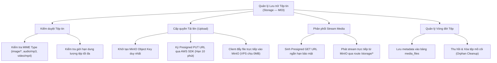

# Biểu đồ phân rã chức năng

## 1. Phân rã chức năng tổng thể

```mermaid
flowchart TD
    ROOT["HỆ THỐNG QUẢN TRỊ KHÓA HỌC & ĐÁNH GIÁ CHUẨN ĐẦU RA<br/>(BRAINMEMO LMS)"]
    
    M1["1. Quản lý Tài khoản & Xác thực<br/>(Identity Module)"]
    M2["2. Quản lý Khóa học & Chuẩn đầu ra<br/>(Curriculum & AUN-QA Module)"]
    M3["3. Quản lý Lưu trữ Tệp tin<br/>(Storage Module)"]
    M4["4. Khảo thí & AI Sư phạm<br/>(Assessment & AI Engine)"]

    ROOT --> M1
    ROOT --> M2
    ROOT --> M3
    ROOT --> M4

    M1 --> F11["Đăng ký & Đăng nhập"]
    M1 --> F12["Quản lý phiên làm việc"]
    M1 --> F13["Hồ sơ & Đổi mật khẩu"]
    M1 --> F14["Phân quyền vai trò (RBAC)"]

    M2 --> F21["Quản trị khóa học CRUD"]
    M2 --> F22["Thiết lập Chuẩn đầu ra (CLO)"]
    M2 --> F23["Cấu trúc bài giảng phân cấp"]
    M2 --> F24["Soạn thảo khối đa hình (Block-based)"]
    M2 --> F25["Bảo mật 2 tầng (Passcode)"]

    M3 --> F31["Kiểm duyệt tệp tin media"]
    M3 --> F32["Sinh Presigned Upload URL"]
    M3 --> F33["Phân phối stream an toàn"]
    M3 --> F34["Dọn dẹp tệp tin mồ côi"]

    M4 --> F41["AI Sinh học liệu (Quiz & Flashcard)"]
    M4 --> F42["Làm bài & Chấm điểm độc lập"]
    M4 --> F43["AI Chẩn đoán bẫy tư duy"]
    M4 --> F44["Thử thách Cứu viện CLO (Adaptive)"]
    M4 --> F45["Đo lường & Báo cáo AUN-QA"]
```

---

## 2. Phân rã chi tiết từng nhóm chức năng

### 2.1. Phân hệ Xác thực & Quản lý Tài khoản (Identity — M01)

```mermaid
flowchart TD
    M1["Quản lý Tài khoản & Xác thực<br/>(Identity — M01)"]

    M1 --> D1["Đăng ký"]
    M1 --> D2["Đăng nhập"]
    M1 --> D3["Quản lý Phiên"]
    M1 --> D4["Hồ sơ Cá nhân"]
    M1 --> D5["Phân quyền (RBAC)"]

    D1 --> D11["Kiểm tra định dạng Email hợp lệ"]
    D1 --> D12["Kiểm tra trùng lặp Email"]
    D1 --> D13["Băm mật khẩu BCrypt (Work Factor >= 10)"]
    D1 --> D14["Khởi tạo User & Gán Role mặc định"]

    D2 --> D21["Đối soát mật khẩu mã hóa BCrypt"]
    D2 --> D22["Sinh Access Token (JWT Bearer 30p)"]
    D2 --> D23["Tạo Refresh Token ngẫu nhiên"]
    D2 --> D24["Lưu phiên vào bảng refresh_tokens"]

    D3 --> D31["Làm mới phiên (Token Rotation)"]
    D3 --> D32["Thu hồi phiên (Revoke Token) khi đăng xuất"]

    D4 --> D41["Cập nhật Avatar & Tiểu sử Bio"]
    D4 --> D42["Xác thực mật khẩu cũ"]
    D4 --> D43["Cập nhật mật khẩu mới (BCrypt)"]

    D5 --> D51["Kiểm soát vai trò (Student, Creator, Admin)"]
    D5 --> D52["JWT Middleware đối soát Claims"]
```

### 2.2. Phân hệ Khóa học & Chuẩn đầu ra AUN-QA (Curriculum & AUN-QA — M02)

```mermaid
flowchart TD
    M2["Quản lý Khóa học & Chuẩn đầu ra<br/>(Curriculum & AUN-QA — M02)"]

    M2 --> C1["Quản trị Khóa học"]
    M2 --> C2["Thiết lập Chuẩn đầu ra CLO"]
    M2 --> C3["Cấu trúc Phân cấp"]
    M2 --> C4["Soạn thảo Khối Đa hình"]
    M2 --> C5["Bảo mật Truy cập 2 Tầng"]

    C1 --> C11["Khởi tạo khóa học mới"]
    C1 --> C12["Tự động sinh SEO Slug duy nhất"]
    C1 --> C13["Cập nhật thông tin & Thumbnail"]
    C1 --> C14["Xóa khóa học (Cascade xóa chương con)"]
    C1 --> C15["Tìm kiếm & Lọc theo thẻ Tags"]

    C2 --> C21["Khai báo danh mục CLO (Mã CLO, Tên CLO)"]
    C2 --> C22["Mô tả tiêu chí năng lực AUN-QA"]
    C2 --> C23["Cài đặt chỉ tiêu % sinh viên đạt chuẩn"]

    C3 --> C31["Quản lý Chương (Chapter) & OrderIndex"]
    C3 --> C32["Quản lý Trang bài học (Page)"]
    C3 --> C33["Chuyển đổi trạng thái Draft / Published"]

    C4 --> C41["Khối văn bản Markdown (Text Block)"]
    C4 --> C42["Khối Media (Audio/Video MinIO S3)"]
    C4 --> C43["Khối Flashcard 3 mặt"]
    C4 --> C44["Khối Quiz đa dạng (Single/Multi/TF)"]

    C5 --> C51["Cấu hình trạng thái (Public, Private, Protected)"]
    C5 --> C52["Băm Passcode khóa học/chương bằng BCrypt"]
    C5 --> C53["Đối soát Passcode khi người học mở nội dung"]
```

### 2.3. Phân hệ Lưu trữ Tệp tin (Media & Storage — M03)

### 2.4. Phân hệ Khảo thí & AI Sư phạm (Assessment & AI Engine — M04)

```mermaid
flowchart TD
    M4["Khảo thí & Trợ lý AI Sư phạm<br/>(Assessment & AI Engine — M04)"]

    M4 --> A1["AI Sinh Học liệu"]
    M4 --> A2["Ngân hàng Câu hỏi Quiz"]
    M4 --> A3["Trình Làm bài & Chấm điểm"]
    M4 --> A4["AI Sư phạm Thích ứng"]
    M4 --> A5["Đo lường & Kiểm định AUN-QA"]

    A1 --> A11["Trích xuất ngữ cảnh giáo trình"]
    A1 --> A12["Gemini sinh Flashcard 3 mặt (Kèm ví dụ thực tế)"]
    A1 --> A13["Gemini sinh Quiz theo ma trận Bloom & JSON Schema"]

    A2 --> A21["Câu hỏi Single Choice (1 đáp án đúng)"]
    A2 --> A22["Câu hỏi Multiple Choice (Nhiều đáp án đúng)"]
    A2 --> A23["Câu hỏi True/False (Đúng / Sai)"]
    A2 --> A24["Gắn nhãn CLO cho từng câu hỏi"]

    A3 --> A31["Xáo trộn ngẫu nhiên thứ tự câu hỏi và đáp án"]
    A3 --> A32["Chấm điểm độc lập phía Server chống gian lận"]
    A3 --> A33["Lưu kết quả nộp bài vào bảng quiz_attempts"]

    A4 --> A41["AI Chẩn đoán bẫy tư duy câu làm sai"]
    A4 --> A42["Phát sự kiện qua MediatR Bus khi điểm < 70%"]
    A4 --> A43["Thử thách Cứu viện CLO (Parallel Micro-Quiz gỡ điểm)"]
    A4 --> A44["Tự động cập nhật % tiến độ khóa học khi hoàn thành"]

    A5 --> A51["Tổng hợp điểm số sinh viên theo từng mã CLO"]
    A5 --> A52["Xác định tỷ lệ Đạt / Chưa đạt chuẩn đầu ra"]
    A5 --> A53["Tự động kết xuất Ma trận Báo cáo Kiểm định AUN-QA"]
```

