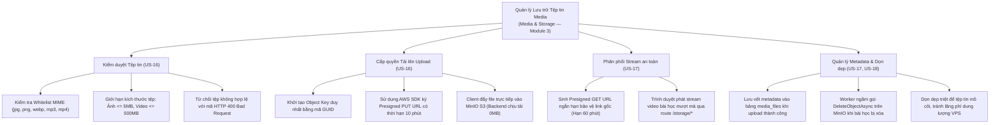

# Biểu đồ phân rã chức năng (Functional Decomposition Diagram)

## 1. Phân rã chức năng tổng thể

```mermaid
flowchart TD
    ROOT["HỆ THỐNG QUẢN TRỊ KHÓA HỌC & ĐÁNH GIÁ CHUẨN ĐẦU RA<br/>(BRAINMEMO LMS)"]
    
    M1["1. Quản lý Tài khoản & Xác thực<br/>(Identity Module)"]
    M2["2. Quản lý Khóa học & Chuẩn đầu ra<br/>(Curriculum & AUN-QA Module)"]
    M3["3. Quản lý Lưu trữ Tệp tin<br/>(Storage Module)"]
    M4["4. Khảo thí & AI Sư phạm<br/>(Assessment & AI Engine)"]

    ROOT --> M1
    ROOT --> M2
    ROOT --> M3
    ROOT --> M4

    %% Module 1
    M1 --> F11["Đăng ký & Đăng nhập (JWT/Refresh Token)"]
    M1 --> F12["Xoay vòng Token & Đăng xuất"]
    M1 --> F13["Hồ sơ cá nhân & Đổi mật khẩu"]
    M1 --> F14["Phân quyền truy cập theo vai trò (RBAC)"]

    %% Module 2
    M2 --> F21["Quản trị khóa học CRUD (Tự sinh SEO Slug)"]
    M2 --> F22["Thiết lập Chuẩn đầu ra (CLO & Bloom)"]
    M2 --> F23["Cấu trúc bài giảng phân cấp & Live Preview"]
    M2 --> F24["Soạn thảo nội dung Chuẩn Khối (Block-based)"]
    M2 --> F25["Bảo mật tiếp cận 2 tầng (Passcode BCrypt)"]
    M2 --> F26["Khám phá, Tìm kiếm & Lọc theo thẻ Tags"]

    %% Module 3
    M3 --> F31["Kiểm duyệt tệp tin media (MIME, Size)"]
    M3 --> F32["Sinh Presigned Upload URL tải trực tiếp MinIO"]
    M3 --> F33["Phân phối Stream an toàn qua Presigned GET"]
    M3 --> F34["Dọn dẹp tệp tin mồ côi (Orphan Cleanup)"]

    %% Module 4
    M4 --> F41["AI Sinh học liệu (Quiz & Flashcard 3 mặt)"]
    M4 --> F42["Làm bài Quiz & Chấm điểm Server độc lập"]
    M4 --> F43["Nút bấm 'Hỏi AI' chẩn đoán bẫy tư duy"]
    M4 --> F44["Đồng bộ tiến độ khóa học qua MediatR"]
    M4 --> F45["Không gian Trao đổi & Thảo luận phân cấp"]
    M4 --> F46["Đo lường CLO Thang 5 Mức & Xuất Ma trận AUN-QA"]
```

---

## 2. Phân rã chi tiết từng nhóm chức năng

### 2.1. Phân hệ Xác thực & Quản lý Tài khoản (Identity — Module 1)

```mermaid
flowchart TD
    M1["Quản lý Tài khoản & Xác thực<br/>(Identity — Module 1)"]

    M1 --> D1["Đăng ký tài khoản (US-01)"]
    M1 --> D2["Đăng nhập & Cấp Token (US-02)"]
    M1 --> D3["Quản lý Phiên & Đăng xuất (US-03)"]
    M1 --> D4["Hồ sơ cá nhân (US-04)"]
    M1 --> D5["Phân quyền vai trò RBAC (US-04)"]

    %% Đăng ký
    D1 --> D11["Kiểm tra định dạng Email hợp lệ RFC 5322"]
    D1 --> D12["Truy vấn kiểm tra trùng lặp Email"]
    D1 --> D13["Băm mật khẩu BCrypt (Work Factor = 11)"]
    D1 --> D14["Khởi tạo User & Gán Role mặc định 'STUDENT'"]

    %% Đăng nhập
    D2 --> D21["Đối soát mật khẩu mã hóa BCrypt.Verify"]
    D2 --> D22["Sinh Access Token (JWT Bearer hạn 30 phút)"]
    D2 --> D23["Tạo Refresh Token 64-byte CSPRNG an toàn"]
    D2 --> D24["Lưu phiên vào bảng refresh_tokens & HttpOnly Cookie"]

    %% Quản lý phiên
    D3 --> D31["Xoay vòng Token Rotation (Thu hồi token cũ, cấp mới)"]
    D3 --> D32["Thu hồi phiên (is_revoked = true) khi Đăng xuất"]
    D3 --> D33["Xóa Cookie trình duyệt & Đưa JTI vào Memory Blacklist"]

    %% Hồ sơ
    D4 --> D41["Cập nhật Họ tên, Tiểu sử Bio & Avatar URL"]
    D4 --> D42["Xác thực mật khẩu cũ trước khi đổi"]
    D4 --> D43["Băm và lưu mật khẩu mới bằng BCrypt"]

    %% Phân quyền
    D5 --> D51["Middleware giải mã Claims từ JWT Header"]
    D5 --> D52["Kiểm soát quyền truy cập: STUDENT, CREATOR, ADMIN"]
    D5 --> D53["Chặn truy cập trái phép với mã HTTP 403 Forbidden"]
```

---

### 2.2. Phân hệ Khóa học & Chuẩn đầu ra AUN-QA (Curriculum & Content — Module 2)

```mermaid
flowchart TD
    M2["Quản trị Khóa học & Chuẩn đầu ra<br/>(Curriculum & Content — Module 2)"]

    M2 --> C1["Quản trị Khóa học (US-05, US-06, US-07)"]
    M2 --> C2["Chuẩn đầu ra AUN-QA & Bloom (US-08)"]
    M2 --> C3["Cấu trúc Chương & Bài học (US-09)"]
    M2 --> C4["Soạn thảo Chuẩn Khối (US-10, US-11, US-12)"]
    M2 --> C5["Xem trước nội dung (US-13)"]
    M2 --> C6["Khám phá & Tìm kiếm Tags (US-14)"]
    M2 --> C7["Bảo mật tiếp cận 2 tầng (US-15)"]

    %% Quản trị khóa học
    C1 --> C11["Khởi tạo khóa học mới & Gán creator_id từ JWT"]
    C1 --> C12["Tự động sinh chuỗi SEO Slug không dấu duy nhất"]
    C1 --> C13["Xem danh sách khóa học của tác giả (Phân trang envelope)"]
    C1 --> C14["Cập nhật thông tin & Xóa cascade bài học trực thuộc"]

    %% Chuẩn AUN-QA
    C2 --> C21["Khai báo mã chuẩn đầu ra: CLO1, CLO2, CLO3..."]
    C2 --> C22["Gắn Thang đo Bloom: Remember, Understand, Apply, Analyze, Evaluate, Create"]
    C2 --> C23["Cài đặt chỉ tiêu phần trăm sinh viên đạt chuẩn (Mặc định >= 75%)"]

    %% Cấu trúc
    C3 --> C31["Quản lý Chương học (Chapter) theo thứ tự order_index"]
    C3 --> C32["Quản lý Trang bài học (Page) trực thuộc chương"]
    C3 --> C33["Quản lý cờ trạng thái xuất bản is_draft"]

    %% Soạn thảo khối
    C4 --> C41["Khối Text: Soạn thảo văn bản định dạng Markdown chuẩn"]
    C4 --> C42["Khối Media: Nhúng video/audio stream từ MinIO S3"]
    C4 --> C43["Khối Flashcard: Thẻ 3 mặt (Thuật ngữ, Định nghĩa, Ví dụ code)"]
    C4 --> C44["Khối Quiz: Câu hỏi trắc nghiệm gắn clo_id & clo_weight"]

    %% Live Preview
    C5 --> C51["Truy vấn cấu trúc bài giảng phân cấp tránh lỗi N+1 Query"]
    C5 --> C52["Hiển thị dòng chảy bài học cuộn liền mạch (Single-scroll stream)"]

    %% Tìm kiếm
    C6 --> C61["Tìm kiếm toàn văn theo từ khóa tiêu đề khóa học"]
    C6 --> C62["Lọc khóa học theo danh mục thẻ Tags (bảng course_tags)"]
    C6 --> C63["Phân trang tối ưu LINQ với thời gian phản hồi < 150ms"]

    %% Bảo mật
    C7 --> C71["Cài đặt 3 chế độ: PUBLIC, PRIVATE, PROTECTED"]
    C7 --> C72["Mã hóa mật mã Passcode bằng giải thuật BCrypt"]
    C7 --> C73["Xác thực Passcode trước khi mở quyền xem nội dung"]
```

---

### 2.3. Phân hệ Quản lý Lưu trữ Tệp tin (Media & Storage — Module 3)

---

### 2.4. Phân hệ Khảo thí & AI Sư phạm (Assessment & AI Engine — Module 4)

```mermaid
flowchart TD
    M4["Khảo thí, AI Sư phạm & Kiểm định<br/>(Assessment & AI Engine — Module 4)"]

    M4 --> A1["AI Tự động Sinh Học liệu (US-22, US-23)"]
    M4 --> A2["Ngân hàng Câu hỏi Đa dạng (US-11)"]
    M4 --> A3["Trình Làm bài & Chấm điểm Server (US-19)"]
    M4 --> A4["Nút bấm 'Hỏi AI' chẩn đoán bẫy tư duy (US-24)"]
    M4 --> A5["Đồng bộ Tiến độ qua Event Bus (US-25)"]
    M4 --> A6["Không gian Trao đổi Thảo luận (US-20)"]
    M4 --> A7["Đánh giá CLO Thang 5 Mức & Báo cáo (US-26, US-27)"]

    %% AI sinh học liệu
    A1 --> A11["Gọi Gemini API với Structured JSON Outputs (response_schema)"]
    A1 --> A12["Tự động sinh bộ Flashcard 3 mặt kèm ví dụ code thực tế"]
    A1 --> A13["Tự động sinh bộ câu hỏi Quiz phân bổ theo Bloom & gợi ý mã CLO"]

    %% Ngân hàng câu hỏi
    A2 --> A21["Hỗ trợ 3 loại: Single Choice, Multiple Choice, True/False"]
    A2 --> A22["Gắn từng câu hỏi với mã chuẩn đầu ra clo_id tương ứng"]
    A2 --> A23["Gán trọng số đóng góp điểm clo_weight (1.0, 1.5, 2.0) theo độ khó"]

    %% Làm bài & Chấm điểm
    A3 --> A31["Xáo trộn ngẫu nhiên thứ tự câu hỏi và các phương án trả lời"]
    A3 --> A32["Client chỉ gửi ID đáp án chọn; Backend đối soát is_correct độc lập"]
    A3 --> A33["Ghi nhận điểm tổng và trạng thái Đạt vào bảng quiz_attempts"]

    %% Hỏi AI
    A4 --> A41["Xuất hiện nút 'Hỏi AI về câu hỏi này' ngay dưới câu làm sai"]
    A4 --> A42["Gemini phân tích bẫy tư duy giữa đáp án chọn sai và lý thuyết chuẩn"]
    A4 --> A43["Trả về Markdown giải thích sư phạm giúp sinh viên hiểu bài tại chỗ"]

    %% Đồng bộ tiến độ
    A5 --> A51["Phát sự kiện StudentFinishedChapterEvent qua MediatR khi is_passed = true"]
    A5 --> A52["Module Curriculum bắt sự kiện & tính toán lại % tiến độ khóa học"]
    A5 --> A53["Cập nhật % hoàn thành vào bảng curriculum.user_course_progress"]

    %% Thảo luận
    A6 --> A61["Gửi bài bình luận trao đổi theo từng khóa học"]
    A6 --> A62["Hỗ trợ trả lời theo luồng phân cấp cha - con (Thread reply)"]
    A6 --> A63["Phân quyền chỉ tác giả hoặc Creator khóa học mới được xóa bình luận"]

    %% Đánh giá CLO AUN-QA
    A7 --> A71["Tính điểm CLO trung bình gia quyền: Tổng(đúng * weight) / Tổng(weight)"]
    A7 --> A72["Quy đổi Thang 5 Mức Rubric (Mức 0: <40%, Mức 1: 40-54%, Mức 2: 55-69%)"]
    A7 --> A73["Xác định sinh viên Đạt chuẩn AUN-QA (Mức 3: 70-84%) & Xuất sắc (Mức 4: >=85%)"]
    A7 --> A74["Lưu kết quả vào bảng clo_results & Tự động xuất Ma trận Báo cáo Kiểm định"]
```

